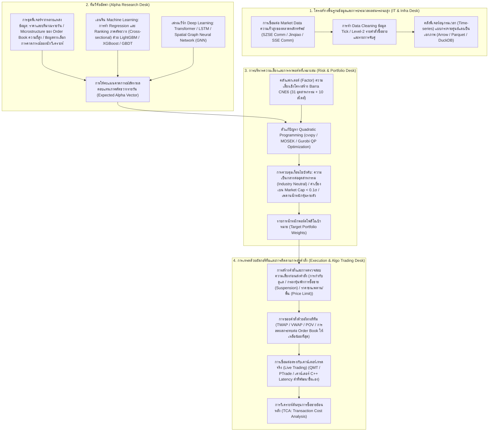
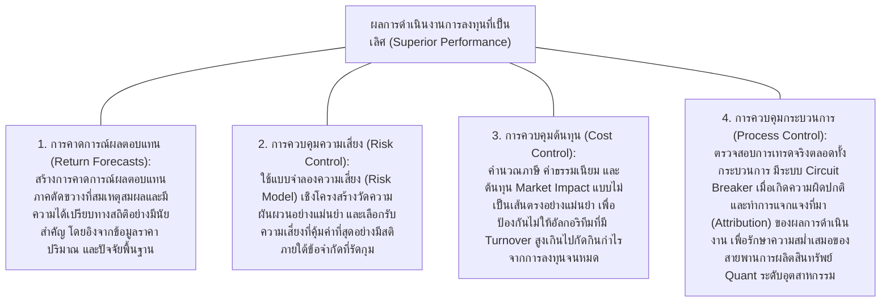
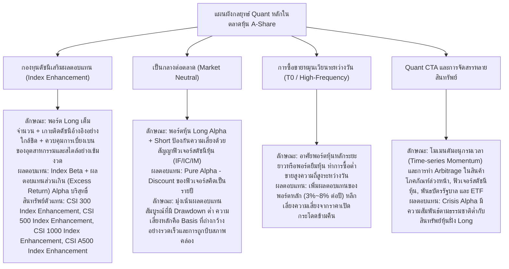

# บทที่ 1: ภาพรวมระบบนิเวศ Quant และโมเดลการทำกำไรในหุ้น A-Share

> **เป้าหมายหลักของบทนี้**:  
> สลัดภาพจำผิดๆ ของนักลงทุนรายย่อยที่ว่า "Quant คือแค่การเขียนอินดิเคเตอร์ทางเทคนิคเพื่อซื้อขายอัตโนมัติ" ให้หมดไป เข้าใจสูตรการแยกองค์ประกอบผลตอบแทนระดับลึกของฝั่ง Buy-side Quant, กฎพื้นฐานของการบริหารเชิงรุก (Fundamental Law of Active Management: FLAM), ลูปการทำงานของ 4 กลยุทธ์หลักในระดับสถาบัน, โครงสร้างองค์กรและระบบบัญชีซื้อขายทั่วไปของกองทุนเอกชน (Private Fund) ฝั่ง Buy-side อย่างเป็นระบบ; วิเคราะห์เจาะลึกระบบการซื้อขายระดับจุลภาคที่เป็นเอกลักษณ์ของหุ้น A-Share และการที่ Basis Discount ติดลบของฟิวเจอร์สกัดกร่อนผลตอบแทนส่วนเกินสุทธิ (Net Excess Return) พร้อมทั้งรวบรวมวรรณกรรมคลาสสิกระดับสากลและชุดเครื่องมือโอเพนซอร์สที่พร้อมใช้งานจริงอย่างเป็นระบบ

---

## 1. Quant ทำกำไรจากอะไรในหุ้น A-Share? การแจกแจงผลตอบแทนระดับลึกและกฎทางคณิตศาสตร์

ในระบบการลงทุนของฝั่ง Buy-side และเฮดจ์ฟันด์ที่เติบโตเต็มที่แล้ว ผลตอบแทนของสินทรัพย์ไม่ได้มาจาก "ลูกแก้วทำนายอนาคต" อันลึกลับ แต่มาจากการได้รับ**ผลตอบแทนชดเชยที่สมเหตุสมผลจากการแบกรับปัจจัยเสี่ยงเชิงระบบ (Systematic Risk Factor)** และการ**ดักจับความคลาดเคลื่อนของการตั้งราคาที่ไร้เหตุผลในระดับจุลภาคของตลาดอย่างเป็นระบบ**

### 1.1 การแจกแจงโครงสร้าง 4 ชั้นของผลตอบแทนสินทรัพย์

ตามทฤษฎีการตั้งราคาตามโอกาสทำกำไร (Arbitrage Pricing Theory: APT) และกรอบแบบจำลองความเสี่ยงเชิงโครงสร้างของ MSCI Barra ผลตอบแทนรวม $R_{p,t}$ ของพอร์ตโฟลิโอ Quant ใดๆ ณ วันซื้อขาย $t$ สามารถกระจายโครงสร้างออกเป็น 4 ชั้นได้อย่างแม่นยำดังนี้:

$$R_{p,t} = \underbrace{\beta_m R_{m,t}}_{\text{Market Beta}} + \underbrace{\sum_{k=1}^K X_{p,k,t} f_{k,t}}_{\text{Style \& Industry Premiums}} + \underbrace{\alpha_{p,t}}_{\text{Pure Alpha}} - \underbrace{\text{Cost}_{p,t}}_{\text{Friction \& Slippage}}$$

```
ระบบการแจกแจงผลตอบแทน 4 ชั้นของพอร์ตโฟลิโอ Buy-side Quant
├── 1. Market Beta (ผลตอบแทนตามเกณฑ์มาตรฐานตลาด)
│     ├── Systematic Beta ของดัชนี Broad-base เช่น CSI 300 / CSI 500 / CSI 1000 / CSI A500
│     └── ลักษณะเฉพาะ: รับความผันผวนขึ้นลงเชิงระบบของทั้งตลาดแบบ Passive ไม่ได้สะท้อน Alpha จากการวิจัยเชิงรุกของผู้จัดการกองทุน
├── 2. Style & Industry Premiums (ส่วนชดเชยความเสี่ยงสไตล์และอุตสาหกรรม - แหล่งรวม Pseudo Alpha)
│     ├── การเปิดรับความเสี่ยงการจัดสรรอุตสาหกรรม: ขับเคลื่อนโดย Industry Beta จากการ Overweight กลุ่มอิเล็กทรอนิกส์/การแพทย์/คอมพิวเตอร์
│     ├── การเปิดรับความเสี่ยงสไตล์มูลค่าตลาด: ส่วนชดเชยสภาพคล่องจากการเปิดรับความเสี่ยงในหุ้นขนาดเล็กมาก (Micro-cap) ในระยะยาว
│     └── สไตล์ปัจจัยพื้นฐานดั้งเดิม: มูลค่า (Value), โมเมนตัม (Momentum), คุณภาพกำไร (Quality), การประเมินมูลค่าต่ำ (BP)
├── 3. Pure Alpha (ผลตอบแทนส่วนเกินบริสุทธิ์เฉพาะตัว - กำแพงปราการหลักของ Buy-side Quant)
│     ├── ความสามารถในการคัดเลือกหุ้นภาคตัดขวาง (Cross-sectional) บริสุทธิ์ หลังผ่าน Neutralization อุตสาหกรรมอย่างสมบูรณ์และ Neutralization มูลค่าตลาดอย่างเข้มงวด
│     └── ที่มา: ฟีเจอร์จุลภาคราคากับปริมาณระดับสูงแบบไม่เป็นเชิงเส้น (Non-linear), การทำ Feature Cross เชิงลึก, ความคาดหวังพฤติกรรมนักวิเคราะห์ทางเลือก, ความไม่สมดุลของ Order Flow ความถี่สูง
└── 4. Execution Friction (แรงเสียดทานจากการซื้อขายและการถือครอง - หลุมดำในโลกจริงที่กลืนกินผลตอบแทน)
      ├── แรงเสียดทานชัดแจ้ง: อากรแสตมป์ (Stamp Duty) การซื้อขายหลักทรัพย์ (ฝั่งขาย 0.05%), คอมมิชชันโบรกเกอร์, ค่าธรรมเนียมการโอนหลักทรัพย์
      ├── แรงเสียดทานแฝง: Bid-Ask Spread บนหน้าต่างเสนอซื้อขาย, Slippage จากต้นทุน Market Impact ของสภาพคล่อง (Square-root Market Impact)
      └── ต้นทุนการป้องกันความเสี่ยงด้วยอนุพันธ์: ความสูญเสียจากการ Roll Over ประจำปีของ Basis Discount ติดลบในสัญญาฟิวเจอร์สดัชนีหุ้น
```

### 1.2 กฎพื้นฐานของการบริหารเชิงรุก (The Fundamental Law of Active Management)

Excess Return ของ Buy-side Quant จะทำได้สูงเพียงใด? ความสามารถในการพยากรณ์ผลตอบแทนจะแปลงไปเป็นผลงานของพอร์ตโฟลิโอในท้ายที่สุดได้อย่างไร? Richard Grinold และ Ronald Kahn ได้นำเสนอ**กฎพื้นฐานของการบริหารเชิงรุก (FLAM)** อันโด่งดังไว้ในคัมภีร์การลงทุนเชิงปริมาณของพวกเขา *Active Portfolio Management (1999)*:

$$\text{IR} \approx \text{IC} \times \sqrt{N} \times \text{TC}$$

โดยที่:
- **$\text{IR}$ (Information Ratio: อัตราส่วนสารสนเทศ)**: วัดผลตอบแทนส่วนเกินที่ปรับลดด้วยความเสี่ยงเชิงรุก (Active Risk-adjusted Excess Return) ของพอร์ตโฟลิโอเมื่อเทียบกับเกณฑ์มาตรฐาน, $\text{IR} = \frac{\text{Annualized Alpha}}{\text{Tracking Error}}$ ในบรรดาสถาบัน Buy-side ของหุ้น A-Share หลังหักค่าธรรมเนียมแล้ว $\text{IR} > 1.5$ ถือว่ายอดเยี่ยม และ $\text{IR} > 2.5$ ถือเป็นระดับท็อป
- **$\text{IC}$ (Information Coefficient: สัมประสิทธิ์สารสนเทศ)**: ค่าสัมประสิทธิ์สหสัมพันธ์เชิงอันดับ (Rank IC) ระหว่างคะแนนพยากรณ์กับอัตราผลตอบแทนภาคตัดขวางจริงในอนาคต ในการพยากรณ์หุ้นความถี่ระดับวันและระดับสัปดาห์ ค่า Rank IC ของแฟกเตอร์ (Factor) เดี่ยวที่ยอดเยี่ยมและมีประสิทธิผลมักอยู่เพียงระหว่าง **$0.03 \sim 0.06$** เท่านั้น การเทรดแบบ Quant ไม่ได้พึ่งพา Win Rate 100% แต่อาศัย "การสะสมความได้เปรียบเพียงเล็กน้อยเชิงสถิติผ่านการเล่นซ้ำจำนวนมหาศาล"
- **$N$ (Breadth: ความกว้างการลงทุน)**: **จำนวนครั้งของการตัดสินใจลงทุนที่มีประสิทธิผลและเป็นอิสระต่อกัน** ที่ผู้จัดการกองทุนทำขึ้นภายในหนึ่งปี
  - หากคัดเลือกหุ้นภายในขอบเขต **CSI 300** (หุ้น 300 ตัว) แม้จะปรับพอร์ต (Rebalance) สัปดาห์ละหนึ่งครั้ง (ประมาณ 50 ครั้งต่อปี) ขีดจำกัดบนของ Breadth จะอยู่ที่ประมาณ $300 \times 50 = 15,000$
  - หากคัดเลือกหุ้นภายในขอบเขต **CSI 1000** (หุ้น 1,000 ตัว) Breadth ความถี่รายสัปดาห์จะก้าวกระโดดขึ้นเป็น $1000 \times 50 = 50,000$ ทันที
  - สิ่งนี้อธิบายจากรากฐานทางคณิตศาสตร์ว่า: **เหตุใดสมรภูมิหลักของกองทุนเอกชน Quant ในประเทศจึงขยับลงอย่างต่อเนื่องจาก CSI 500 ไปยัง CSI 1000 และ CSI 2000 — ยิ่งความกว้าง $N$ ของ Universe หุ้นมีขนาดใหญ่ขึ้น ก็ยิ่งรองรับโอกาสการเล่นที่เป็นอิสระต่อกันได้มากขึ้น เพดานบนของ $\text{IR}$ ที่พอร์ตโฟลิโอสามารถทำได้ก็จะยิ่งสูงขึ้น!**
- **$\text{TC}$ (Transfer Coefficient: สัมประสิทธิ์การถ่ายโอนข้อจำกัด)**: วัดการสูญเสียจากข้อจำกัดเมื่อแปลงสัญญาณการพยากรณ์ไปเป็นพอร์ตการลงทุนจริง (มีค่าอยู่ในช่วง $[0, 1]$)
  - ในตลาดอุดมคติที่ไร้แรงเสียดทานโดยสิ้นเชิงและอนุญาตให้ยืมหุ้นเพื่อขายชอร์ตได้อย่างอิสระ ค่า $\text{TC} \approx 1.0$
  - ในตลาดหุ้น A-Share เนื่องจาก**ข้อจำกัดการทำชอร์ต (ข้อจำกัดฝั่ง Long ฝั่งเดียว)**, **ราคาหุ้นชนเพดาน/พื้นทำให้ไม่สามารถจับคู่คำสั่งได้**, **เพดานน้ำหนักอุตสาหกรรมและหุ้นรายตัวที่เข้มงวด** ค่า $\text{TC}$ จึงมักลดฮวบลงมาอยู่ที่ **$0.3 \sim 0.6$** ซึ่งหมายความว่าสัญญาณพยากรณ์ดั้งเดิมมากกว่าครึ่งหนึ่งต้องสูญเปล่าไปในขั้นตอนการสร้างพอร์ตอันเนื่องมาจากข้อจำกัดในโลกแห่งความเป็นจริง

### 1.3 ระวัง "กับดักหุ้นไมโครแคป" และการพังทลายของ Pseudo Alpha

ในช่วงปี 2021 ถึง 2023 ผลิตภัณฑ์ Quant ในประเทศบางส่วนได้แสดงค่า Sharpe Ratio ที่สูงเกินจริงมากกว่า 3.5 ทว่าการแจกแจงที่มา (Attribution) ในภายหลังพิสูจน์แล้วว่า ผลตอบแทนส่วนเกินมากกว่า 80% ไม่ได้มาจาก Alpha ในการเลือกหุ้นที่แท้จริง แต่เกิดจาก**การเปิดรับความเสี่ยงอย่างหนักในหุ้นไมโครแคป 400 ตัวที่มีมูลค่าตลาดเล็กที่สุดในตลาด**

- **ธรรมชาติของส่วนชดเชยสไตล์หุ้นไมโครแคป**: นี่คือส่วนชดเชยความเสี่ยงด้านสภาพคล่อง (Liquidity Risk Premium) ที่ได้รับจากการแบกรับความเสี่ยง Liquidity Run ในระดับสูงมาก ทันทีที่ทั้งตลาดเผชิญกับภาวะตึงตัวของสภาพคล่องระดับมหภาคหรือการเปลี่ยนแปลงของนโยบายกำกับดูแล สภาพคล่องของหุ้นไมโครแคปจะถูกแช่แข็งในทันที
- **บทเรียนย้อนหลังเหตุการณ์เหยียบกันตายด้านสภาพคล่องช่วงต้นปี 2024**: ในช่วงเดือนมกราคมถึงกุมภาพันธ์ 2024 เมื่อหุ้นไมโครแคปเผชิญกับ Liquidity Run เนื่องจากราคาชนพื้นติดกันต่อเนื่องโดยไม่มีปริมาณการซื้อขาย (No-volume Limit-down) จนไม่สามารถปิดสถานะได้ ผลิตภัณฑ์ Quant จำนวนมากที่ถือหุ้นไมโครแคปในสัดส่วนสูงจึงมีมูลค่าสินทรัพย์สุทธิ (NAV) ปรับตัวลดลงอย่างหนักถึง 30%~50% ภายในเวลาเพียงสองสัปดาห์ ส่งผลให้ "ผลตอบแทนส่วนเกินจอมปลอม" ที่สะสมมาหลายปีมลายหายไปในพริบตา
- **กฎเหล็กระดับสถาบัน**: การวิจัย Quant ระดับสถาบันที่แท้จริง ขั้นตอนแรกจำเป็นต้องสร้าง**เกณฑ์มาตรฐานที่ผ่าน Neutralization สไตล์และอุตสาหกรรมอย่างเข้มงวด** ผลตอบแทนส่วนเกินใดๆ ที่ไม่ผ่านการทดสอบ Neutralization มูลค่าตลาดและอุตสาหกรรม ให้ถือว่าเป็น "Pseudo Alpha" ทั้งสิ้น

---
## 2. โครงสร้างการดำเนินงานภายในและระบบบัญชีของสถาบันการลงทุนเชิงปริมาณ (Quant) ฝั่ง Buy-side

การจะเข้าใจการเทรดเชิงปริมาณ (Quant Trading) ได้อย่างถ่องแท้ จำเป็นต้องเข้าใจว่าในโลกความเป็นจริงนั้น สถาบัน Quant ฝั่ง Buy-side ระดับหมื่นล้าน (เช่น Jiukun, High-Flyer, Lingjun, Minghong ฯลฯ) มีการแบ่งงานและทำงานร่วมกันอย่างไร



### 2.1 สี่องค์ประกอบของ Quant ฝั่ง Buy-side: ปิรามิดแห่งความเป็นเลิศของ BARRA (Performance Pyramid)
ตาม **คู่มือความเสี่ยง BARRA US-E3 บทที่ 1** และ **Huatai Securities Multi-Factor Series ตอนที่ 1** ผลการดำเนินงานด้านการลงทุนแบบ Quant ที่เป็นเลิศ (Superior Performance) ไม่ใช่แค่ตัวเลขผลตอบแทนเดี่ยวๆ แต่ถูกสร้างขึ้นอย่างมั่นคงบนเสาหลักสี่ด้านที่ขาดไม่ได้:



### 2.2 ขอบเขตอำนาจหน้าที่ของ 4 ทีมปฏิบัติการ
1. **ทีม IT และโครงสร้างพื้นฐาน (Quant Infra)**: รับผิดชอบการรับฟีดข้อมูลตลาด, เกตเวย์เชื่อมต่อ C++ ความหน่วงต่ำในระดับล่าง, การจัดสรรคลัสเตอร์ประมวลผลบน GPU และการจัดการฐานข้อมูลอนุกรมเวลาแบบกระจายศูนย์
2. **ทีมวิจัยอัลฟา (Alpha Research)**: ดัชนีชี้วัดผลงานหลักคือค่า **Pure IC, IC_IR, Monotonicity และ Half-life ของการลดลงของ Turnover** ของสัญญาณ โดยนักวิจัยอัลฟาไม่ได้มีหน้าที่ตัดสินใจโดยตรงว่าจะซื้อหรือขายกี่หุ้น แต่จะส่งมอบเพียงคะแนนการคาดการณ์อัตราผลตอบแทนภาคตัดขวางของหุ้นทั้งตลาด
3. **ทีมบริหารความเสี่ยงและการหาพอร์ตที่เหมาะสม (Portfolio Management & Risk)**: รับผิดชอบการใช้แบบจำลองความเสี่ยงเชิงโครงสร้าง Barra และตัวแก้ปัญหา Quadratic Programming เพื่อคำนวณหาน้ำหนักพอร์ตโฟลิโอเป้าหมายที่เหมาะสมที่สุด ภายใต้เงื่อนไขการควบคุมการเบี่ยงเบนของกลุ่มอุตสาหกรรม, การเบี่ยงเบนของ Market Cap, Tracking Error (TE) และอัตรา Turnover
4. **ทีมส่งคำสั่งด้วยอัลกอริทึม (Execution Trading)**: รับผิดชอบการปรับพอร์ต (Rebalance) จากพอร์ตเป้าหมายตามทฤษฎีให้เสร็จสิ้นในช่วงเวลาการซื้อขายต่อเนื่อง โดยให้มีต้นทุน Market Impact และ Slippage น้อยที่สุด

### 2.3 โครงสร้างบัญชีซื้อขายของสถาบันและเครื่องมืออนุพันธ์
- **บัญชีหลักทรัพย์ทั่วไป vs บัญชีเครดิต (Margin & Securities Lending)**: ผลิตภัณฑ์ Quant กองทุนดัชนีเสริมผลตอบแทน (Index Enhancement) ทั่วไปจะใช้บัญชีหลักทรัพย์ทั่วไปที่ดูแลโดยโบรกเกอร์ ส่วนเมื่อเกี่ยวข้องกับการยืมหุ้นมา Short หรือกลยุทธ์ T0 ด้วยการยืมหุ้น จะต้องใช้บัญชีเครดิต
- **ธุรกรรม DMA (Direct Market Access)**: ในอดีต กองทุนเอกชน (Private Fund) จะเชื่อมต่อตรงผ่านเคาน์เตอร์เทรดของโบรกเกอร์ (มักมาพร้อมเลเวอเรจ 2~4 เท่าและโครงสร้าง Total Return Swap: TRS) เพื่อดำเนินกลยุทธ์ Market Neutral แต่หลังจากการออกเกณฑ์กำกับดูแลใหม่ในปี 2024 เลเวอเรจของธุรกรรม DMA ถูกสั่งปรับลดลงอย่างเข้มงวด ส่งผลให้กลยุทธ์ต้องย้ายไปสู่ Market Neutral แบบไม่มีเลเวอเรจ หรือกองทุนดัชนีเสริมผลตอบแทนฝั่ง Public Fund
- **ความเชื่อมโยงระหว่าง Snowball Options กับ Basis**: ตราสารที่มีโครงสร้าง Auto-Callable Knock-in/Knock-out (Snowball Options) ที่ออกโดยโบรกเกอร์ ซึ่งอ้างอิงกับดัชนี CSI 500 / CSI 1000 นั้น ฝั่ง Hedging จะทำการ Dynamic Delta Hedging โดยการซื้อต่ำขายสูงในสัญญาฟิวเจอร์สดัชนีหุ้น (IC/IM) เมื่อตลาดปรับตัวลงอย่างรวดเร็วจนแตะระดับ "Knock-in" เป็นวงกว้าง สถานะ Hedging ของโบรกเกอร์จำเป็นต้องเร่งปิดสถานะ Long ในฟิวเจอร์ส ส่งผลให้ Discount ของสัญญาฟิวเจอร์สดัชนีถ่างกว้างขึ้นอย่างรวดเร็ว และสร้างแรงกดดันต่อต้นทุน Basis Loss มหาศาลให้กับกลยุทธ์ Market Neutral

---

## 3. กลไกการดำเนินงานของ 4 กลยุทธ์ Quant สถาบันหลักในตลาดหุ้น A-Share


### 3.1 กลยุทธ์กองทุนดัชนีเสริมผลตอบแทน (Index Enhancement) — เสาหลักของกองทุนเอกชน (Private Fund) ระดับหมื่นล้านในประเทศ

กลยุทธ์ Index Enhancement ถือเป็นผลิตภัณฑ์หลักที่มีสินทรัพย์ภายใต้การจัดการ (AUM) สูงที่สุด และมีขีดความสามารถในการรองรับเม็ดเงินลงทุน (Capacity) สูงที่สุดของ Quant ฝั่ง Buy-side ในประเทศ ณ ปัจจุบัน

#### หลักการดำเนินงานหลัก:
1. **การจัดสรรสัดส่วนการลงทุนสูง (High Exposure)**: รักษาสัดส่วนพอร์ตหุ้นไว้ที่ 95%~100% ตลอดทั้งปี โดยไม่มีการจับจังหวะตลาด (Market Timing) ตามดุลยพินิจ
2. **การอิงดัชนีอ้างอิงและการจำกัด Tracking Error (TE)**:
   - กลยุทธ์จะเกาะติดดัชนีตลาดวงกว้าง (เช่น CSI 300, CSI 500, CSI 1000) อย่างใกล้ชิด
   - กำหนดข้อจำกัดการเบี่ยงเบนของกลุ่มอุตสาหกรรมอย่างเข้มงวด (เช่น น้ำหนักของแต่ละกลุ่มอุตสาหกรรมระดับ 1 ตามการจัดกลุ่ม Shenwan เบี่ยงเบนจากดัชนีอ้างอิงได้ไม่เกิน $\pm 1.5\%$)
   - กำหนดข้อจำกัด Market Cap Exposure อย่างเข้มงวด (เช่น ค่าเฉลี่ย Log ของมูลค่าตลาดตามราคาตลาดหมุนเวียนของพอร์ตเบี่ยงเบนจากดัชนีอ้างอิงไม่เกิน $0.1$ ส่วนเบี่ยงเบนมาตรฐาน)
3. **สองตัวชี้วัดหลักในการประเมินผลตอบแทนส่วนเกิน (Excess Return)**:
   - **Tracking Error (TE)**: วัดความผันผวนของการเบี่ยงเบนเมื่อเทียบกับดัชนีอ้างอิง:
     $$\text{TE} = \sqrt{\frac{252}{T-1} \sum_{t=1}^T (R_{p,t} - R_{b,t} - \overline{\alpha})^2}$$
   - **Information Ratio (IR)**: วัด Excess Return ที่ได้รับต่อหนึ่งหน่วยของความเสี่ยงจากการติดตามเชิงรุก (Active Risk) ที่แบกรับ:
     $$\text{IR} = \frac{\overline{\alpha}_{annual}}{\text{TE}}$$

#### ภาพรวมความยากในการค้นหา Alpha และ Capacity ของกลยุทธ์ Index Enhancement บนดัชนีตลาดวงกว้าง:
| ดัชนีอ้างอิง | รหัสดัชนี | ค่ามัธยฐาน Market Cap ของหุ้นในดัชนี | สัดส่วนการซื้อขายของรายย่อย | ระดับความคลาดเคลื่อนของราคา | ช่วง Excess Return ต่อปีโดยทั่วไป | Capacity ของกลยุทธ์ |
| :--- | :--- | :--- | :--- | :--- | :--- | :--- |
| **CSI 300** | 000300.SH | ประมาณ 1.2 แสนล้านหยวน | ต่ำมาก (ส่วนใหญ่เป็นเงินประกัน/กองทุนรวม/สถาบันต่างชาติ) | ต่ำมาก (ราคาสะท้อนข้อมูลอย่างมีประสิทธิภาพสูงมาก) | 5% ~ 10% | มหาศาล (>1.5 แสนล้าน) |
| **CSI 500** | 000905.SH | ประมาณ 2.2 หมื่นล้านหยวน | ปานกลาง | ปานกลาง | 8% ~ 14% | สูง (ประมาณ 6 หมื่นล้าน) |
| **CSI 1000** | 000852.SH | ประมาณ 9.5 พันล้านหยวน | ค่อนข้างสูง (Turnover คึกคัก) | ค่อนข้างสูง | 12% ~ 22% | ปานกลาง (ประมาณ 2-3 หมื่นล้าน) |
| **CSI 2000** | 932000.CSI | ประมาณ 3.5 พันล้านหยวน | สูงมาก | สูงมาก (เก็งกำไรด้วย Turnover สูง) | 18% ~ 30% | ค่อนข้างน้อย (ประมาณ 5 พันล้าน - 1 หมื่นล้าน) |
| **CSI A500** | 000510.CSI | ประมาณ 3.5 หมื่นล้านหยวน | ปานกลาง | ปานกลาง (กระจายน้ำหนักอุตสาหกรรมอย่างสมดุล) | 8% ~ 15% | กำลังขยาย Capacity อย่างรวดเร็ว |

---

### 3.2 กลยุทธ์ป้องกันความเสี่ยงแบบ Market Neutral กับปัญหาต้นทุน Hedging อันเจ็บปวด

กลยุทธ์ Market Neutral มีเป้าหมายเพื่อขจัด Beta ของตลาดโดยรวมออกไป ไม่ว่าดัชนี SSE Composite จะพุ่งขึ้นถึง 5,000 จุด หรือร่วงลงแตะ 2,000 จุด พอร์ตจะทำกำไรเฉพาะจากส่วนต่างผลตอบแทนของหุ้นฝั่ง Long เมื่อเทียบกับเกณฑ์มาตรฐานฝั่ง Short เท่านั้น

#### หลักการทางคณิตศาสตร์ของกลยุทธ์:
- ขนาดเงินทุน: $V$
- **พอร์ตฝั่งซื้อ (Long Leg)**: ซื้อพอร์ตหุ้นที่คัดเลือกด้วยโมเดล Quant มูลค่า $V$ โดยมีอัตราผลตอบแทน $R_{long} = R_{index} + \alpha$
- **พอร์ตฝั่งขาย (Short Leg)**: เปิดสถานะ Short สัญญา Index Futures บน CFFEX ที่มีมูลค่าสัญญาเทียบเท่า (เช่น ฟิวเจอร์สดัชนี CSI 1000 สัญลักษณ์ IM, ฟิวเจอร์สดัชนี CSI 500 สัญลักษณ์ IC) โดยมีอัตราผลตอบแทนฝั่ง Short เป็น $-R_{futures}$
- **ผลตอบแทนพอร์ตตามทฤษฎีของกลยุทธ์**:
  $$R_{neutral} = R_{long} - R_{futures} = (R_{index} + \alpha) - (R_{index} - \text{Basis Discount}) = \alpha - \text{Basis Discount}$$

#### จุดตายสำคัญของหุ้น A-Share: ภาวะ Basis Discount ติดลบเรื้อรังของสัญญาฟิวเจอร์ส
ในตลาดต่างประเทศที่พัฒนาแล้ว กลไกการยืมหุ้นเพื่อทำ Short Selling มีความพร้อมสมบูรณ์ ส่งผลให้ Index Futures มักอยู่ในภาวะ Contango เล็กน้อย หรือมี Discount เพียงเล็กน้อย แต่ในหุ้น A-Share นั้น:
1. **กลไก Short Selling มีความไม่สมมาตรอย่างรุนแรง**: สต็อกหุ้นให้ยืม (Securities Lending) ของหุ้นรายตัวมีจำกัดมากและมีอัตราดอกเบี้ยสูง (6%~10% ต่อปี) ทำให้สถาบันส่วนใหญ่ (Private Fund เชิง Quant, กองทุนส่วนบุคคลของ บลจ., พอร์ตลงทุนของบริษัทหลักทรัพย์) จำเป็นต้องแห่กันไปเปิดสถานะ Short เพื่อ Hedging ใน CFFEX
2. **แรงเทขายมหาศาลส่งผลให้ราคาฟิวเจอร์สต่ำกว่าราคาดัชนีสปอตอย่างมากตลอดทั้งปี ($F_t < S_t$)**
3. **การคำนวณต้นทุน Hedging จาก Basis Discount**:
   - กำหนดให้วันหนึ่งดัชนีสปอตของ CSI 1000 อยู่ที่ $S = 6000$ จุด, สัญญาฟิวเจอร์สรายไตรมาสมีราคา $F = 5880$ จุด, และมีอายุคงเหลือจนถึงวันหมดอายุ 90 วัน
   - สูตรคำนวณอัตรา Basis Discount ต่อปี:
     $$\text{Annualized Basis} = \frac{S - F}{S} \times \frac{365}{\text{Days to Expiration}} = \frac{6000 - 5880}{6000} \times \frac{365}{90} \approx 8.11\%$$
   - **สิ่งนี้ชี้ว่า: ฝั่ง Short จะต้องแบกรับการสูญเสียจากการลู่เข้าหากันระหว่างราคาฟิวเจอร์สกับสปอต (Basis Convergence Loss) ถึง 8.11% เมื่อถือจนครบกำหนดอายุสัญญาอย่างหลีกเลี่ยงไม่ได้!**
   - **ความเป็นจริงอันโหดร้าย**: หาก Engine คัดเลือกหุ้นของคุณสร้าง Gross Alpha ได้เพียง 8% ต่อปี เมื่อหักกลบความเสียหายจาก Basis Discount 7%~8% และค่าใช้จ่ายในการทำธุรกรรม ผลตอบแทนสุทธิของกลยุทธ์ Market Neutral จะกลายเป็นศูนย์ทันที

---

### 3.3 การเทรดรอบย่อยระหว่างวัน (กลยุทธ์ T0)

เนื่องจากหุ้น A-Share ใช้ระบบ T+1 (ซื้อหุ้นวันใด ห้ามขายในวันนั้น) ผู้เล่น High-Frequency Trading จึงไม่สามารถทำการจับคู่คำสั่ง (Matching) ไป-กลับระหว่างวันได้อย่างไม่จำกัดเหมือนในตลาดสหรัฐฯ วงการ Quant ในประเทศจึงพัฒนาโมเดล T0 ขึ้นมา 2 รูปแบบที่เป็นเอกลักษณ์:

1. **Inventory T0 (ใช้หุ้นเดิมในพอร์ต)**:
   - เงื่อนไขเบื้องต้น: บัญชี Index Enhancement หรือบัญชีระยะยาวถือหุ้นตัวหนึ่งจำนวน 10,000 หุ้นอยู่แล้ว
   - การดำเนินการ: อาศัยความไม่สมดุลของ Order Flow ระดับจุลภาคใน Order Book (Order Flow Imbalance, OFI) ระหว่างวัน โดยขายหุ้นเดิมจากเมื่อวานออกไป 3,000 หุ้นในช่วงเช้าที่ราคาพุ่งขึ้นอย่างรวดเร็ว และเข้าซื้อหุ้นใหม่กลับคืนมา 3,000 หุ้นในราคาที่ต่ำกว่าเมื่อตลาดทิ้งตัวลงในภาคบ่าย
   - ผลลัพธ์: เมื่อปิดตลาด จำนวนหุ้นที่ถือครองรวมยังคงเป็น 10,000 หุ้นเท่าเดิม แต่พอร์ตสามารถล็อกกำไรเป็นเงินสดจากการซื้อต่ำขายสูงระหว่างวันได้โดยปราศจากความเสี่ยงข้ามคืน
2. **Margin T0 (เทรดผ่านการยืมหุ้น)**:
   - ยืมหุ้นจากพูลโควตายืมหุ้นเฉพาะของโบรกเกอร์ โดยเปิดสถานะ Short ในภาคเช้า และซื้อหุ้นในตลาดส่งคืนในตอนท้ายตลาด

---

## 4. กฎเกณฑ์การซื้อขายเฉพาะของหุ้น A-Share และ "เส้นตายที่ละเมิดไม่ได้" ในการเทรดจริง (Live Trading) เชิง Quant

ก่อนจะเขียนโค้ดสำหรับ Live Trading และ Backtest ของหุ้น A-Share ใดๆ จะต้องแปลงกฎระเบียบเหล่านี้เป็นเสมือนกฎฟิสิกส์ที่ไม่สามารถละเมิดได้ และเขียนกำกับไว้ในระบบอย่างเคร่งครัด:

```mermaid
timeline
    title ไทม์ไลน์การประมูลราคาและกฎการส่งคำสั่งตลอดวันซื้อขายของหุ้น A-Share
    09:15 - 09:20 : การประมูลราคาเปิด (ส่งคำสั่งได้, ยกเลิกคำสั่งได้, แหล่งรวมคำสั่งหลอก)
    09:20 - 09:25 : การประมูลราคาเปิด (ส่งคำสั่งได้, ห้ามยกเลิกคำสั่งเด็ดขาด, จับคู่คำสั่งจริงเพื่อหาราคาเปิด)
    09:25 - 09:30 : ช่วงพักก่อนเปิดตลาด (รับคำสั่ง, ไม่จับคู่คำสั่ง)
    09:30 - 11:30 : การซื้อขายต่อเนื่องภาคเช้า (Price Priority / Time Priority / จำกัด Price Limit Bands 2%)
    13:00 - 14:57 : การซื้อขายต่อเนื่องภาคบ่าย (Price Priority / Time Priority / จำกัด Price Limit Bands 2%)
    14:57 - 15:00 : การประมูลราคาปิด (ห้ามยกเลิกคำสั่งเด็ดขาด, จับคู่คำสั่งรอบสุดท้ายเพื่อหาราคาปิด)
```

### 4.1 กลไกกรอบราคาเสนอซื้อขาย (Price Limit Bands)
ทั้งกระดานหลักและกระดานนวัตกรรม ChiNext / STAR Market ของหุ้น A-Share ต่างบังคับใช้ข้อจำกัด "Price Limit Bands" ในช่วงการซื้อขายต่อเนื่อง:
- **คำสั่งเสนอซื้อ**: ราคาเสนอซื้อต้องไม่สูงกว่า $102\%$ ของราคาอ้างอิงฝั่งซื้อ หรือราคาอ้างอิงบวก 0.10 หยวน (ยึดตามค่าที่สูงกว่า)
- **คำสั่งเสนอขาย**: ราคาเสนอขายต้องไม่ต่ำกว่า $98\%$ ของราคาอ้างอิงฝั่งขาย หรือราคาอ้างอิงลบ 0.10 หยวน (ยึดตามค่าที่ต่ำกว่า)
- **ผลกระทบต่ออัลกอริทึม Quant**: โปรแกรม Algorithmic Trading ถูกห้ามไม่ให้ส่งคำสั่งกวาด Offer ที่ราคาสูงกว่าราคาตลาดมากๆ โดยตรงโดยเด็ดขาด โดยคำสั่งซื้อขายที่อยู่นอกกรอบราคาจะถูกระบบของตลาดหลักทรัพย์ปฏิเสธและตีตราว่าเป็น**คำสั่งเสีย (Rejected Order)** ทันที!
### 4.2 ขีดจำกัดราคาชนเพดาน/พื้น (Price Limit) และการหยุดชะงักของสภาพคล่องโดยสิ้นเชิง
- **หุ้นกระดานหลัก (Main Board)**: $\pm 10\%$ ของราคาปิดวันก่อนหน้า (หุ้น ST อยู่ที่ $\pm 5\%$)
- **กระดานคู่ ChiNext / STAR Market**: $\pm 20\%$
- **ตลาดหลักทรัพย์ปักกิ่ง (BSE)**: $\pm 30\%$
- **กฎเหล็กทางกายภาพของการ Backtest เชิงปริมาณ (Quant Backtest)**:
  - **ชนเพดานสนิท (Limit-up Locked)** (มีคำสั่งตั้งซื้อที่ Best Bid ปริมาณมหาศาลโดยไม่มีคำสั่งขายจับคู่ได้): **ห้ามจับคู่คำสั่ง (Matching) ซื้อใดๆ โดยเด็ดขาด!**
  - **ชนพื้นสนิท (Limit-down Locked)** (มีคำสั่งตั้งขายที่ Best Ask ปริมาณมหาศาลโดยไม่มีแรงซื้อรองรับ): **ห้ามจับคู่คำสั่งขายใดๆ โดยเด็ดขาด และสถานะถือครองจะถูกบังคับเลื่อนไปยังวันซื้อขายถัดไป!**

### 4.3 ต้นทุน Market Impact และกฎรากที่สอง (Square-Root Law)
ภาควิชาการและอุตสาหกรรม (Bouchaud 2004, Almgren 2005) ยอมรับตรงกันว่าต้นทุน Market Impact เป็นไปตามกฎรากที่สองแบบคลาสสิก:

$$I(Q) = Y \cdot \sigma \cdot \sqrt{\frac{Q}{V}}$$

โดยที่ $Q$ คือปริมาณคำสั่งซื้อขายที่ซอยย่อยด้วยอัลกอริทึม, $V$ คือปริมาณการซื้อขายเฉลี่ยทั้งวันของหุ้นดังกล่าว, $\sigma$ คือความผันผวนรายวัน, และ $Y$ คือค่าคงที่ของตลาด กฎนี้ระบุว่า: **ยิ่งขนาดเงินทุนใหญ่ขึ้นและมี Turnover สูงขึ้น ต้นทุน Market Impact จะยิ่งพุ่งสูงขึ้นอย่างรวดเร็วตามรากที่สองของสัดส่วนคำสั่งซื้อขาย ซึ่งถือเป็นการกำหนดเพดานขีดจำกัดสูงสุด (Hard Ceiling) ให้กับความจุของกลยุทธ์ที่ใช้เงินทุนขนาดใหญ่**

### 4.4 เมทริกซ์พารามิเตอร์ต้นทุนความเสียดทานในการซื้อขายจริงแบบครบวงจร
| รายการค่าใช้จ่าย | ฐานการคำนวณ | ฝ่ายที่เกี่ยวข้อง | อัตราค่าธรรมเนียมปัจจุบัน | หมายเหตุ |
| :--- | :--- | :--- | :--- | :--- |
| **อากรแสตมป์ (Stamp Duty) จากการซื้อขายหลักทรัพย์** | มูลค่าการซื้อขาย | เรียกเก็บเฉพาะฝั่งขาย | **0.05% (5 bps)** | ปรับลดลงครึ่งหนึ่งจาก 0.1% ตั้งแต่วันที่ 28 สิงหาคม 2023 |
| **ค่าคอมมิชชันโบรกเกอร์** | มูลค่าการซื้อขาย | เรียกเก็บทั้งสองฝั่ง | **0.01% ~ 0.02% (1~2 bps)** | ลูกค้าสถาบัน Quant รายใหญ่มักเจรจาได้ที่ประมาณ 0.01% (1 bps) |
| **ค่าธรรมเนียมการโอนหลักทรัพย์** | มูลค่าการซื้อขาย | เรียกเก็บทั้งสองฝั่ง | **0.001% (0.1 bps)** | อัตรามาตรฐานของ ChinaClear |
| **Bid-Ask Spread ใน Order Book** | มูลค่าการซื้อขาย | เรียกเก็บทั้งสองฝั่ง | **0.02% ~ 0.05% (2~5 bps)** | ขึ้นอยู่กับสภาพคล่องและความหนาแน่นของ Order Book |
| **Slippage จากผลกระทบสภาพคล่อง** | มูลค่าการซื้อขาย | เรียกเก็บทั้งสองฝั่ง | **0.02% ~ 0.08% (2~8 bps)** | มีความสัมพันธ์เชิงบวกกับสัดส่วนของคำสั่งเดี่ยวต่อปริมาณการซื้อขาย |
| **ต้นทุนการขาดทุนจากส่วนลดดัชนีฟิวเจอร์ส** | มูลค่าตามสัญญาของฟิวเจอร์ส | ฝั่งผู้ถือสถานะ Short | **5% ~ 10% ต่อปี** | ต้นทุน Rollover ที่ฝั่ง Short ของกลยุทธ์ Market Neutral ต้องแบกรับ |

---

## 5. ระบบนิเวศเครื่องมือโอเพนซอร์สที่พร้อมใช้งานและคู่มือการอ่านวรรณกรรมชิ้นสำคัญ

การลงทุนแบบ Quant เป็นศาสตร์สหวิทยาการที่เน้นกระบวนการทางวิศวกรรมและวิทยาศาสตร์ขั้นสูง อย่าสร้างวงล้อขึ้นมาใหม่โดยไม่จำเป็น ต่อไปนี้คือโครงการโอเพนซอร์สชั้นนำระดับโลกและในประเทศที่ได้รับการยอมรับในอุตสาหกรรม รวมถึงบทความวิชาการระดับคลาสสิกที่ต้องอ่าน

### 5.1 โครงการโอเพนซอร์สสาย Quant ระดับ Production ที่แนะนำ

| ชื่อโครงการ | องค์กรโอเพนซอร์ส / ผู้พัฒนา | ขั้นตอนการใช้งาน | จุดเด่นหลักและสถาปัตยกรรม |
| :--- | :--- | :--- | :--- |
| **Qlib** | Microsoft Research Asia (MSRA) | กระบวนการ AI Quant แบบครบวงจร | แพลตฟอร์มแบบ End-to-End ที่ออกแบบมาเพื่อการลงทุนด้วย AI โดยเฉพาะ มาพร้อมคลังแฟกเตอร์ (Factor) Alpha158, โมเดล LightGBM/Transformer และการประเมินผลด้วย Rolling Backtest ในตัว |
| **Backtrader** | Daniel Rodriguez | การ Backtest แบบ Event-driven | เฟรมเวิร์กการ Backtest แบบ Event-driven ด้วย Python แท้ รองรับสินทรัพย์หลากหลายผสมผสาน, การจัดการวงจรชีวิตคำสั่งซื้อขายที่ยืดหยุ่น และการแสดงผลกราฟ |
| **cvxpy** | ทีม Convex Optimization มหาวิทยาลัย Stanford | การแก้ปัญหาการหาพอร์ตที่เหมาะสม (Portfolio Optimization) | ไลบรารีการสร้างแบบจำลอง Convex Optimization ที่เป็นมาตรฐานในอุตสาหกรรม รองรับ Quadratic Programming (QP), Second-Order Cone Programming (SOCP) และเชื่อมต่อกับ Solver อย่าง OSQP, SCS, Gurobi, MOSEK ได้อย่างไร้รอยต่อ |
| **Alphalens-reloaded** | Quantopian / ดูแลโดย Stefan Jansen | การทดสอบคุณลักษณะของแฟกเตอร์ | ไลบรารีมาตรฐานสำหรับวิเคราะห์ประสิทธิภาพของแฟกเตอร์ สรุปผล Information Coefficient (IC), ครึ่งชีวิตการเสื่อมค่าของ IC, ควอนไทล์ของผลตอบแทนแบบแยกชั้น และ Tearsheet สำหรับ Turnover ได้อย่างรวดเร็ว |
| **Pyfolio-reloaded** | Quantopian / ดูแลโดย Stefan Jansen | การแจกแจงที่มา (Attribution) ของผลตอบแทนและความเสี่ยง | เครื่องมือวิเคราะห์ผลงานพอร์ตที่สถาบันทั่วโลกนิยมใช้มากที่สุด ให้ข้อมูล Sharpe Ratio, Maximum Drawdown, Calmar Ratio, Beta Exposure และการวิเคราะห์ความเสี่ยงแบบเบย์เซียน |
| **DuckDB + Polars** | DuckDB Labs / Ritchie Vink | การประมวลผลข้อมูลประสิทธิภาพสูง | เอนจิน In-memory OLAP แบบคอลัมน์ยุคใหม่ จัดการข้อมูล Tick-by-tick ของหุ้น A-Share หลายร้อยล้านแถวได้ในหลักสิบวินาทีบนเครื่องเดียว ประสิทธิภาพเหนือกว่า Pandas แบบดั้งเดิมอย่างสิ้นเชิง |
| **AKShare / BaoStock** | ชุมชนโอเพนซอร์ส | การดึงข้อมูลตลาดแบบเปิดฟรี | ไลบรารีเชื่อมต่อข้อมูลโอเพนซอร์สพร้อมใช้ ครอบคลุมข้อมูลราคาหุ้น A-Share รายวันย้อนหลัง, งบการเงิน, หุ้นที่เป็นองค์ประกอบในดัชนี และดัชนีชี้วัดเศรษฐกิจมหภาค |

### 5.2 วรรณกรรมวิชาการระดับคลาสสิกที่เป็นหมุดหมายสำคัญ (รายการที่ฝั่ง Buy-side เชิง Quant ต้องอ่าน)

1. **คัมภีร์การบริหารพอร์ตเชิงรุก**:  
   Grinold, R. C., & Kahn, R. N. (1999). *Active Portfolio Management: A Quantitative Approach for Producing Superior Returns and Controlling Risk*. McGraw-Hill.  
   *คุณูปการสำคัญ*: นำเสนอกฎพื้นฐานของการบริหารเชิงรุกอย่างเป็นทางการ (FLAM: $\text{IR} = \text{IC} \times \sqrt{N}$) ซึ่งวางรากฐานทางทฤษฎีให้กับโมเดลมัลติแฟกเตอร์ยุคใหม่และการแยกย่อยผลตอบแทนส่วนเกิน (Excess Return)
2. **จุดเริ่มต้นของทฤษฎีการตั้งราคาสินทรัพย์ด้วยมัลติแฟกเตอร์**:  
   Fama, E. F., & French, K. R. (1993). *Common risk factors in the returns on stocks and bonds*. Journal of Financial Economics.  
   *คุณูปการสำคัญ*: นำเสนอแบบจำลอง 3 แฟกเตอร์ Fama-French อันคลาสสิก (Market, SMB, HML) ซึ่งเปิดประเดิมการเปลี่ยนผ่านในการตั้งราคาสินทรัพย์จาก CAPM เดี่ยวไปสู่แฟกเตอร์ความเสี่ยงเชิงระบบ
3. **การสถาปนาแฟกเตอร์โมเมนตัม**:  
   Carhart, M. M. (1997). *On persistence in mutual fund performance*. The Journal of Finance.  
   *คุณูปการสำคัญ*: เพิ่มแฟกเตอร์โมเมนตัม (UMD/Momentum) เข้าไปในแบบจำลอง 3 แฟกเตอร์อย่างเป็นทางการ ก่อให้เกิดแบบจำลอง 4 แฟกเตอร์ของ Carhart ซึ่งส่งอิทธิพลต่อวงการวิชาการและอุตสาหกรรมมานานหลายสิบปี
4. **โครงสร้างจุลภาคของตลาดและต้นทุน Market Impact**:  
   Bouchaud, J. P., Gefen, Y., Potters, M., & Wyart, M. (2004). *Fluctuations and response in financial markets: the subtle nature of ‘random’ price changes*. Quantitative Finance.  
   Almgren, R., Thum, C., Hauptmann, E., & Li, H. (2005). *Direct estimation of equity market impact*. Risk.  
   *คุณูปการสำคัญ*: เริ่มต้นจากกลศาสตร์สถิติทางฟิสิกส์และ Order Flow ในการเทรดจริง (Live Trading) มหาศาล เพื่อยืนยันว่าต้นทุน Market Impact สอดคล้องกับกฎรากที่สอง (Square-Root Law) ตามขนาดของคำสั่งซื้อขาย
5. **ระเบียบวิธี Machine Learning ทางการเงิน**:  
   López de Prado, M. (2018). *Advances in Financial Machine Learning*. John Wiley & Sons.  
   *คุณูปการสำคัญ*: เผยให้เห็นหลุมพราง 7 ประการของ Backtest ลวงตาในวงการ Quant Finance อย่างเป็นระบบ พร้อมนำเสนอวิธี Triple Barrier Method, การทำ Uniqueness Labeling และ Cross-validation แบบผสมผสาน (PurgedGroupTimeSeriesSplit)

---
## 6. ภาคปฏิบัติ: Trading Friction เสมือนจริง, การคำนวณเชิงทฤษฎีตาม FLAM และตัวจำลอง Sensitivity ของ Net Alpha

โค้ด Python ด้านล่างนี้พัฒนาขึ้นตามมาตรฐานของฝั่ง Buy-side ระดับสถาบันอย่างเข้มงวด โดยได้รวบรวมฟังก์ชันสำหรับ **การคำนวณผลตอบแทนส่วนเกิน (Excess Return) เชิงทฤษฎีตามกฎพื้นฐานของการบริหารเชิงรุก (Fundamental Law of Active Management: FLAM)**, **การแจกแจงต้นทุน Friction จากการปรับพอร์ต (Rebalance) เสมือนจริงอย่างละเอียดต่อหนึ่งรอบคำสั่ง** และ **การวิเคราะห์ Sensitivity หลายมิติจากการกัดกร่อนของ Futures Discount** เอาไว้ด้วยกัน

รันคำสั่ง `python3 -m tutorial.examples.lecture_01_comprehensive_cost_engine` ที่ Root Directory ของโปรเจกต์ หรือรันสคริปต์โดยตรง ดูรายละเอียดการติดตั้ง Dependency, โมดูลที่ใช้ร่วมกัน และ Data Contract ได้ที่ [คำอธิบายโปรเจกต์](../README.md)

<<< @/examples/lecture_01_comprehensive_cost_engine.py

### บทวิเคราะห์ผลลัพธ์การรันเชิงลึกและข้อคิดสำหรับการเทรดจริง (Live Trading) ระดับสถาบัน:
```
===========================================================================
0. การคำนวณ Excess Return เชิงทฤษฎีตาม FLAM (กรณีตัวอย่างการ Rebalance รายสัปดาห์ของดัชนี CSI 1000)
===========================================================================
  rank_ic                      : 0.0450
  universe_size                : 1000
  annual_decisions             : 50000
  transfer_coefficient_tc      : 0.4500
  active_risk_te               : 0.0800
  theoretical_ir               : 4.5280
  theoretical_gross_alpha      : 0.3622
```
1. **ช่องว่างมหาศาลระหว่างทฤษฎีและความเป็นจริง**:
   - สมมติว่าทีมนักวิจัยค้นพบฟีเจอร์มัลติแฟกเตอร์ (Multi-factor) ชั้นยอดที่มีค่า Rank IC ภาคตัดขวาง (Cross-sectional) อยู่ที่ **0.045** ในดัชนี CSI 1000 (หลักทรัพย์ 1,000 ตัว) ด้วยความถี่การ Rebalance รายสัปดาห์ (Decision Breadth ต่อปี $N = 50,000$ ครั้ง) หากมี Transfer Coefficient จากข้อจำกัด $\text{TC} = 0.45$ และ Tracking Error เชิงรุก $\text{TE} = 8\%$ ค่า Gross Alpha เชิงทฤษฎีจะสูงถึง **36.22%** (IR เชิงทฤษฎีสูงถึง 4.53)
2. **ผลกระทบร้ายแรงจาก Friction ของ Turnover ในการเทรด**:
   - ต้นทุน Friction ทางตรงของการ Rebalance ครบหนึ่งรอบ (ขายโพสิชันเดิมและซื้อโพสิชันใหม่) อยู่ที่ **16.2 bps (16.2 ในหมื่นส่วน)**
   - เมื่ออัตรา One-way Annualized Turnover อยู่ที่ **35 เท่า** (ถือเป็นความถี่ระดับปานกลางสำหรับการ Rebalance รายวันในหุ้น A-Share) ค่า Friction ทางตรงจากการซื้อขายในหนึ่งปีจะสูงถึง **$35 \times 0.00162 = 5.67\%$**!
   - Excess Return เชิงทฤษฎีจึงถูกลดทอนลงจาก 36.22% เหลือเพียง **30.55%**
3. **เส้นแบ่งความเป็นความตายของกลยุทธ์ Market Neutral**:
   - หากนำ Alpha Engine เดียวกันนี้ไป Hedging ด้วยสัญญาฟิวเจอร์สดัชนี CSI 1000 (IM) เพื่อสร้างเป็นกลยุทธ์ Market Neutral ที่มุ่งสร้าง Absolute Return เมื่อหักลบ Annualized Negative Basis Discount 7.5% แล้ว ผลตอบแทนสุทธิจะลดลงเหลือ **23.05%**
   - ในดัชนี Broad-based ขนาดใหญ่ที่มีเสถียรภาพ (เช่น CSI 300) ซึ่ง Gross Alpha มักจะต่ำกว่า (เช่น 12%) หาก Turnover ต่อปีสูงถึง 40 เท่า ค่า Trading Friction และ Basis จะกลืนกินผลตอบแทนรวมไปถึง **54% ถึง 81%**!
   - **ข้อคิดสำคัญ**: ปราการด่านสำคัญที่แท้จริงของการวิจัย Quant ระดับแนวหน้า ไม่ใช่การไล่ล่าค่า IC ระยะสั้นแบบจุดเดียวที่สูงลิบลิ่วเพียงอย่างเดียว แต่คือ**การมองหาสัญญาณที่มี Information Half-life ยาวนานขึ้น มี Turnover ต่ำ และมี Slippage จากต้นทุน Market Impact ต่ำ เพื่อรองรับพอร์ตขนาดใหญ่ โดยที่ยังคงรักษา IC ที่มีประสิทธิภาพเอาไว้ได้**!

---

## 7. สรุปบทนี้และแบบฝึกหัดปฏิบัติการท้ายบท

### สรุปแผนผังความรู้หลัก:
1. **แก่นแท้ของผลตอบแทน**: $\text{ผลตอบแทนรวม (Total Return)} = \text{Beta} + \text{ส่วนชดเชยความเสี่ยง Style/Industry} + \text{Pure Idiosyncratic Alpha} - \text{ต้นทุนการเสียดทาน (Friction Loss)}$ ห้ามตีความว่า Exposure ในมูลค่าตลาดของหุ้น Micro-cap เท่ากับ Alpha โดยเด็ดขาด
2. **กฎพื้นฐาน**: กฎพื้นฐานของการบริหารเชิงรุก $\text{IR} \approx \text{IC} \times \sqrt{N} \times \text{TC}$ เผยให้เห็นบทบาทชี้ขาดของ Investment Breadth $N$ และ Transfer Coefficient $\text{TC}$ ที่มีต่อ Excess Return สุดท้าย
3. **สองเสาหลักแห่งกลยุทธ์**: กองทุนดัชนีเสริมผลตอบแทน (Index Enhancement) คือเกม Beta+Alpha ที่มุ่งเอาชนะเบนช์มาร์ก ส่วน Market Neutral คือการใช้สัญญาฟิวเจอร์สดัชนีสกัด Beta ออกไปเพื่อสร้าง Absolute Return แต่ต้องเฝ้าระวังการกัดกร่อนอย่างต่อเนื่องของ Negative Basis Discount อยู่เสมอ
4. **เส้นตายทางกายภาพ**: การทำความเข้าใจกลไก T+1 ของหุ้น A-Share, กลไก Order Price Cage ในการส่งคำสั่ง และกลไกราคาชนเพดาน/พื้น (Price Limit) อย่างลึกซึ้ง คือเงื่อนไขพื้นฐานทางกายภาพที่สำคัญอย่างยิ่งในการเขียนกลยุทธ์สำหรับการเทรดจริงและการ Backtest ให้สมจริงและมีประสิทธิภาพ

### แบบฝึกหัดปฏิบัติการท้ายบท:
> **โจทย์ปฏิบัติการ**:  
> 1. เปิดและรันสคริปต์ `lecture_01_comprehensive_cost_engine.py`  
> 2. ปรับค่า `transfer_coefficient` (Transfer Coefficient จากข้อจำกัด) จาก 0.45 เป็น 0.25 (กรณีจำกัดการเบี่ยงเบนน้ำหนักอุตสาหกรรมอย่างเข้มงวดเป็นพิเศษและการหยุดชะงักของสภาพคล่องจากการพักการซื้อขาย (Suspension)) และ 0.65 (กรณีผ่อนปรนข้อจำกัดด้าน Turnover และน้ำหนักพอร์ต) ตามลำดับ พร้อมทั้งสังเกตการเปลี่ยนแปลงของ Excess Return เชิงทฤษฎีและ IR เชิงทฤษฎี  
> 3. ปรับพารามิเตอร์ One-way Slippage จาก "4 ในหมื่นส่วน (4 bps)" เป็น "1.5 ในพันส่วน (15 bps)" ภายใต้สภาวะสภาพคล่องเหือดแห้งขั้นรุนแรง จากนั้นสังเกตและบันทึกว่า อัตรา Annualized Turnover วิกฤตที่ทำให้ Net Alpha ของกลยุทธ์พลิกกลับมาติดลบอยู่ที่เท่าใด?
