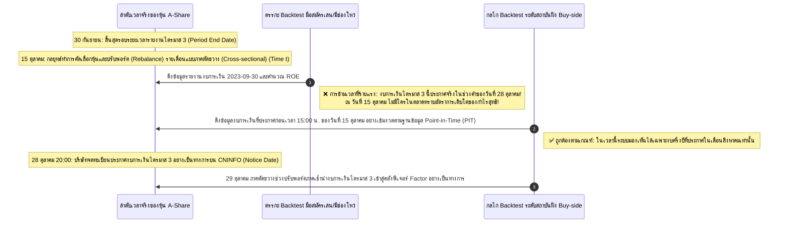

# บทที่ 2: "4 สาเหตุการตายหลัก" ของ Quant Backtest และหลักการป้องกัน

> **เป้าหมายหลักของบทนี้**:  
> เจาะลึก 4 กลไกระดับจุลภาคที่ทำให้กลยุทธ์ Quant "พังทันทีเมื่อลงเทรดจริง (Live Trading)": **Look-ahead Bias**, **Survivorship Bias**, **กับดักคำสั่งที่ไม่สามารถจับคู่ได้** และ **Overfitting จากการทดสอบซ้ำซ้อน (P-Hacking & Overfitting)** ร่วมกับการอนุพัทธ์ทางคณิตศาสตร์อย่างเป็นทางการ, กรณีศึกษาจริงในประวัติศาสตร์ของหุ้น A-Share (หุ้นที่ถูกเพิกถอนหลักทรัพย์ (Delisting) และกลไกราคาชนเพดาน), การอนุพัทธ์ทางคณิตศาสตร์ Deflated Sharpe Ratio (DSR) และ Probabilistic Sharpe Ratio (PSR) ของ Marcos López de Prado เพื่อสร้างระบบ Backtest เชิงรับที่แข็งแกร่งระดับฝั่ง Buy-side

---

## 1. สาเหตุการตายที่ 1: Look-ahead Bias

Look-ahead Bias หมายถึงการที่ในการคำนวณลักษณะของแฟกเตอร์ (Factor), การคัดกรองหลักทรัพย์ หรือการสร้างคำสั่งซื้อขาย ณ จุดเวลา $t$ ใดเวลาหนึ่งในอดีต **ได้มีการนำข้อมูลในอนาคตที่ยังไม่สามารถรับรู้ได้ ณ เวลา $t$ มาใช้ในทางทฤษฎีสารสนเทศและลำดับเหตุผลของอนุกรมเวลา (Time-series)**

### 1.1 นิยามทางคณิตศาสตร์อย่างเป็นทางการและการแตกหักของความสัมพันธ์เชิงสาเหตุ

กำหนดให้กระบวนการสร้างข้อมูลของตลาดการเงินจริงเป็นปริภูมิความน่าจะเป็นที่มีฟิลเตรชัน $(\Omega, \mathcal{F}, \{\mathcal{F}_t\}_{t \ge 0}, \mathbb{P})$ โดยที่ $\mathcal{F}_t = \sigma(X_s : s \le t)$ แทนพีชคณิตของกระแสข้อมูลทั้งหมดที่เปิดเผยต่อสาธารณะในตลาดก่อนเวลา $t$ (รวมถึงภาพรวมคำสั่งที่จับคู่แล้ว, ประกาศจากตลาดหลักทรัพย์, ข้อมูลเศรษฐกิจมหภาค เป็นต้น)

- **การตัดสินใจ Quant ที่ถูกต้องตามกฎเกณฑ์**: เวกเตอร์น้ำหนักการถือครองเป้าหมาย $w_t$ ที่กำหนดขึ้น ณ เวลา $t$ จะต้องเป็นสิ่งที่วัดค่าได้บน $\mathcal{F}_t$ (นั่นคือ $w_t \in \mathcal{F}_t$)
- **การแทรกซึมของ Look-ahead Bias**: ขอเพียงมีองค์ประกอบเล็กน้อยเพียงใดก็ตามที่ทำให้ฟังก์ชันการตัดสินใจ $w_t$ ขึ้นอยู่กับเซตย่อยของข้อมูลในอนาคต $\mathcal{F}_{t + \Delta t} (\Delta t > 0)$ คุณสมบัติ Martingale ของทั้งระบบ Backtest จะพังทลายลงทันที! ผลตอบแทนส่วนเกิน (Excess Return), สถิติ t และ Sharpe Ratio ทั้งหมดที่คำนวณจาก Backtest ดังกล่าวจะกลายสภาพเป็นตัวเลขลวงที่ไร้ความหมายทางสถิติโดยสิ้นเชิง



### 1.2 รูปแบบ Look-ahead Bias ที่แนบเนียนที่สุด 4 รูปแบบในหุ้น A-Share

#### รูปแบบ A: ความคลาดเคลื่อนของ 3 ตัวประทับเวลาในงบการเงิน (Period Date vs Notice Date vs Revision Date)
งบการเงินของบริษัทจดทะเบียนประกอบด้วย 3 Timestamp หลักที่แตกต่างกันโดยสิ้นเชิง:
1. **วันสิ้นสุดรอบระยะเวลารายงาน (Period End Date)**: เช่น งบไตรมาส 1 คือ `03-31`, งบครึ่งปีคือ `06-30`, งบไตรมาส 3 คือ `09-30`, งบประจำปีคือ `12-31`
2. **วันประกาศเปิดเผยข้อมูลจริง (Notice Date)**: วันที่บริษัทจดทะเบียนเปิดเผยงบการเงินต่อสาธารณะอย่างเป็นทางการ กฎระเบียบของหุ้น A-Share กำหนดว่าต้องเปิดเผยงบการเงินไตรมาส 3 ภายในวันที่ 31 ตุลาคม บริษัทจำนวนมากจึงกระจุกตัวเปิดเผยในช่วงวันที่ 25 ถึง 30 ตุลาคม
3. **วันประกาศแก้ไขงบ (Revision Date)**: วันที่ประกาศฉบับแก้ไข หากหลังจากเผยแพร่งบการเงินแล้วถูกหน่วยงานกำกับดูแลสอบถาม หรือผู้สอบบัญชีตรวจพบข้อผิดพลาด
- **โค้ดมือสมัครเล่น**: `df.filter(pl.col("report_date") == "2023-09-30")` ซื้อหุ้นดังกล่าวตั้งแต่ต้นเดือนตุลาคมโดยอิงจาก "กำไรสุทธิโตทะลัก 200% YoY" ซึ่งในโลกความเป็นจริงนี่คือการเดินทางข้ามเวลาของข้อมูลที่เร็วกว่าแสง
- **โซลูชันของฝั่ง Buy-side**: ต้องใช้**ฐานข้อมูลทางการเงินแบบ Point-in-Time (PIT)** โดยเงื่อนไขการคิวรีต้องเป็นไปตามเงื่อนไขบังคับ:
  $$\text{Query Condition}: \text{report\_period} = \text{'2023-09-30'} \quad \text{AND} \quad \text{publish\_time} < t_{\text{decision}}$$

#### รูปแบบ B: การสลับลำดับเหตุและผลของค่าขีดสุดราคาและปริมาณระหว่างวัน (High / Low Causality Inversion)
ในการทำ Backtest กราฟรายวัน หลายคนเขียนตรรกะดังนี้:
```python
# ❌ ตัวอย่างคลาสสิกของ Look-ahead Bias ภายในวัน
if today_low <= limit_buy_price:
    execute_buy(limit_buy_price)
```
- **ความจริงของการจับคู่คำสั่งในตลาดจริง**: ในวันนั้น สรุปแล้วเกิดราคาสูงสุดก่อน เกิดราคาต่ำสุดก่อน หรือเปิดตลาดมาก็ดิ่งลงชนพื้น (Limit-down) ทันที? เพียงแค่ตัวเลข OHLC 4 ตัวของกราฟรายวัน ย่อมไม่สามารถกู้คืนเส้นทางของราคาระหว่างวัน (Intraday Path Dependency) ได้เลย การสมมุติว่าตนเองสามารถส่งคำสั่ง Limit Order แล้วจับคู่ได้ที่จุดต่ำสุดโดยที่ยังไม่ทราบข้อมูลการซื้อขายแบบ Tick-by-tick ก็ไม่ต่างอะไรกับการเปิดตาทิพย์

#### รูปแบบ C: ข้อมูลสถิติระดับสากลรั่วไหล (Global Normalization Leakage)
```python
# ❌ การรั่วไหลระดับสากล: ทำ Standardization บนชุดข้อมูลทั้งหมดโดยตรง
from sklearn.preprocessing import StandardScaler
scaler = StandardScaler()
X_scaled = scaler.fit_transform(X_all) # X_all ประกอบด้วยข้อมูลทั้งหมดตั้งแต่ปี 2018 ถึง 2025
```
- ในการคำนวณข้อมูลของปี 2018 ค่าเฉลี่ย $\mu$ และความแปรปรวน $\sigma$ ได้หลอมรวมข้อมูลการแจกแจงของตลาดในปี 2024 เข้าไปเรียบร้อยแล้ว
- **วิธีปฏิบัติที่ถูกต้อง**: ต้องใช้**หน้าต่างเวลาแบบเลื่อน (Rolling Window)** หรือ**หน้าต่างเวลาแบบขยายตัว (Expanding Window)** ในการคำนวณพารามิเตอร์การทำ Standardization โดยอิงจากกลุ่มตัวอย่างในอดีตเท่านั้น!

#### รูปแบบ D: การข้ามเวลาของหุ้นที่เป็นองค์ประกอบของดัชนีวงกว้าง (Constituent Rebalancing Leakage)
- ดัชนีวงกว้างอย่าง CSI 300, CSI 500 และ CSI 1000 มีการปรับหุ้นที่เป็นองค์ประกอบทุกครึ่งปี (มีผลบังคับใช้ช่วงกลางเดือนมิถุนายนและธันวาคมของทุกปี)
- หากคุณนำรายชื่อหุ้นที่เป็นองค์ประกอบของ CSI 1000 ใน**วันนี้** ไปรัน Backtest กลยุทธ์ของปี 2020: บริษัทที่ยังคงอยู่ในดัชนีได้ในวันนี้ ส่วนใหญ่เป็นกิจการคุณภาพดีที่มีผลการดำเนินงานยอดเยี่ยมตลอด 4 ปีที่ผ่านมา และไม่เคยประสบวิกฤตล้มละลายรุนแรง ส่วนหุ้นผลประกอบการแย่ที่เคยอยู่ในองค์ประกอบดัชนีเมื่อปี 2020 ซึ่งต่อมาราคาดิ่งลงต่อเนื่องจนถูกคัดออกหรือแม้กระทั่งถูกเพิกถอนหลักทรัพย์ กลับถูก Backtest ของคุณกรองทิ้งออกไปอย่างสมบูรณ์แบบ

---
## 2. สาเหตุความล้มเหลวร้ายแรงข้อที่ 2: Survivorship Bias

หากคลังข้อมูลย้อนหลังของคุณ**มีเฉพาะหุ้นที่ยังคงซื้อขายตามปกติในปัจจุบันเท่านั้น** ระบบ Backtest จะถือว่าให้พลังเหนือธรรมชาติแก่กลยุทธ์โดยปริยาย ในการ “สามารถระบุล่วงหน้าและหลีกเลี่ยงหุ้นที่จะถูกเพิกถอนหลักทรัพย์ (Delisting) และระเบิดลงในอนาคตได้ทั้งหมด”

```
แบบจำลองการบิดเบือนผลตอบแทนของกลยุทธ์จาก Survivorship Bias
ข้อมูลประวัติศาสตร์ทั้งหมดของทั้งตลาดปี 2018 (ประมาณ 4,000 ตัว)
├── หุ้นที่ดำเนินธุรกิจอย่างมีเสถียรภาพต่อเนื่อง (ประมาณ 3,600 ตัว) ── อยู่รอดมาจนถึงปี 2026 (เกณฑ์มาตรฐานผลการดำเนินงานในอดีต)
└── เผชิญกับการตกแต่งบัญชีครั้งใหญ่ ชนพื้น (Limit-down) แบบเปิดกระโดดต่อเนื่อง แล้วถูกบังคับ Delisting (400+ ตัว)
      ├── ตัวแทนเด่น: Kangde (เพิกถอน), Botian (เพิกถอน), LeTV, Kangmei Pharmaceutical, Huaze (เพิกถอน)...
      └── เส้นทางการขาดทุน: พักการซื้อขาย (Suspension) ที่ราคาสูง ──> ชน Limit-down ล็อคสนิทต่อเนื่อง 15-30 วัน ──> ดิ่งลงกว่า 95% ──> เพิกถอนหลักทรัพย์มูลค่าเหลือศูนย์

หากระบบ Backtest คัดหุ้นที่ถูก Delist กว่า 400 ตัวนี้ออกไป:
พอร์ต Backtest จะมีภูมิคุ้มกันตามธรรมชาติต่อผลขาดทุน Black Swan มหาศาลระดับ -95% ทั้งหมด ส่งผลให้ผลตอบแทนส่วนเกิน (Excess Return) ต่อปีของกลยุทธ์สูงเกินจริงไป 5%~10%!
```

### 2.1 ระบบแจ้งเตือน ST และหลุมดำสภาพคล่อง
- **การแจ้งเตือนความเสี่ยง ST / *ST**: เมื่อบริษัทจดทะเบียนขาดทุนต่อเนื่อง หรือมีการตกแต่งงบการเงินและทำผิดกฎหมายอย่างร้ายแรง ตลาดหลักทรัพย์จะประกาศเตือนความเสี่ยง และจำกัดกรอบราคาชนเพดาน/พื้น (Price Limit) รายวันลดลงเหลือ $\pm 5\%$
- **เส้นตายของ Stock Universe สำหรับสถาบัน**: หุ้นใน Universe ของสถาบันมี "ข้อจำกัดการรับเข้าพอร์ต" อย่างเข้มงวด โดย **ห้ามซื้อหุ้นที่มีการแจ้งเตือนความเสี่ยงเด็ดขาด หากหุ้นที่ถือครองอยู่โดน ST จะต้องปิดสถานะทันทีที่หลุดจากกระดาน Limit-down ในโอกาสแรก**
- หาก Backtest ไม่ติดตามประวัติการถูกขึ้นเครื่องหมาย ST ของหุ้นรายตัวแบบไดนามิก ก็จะเกิดความผิดพลาดระหว่างที่ราคาหุ้นดิ่งเหว โดยมองว่าเป็น "หุ้นกลับตัวราคาถูกที่ Oversold อย่างหนัก" แล้วเข้าซื้ออย่างหนัก ซึ่งในการเทรดจริง (Live Trading) พังยับเยินอย่างแน่นอน

---

## 3. สาเหตุความล้มเหลวร้ายแรงข้อที่ 3: กับดักคำสั่งที่ไม่สามารถจับคู่ได้จริง (Unexecutable Orders)

หัวใจสำคัญระดับล่างสุดของระบบ Quant Backtest ใดๆ คือ **Matching Engine** จุดตัดแบ่งระหว่าง Backtest ระดับมือสมัครเล่นกับ Backtest ฝั่ง Buy-side อยู่ที่ความรัดกุมในการสร้างแบบจำลองความเป็นไปได้ที่จะเกิดการจับคู่คำสั่ง (Matching) ภายใต้สภาวะตลาดสุดขั้ว

| ประเภทกับดักการจับคู่คำสั่ง | สมมติฐานไร้เดียงสาใน Backtest มือสมัครเล่น | ความเป็นจริงของ Matching ในโครงสร้างจุลภาคของหุ้น A-Share | ผลลัพธ์หายนะเมื่อนำไปเทรดจริง |
| :--- | :--- | :--- | :--- |
| **การซื้อที่ราคาชนเพดานแบบเปิดกระโดด (Limit-up Buy)** | ขอแค่ราคาปิดวันนั้นปรับขึ้น 10% โมเดลจะจับคู่คำสั่งซื้อทั้งหมดที่ราคาเปิด `Open` ทันที | ช่วง Call Auction มีคำสั่งซื้อสะสมหลายแสน Lot ล็อคแน่นที่ Buy 1 ขณะที่รายย่อยและ Quant ความถี่ต่ำถึงปานกลางต่อคิวอยู่ท้ายแถว **ความน่าจะเป็นที่จะ Match ได้จริงเท่ากับ 0 อย่างแท้จริง** | "กลยุทธ์ไล่ราคาหุ้นชนเพดาน" ผล Backtest ได้ผลตอบแทน 300% ต่อปี, Sharpe Ratio 5.0 แต่พอเทรดจริงคำสั่งตั้งรอทั้งหมดล้มเหลว ซื้อไม่ได้แม้แต่หุ้นเดียว! |
| **การขายเมื่อราคาชนพื้นล็อคสนิท (Locked Limit-down Sell)** | กลยุทธ์ส่งสัญญาณ Cut-loss และปิดสถานะออกทันทีที่ราคาชนพื้นตามราคาปิด `Close` | ฝั่งซื้อที่ราคาชนพื้นยกเลิกคำสั่งทั้งหมด Buy 1 กลายเป็น 0 ฝั่ง Sell 1 อัดแน่นไปด้วยคำสั่งขายมหาศาล **แทบไม่มีการจับคู่คำสั่งทั้งวัน ไม่สามารถปิดสถานะออกได้** | "กลยุทธ์ Cut-loss อย่างเข้มงวด" มี Max Drawdown ใน Backtest เพียง 4% แต่การเทรดจริงถูกบังคับให้ล็อคสถานะทนรับ Limit-down ล็อคสนิทติดต่อกัน 3~5 วัน ขาดทุนต่อตัวเกิน 40%! |
| **การพักการซื้อขายชั่วคราวระหว่างวัน** | ระบบ Backtest คำนวณมูลค่าพอร์ตรายวันโดยใช้ราคาล่าสุดก่อน Suspension | หุ้นถูกตลาดหลักทรัพย์สั่งพักการซื้อขายนานหลายเดือนจากการปรับโครงสร้างหรือทำผิดกฎ สภาพคล่องของพอร์ตเหือดแห้งทันที เงินทุนไม่สามารถปรับพอร์ต (Rebalance) ได้ | สัดส่วนการถือครองของพอร์ตเกิด Drift อย่างรุนแรงโดยไม่ตั้งใจ และหลังจากกลับมาซื้อขายมักจะชนพื้นต่อเนื่องแบบไม่มี Volume เพื่อชดเชยการปรับลง |
| **ต้นทุน Market Impact จากคำสั่งซื้อขายขนาดใหญ่** | สมมติว่าไม่ว่าจะซื้อขาย 1 ล้านหรือ 50 ล้าน ก็สามารถ Match ได้ที่ราคา Order Book เดียวกันทั้งหมด | **แบบจำลองผลกระทบตามกฎรากที่สอง**: ต้นทุน Market Impact แปรผันตรงกับรากที่สองของสัดส่วนคำสั่งซื้อขายเทียบกับปริมาณการซื้อขายเฉลี่ยต่อวัน (ADV) | กลยุทธ์ทำกำไรได้ดีเมื่อทดสอบด้วยเงินทุนขนาดเล็ก (5 แสน) แต่เมื่อขยายขนาดพอร์ตเป็น 20 ล้าน คำสั่งซื้อของตัวเองกลับดันราคาให้สูงขึ้น ส่งผลให้ Alpha หายวับไปทันที |

---

## 4. สาเหตุความล้มเหลวร้ายแรงข้อที่ 4: Overfitting และ Data Snooping (Overfitting & P-Hacking)

ในแวดวง Quant การเงิน **Overfitting ไม่ใช่เรื่องบังเอิญ แต่เป็นสภาวะตั้งต้นที่นักวิจัย Quant ทุกคนต้องรับมืออยู่ทุกวัน**

### 4.1 "บาป 7 ประการของสาย Quant" โดย Marcos López de Prado
Marcos López de Prado ผู้บุกเบิกงานวิจัยด้านเฮดจ์ฟันด์ ได้สรุปข้อผิดพลาดร้ายแรงที่พบบ่อยที่สุดในการวิจัยและพัฒนากลยุทธ์เชิงปริมาณไว้ในการบรรยายและบทความวิชาการปี 2019 ในชื่อ "บาป 7 ประการของการลงทุนเชิงปริมาณ (The 7 Sins of Quantitative Investing)":
1. **Survivorship Bias**: การใช้ชุดข้อมูลที่ไม่รวมหลักทรัพย์ที่ถูกเพิกถอน
2. **Look-ahead Bias**: การใช้ข้อมูลที่ยังไม่ได้เปิดเผยต่อสาธารณะ ณ ขณะที่เหตุการณ์เกิดขึ้น
3. **กับดักการผูกเรื่องราว (Storytelling)**: การแต่งเรื่องเล่าเชิงมหภาคหรือตรรกะย้อนหลังตามกราฟของกลยุทธ์ เพื่ออธิบายสิ่งที่เป็นเพียง Noise ให้ดูสมเหตุสมผล
4. **Data Mining & Snooping**: การวนลูปค้นหาฟีเจอร์นับหมื่นตัว แล้วเลือกเฉพาะฟีเจอร์ที่บังเอิญทำผลงานได้ดีเยี่ยมบนชุดข้อมูลในอดีต
5. **การประเมินต้นทุนการซื้อขายและ Market Impact ต่ำเกินไป (Cost Underestimation)**: การมองข้าม Slippage, อากรแสตมป์ (Stamp Duty) และการเติบโตแบบไม่เป็นเชิงเส้นของ Market Impact
6. **การละเลยค่าผิดปกติและความไม่นิ่งของข้อมูล (Outliers & Non-stationarity)**: การไม่จัดการกับการแจกแจงแบบหางหนาและเหตุการณ์สุดขั้วอย่างรัดกุม
7. **กับดักการ Short Volatility แอบแฝง (Short Volatility Trap)**: กลยุทธ์ที่แอบแบกรับความเสี่ยงส่วนหางมหาศาลไว้เบื้องหลัง เพื่อแลกกับผลตอบแทนเล็กน้อยที่ดูสม่ำเสมอในสภาวะปกติ (เช่น โครงสร้าง Snowball Options)

### 4.2 การพิสูจน์ทางคณิตศาสตร์ของ Probabilistic Sharpe Ratio (PSR) และ Deflated Sharpe Ratio (DSR)

กำหนดให้ผลตอบแทนเฉลี่ยของกลุ่มตัวอย่างของกลยุทธ์ตลอด $T$ คาบการสังเกตคือ $\hat{\mu}$, ส่วนเบี่ยงเบนมาตรฐานของกลุ่มตัวอย่างคือ $\hat{\sigma}$ และ Sharpe Ratio ของกลุ่มตัวอย่างคือ $\widehat{SR} = \frac{\hat{\mu}}{\hat{\sigma}}$ หากอนุกรมผลตอบแทนมีความเบ้ $\hat{\gamma}_3$ (Skewness) และความโด่ง $\hat{\gamma}_4$ (Kurtosis) ตามการกระจายแบบปกติเชิงเส้นกำกับของ Mertens (2002) และ Bailey & López de Prado (2012) ความแปรปรวนเชิงเส้นกำกับของ Sharpe Ratio ของกลุ่มตัวอย่างคือ:

$$\hat{\sigma}_{\widehat{SR}}^2 = \frac{1}{T-1} \left( 1 - \hat{\gamma}_3 \widehat{SR} + \frac{\hat{\gamma}_4 - 1}{4} \widehat{SR}^2 \right)$$

#### Probabilistic Sharpe Ratio (PSR):
วัดความน่าจะเป็นที่ Sharpe Ratio ที่แท้จริงของกลยุทธ์จะสูงกว่าเกณฑ์อ้างอิง $SR^*$:

$$\text{PSR}(SR^*) = \Phi\left( \frac{(\widehat{SR} - SR^*) \sqrt{T-1}}{\sqrt{1 - \hat{\gamma}_3 \widehat{SR} + \frac{\hat{\gamma}_4 - 1}{4} \widehat{SR}^2}} \right)$$

โดยที่ $\Phi(\cdot)$ คือฟังก์ชันการแจกแจงสะสมแบบปกติมาตรฐาน (CDF)

#### Deflated Sharpe Ratio (DSR):
เมื่อนักวิจัยทำการทดสอบกลยุทธ์หรือชุดพารามิเตอร์ที่แตกต่างกัน $K$ ครั้งอย่างอิสระ แล้วคัดเลือกค่า Sharpe Ratio ที่สูงสุด $\widehat{SR}_{\max}$ ออกมา ค่าคาดหวังของค่าสูงสุดจากการทดสอบ $K$ ครั้งย่อมไม่เท่ากับ 0 ตามทฤษฎีค่าสุดขีด (Extreme Value Theory) ภายใต้สมมติฐานหลัก ค่าคาดหวังของเกณฑ์มาตรฐาน Sharpe Ratio สูงสุด $SR_0$ ที่สามารถทำได้จากการทดลองที่อิสระต่อกัน (หรือมีความสัมพันธ์กันต่ำ) จำนวน $K$ ครั้ง คือ:

$$SR_0 = \sqrt{V(\{SR_k\})} \left[ (1 - \gamma) \Phi^{-1}\left(1 - \frac{1}{K}\right) + \gamma \Phi^{-1}\left(1 - \frac{1}{K \cdot e}\right) \right]​$$

โดยที่:
- $\gamma \approx 0.5772156649$ (ค่าคงที่ Euler-Mascheroni);
- $V(\{SR_k\})$ คือความแปรปรวนภาคตัดขวาง (Cross-sectional) ของ Sharpe Ratio จากการทดลองทั้งหมด $K$ ครั้ง;
- $K$ คือจำนวนครั้งการทดลองทั้งหมดที่ลองทำในกระบวนการวิจัยและพัฒนา (Number of Trials)

**นิยามขั้นสุดท้ายของ DSR** คือการแทนค่า Sharpe สูงสุดลงในสูตร PSR โดยใช้ค่าคาดหวังของค่าสุดขีด $SR_0$ เป็นเกณฑ์อ้างอิง:

$$\text{DSR} \equiv \text{PSR}(SR_0) = \Phi\left( \frac{(\widehat{SR}_{\max} - SR_0) \sqrt{T-1}}{\sqrt{1 - \hat{\gamma}_3 \widehat{SR}_{\max} + \frac{\hat{\gamma}_4 - 1}{4} \widehat{SR}_{\max}^2}} \right)$$

**ข้อคิดสำคัญ**: เมื่อคุณลองปรับจูนพารามิเตอร์ไป 500 ครั้ง ($K = 500$) ในระหว่างพัฒนากลยุทธ์ Sharpe Ratio เดิมที่ดูโดดเด่นจะดิ่งลงเหวทันทีเมื่อผ่านการทดสอบ DSR หากค่า DSR ต่ำกว่า 0.95 แสดงว่ามีความน่าจะเป็นสูงมากที่กลยุทธ์นี้เป็นเพียงผลผลิตของ Overfitting ที่เกิดจากความบังเอิญในการทดสอบซ้ำหลายครั้ง!

---
## 5. เครื่องมือ Open-source ที่ได้มาตรฐานสำหรับการตรวจสอบและบทนำสู่วรรณกรรมคลาสสิก

### 5.1 เครื่องมือ Open-source ระดับ Production สำหรับป้องกัน Overfitting และประเมินแฟกเตอร์ (Factor)

| ชื่อไลบรารี | ขอบเขตการใช้งาน | แนวป้องกันหลักและแนวทางปฏิบัติของฝั่ง Buy-side |
| :--- | :--- | :--- |
| **Alphalens-reloaded** | การทดสอบประสิทธิภาพของ Factor และ Look-ahead Bias | สร้างผลตอบแทนแบบแยกชั้นของ Factor และเส้นโค้งการลดทอนของ Rank IC โดยอัตโนมัติ; ระบุความล่าช้าหรือการรั่วไหลของข้อมูลได้อย่างรวดเร็วผ่านการเปรียบเทียบความสม่ำเสมอเชิงเดียว (Monotonicity) ของผลตอบแทนตั้งแต่ช่วงที่ 1 ถึงช่วงที่ $N$ |
| **Pyfolio-reloaded** | การตรวจสอบความเสี่ยงของพอร์ตและผลตอบแทนสุดโต่ง | แสดงค่าความเบ้ (Skewness), ความโด่ง (Kurtosis) ของผลตอบแทน และระยะเวลา Drawdown สูงสุด; ช่วยตรวจสอบว่าการกระจายตัวของผลตอบแทนมีลักษณะหางหนา (Fat-tailed) จากการ Short Volatility หรือไม่ |
| **scikit-learn (`TimeSeriesSplit`)** | Cross-validation แบบอนุกรมเวลา (Time-series) | รับประกันอย่างเข้มงวดว่าชุดข้อมูล Train ต้องอยู่ก่อนชุดข้อมูล Test บนแกนเวลาเสมอ ป้องกันการสับเปลี่ยนข้อมูลข้ามเวลาโดยเด็ดขาด |
| **mlfinlab / de Prado Toolchain** | การตรวจสอบเฉพาะสำหรับ Machine Learning ทางการเงิน | ใช้งาน PurgedGroupTimeSeriesSplit เพื่อตัดข้อมูลซ้ำซ้อนและทำ Cross-validation กำจัดการรั่วซึมของข้อมูลที่เกิดจาก Autocorrelation และ Overlapping Labels ในอนุกรมเวลาทางการเงินอย่างเด็ดขาด |

### 5.2 วรรณกรรมวิชาการระดับหมุดหมายสำคัญ

1. **การทดสอบทางคณิตศาสตร์สำหรับ Overfitting และ Multiple Testing**：  
   Bailey, D. H., & López de Prado, M. (2012). *The Sharpe Ratio Efficient Frontier*. Journal of Risk.  
   Bailey, D. H., & López de Prado, M. (2014). *The Deflated Sharpe Ratio: Correcting for Selection Bias, Backtest Overfitting, and Non-Normality*. Journal of Portfolio Management.  
   *คุณูปการหลัก*：นำเสนอ PSR และ DSR ซึ่งนับเป็นครั้งแรกที่มีการวัดผลเชิงปริมาณทางคณิตศาสตร์ของการลงโทษ (Penalty) ต่อผลการดำเนินงานของกลยุทธ์จากจำนวนครั้งในการทดลองและลักษณะที่ไม่แจกแจงแบบปกติ
2. **ความน่าจะเป็นของการเกิด Overfitting ใน Backtest (PBO) และ Combinatorial Symmetric Cross-Validation**：  
   Bailey, D. H., Borwein, J. M., López de Prado, M., & Zhu, Q. J. (2014). *Pseudo-mathematics and financial charlatanism: The effects of backtest overfitting on out-of-sample performance*. Notices of the AMS.  
   *คุณูปการหลัก*：นำเสนอ Combinatorial Symmetric Cross-Validation (CSCV) และพิสูจน์ให้เห็นว่ากลยุทธ์ที่มีค่า Sharpe Ratio สูงที่เผยแพร่ต่อสาธารณะส่วนใหญ่นั้น มีผลการดำเนินงานนอกกลุ่มตัวอย่างเท่ากับการโยนเหรียญ
3. **วิกฤต Multiple Testing ของ Factor ภาคตัดขวาง (Cross-sectional)**：  
   Harvey, C. R., Liu, Y., & Zhu, H. (2016). *...and the Cross-Section of Expected Returns*. The Review of Financial Studies.  
   *คุณูปการหลัก*：ตรวจสอบ Factor ที่มีประสิทธิภาพหลายร้อยตัวที่ค้นพบในแวดวงวิชาการอย่างเป็นระบบ โดยพิสูจน์ว่าเมื่อพิจารณาการปรับลดจาก Multiple Testing แล้ว เกณฑ์ความมีนัยสำคัญของ t-test จะต้องปรับเพิ่มขึ้นจากเดิมที่ 2.0 เป็นมากกว่า 3.0

---

## 6. ภาคปฏิบัติ: การตรวจสอบ Backtest เสมือนจริง, แนวป้องกันการจับคู่คำสั่ง (Matching) และตัวตรวจสอบ Overfitting ด้วย DSR

โค้ด Python ด้านล่างนี้เปรียบเทียบอย่างเข้มงวดระหว่าง **เวอร์ชันมือสมัครเล่นที่มีช่องโหว่ซึ่งแฝง Look-ahead Bias และละเลยราคาชนเพดาน/พื้น (Price Limit)** กับ **เวอร์ชันฝั่ง Buy-side ที่ใช้การแบ่ง Time-series อย่างเข้มงวด, สกัดกั้นการ Matching เมื่อราคาติดเพดาน/พื้น และตรวจสอบด้วย DSR**

ในไดเรกทอรีรูทของโปรเจกต์ ให้รัน `python3 -m tutorial.examples.lecture_02_backtest_sanitizer` หรือรันสคริปต์โดยตรง

<<< @/examples/lecture_02_backtest_sanitizer.py

### การวิเคราะห์ผลลัพธ์เชิงลึกและข้อคิดสำหรับการเทรดจริง (Live Trading) ระดับสถาบัน:
```
======================================================================
การทดลองที่ 1: 【เวอร์ชันมือสมัครเล่นที่มีช่องโหว่】 แฝง Look-ahead Bias + ละเลยข้อจำกัดราคาชนเพดาน/พื้น
======================================================================
  Sharpe Ratio ของ Backtest ลวง (Sharpe Ratio) : 0.52
  ผลตอบแทนสะสมรวมลวง (Cumulative Ret): 14.10%

======================================================================
การทดลองที่ 2: 【เวอร์ชันฝั่ง Buy-side เชิงป้องกัน】 Time-series เข้มงวด + สกัดกั้นการ Matching เมื่อราคาติดเพดาน/พื้น
======================================================================
  Sharpe Ratio เวอร์ชันมีข้อจำกัด (Clean Sharpe) : -0.63
  ผลตอบแทนสะสมเวอร์ชันมีข้อจำกัด (Clean Return)    : -17.31%

======================================================================
การทดลองที่ 3: การตรวจสอบ Overfitting และ Data Snooping (Deflated Sharpe Ratio)
======================================================================
  Sharpe Ratio เลียนแบบจากการ Backtest ครั้งเดียว               : -0.63
  DSR สมมติการทดลองอิสระ 500 ครั้ง และส่วนเบี่ยงเบนมาตรฐานของ Sharpe รายงวด 0.02: 0.0072 (แสดงเป็นเพียงตัวอย่างสูตร ไม่สามารถใช้ตัดสินความน่าจะเป็นจริงของกลยุทธ์)
```

1. **ความเป็นจริงอันโหดร้ายของการสกัดกั้น Matching เมื่อราคาติดเพดาน/พื้น**：
   - ในการทดลองที่ 1 กลยุทธ์เข้าซื้อในวันที่ราคาชนเพดาน (Limit-up) และขายในวันที่ราคาชนพื้น (Limit-down) จึงสร้างค่า Sharpe ที่เป็นบวกดูมีเสถียรภาพ (0.52) และผลตอบแทนลวง 14.1%
   - แต่เมื่อเปิดใช้ข้อจำกัดทางกายภาพตามจริงของหุ้น A-Share ในการทดลองที่ 2 (**เมื่อชนเพดานสนิทจะซื้อไม่ได้ และเมื่อชนพื้นสนิทจะขายไม่ได้**) พร้อมทั้งสร้างสัญญาณหลังราคาปิดในวัน $t-1$ และ Match คำสั่งที่ราคาเปิด `Open` ในวันถัดไป $t$ ธาตุแท้ของกลยุทธ์นี้ก็ถูกเปิดเผย: Annualized Sharpe ดิ่งลงเหลือ **-0.63** ทันที และขาดทุนจริงถึง **-17.31%**!
2. **สัญญาณเตือนสติจาก DSR**：
   - การทดลองที่ 3 จำลองสถานการณ์ที่ผู้วิจัยทดลอง Grid Search พารามิเตอร์ไป 500 ครั้ง แม้ว่าจะเลือกชุดพารามิเตอร์ที่ดูเข้าท่าออกมาได้ แต่เมื่อนำไปปรับแก้ด้วยความเบ้, ความโด่ง และเกณฑ์มาตรฐาน Multiple Testing $SR_0$ แล้ว สถิติ DSR มีค่าเพียง **0.0072** เท่านั้น ซึ่งยืนยันว่าผลลัพธ์ดังกล่าวเป็นเพียงผลผลิตจาก Random Noise และ Data Snooping ล้วน ๆ

---

## 7. Checklist ตรวจสอบ Backtest ด้วยตนเองที่จำเป็นระดับสถาบันฝั่ง Buy-side (Pre-Flight Checklist)

ก่อนส่งมอบโมเดล Quant ใด ๆ ให้คณะกรรมการการลงทุน หรือนำไปเทรดจริง จะต้องตรวจสอบทีละข้อเทียบกับ 8 เช็กลิสต์ทองคำดังต่อไปนี้:

```text
[ ] 1. การแยก Time-series อย่างเข้มงวด: Timestamp ของฟีเจอร์ต้องอยู่ก่อน Timestamp ของการตัดสินใจอย่างเคร่งครัด สัญญาณสร้างขึ้นหลังตลาดปิดในวัน t และดำเนินการส่งคำสั่งตอนเปิดตลาดหรือระหว่างวันของวัน t+1
[ ] 2. การสืบค้นงบการเงินแบบ Point-in-Time (PIT): งบการเงินต้องใช้วันที่เปิดเผยต่อสาธารณะจริง (Notice Date) ห้ามใช้วันสิ้นสุดรอบระยะเวลารายงาน (Period Date) โดยเด็ดขาด
[ ] 3. ข้อมูลย้อนหลังครบถ้วนและหุ้นที่เพิกถอนหลักทรัพย์ (Delisting): Universe หุ้นในอดีตต้องครอบคลุมหุ้นทั้งหมดที่มีอยู่ ณ เวลานั้น รวมถึงหุ้นที่ถูกเพิกถอนในเวลาต่อมา เพื่อขจัด Survivorship Bias โดยสิ้นเชิง
[ ] 4. ข้อจำกัดราคาในการ Matching ตามจริง: ห้าม Match คำสั่งซื้อเมื่อราคาชนเพดานสนิท และห้าม Match คำสั่งขายเมื่อราคาชนพื้นสนิทโดยเด็ดขาด คำสั่งที่ยังไม่จับคู่ต้องคงค้างไว้ในคิวรอ Match
[ ] 5. การจัดการหุ้นที่พักการซื้อขาย (Suspension) และสภาพคล่อง: ห้ามสมมติว่าสามารถปิดสถานะหุ้นที่ถูกพักการซื้อขายเนื่องจากการปรับโครงสร้างหรือการตรวจสอบด้วยราคาล่าสุดโดยเด็ดขาด สถานะถือครองจะต้องคงอยู่ในสภาวะล็อกไว้
[ ] 6. การกระทบยอดบัญชีอย่างรัดกุม: คำนวณอากรแสตมป์ (Stamp Duty) ฝั่ง Sell-side (0.05%), ค่าคอมมิชชันโบรกเกอร์, ค่าธรรมเนียมการโอน รวมถึงต้นทุน Market Impact และ Slippage อย่างละเอียดทั้งสองฝั่งซื้อขาย โดยกระแสเงินสดต้องสอดคล้องสมบูรณ์ในตัวเอง
[ ] 7. การแยกข้อมูล Blind Test นอกกลุ่มตัวอย่าง: ก่อนกำหนดช่วงเวลา Backtest ต้องล็อกเก็บข้อมูล 12 เดือนล่าสุดไว้อย่างเข้มงวดเพื่อเป็น Out-of-Sample ที่แท้จริง และห้ามแอบดูซ้ำ ๆ โดยเด็ดขาด
[ ] 8. การปรับแก้ Multiple Testing: บันทึกจำนวนครั้งทั้งหมดในการปรับจูนพารามิเตอร์ คำนวณ Deflated Sharpe Ratio (DSR) และยืนยันความมีนัยสำคัญทางสถิติ
```

---
## 8. สรุปประจำบทและแบบฝึกหัดปฏิบัติการหลังเรียน

### ประเด็นสำคัญที่ต้องจำ:
- **Look-ahead Bias คือความผิดมหันต์ของ Quant**: การสับสนวันเปิดเผยงบการเงิน, การสลับลำดับราคาและปริมาณการซื้อขายระหว่างวัน, การทำ Standardization กับฟีเจอร์ระดับ Global คือมือสังหารล่องหนที่พบบ่อยที่สุด
- **Survivorship Bias ลบล้างความเสี่ยงจนหมดสิ้น**: การไม่นำหุ้นที่ถูกเพิกถอนหลักทรัพย์ (Delisting) มารวมใน Backtest ย้อนหลัง ก็เท่ากับสมมุติว่าตนเองมีพลังเหนือธรรมชาติที่หยั่งรู้อนาคตได้
- **Backtest ที่ปราศจาก Slippage และข้อจำกัดด้านการจับคู่คำสั่ง (Matching) ไร้ค่าโดยสิ้นเชิง**: ซื้อไม่ได้เมื่อชนเพดาน (Limit-up) ขายไม่ออกเมื่อชนพื้น (Limit-down) คือกฎฟิสิกส์แห่งโลกความเป็นจริงที่สำคัญที่สุดของหุ้น A-Share
- **Multiple Testing ต้องผ่านการพิสูจน์ความจริงอย่างเข้มงวดด้วย DSR**: อย่าหลงคิดว่า Sharpe Ratio ที่พุ่งสูงเกินจริงจากการลองผิดลองถูกใน In-sample นับพันครั้งเป็น Alpha ที่แท้จริง

### แบบฝึกหัดภาคปฏิบัติหลังเรียน:
> **ภารกิจปฏิบัติจริง**:  
> 1. เปิด `tutorial/examples/lecture_02_backtest_sanitizer.py`  
> 2. สังเกต price path ที่สร้างขึ้นในฟังก์ชัน `simulate_mock_ashare_universe` แล้วลองเพิ่ม "กลไกการพักการซื้อขาย (Suspension)" (เช่น หุ้นแต่ละตัวมีโอกาส 1% ที่จะมีปริมาณการซื้อขายเป็น 0 และราคาไม่เปลี่ยนแปลงในวันทำการใดวันทำการหนึ่ง)  
> 3. เพิ่มตรรกะการดักจับสำหรับหุ้นที่ถูกพักการซื้อขายใน Matching engine (ช่วงที่พักการซื้อขายจะไม่สามารถซื้อหรือขายได้) แล้วรันการทดลองเปรียบเทียบใหม่อีกครั้ง เพื่อสังเกตผลกระทบที่มีต่อเส้น NAV ของพอร์ตและ Turnover
