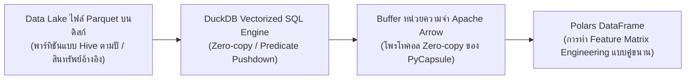

# บทที่ 3: บอกลาเทคสแต็กดั้งเดิมที่เชื่องช้า: สร้างสภาพแวดล้อมทางวิศวกรรม Quant สมัยใหม่

> **เป้าหมายหลักของบทนี้**:  
> เริ่มต้นจากหลักการทำงานของฮาร์ดแวร์ระดับล่าง ทั้ง CPU Cache Line, คำสั่งเวกเตอร์ไรเซชัน SIMD, การจัดวางหน่วยความจำแบบคอลัมน์ (Columnar Memory Layout) และ Python GIL Lock เพื่อทำความเข้าใจอย่างถ่องแท้ถึงสาเหตุทางกายภาพที่ทำให้ Pandas แบบดั้งเดิมเกิดอาการค้างและหน่วยความจำล้นเมื่อต้องจัดการกับข้อมูลพาเนลหลายมิติของทั้งตลาดหุ้น A-Share พร้อมทั้งลงมือฝึกฝน 3 เครื่องมือหัวใจหลักด้าน Quant (เชิงปริมาณ) ประสิทธิภาพสูงยุคใหม่ (`uv` + `Polars` + `DuckDB`), เชี่ยวชาญการแชร์หน่วยความจำแบบ Zero-copy ด้วย Arrow, สถาปัตยกรรม Data Lake แบบ Hive-partitioned Parquet ตลอดจนไวยากรณ์หลักระดับ Production สำหรับงาน Quant เช่น `.over()`, `join_asof` เป็นต้น

---

## 1. ผ่าโครงสร้างระดับล่าง: เหตุใด Pandas ดั้งเดิมจึงทำงานได้อย่างยากลำบากในงาน Quant ของหุ้น A-Share?

ผู้เริ่มต้นจำนวนมากมักคิดว่า "โค้ดรันช้า ก็แค่อัปเกรดไปใช้เซิร์ฟเวอร์สเปกสูงก็พอ" แต่ในการวิจัยและพัฒนางาน Quant สำหรับหุ้น A-Share นั้น **การออกแบบสถาปัตยกรรมข้อมูลที่ด้อยประสิทธิภาพจะกลืนกินพลังการประมวลผลของฮาร์ดแวร์ระดับหรูหราไปอย่างรวดเร็ว**

### 1.1 ขนาดทางกายภาพที่แท้จริงของสเกลข้อมูล Quant ในหุ้น A-Share

```
ภาพรวมสเกลของเมทริกซ์ฟีเจอร์ข้อมูล Quant ในหุ้น A-Share
หลักทรัพย์ที่มีการซื้อขายปกติและที่ถูกเพิกถอนหลักทรัพย์ (Delisting) ในอดีตทั้งตลาด: 5,400+ หุ้น
├── 1. ข้อมูลพาเนลความถี่ระดับวัน (ช่วงเวลา 10 ปี):
│     5,400 หุ้น × 2,420 วันทำการ ≈ 13 ล้านแถว
│     ตารางกว้างของฟีเจอร์ภาคตัดขวาง (Cross-sectional) ทั้งหมดต่อวัน (200 แฟกเตอร์ (Factor)): หน่วยความจำประมาณ 10 GB
├── 2. ข้อมูลความถี่สูงระดับแท่งเทียน 1 นาที (ช่วงเวลา 5 ปี):
│     5,400 หุ้น × 1,210 วัน × 240 นาที ≈ 1.56 พันล้านแถว!
│     ขนาดข้อมูลดิบหลังแตกไฟล์: ประมาณ 150 GB ~ 250 GB
└── 3. ข้อมูลคำสั่งซื้อขายรายรายการและ Snapshot ของ Level-2 (ช่วงเวลา 1 ปี):
      5,400 หุ้น × 242 วัน × 4,800 Snapshot ≈ 6.2 พันล้าน Snapshot!
      กระแสข้อมูลคำสั่งซื้อขายและคำสั่งที่จับคู่สำเร็จรายรายการต่อวัน: ประมาณ 15 GB ~ 30 GB / วัน พุ่งเกินหลาย TB ในปีเดียว!
```

### 1.2 CPU Cache Locality และการจัดวางหน่วยความจำ: Row-Oriented vs Columnar Storage

Latency ในการเข้าถึงของ CPU ยุคใหม่ (เช่น Intel Xeon หรือ Apple Silicon ตระกูล M) นั้นแตกต่างกันอย่างมหาศาล:
- **การเข้าถึง L1/L2 Cache**: ประมาณ $1 \sim 4$ นาโนวินาที (Nanoseconds);
- **การเข้าถึงหน่วยความจำ (DRAM) แบบสุ่ม**: ประมาณ $60 \sim 100$ นาโนวินาที (ช้ากว่าเกือบสองอันดับขนาด!).
- **กลไก Cache Line**: ในการดึงข้อมูลจากหน่วยความจำแต่ละครั้ง CPU จะไม่อ่านทีละไบต์ แต่จะโหลดเข้ามาเป็นบล็อกต่อเนื่องขนาด 64 ไบต์ (Cache Line) แบบเป็นชุด

```
การเปรียบเทียบการจัดเก็บแบบแถว (Row-Oriented) ดั้งเดิม vs การจัดเก็บแบบคอลัมน์ (Columnar) ของ Arrow ยุคใหม่ใน CPU Cache

【การจัดเก็บแบบแถว (Row-Oriented / ฐานข้อมูลดั้งเดิม / ลิสต์ของ Python Dict)】
การจัดเรียงในหน่วยความจำ: [StockA_Open, StockA_High, StockA_Low, StockA_Close, StockB_Open, StockB_High...]
ปัญหา: เมื่อคุณต้องการคำนวณค่าเฉลี่ยของราคาปิดทั้งตลาด แต่ละ Cache Line ที่ CPU โหลดเข้ามาจะถูกบังคับให้ปะปนข้อมูลที่ไม่เกี่ยวข้องอย่าง High, Low เข้ามาด้วย
      ส่งผลให้อัตรา Cache Miss พุ่งสูงมาก และบัสของหน่วยความจำจะเต็มไปด้วยการย้ายข้อมูลที่ไร้ประโยชน์จำนวนมหาศาล

【การจัดเก็บแบบคอลัมน์ (Columnar / Apache Arrow / Polars / Parquet)】
การจัดเรียงในหน่วยความจำ: 
  คอลัมน์ Close: [A_Close, B_Close, C_Close, D_Close, E_Close, F_Close, G_Close, H_Close...]
  คอลัมน์ Open : [A_Open,  B_Open,  C_Open,  D_Open,  E_Open,  F_Open,  G_Open,  H_Open...]
ข้อได้เปรียบ: หน่วยความจำจัดเก็บทศนิยม (Floating-point) ชนิดเดียวกันอย่างต่อเนื่อง คำสั่ง SIMD ของ CPU เพียงครั้งเดียว (AVX-512 / NEON) สามารถคำนวณเลขทศนิยมพร้อมกันได้ 8~16 ตัว,
            อัตรา Cache Hit ของ L1/L2 เกือบ 100% ทำให้ Throughput เพิ่มขึ้นแบบก้าวกระโดด!
```

### 1.3 Python GIL และคอขวดแบบ Single-core vs Rayon Work-Stealing Parallel Pool ของ Rust

1. **CPython Global Interpreter Lock (GIL)**: ในสคริปต์ Pandas ดั้งเดิม แม้ว่าเครื่องของคุณจะมี CPU ถึง 64 คอร์ แต่เนื่องจากมี GIL ลูปของ Python ทั้งหมดและการจัดการออบเจกต์ Python ล้วนๆ จะถูกบังคับให้ล็อกและทำงานแบบเรียงลำดับบนคอร์เดียวเท่านั้น
2. **สถาปัตยกรรม Concurrency ของ Polars**: Polars พัฒนาขึ้นบนพื้นฐานของภาษา Rust และใช้ประโยชน์จาก **Rayon Work-Stealing Parallel Pool** โดยกำเนิด ในการคำนวณ Rolling อนุกรมเวลา (Time-series), การเรียงลำดับภาคตัดขวาง หรือการทำ Aggregation ฟีเจอร์หลายคอลัมน์ Polars จะแบ่งข้อมูลทั้งหมดออกเป็นชิ้นๆ และกระจายไปยังคอร์ CPU ทางกายภาพทั้งหมดที่มีอยู่โดยอัตโนมัติ พร้อมทั้งประมวลผลแบบขนานในเลเยอร์หน่วยความจำของ C/Rust ที่อยู่เบื้องล่าง หลุดพ้นจากพันธนาการของ GIL อย่างสิ้นเชิง

### 1.4 การประเมินผลแบบ Lazy และ Query Optimizer (Lazy Execution & Query Optimization)

ใน Pandas แบบดั้งเดิม โค้ดจะทำงานแบบ **Eager Evaluation**:
```python
# ❌ Pandas: แต่ละขั้นตอนจะบังคับให้เกิด Deep Copy ของตารางกว้างระดับกลางขึ้นมาในหน่วยความจำ
step1 = df[df['turnover'] > 1e8]          # คัดลอก step1 ทั้งหมดในหน่วยความจำ 
step2 = step1.groupby('symbol').mean()    # คัดลอก step2 ทั้งหมดในหน่วยความจำ
result = step2[['close']]                 # ท้ายที่สุดต้องการเพียงคอลัมน์เดียว แต่ขั้นตอนก่อนหน้านี้กลับคำนวณและคัดลอกไปทั้งหมดนับร้อยคอลัมน์!
```

และใน Polars แนะนำให้ใช้ **Lazy API (`df.lazy()`)**:
- จะยังไม่ประมวลผลการคำนวณในทันที แต่จะแปลงโค้ดให้เป็น **Logical Plan** เสียก่อน
- **Query Optimizer จะทำการปรับให้เหมาะสมระดับ Production ให้โดยอัตโนมัติ 2 ประการ**:
  1. **Predicate Pushdown**: ดันเงื่อนไขการกรองข้อมูล (`filter`) ลงไปให้ลึกที่สุดจนถึงระดับดิสก์หรือระดับการอ่านไฟล์ Parquet ทำให้ไม่ต้องโหลดแถวที่ไม่ต้องการขึ้นมาไว้ในหน่วยความจำเลย
  2. **Projection Pushdown**: วิเคราะห์โค้ดปลายทางแบบสแตติก แล้วเลือกอ่านเฉพาะฟิลด์ที่จำเป็นต่อการคำนวณขั้นสุดท้ายขึ้นมาจากดิสก์เท่านั้น ส่วนคอลัมน์หลายสิบคอลัมน์ที่ไม่ได้ถูกอ้างอิงจะถูกข้ามไปตั้งแต่ขั้นตอนการพาร์ส Metadata ของไฟล์ Parquet

---

## 2. การจัดการ Dependency ของงานวิศวกรรม Quant สมัยใหม่: บอกลา Conda แล้วหันมาใช้ uv

ในอดีต ทีม Quant ทั่วไปมักใช้ Anaconda หรือ Miniconda ในการจัดการสภาพแวดล้อม แต่ในการทำวิจัยและลงทุนจริงมักพบ Pain Point สำคัญ 3 ประการ:
1. **การ Resolve Dependency เชื่องช้า**: การแก้ปัญหาความเข้ากันได้ของสภาพแวดล้อมที่มี PyTorch, SciPy, LightGBM มักใช้เวลานานหลายสิบนาที หรือแม้กระทั่งค้างไปเลย (Solving Environment Hang)
2. **ขนาดเทอะทะอย่างยิ่ง**: สภาพแวดล้อมเพียงชุดเดียวมักกินพื้นที่ดิสก์ไปถึง 5GB~10GB
3. **ยากต่อการทำซ้ำในการทำงานร่วมกันเป็นทีม**: ไฟล์ `environment.yml` ที่ส่งออกไป มักจะติดตั้งล้มเหลวเมื่อนำไปใช้ข้ามระบบปฏิบัติการของเครื่องต่างๆ (macOS / Linux) เนื่องจาก Dependency ระดับการคอมไพล์เบื้องล่างไม่ตรงกัน

### 2.1 เหตุใดงานวิศวกรรมยุคใหม่จึงเปลี่ยนมาใช้ Astral `uv` ทั้งหมด?
`uv` เป็นเครื่องมือจัดการโปรเจกต์และแพ็กเกจ Python ความเร็วสูงพิเศษที่สร้างขึ้นใหม่ด้วยภาษา Rust โดยทีมพัฒนา Ruff (Astral):
- **เร็วกว่า 10~100 เท่า**: การ Resolve Dependency และการสร้าง Virtual Environment ทำได้เสร็จสิ้นในระดับมิลลิวินาทีถึงวินาทีเท่านั้น
- **รองรับการล็อกข้ามแพลตฟอร์มโดยกำเนิด (`uv.lock`)**: บันทึกค่าแฮชตรวจสอบความถูกต้องของทุก Dependency และการพึ่งพาแบบส่งต่อไว้อย่างเข้มงวด เพื่อให้มั่นใจว่าสภาพแวดล้อมของสมาชิกทุกคนในทีม, เซิร์ฟเวอร์ Production และคอนเทนเนอร์สำหรับ Backtest มีความสอดคล้องกันในระดับไบต์แบบ 100%
- **มาพร้อมการจัดการเวอร์ชันของ Python ในตัว**: ไม่จำเป็นต้องติดตั้ง Python ลงในระบบล่วงหน้า `uv` สามารถดาวน์โหลดและจัดการแยกเวอร์ชันของ Python 3.10 / 3.11 / 3.12 ได้ตามที่ระบุโดยอัตโนมัติ
### 2.2 การลงมือสร้าง Scaffold สำหรับงานวิจัยเชิงปริมาณ (Quant) ระดับ Production

#### ขั้นตอนที่ 1: ติดตั้ง uv
```bash
# ติดตั้งด่วนด้วยคำสั่งเดียวบน macOS / Linux
curl -LsSf https://astral.sh/uv/install.sh | sh
```

#### ขั้นตอนที่ 2: เริ่มต้นโปรเจกต์งานวิจัย Quant
```bash
# สร้าง Workspace สำหรับงานวิจัยและลงทุน Quant ยุคใหม่
mkdir ashare_quant_lab && cd ashare_quant_lab

# เริ่มต้นโปรเจกต์และระบุเวอร์ชัน Production เป็น Python 3.11 อย่างชัดเจน
uv init --python 3.11
```

#### ขั้นตอนที่ 3: เพิ่ม Core Dependencies สำหรับงานวิจัยและลงทุน Quant แบบ Declarative
```bash
uv add polars pyarrow duckdb numpy scipy lightgbm cvxpy akshare
```

ดูไฟล์ `pyproject.toml` ระดับ Production ที่ถูกสร้างขึ้นโดยอัตโนมัติ:
```toml
[project]
name = "ashare-quant-lab"
version = "0.1.0"
description = "Modern High-Performance A-share Quantitative Research Lab"
readme = "README.md"
requires-python = ">=3.11"
dependencies = [
    "akshare>=1.15.0",      # แหล่งข้อมูลราคาและปัจจัยพื้นฐานฟรีสำหรับหุ้น A-Share
    "cvxpy>=1.5.0",         # ตัวแก้ปัญหาการหาพอร์ตที่เหมาะสม (Portfolio Optimization) และ Convex Optimization สำหรับความเสี่ยงยุคใหม่
    "duckdb>=1.1.0",        # ฐานข้อมูล SQL แบบ Embedded สำหรับงาน Analytics
    "lightgbm>=4.5.0",      # ไลบรารีอัลกอริทึมจัดอันดับภาคตัดขวาง (Cross-sectional) ด้วยโมเดลต้นไม้
    "numpy>=1.26.0",
    "polars[all]>=1.12.0",  # เอนจินประมวลผล In-Memory ตัวหลัก (รวมส่วนขยายอนุกรมเวลา (Time-series) และการประมวลผลแบบขนาน)
    "pyarrow>=17.0.0",      # รูปแบบจัดเก็บแบบคอลัมน์และโพรโทคอลสื่อสารระดับล่าง
    "scipy>=1.14.0",
]
```

หากต้องการ Deploy บนเครื่องใหม่ด้วยคำสั่งเดียวในภายหลัง เพียงรัน:
```bash
uv sync --locked
```

---

## 3. เจาะลึกกระบวนทัศน์หลักของ Polars สำหรับ Quant (Quant Idioms Masterclass)

การทำ Feature Engineering สำหรับมัลติแฟกเตอร์ (Factor) เชิง Quant มักแบ่งออกเป็น 2 มิติการคำนวณหลัก:
1. **มิติอนุกรมเวลา (Time-Series Dimension)**: คำนวณแบบ Rolling ย้อนหลังตามลำดับเวลาภายในหุ้นแต่ละตัว (เช่น โมเมนตัม 20 วัน, Average True Range: ATR, ความผันผวนย้อนหลัง)
2. **มิติภาคตัดขวาง (Cross-Sectional Dimension)**: เปรียบเทียบเชิงเปรียบเทียบข้ามหุ้นทั้งตลาด 5,000 ตัวบนภาคตัดขวางของวันทำการซื้อขายเดียวกัน (เช่น การทำ Standardization ภาคตัดขวางทั่วทั้งตลาด, การจัดอันดับ Rank ตามเปอร์เซ็นต์, ค่า Residual หลังทำ Neutralization ตามอุตสาหกรรมและมูลค่าตลาด)

### 3.1 เทคนิคหัวใจสำคัญ: Window Expression `.over()` (บอกลาปัญหา Memory บวมจาก `groupby` อย่างสิ้นเชิง)

ใน Pandas การสลับไปมาระหว่าง Time-series และ Cross-sectional จะต้องเขียน `groupby().apply()` ที่ทำงานช้ามากและกิน Memory มหาศาลถึงสองรอบ แต่ใน Polars เพียงใช้ Window Expression `.over()` ที่กระชับและสง่างาม:

```python
import polars as pl

# สมมติว่า df เป็นข้อมูลพาเนลที่มี [symbol, trade_date, open, high, low, close, volume]

features = df.lazy().with_columns([
    # ================= 1. ฟีเจอร์ Time-series ล้วน (จัดกลุ่มตามรหัสหุ้น) =================
    # คำนวณผลตอบแทนโมเมนตัม 20 วันของหุ้นแต่ละตัว
    (pl.col("close") / pl.col("close").shift(20).over("symbol") - 1.0).alias("mom_20d"),
    
    # คำนวณความผันผวนต่อปีของผลตอบแทน 20 วันที่ผ่านมาของหุ้นแต่ละตัว
    (
        (pl.col("close") / pl.col("close").shift(1).over("symbol") - 1.0)
        .rolling_std(window_size=20)
        .over("symbol") * (252 ** 0.5)
    ).alias("vol_20d"),
    
    # ================= 2. ฟีเจอร์ Cross-sectional ล้วน (จัดกลุ่มตามวันทำการซื้อขาย) =================
    # บนภาคตัดขวางของแต่ละวัน แปลงแฟกเตอร์โมเมนตัมเป็นอันดับแบบ Uniform Distribution ช่วง 0~1 (Cross-sectional Rank)
    (
        pl.col("close").rank(method="average").over("trade_date") / 
        pl.col("close").count().over("trade_date")
    ).alias("cs_close_rank"),

    # ================= 3. Standardization ภาคตัดขวาง (Z-Score) =================
    (
        (pl.col("close") - pl.col("close").mean().over("trade_date")) /
        (pl.col("close").std().over("trade_date") + 1e-8)
    ).alias("cs_close_zscore")
]).collect()
```

### 3.2 เครื่องมือจัดระเบียบเหตุการณ์ราคาตลาดและการจับคู่คำสั่ง (Matching): `join_asof`
ในการเทรดจริง (Live Trading) เชิง Quant เวลาที่ออร์เดอร์ส่งคำสั่งถูกสร้างขึ้น (เช่น `09:30:15.120`) มักจะไม่ตรงกับ Timestamp ของ Snapshot ออร์เดอร์บุ๊กแบบเป๊ะๆ ในระดับวินาที
- วิธีการแบบดั้งเดิม: เขียนลูปซ้อนกัน 2 ชั้น หรือใช้ Binary Search (`bisect`) ที่ซับซ้อน ซึ่งทำงานช้ามาก
- **การใช้งานแบบ Native ด้วย `join_asof` ของ Polars**:
```python
# จัด Timestamp ของคำสั่งซื้อขายให้ตรงกับ Snapshot ข้อมูลราคาตลาดล่าสุด
matched_trades = trades.join_asof(
    market_depth_quotes,
    on="timestamp",
    by="symbol",
    strategy="backward" # แมตช์เฉพาะราคาเสนอซื้อขายล่าสุดที่ <= Timestamp ของคำสั่งซื้อขายปัจจุบันอย่างเข้มงวด ไม่ดึง Look-ahead Bias เข้ามาเด็ดขาด!
)
```

---

## 4. DuckDB: สุดยอดเอนจินวิเคราะห์ที่รัน SQL บนไฟล์ Parquet ในดิสก์ได้โดยตรง

หากคุณมีไฟล์ Parquet ของข้อมูล Tick ย้อนหลัง, ข้อมูลรายวัน หรือไฟล์งบการเงินขนาดหลายร้อย GB บนดิสก์ วิธีการแบบดั้งเดิมคือการใช้ Python อ่านแบบแบ่งส่วน (Chunked Read) ซึ่งทำให้เครื่องเกิดปัญหา OOM ล้มเหลวได้ง่าย

**DuckDB มอบประสบการณ์การวิเคราะห์ขั้นสุดยอดด้วยการคิวรีไฟล์ Parquet ในเครื่องได้โดยตรงแบบ Zero-Copy Memory**:



```python
import duckdb

con = duckdb.connect()

# มองไฟล์ Parquet บนดิสก์เป็นตารางข้อมูล SQL ได้โดยตรง เพื่อการคิวรีแบบเจาะทะลุได้ในหลักวินาที
query = """
SELECT 
    symbol,
    COUNT(DISTINCT trade_date) as trade_days,
    AVG(volume) as avg_daily_volume,
    MAX(high) / MIN(low) - 1.0 as max_amplitude
FROM 'data_lake/daily_bars/*/*.parquet' -- รองรับการใช้ Wildcard หลายชั้นเพื่อสแกนไฟล์พาร์ทิชันขนาดมหาศาลโดยอัตโนมัติ!
WHERE trade_date >= '2023-01-01'
GROUP BY symbol
HAVING trade_days > 200
ORDER BY avg_daily_volume DESC
LIMIT 10;
"""

# ผลลัพธ์การคิวรีส่งกลับมาในเสี้ยววินาที และแปลงเป็น Polars DataFrame ได้โดยตรงผ่าน Arrow Zero-Copy!
top_liquid_stocks = con.execute(query).pl()
print(top_liquid_stocks)
```

---
## 5. ลงมือปฏิบัติจริง: การประชันประสิทธิภาพบนข้อมูล Panel จริงระดับล้านแถวของหุ้น A-Share

สคริปต์ Benchmark Stress Test ด้านล่างนี้จะสร้าง **หุ้น 2,000 ตัว × 500 วันทำการ (รวมข้อมูล Panel ทั้งหมด 1,000,000 แถว)** เพื่อเปรียบเทียบเวลาที่ใช้และความสอดคล้องของค่าเชิงตัวเลขระหว่าง Pandas กับ Polars อย่างเข้มงวด ภายใต้สภาพแวดล้อมฮาร์ดแวร์เดียวกันทุกประการ ในการรันงานคำนวณแบบเข้มข้นสองชั้นคือ **โมเมนตัม 20 วันแบบอนุกรมเวลา (Time-series) + การจัดอันดับ Percentile Rank แบบภาคตัดขวาง (Cross-sectional)**

รัน `python3 -m tutorial.examples.lecture_03_benchmark_massive` ที่โฟลเดอร์ root ของโปรเจกต์ หรือรันสคริปต์โดยตรง

<<< @/examples/lecture_03_benchmark_massive.py

### การวิเคราะห์ผลลัพธ์การรันและข้อคิดเชิงวิศวกรรมอย่างลึกซึ้ง:
```
======================================================================
การประชันพลังประมวลผล Quant (เชิงปริมาณ) ยุคใหม่: การทดสอบประสิทธิภาพและ Throughput ระหว่าง Pandas vs Polars
======================================================================
[*] กำลังสร้างชุดข้อมูลจำลองหุ้น A-Share ขนาด 1,000,000 แถว...
[*] กำลังแมปข้อมูลอย่างไร้รอยต่อเข้าสู่รูปแบบ Apache Arrow (Polars)...
✅ ข้อมูลเตรียมพร้อมแล้ว! จำนวนแถวในหน่วยความจำ: 1,000,000 แถว

>>> กำลังเริ่มไปป์ไลน์การคำนวณของ Pandas (ประมวลผลแบบ Single-thread)...
  เวลาที่ Pandas ใช้ : 0.292 วินาที

>>> กำลังเริ่มไปป์ไลน์ประมวลผลแบบคู่ขนานยุคใหม่ของ Polars (ประมวลผลแบบขนาน Multi-core)...
  เวลาที่ Polars ใช้ : 0.090 วินาที
----------------------------------------------------------------------
ผลลัพธ์ตรงกัน; อัตราส่วนเวลาที่ใช้ของ Pandas / Polars ครั้งนี้: 3.24 (น้อยกว่า 1 หมายถึง Pandas เร็วกว่า)
อัตราส่วนนี้ใช้ได้เฉพาะกับขนาดข้อมูล ฮาร์ดแวร์ เวอร์ชัน และงานคำนวณในครั้งนี้เท่านั้น
======================================================================
```

1. **การตรวจสอบความเท่ากันของค่าเชิงตัวเลข**：
   - สคริปต์ได้ตรวจสอบผ่าน `np.testing.assert_allclose` อย่างรัดกุมแล้วว่าค่าผลลัพธ์เชิงตัวเลขของ Pandas และ Polars ใน `mom20` (โมเมนตัม Time-series) และ `cs_rank` (อันดับเปอร์เซ็นไทล์ Cross-sectional) นั้น**ตรงกันอย่างเคร่งครัด 100%**
2. **ความได้เปรียบด้านการประมวลผลขนาน Multi-core และ Throughput**：
   - ที่ขนาดข้อมูลระดับล้านแถว Polars ใช้เวลาเพียงเศษเสี้ยวของ Pandas ด้วย Expression แบบ Multi-thread ในระดับล่างและการลดภาระการจัดสรรหน่วยความจำส่วนเกินขั้นกลางให้เป็นศูนย์
   - เมื่อขยายจำนวนฟีเจอร์จาก 1 ฟีเจอร์ไปสู่ระดับ Production ที่เป็น**ตาราง Wide Table ของแฟกเตอร์ (Factor) เชิงประกอบกว่า 200+ ตัว** และขนาดข้อมูลเพิ่มจากล้านแถวพุ่งขึ้นสู่หลักร้อยล้านแถว (ข้อมูลระดับนาที) Pandas จะเกิดอาการหน่วยความจำหมดจนแครช (OOM) เนื่องจากการทำ Deep Copy หน่วยความจำบ่อยครั้ง ในขณะที่ Lazy Pipeline ของ Polars สามารถประมวลผลแบบ Streaming โดยแบ่งเป็น Chunk ได้อย่างราบรื่นจนเสร็จสิ้น

---

## 6. สรุปบทนี้และแบบฝึกหัดลงมือปฏิบัติท้ายบท

### ทบทวนสาระสำคัญขององค์ความรู้หลัก：
1. **โครงสร้างทางกายภาพระดับล่างกำหนดขีดจำกัดของการคำนวณ**：โครงสร้างการจัดเก็บแบบคอลัมน์ (Arrow/Parquet) สอดรับกับ CPU Cache Line และ SIMD Vectorization อย่างเป็นธรรมชาติ จึงเป็นรากฐานทางกายภาพของการคำนวณ High-throughput ในสาย Quant ยุคใหม่
2. **บอกลาความยุ่งเหยิงด้าน Dependency ทางวิศวกรรม**：ใช้ `uv` ในการประกาศ Dependency ให้เป็นมาตรฐานเดียวกัน และสร้าง `uv.lock` แบบข้ามแพลตฟอร์ม เพื่อขจัดปัญหาสภาพแวดล้อมในทีมไม่ตรงกันและการเกิด Deadlock ในการ Resolve แพ็กเกจตั้งแต่ต้นทาง
3. **ปรับกระบวนทัศน์การเขียน Expression ให้ทันสมัย**：ละทิ้ง `groupby().apply()` ที่เชื่องช้าอย่างสิ้นเชิง แล้วหันมาใช้ Window แบบ Time-series ของ `.over("symbol")` และ Expression แบบ Cross-sectional ของ `.over("trade_date")` ใน Polars อย่างเต็มรูปแบบ
4. **สถาปัตยกรรม Data Lake แบบฝังตัว**：ใช้ DuckDB สแกนไฟล์ Parquet ในเครื่องแบบ Native เพื่อสร้าง Analysis Pipeline ยุคใหม่ที่ผสานทั้งความยืดหยุ่นของ SQL และการคำนวณที่รวดเร็วระดับสูงของ Arrow

### เวิร์กช็อปลงมือปฏิบัติท้ายบท：
> **ภารกิจปฏิบัติจริง**：  
> 1. เปิดเทอร์มินัลในเครื่อง ใช้ `uv init` เพื่อสร้างสภาพแวดล้อมการทดลอง Quant และติดตั้ง `polars`, `duckdb` รวมทั้ง `pyarrow` ให้สำเร็จ  
> 2. รันสคริปต์ `tutorial/examples/lecture_03_benchmark_massive.py` แล้วบันทึกอัตราส่วนเวลาที่ใช้ภายใต้สเปกฮาร์ดแวร์ในเครื่องของคุณ  
> 3. เขียน Polars Expression: คำนวณค่าเฉลี่ยเคลื่อนที่ของปริมาณการซื้อขายย้อนหลัง 20 วันของหุ้นแต่ละตัว (`vol_ma20`) พร้อมทั้งคำนวณสัดส่วนน้ำหนักเปอร์เซ็นต์ของค่าเฉลี่ยดังกล่าวเทียบกับปริมาณการซื้อขายรวมทั้งตลาดในวันนั้น
