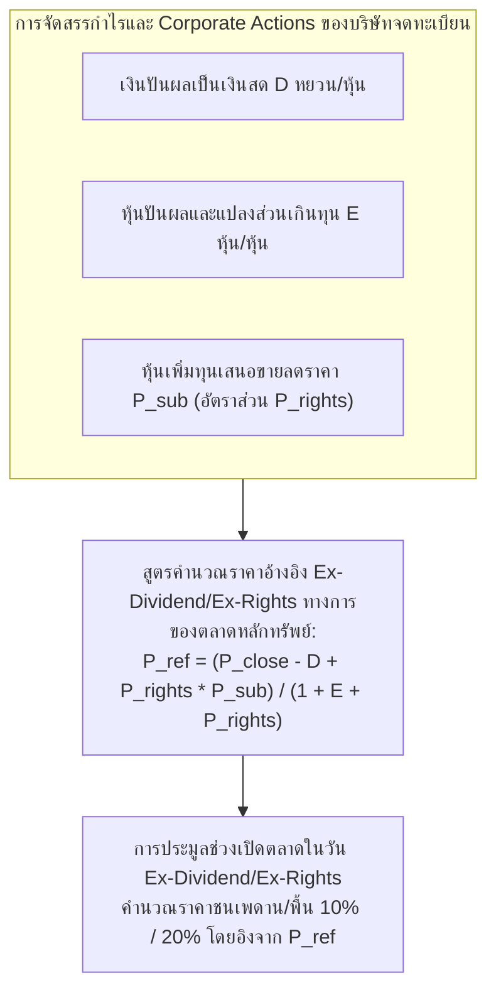
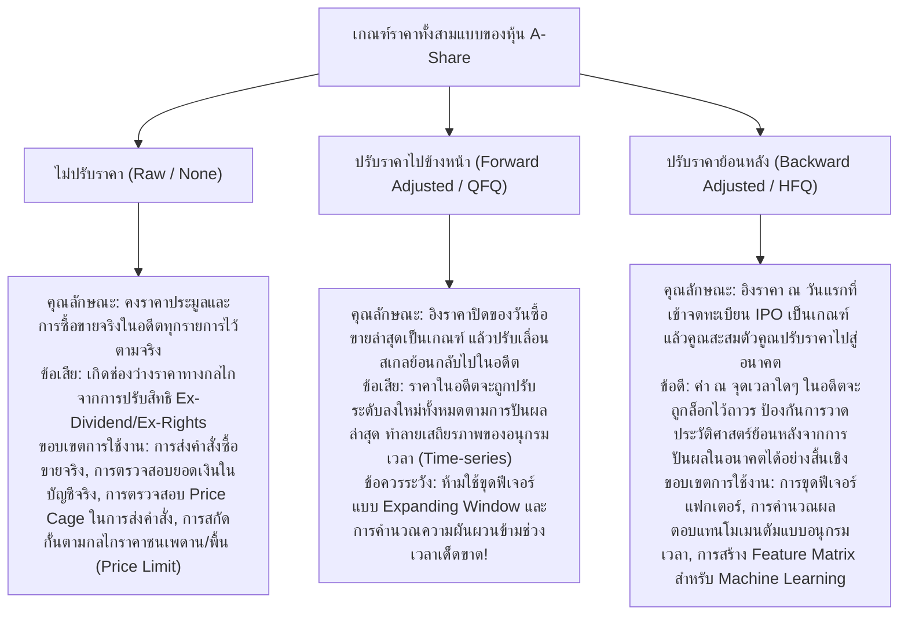

# บทที่ 4: ภาคปฏิบัติการเชื่อมต่อข้อมูลหลายแหล่งของหุ้น A-Share และการจัดเก็บลงฐานข้อมูลในเครื่อง

> **เป้าหมายหลักของบทนี้**:  
> เริ่มต้นจากสูตรคณิตศาสตร์ระดับล่างของตลาดหลักทรัพย์สำหรับการปรับสิทธิ Ex-Dividend/Ex-Rights และการดำเนินการของบริษัท (Corporate Actions) เพื่อทำความเข้าใจขอบเขตการใช้งานระหว่างราคาดั้งเดิม (Raw Price), ราคาปรับไปข้างหน้า (Forward Adjusted: QFQ) และราคาปรับย้อนหลัง (Backward Adjusted: HFQ) ในการขุดแฟกเตอร์ (Factor) และการจับคู่คำสั่ง (Matching) ในการเทรดจริง (Live Trading) อย่างถ่องแท้; เปรียบเทียบแหล่งข้อมูลโอเพนซอร์สของหุ้น A-Share ที่เสถียร (AKShare, BaoStock, PyTDX, TuShare) กับแหล่งข้อมูลเชิงพาณิชย์ระดับสถาบันอย่างครอบคลุม; สร้าง Parquet Data Lake ในเครื่องที่รองรับการเขียนแบบ Atomic (Atomic Write), การผสานข้อมูลส่วนเพิ่ม (Incremental Merge), พันธสัญญาข้อมูลที่เข้มงวด (Data Contract) และสแนปช็อตแบบระบุจุดเวลา (Point-in-Time: PIT)

---

## 1. หลักการทางคณิตศาสตร์หลัก: เจาะลึกกลไก Ex-Dividend/Ex-Rights และการปรับราคาของหุ้น A-Share

ในตลาดหุ้น A-Share บริษัทจดทะเบียนมักมีการ**จ่ายเงินปันผลเป็นเงินสด (Dividend)**, **การจ่ายปันผลเป็นหุ้น (Bonus Shares)**, **การแปลงส่วนเกินทุนเป็นทุนเรือนหุ้น (Capital Reserve Transfer)** และ**การเสนอขายหุ้นเพิ่มทุนแก่ผู้ถือหุ้นเดิม (Rights Offering)** Corporate Actions เหล่านี้จะส่งผลให้ราคาหุ้นเกิดการปรับตัวลดลงตามกลไกทางราคาโดยไม่ใช่ผลจากการซื้อขายจริง เมื่อเปิดตลาดในวันขึ้นเครื่องหมาย Ex-Dividend/Ex-Rights (Ex-Dividend Date)

หากระบบ Backtest ไม่ทำการปรับราคา (Adjustment) อย่างถูกต้อง ตัวชี้วัดเชิงปริมาณ (Quant) ของคุณจะตีความการปรับสิทธิปันผลผิดพลาดเป็น "ราคาหุ้นดิ่งเหว 50%" จนกระตุ้นสัญญาณบังคับขายล้างพอร์ตหรือสัญญาณเข้าซื้อที่ผิดพลาดอย่างรุนแรง!

### 1.1 สูตรคณิตศาสตร์ของราคาอ้างอิง Ex-Dividend/Ex-Rights ของตลาดหลักทรัพย์ (Ex-Dividend Reference Price)

สมมติให้ราคาปิดของหุ้นตัวหนึ่งในวันกำหนดรายชื่อผู้มีสิทธิ (Record Date: วันที่ $t-1$) คือ $P_{\text{close}}$:
- เงินปันผลเป็นเงินสดก่อนหักภาษีต่อหุ้นคือ $D$ (หยวน);
- จำนวนหุ้นปันผลต่อหุ้นคือ $E_{\text{bonus}}$ (หุ้น);
- จำนวนหุ้นที่แปลงจากส่วนเกินทุนต่อหุ้นคือ $E_{\text{transfer}}$ (หุ้น) รวมอัตราส่วนหุ้นปันผลและหุ้นแปลงจากส่วนเกินทุน $E = E_{\text{bonus}} + E_{\text{transfer}}$;
- สัดส่วนหุ้นเพิ่มทุนที่จัดสรรต่อหุ้นคือ $P_{\text{rights}}$ (หุ้น), ราคาเสนอขายหุ้นเพิ่มทุนคือ $P_{\text{sub}}$ (หยวน)

ระบบ Matching ทางการของตลาดหลักทรัพย์จะคำนวณราคาอ้างอิงมาตรฐาน $P_{\text{ref}}$ ในช่วงเช้าของวันขึ้นเครื่องหมาย Ex-Dividend/Ex-Rights วันแรก (วันที่ $t$) ตามสูตรดุลยภาพที่ปราศจากการทำกำไรโดยไร้ความเสี่ยง (No-Arbitrage Equilibrium) อย่างเคร่งครัดดังนี้:

$$P_{\text{ref}} = \frac{P_{\text{close}} - D + P_{\text{rights}} \times P_{\text{sub}}}{1 + E + P_{\text{rights}}}$$



---

### 1.2 ความแตกต่างเชิงแก่นแท้ของประเภทการปรับราคาทั้งสามแบบ และเกณฑ์การเลือกใช้ของฝั่ง Buy-side



#### กฎ "ระบบรางคู่" ของสถาบันฝั่ง Buy-side:
1. **การคำนวณอัตราผลตอบแทนและฟีเจอร์ราคา-ปริมาณ**: **จำเป็นต้องใช้ลำดับราคา HFQ** มีเพียงลำดับราคา HFQ เท่านั้นที่สามารถสะท้อนอัตราผลตอบแทนรวมจากการทบต้น (Total Return) ในการถือครองหุ้นระยะยาวของนักลงทุนได้อย่างแท้จริง
2. **การจับคู่คำสั่งซื้อขาย, การกระทบยอดเงินทุน และการตรวจสอบควบคุมความเสี่ยง**: **จำเป็นต้องใช้ราคาดั้งเดิม (Raw)** การ Matching คำสั่งของตลาดหลักทรัพย์, การตัดยอดเงินที่ใช้ได้ในบัญชี, การตรวจสอบกรอบราคา Price Cage และการตัดสินราคาปิดชนเพดาน/พื้น จะยอมรับเฉพาะราคาซื้อขายจริงที่เป็นราคาดั้งเดิม ณ เวลานั้นเท่านั้น

---

## 2. ภาพรวมระบบนิเวศแหล่งข้อมูลหุ้น A-Share (โอเพนซอร์ส vs เชิงพาณิชย์)

รากฐานของการวิจัยและพัฒนา Quant คือข้อมูลราคาซื้อขายและข้อมูลพื้นฐานที่มีคุณภาพสูง, สัญญาณรบกวนต่ำ และมีความสอดคล้องทางอนุกรมเวลา สถาบันฝั่ง Buy-side และนักวิจัยรายบุคคลสามารถเลือกใช้งานได้ตามกำลังการประมวลผลและงบประมาณของตนเอง:

| แพลตฟอร์มข้อมูล | โอเพนซอร์ส/เชิงพาณิชย์ | คุณลักษณะเด่นและมิติความครอบคลุม | สถานการณ์การใช้งานและตำแหน่งทางวิศวกรรม |
| :--- | :--- | :--- | :--- |
| **AKShare** | ฟรีโอเพนซอร์ส (GitHub) | คลังเครื่องมือ Web Scraping ทางการเงินแบบโอเพนซอร์สที่ครอบคลุมที่สุด ครอบคลุมทั้งหุ้น A-Share, ETF, สัญญาซื้อขายล่วงหน้าสินค้าโภคภัณฑ์, ตลาดต่างประเทศ, ข้อมูลมหภาค และข้อมูลทางเลือกด้าน Sentiment | เหมาะสำหรับการเรียนรู้ Quant รายบุคคล, การวิจัยเชิงวิชาการในมหาวิทยาลัย และการสำรวจต้นแบบฟีเจอร์ข้อมูลมหภาคทางเลือกและความถี่ระดับกลางถึงต่ำ |
| **BaoStock** | ฟรีโอเพนซอร์ส (Securities Network) | ไคลเอนต์ Python แท้ ไม่ต้องล็อกอิน ไม่ต้องสะสมคะแนน ให้บริการข้อมูลกราฟรายวัน กราฟ 5 นาที และงบการเงินย้อนหลังแบบระบุจุดเวลา (Point-in-Time: PIT) คุณภาพสูงมาก | เหมาะสำหรับสร้าง Data Lake ในเครื่องเพื่อการ Backtest ทั้งข้อมูลความถี่สูงและข้อมูลรายวันในอดีต อนุกรมเวลามีความเสถียรอย่างยิ่ง |
| **PyTDX** | ฟรีโอเพนซอร์ส (โปรโตคอล TongDaXin) | เชื่อมต่อผ่าน Socket แบบ Reverse Engineering ตรงไปยังเซิร์ฟเวอร์หลักข้อมูล L1 ของโบรกเกอร์หรือ TongDaXin รองรับการดึงข้อมูล Tick ทีละรายการและข้อมูลระหว่างวันได้อย่างรวดเร็ว | เหมาะสำหรับการมอนิเตอร์ราคาแบบเรียลไทม์ที่มีขนาดเบา, การรับข้อมูล Tick ระหว่างวัน และการจำลอง Order Book ในเครื่อง |
| **TuShare Pro** | ชุมชน/ระบบคะแนน | ชุมชน Quant ชั้นนำในประเทศ อินเทอร์เฟซเป็นระเบียบ ฟิลด์ข้อมูลครบถ้วน ให้บริการรายชื่อหุ้นมาตรฐาน ประวัติการเปลี่ยนแปลงหุ้นที่เป็นองค์ประกอบดัชนี และรายงานงบการเงินพื้นฐานที่สมบูรณ์ | เหมาะสำหรับกองทุนเอกชน (Private Fund) ขนาดกลางและขนาดย่อม และนักวิจัยรายบุคคลในการสร้างคลังข้อมูลพื้นฐานและคลังฟีเจอร์แบบมัลติแฟกเตอร์ความถี่ระดับกลาง |
| **RQData / JoinQuant** | สัญญาอนุญาตเชิงพาณิชย์ระดับสถาบัน | ผ่านการคลีนข้อมูลระดับ Buy-side มืออาชีพ มีงบการเงิน PIT ที่เข้มงวด ประวัติการติดสถานะ ST น้ำหนักหุ้นรายวันขององค์ประกอบดัชนี และอินดิเคเตอร์อนุพันธ์ | เหมาะสำหรับ Private Fund สาย Quant ขนาดกลางและขนาดย่อมเพื่อใช้เป็นโครงสร้างพื้นฐานในการวิจัยและการเทรดจริง คุณภาพข้อมูลสูงและต้นทุนการดูแลรักษาต่ำ |
| **Wind / Choice / iFinD** | เทอร์มินัลการเงินชั้นนำ | มาตรฐานโดยพฤตินัยของข้อมูลการเงินระดับสถาบัน ครอบคลุมข้อมูลมหภาค บทวิเคราะห์ สินทรัพย์นอกตลาด และ Corporate Actions อย่างครบวงจร | เทอร์มินัลสากลสำหรับการควบคุมความเสี่ยงของสถาบันฝั่ง Buy-side ชั้นนำ การวิเคราะห์เศรษฐกิจมหภาค และนักวิจัย |

---

## 3. กฎการสร้าง Universe แบบไดนามิกและกรวยการคัดกรอง

ในกลยุทธ์เชิงปริมาณใดๆ **ต้องไม่ใช้รายชื่อรหัสหุ้นทั้งตลาดแบบคงที่ตั้งแต่ต้นจนจบโดยเด็ดขาด** หากใช้รายชื่อหุ้น 5,000 ตัวของวันนี้มารันข้อมูลย้อนหลังในปี 2018 จะถือว่าเกิดความลำเอียงจากการรอดชีวิต (Survivorship Bias) และข้อผิดพลาดจากการรั่วไหลของข้อมูลหุ้นองค์ประกอบข้ามเวลาอย่างร้ายแรง

จำเป็นต้องดำเนินการคัดกรองผ่านกรวยกรองแบบไดนามิกอย่างเคร่งครัดในทุกภาคตัดขวาง (Cross-sectional) ของวันทำการซื้อขายในอดีต $t$:

```
กรวยกรองหุ้นที่สามารถลงทุนได้รายวัน (Daily Investable Universe Funnel)
หลักทรัพย์ทั้งหมดที่เคยมีอยู่ในประวัติศาสตร์ของตลาด (รวมถึงบริษัทที่จดทะเบียนปกติและที่เพิกถอนหลักทรัพย์ (Delisting) ไปแล้ว)
  │
  ├── [ตัวกรอง 1] คัดหุ้นเข้าใหม่ที่จดทะเบียนไม่ถึง N วันออก (โดยทั่วไปกรองหุ้นที่เข้าเทรด <= 60 หรือ 120 วันทำการ)
  │     └── กลไกเชิงกายภาพ: ช่วงแรกที่หุ้นเข้าใหม่เริ่มซื้อขายจะมีการเก็งกำไรที่ไม่สมเหตุสมผล อัตรา Turnover ผิดปกติอย่างรุนแรง และขาดข้อมูลทางการเงินในอดีตมารองรับ
  │
  ├── [ตัวกรอง 2] คัดหุ้น ST / *ST ที่ถูกขึ้นเครื่องหมายเตือนความเสี่ยงในวันนั้นออก
  │     └── กลไกเชิงกายภาพ: กฎเหล็กห้ามลงทุนของคลังควบคุมความเสี่ยงระดับสถาบัน เพื่อหลีกเลี่ยงเหตุการณ์ Black Swan จากราคาชนพื้นต่อเนื่องและการระเบิดของปัญหาทางการเงิน
  │
  ├── [ตัวกรอง 3] คัดหุ้นที่พักการซื้อขาย (Suspension) ทั้งวันหรือมีปริมาณการซื้อขายเป็นศูนย์ (Volume == 0) ออก
  │     └── กลไกเชิงกายภาพ: ในวันนั้นไม่มีสภาพคล่องอย่างสิ้นเชิง ไม่สามารถ Matching ได้ เพื่อป้องกันการลงบัญชีที่บิดเบือน
  │
  ├── [ตัวกรอง 4] คัดหุ้นที่ราคาปิดเมื่อวานเข้าสู่ช่วงเวลาจัดการก่อนเพิกถอนหลักทรัพย์ออก
  │     └── กลไกเชิงกายภาพ: หุ้นได้เข้าสู่กระบวนการที่ตลาดหลักทรัพย์บังคับยุติการจดทะเบียนเพื่อเพิกถอนหลักทรัพย์แล้ว สภาพคล่องมีแนวโน้มเหือดแห้ง
  │
  └── ผลลัพธ์สุดท้าย: 【Valid Universe】ที่มีความสามารถในการซื้อขายจริงและความทนทานทางสถิติในวันดังกล่าว
```

---
## 4. การออกแบบสถาปัตยกรรม Local Data Lake และข้อตกลง Atomic Write

เพื่อรับประกัน Throughput ระดับสูงและความน่าเชื่อถือสูงสุดสำหรับงานวิจัยและการลงทุนเชิงปริมาณ (Quant) แนะนำให้ใช้สถาปัตยกรรมจัดเก็บข้อมูล Local Data Lake ที่มี **Apache Arrow + Parquet** เป็นแกนหลัก:

```text
data_lake/
├── metadata/
│   ├── trade_calendar.parquet      # ปฏิทินการซื้อขาย: trade_date (ครอบคลุมวันทำการซื้อขายย้อนหลังทั้งหมด)
│   └── stock_basic.parquet         # ข้อมูลทะเบียนหุ้นจดทะเบียน: symbol, display_name, list_date, delist_date
├── daily_bars/
│   ├── year=2021.parquet           # Partition รายปี: OHLCV ดั้งเดิม, close_hfq, turnover (พร้อมคำต่อท้ายตลาดหลักทรัพย์)
│   ├── year=2022.parquet
│   ├── year=2023.parquet
│   └── year=2024.parquet
└── index_constituents/
    └── 000852/                     # ไดเรกทอรีรหัสดัชนี (เช่น CSI 1000)
        ├── 20230615T160000-xxxx.parquet  # Snapshot ย้อนหลังแบบแก้ไขไม่ได้ที่บันทึกไว้จากการสังเกตแต่ละครั้ง
        └── 20231218T160000-xxxx.parquet
```

### 4.1 สี่หลักการวิศวกรรมทองคำเพื่อรับประกันคุณภาพข้อมูล:
1. **การเขียนแบบอะตอมิก (Atomic File Replacement)**: เมื่อบันทึกลงฐานข้อมูล ให้เขียนลงไฟล์ชั่วคราวแบบสุ่ม (`.tmp`) ก่อนเสมอ หลังตรวจสอบความถูกต้องเรียบร้อยแล้วจึงใช้คำสั่ง `replace` ระดับระบบปฏิบัติการเพื่อแทนที่ไฟล์เป้าหมาย ขจัดปัญหาไฟล์ Parquet เสียหายจากการที่โปรแกรมหยุดทำงานกะทันหันอย่างเด็ดขาด
2. **หลักการสแนปช็อตแบบเพิ่มอย่างเดียวไม่แก้ไข (Append-Only Snapshots)**: การเปลี่ยนแปลงในอดีตของหุ้นองค์ประกอบดัชนีมีความซับซ้อนสูงมาก ทุกครั้งที่ดึงข้อมูลให้บันทึกเป็นไฟล์ Snapshot แยกต่างหากพร้อมระบุเวลาที่ดึงข้อมูล `available_at` ไว้อย่างแม่นยำ และห้ามเขียนทับ Snapshot ในอดีตโดยเด็ดขาด!
3. **การตรวจสอบความเป็นเอกลักษณ์ของคีย์หลัก (Unique Primary Key)**: ตารางข้อมูลราคาทั้งหมดต้องบังคับตรวจสอบความเป็นเอกลักษณ์ของ `(symbol, trade_date)` หากพบแถวข้อมูลซ้ำซ้อนให้โยน exception ออกมาเพื่อขัดขวางการทำงานทันที
4. **การตรวจสอบความสอดคล้องทางกายภาพของ OHLC**: ตรวจสอบเงื่อนไขอย่างเข้มงวดว่า $\text{High} \ge \max(\text{Open}, \text{Close}, \text{Low})$ และ $\text{Low} \le \min(\text{Open}, \text{Close}, \text{High})$ เพื่อสกัดกั้นข้อมูลที่ไม่ถูกต้องและปนเปื้อนทั้งหมด

---

## 5. ลงมือปฏิบัติ: การสร้าง Data Pipeline จัดเก็บข้อมูลหุ้น A-Share ระดับ Production

โค้ด Python ด้านล่างนี้ปฏิบัติตามมาตรฐานสถาบันฝั่ง Buy-side อย่างเคร่งครัด โดยครอบคลุมทั้ง**การลองส่งคำขอเครือข่ายใหม่แบบ Exponential Backoff**, **การแยกดึงข้อมูลราคาดั้งเดิมและราคาปรับสิทธิย้อนหลัง (HFQ)**, **การอัปเดตรวมข้อมูลส่วนเพิ่ม**, **Atomic Write** รวมถึง**การตรวจสอบความสมบูรณ์ของข้อมูลทั้งหมดในตัว**

ในไดเรกทอรีรูทของโปรเจกต์ ให้รัน `python3 -m tutorial.examples.lecture_04_industrial_data_pipeline` หรือรันสคริปต์ได้โดยตรง

<<< @/examples/lecture_04_industrial_data_pipeline.py

### สรุปประเด็นสำคัญของการพัฒนาระบบ:
1. **การลองใหม่เมื่อเกิดปัญหาทางเครือข่าย (`fetch_with_retry`)**:
   - เมื่อต้องเผชิญกับความผันผวนของเครือข่าย, Rate Limit หรือ Timeout ที่เกิดขึ้นเป็นครั้งคราวจาก Public API ภายนอก จึงเลือกใช้กลยุทธ์ Exponential Backoff Retry เพื่อรับประกันความสามารถในการกู้คืนตัวเองของ Batch Job แบบออฟไลน์
2. **มาตรฐานการตั้งชื่อรหัสหลักทรัพย์ให้เป็นหนึ่งเดียว**:
   - กำหนดให้รหัสหุ้นต้องมีตัวย่อตลาดหลักทรัพย์ตัวพิมพ์ใหญ่ต่อท้ายเสมอ (เช่น `600519.SH`, `000001.SZ`, `688981.SH`) เพื่อป้องกันปัญหาความสับสนจากรหัสหุ้นที่ซ้ำกันระหว่างตลาดเซี่ยงไฮ้และเซินเจิ้น
3. **การแปลงหน่วยอย่างเคร่งครัด**:
   - ข้อมูล Volume ดั้งเดิมของหุ้น A-Share มักใช้หน่วยเป็น "ล็อต (100 หุ้น)" ตัว Pipeline จะแปลงให้เป็นหน่วย "หุ้น (Shares)" ทั้งหมดเมื่อบันทึกลงฐานข้อมูล เพื่อรักษาความเป็นเอกภาพของมิติทางกายภาพร่วมกับมูลค่าซื้อขาย (หยวน) และข้อมูล Tick ความถี่สูงในอนาคตอย่างเคร่งครัด

---

## 6. สรุปบทเรียนและสรุปภาพรวมโมดูล

### สรุปแผนผังองค์ความรู้หลัก:
1. **แก่นแท้ของ Corporate Actions (XD/XR)**: เข้าใจสูตรการคำนวณราคาอ้างอิงของตลาดหลักทรัพย์อย่างถ่องแท้ พร้อมทั้งเข้าใจผลกระทบเชิงกลไกของการจ่ายเงินปันผลและการแจกหุ้นปันผล/หุ้นเพิ่มทุนที่มีต่อ Price Series
2. **การแบ่งหน้าที่ของการวัดราคา**: การคำนวณผลตอบแทนและการทำเหมืองแฟกเตอร์ (Factor) ให้ใช้**ราคาปรับสิทธิย้อนหลัง (HFQ)** ส่วนการจับคู่คำสั่ง (Matching), การชำระราคาและส่งมอบเงินทุน รวมถึงการควบคุมความเสี่ยงให้ใช้**ราคาดั้งเดิมก่อนปรับสิทธิ (Raw)**
3. **Universe หุ้นแบบไดนามิก**: ใช้ Funnel อนุกรมเวลา (Time-series) ที่เข้มงวด (หุ้น IPO ใหม่, หุ้น ST, พักการซื้อขาย (Suspension), เพิกถอนหลักทรัพย์ (Delisting)) เพื่อสร้าง Trading Mask รายวันแบบไดนามิก บอกลา Universe หุ้นแบบ Static อย่างสิ้นเชิง
4. **โครงสร้างพื้นฐาน Data Engineering**: สร้าง Local Data Lake ประสิทธิภาพสูงด้วย Apache Arrow + Parquet โดยปฏิบัติตามมาตรฐาน Atomic Write และการเก็บรักษาประวัติเวอร์ชันของ Snapshot

ถึงตรงนี้ **โมดูลที่ 1: การปรับกรอบความคิดและชุดเครื่องมือวิศวกรรม Quant ยุคใหม่** ได้ครอบคลุมเนื้อหาสำคัญทั้งสี่บทเรียบร้อยแล้ว!
- เราเริ่มต้นจากแกนรากฐานของ Quant ด้วยการจำแนกผลตอบแทน 4 ชั้นและแรงเสียดทานเชิงสถาบัน (บทที่ 1);
- วิเคราะห์ 4 สาเหตุหลักที่ทำให้ผล Backtest ล้มเหลว พร้อมพิสูจน์การทดสอบ Overfitting ด้วย DSR (บทที่ 2);
- สร้าง Engineering Stack สำหรับ Columnar Computing ประสิทธิภาพสูงด้วย `uv` + `Polars` + `DuckDB` (บทที่ 3);
- วางรากฐานที่เชื่อถือได้สำหรับการจัดการ Corporate Actions ของหุ้น A-Share, การปรับราคา และโครงสร้างพื้นฐาน Local Parquet Data Lake (บทที่ 4)

ตั้งแต่โมดูลถัดไป เราจะเข้าสู่: **โมดูลที่ 2: โครงสร้างจุลภาคของตลาดหุ้น A-Share และ Feature Engineering** เพื่อเจาะลึกฟีเจอร์ความไม่สมดุลของปริมาณและราคาในระดับจุลภาค พร้อมด้วยข้อมูลปัจจัยพื้นฐานแบบ Point-in-Time!
