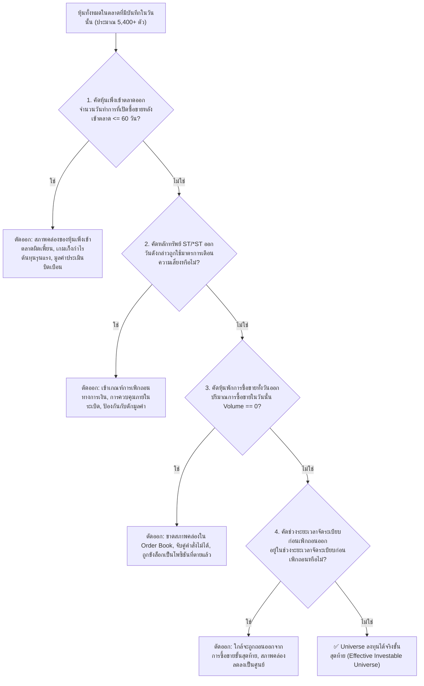

# บทที่ 5: การปรับสิทธิ์ข้อมูลราคาตลาดและการสร้าง Universe หุ้นแบบไดนามิก

> **เป้าหมายหลักของบทนี้**:  
> ทำลายแนวปฏิบัติแบบมือสมัครเล่นที่ "ใช้ Universe หุ้นแบบคงที่ (Static Universe) ในการ Backtest ข้อมูลย้อนหลัง" ให้หมดสิ้น เจาะลึกความผิดเพี้ยนของสภาพคล่องในหุ้นเพิ่งเข้าตลาด (Sub-new Stocks), กฎเกณฑ์ใหม่ว่าด้วยการเพิกถอนหลักทรัพย์ (Delisting) ของหุ้น A-Share และกลไก ST/*ST ที่สร้างมลภาวะทำลายล้างแฟกเตอร์ (Factor) เชิงมูลค่า รวมถึงตรรกะการชำระราคาจริงในสภาวะเทรดจริง (Live Trading) จากหลุมดำสภาพคล่องของการพักการซื้อขาย (Suspension); อนุพัทธ์คุณสมบัติทางคณิตศาสตร์ของ Trading Mask แบบไดนามิก; เขียนโค้ดสร้าง Engine สำหรับ Universe หุ้นแบบไดนามิกระดับ Production ด้วย Polars ขึ้นมาเอง พร้อมสร้างและตรวจสอบ Trading Mask ระดับรายวัน

---

## 1. "บาป 7 ประการ" ของ Universe หุ้นแบบคงที่: ทำไมผลตอบแทนส่วนเกิน (Excess Return) จาก Backtest ของคุณถึงเป็นภาพลวงตา?

ผู้เริ่มต้นสาย Quant (เชิงปริมาณ) จำนวนมากมักทำผิดพลาดอย่างแนบเนียนขณะสร้างกลยุทธ์ นั่นคือ: **ดึง "รายชื่อหุ้นที่เป็นองค์ประกอบของดัชนี CSI 1000 ล่าสุดในปัจจุบัน" หรือ "รายชื่อรหัสหุ้น 5,000+ ตัวที่ซื้อขายได้ตามปกติในตลาดปัจจุบัน" ออกมาจากฐานข้อมูลโดยตรง แล้วนำเอารายชื่อรหัสหุ้นที่คงที่นี้ไป Backtest กลยุทธ์ย้อนหลังตั้งแต่ปี 2018 ถึง 2024**

แนวทาง "Universe หุ้นแบบคงที่" เช่นนี้ ในสถาบันฝั่ง Buy-side จะถูกตัดสินทันทีว่าเป็น**อุบัติเหตุด้านความปลอดภัยของ Backtest ที่ร้ายแรง**:

```
โมเดลความเอนเอียงแฝงที่เกิดจาก Universe หุ้นแบบคงที่
ตลาดจริงในปี 2018 (ประกอบด้วยหุ้น 3,600 ตัว)
├── บริษัทที่ต่อมาเติบโตเป็นผู้นำอุตสาหกรรม (ปี 2018 อาจเป็นหุ้น Micro-cap ที่พุ่งทะยาน) ─── [ถูกเก็บไว้ใน Static Pool]
├── บริษัทที่ดำเนินธุรกิจอย่างมั่นคงตามปกติ ────────────────────────── [ถูกเก็บไว้ใน Static Pool]
└── บริษัทขยะที่ต่อมาเกิดการตกแต่งบัญชีครั้งใหญ่ ชนพื้นแบบ One-word ต่อเนื่อง และถูก Delist ── [ระเหยหายไปจาก Static Pool โดยสิ้นเชิง!]
      ├── ตัวแทนเด่น: Kangmei Pharmaceutical, Kangde Xin, LeTV, Kaile Technology, Delisted Botian...
      └── ประวัติศาสตร์จริง: ในช่วงปี 2018-2023 หุ้นเหล่านี้เคยทำให้นักลงทุนนับไม่ถ้วนขาดทุนมากกว่า 95%
```

### 1.1 อันตรายหลักของ Universe หุ้นแบบคงที่

1. **คัดกรองหุ้นถูกเพิกถอนและหุ้นระเบิดทิ้งไปโดยธรรมชาติ (ความเอนเอียงของผู้รอดชีวิต / Survivorship Bias)**: หุ้นที่ยังคงมีการซื้อขายอยู่ในวันนี้ ล้วนมี "ยีนของผู้รอดชีวิต" ติดตัวมาโดยกำเนิด กลยุทธ์จึงไม่ได้รับผลกระทบรุนแรงจากการดิ่งลงอย่างหนักและการถูก Delist ของหุ้นเหล่านั้นเลย
2. **ล่วงรู้การปรับหุ้นองค์ประกอบของดัชนีล่วงหน้า (Index Selection Leakage)**: ดัชนีวงกว้าง เช่น CSI 500, CSI 1000 มีการปรับหุ้นองค์ประกอบทุกครึ่งปี (ช่วงกลางเดือนมิถุนายนและธันวาคมของทุกปี) บริษัทที่ได้รับการคัดเลือกเข้าสู่ดัชนีใหม่ มักจะมีมูลค่าหลักทรัพย์ตามราคาตลาดขยายตัวอย่างรวดเร็วและราคาหุ้นพุ่งสูงขึ้นในช่วงครึ่งปีถึงหนึ่งปีก่อนเข้าดัชนี การใช้ Static Pool จึงเท่ากับทำให้คุณแอบเข้าซื้อหุ้นซูเปอร์สต็อกในอนาคตตั้งแต่ปี 2018 ทั้งที่หุ้นตัวนั้นเพิ่งจะถูกคัดเข้าดัชนีในปี 2023!
3. **หลักฐานเชิงประจักษ์ชิ้นสำคัญจากแวดวงวิชาการ: พรีเมียมของขนาดหลังจากควบคุมหุ้นขยะ**:  
   Clifford Asness ผู้ก่อตั้งสถาบัน Quant ชื่อดัง AQR และคณะ ได้พิสูจน์อย่างรัดกุมในเอกสารวิชาการระดับคลาสสิก *Size matters, if you control your junk (Journal of Financial Economics, 2018)* ว่า: ในกลุ่มบริษัทมูลค่าตลาดขนาดเล็กนั้นเต็มไปด้วย "สินทรัพย์ขยะ (Junk)" ที่สถานะทางการเงินย่ำแย่และสุ่มเสี่ยงต่อการผิดนัดชำระหนี้ หากไม่สร้าง Universe หุ้นที่ลงทุนได้แบบไดนามิกเพื่อคัดกรองสินทรัพย์ขยะเหล่านี้ออกไป สิ่งที่เรียกว่า "Alpha ของหุ้นขนาดเล็ก" ก็จะมลายหายไปจนหมดสิ้นหลังผ่านการชำระราคา Delist ในส่วนหาง!

---

## 2. แบบจำลองทางคณิตศาสตร์และกรวยกรองสำหรับ Universe หุ้นที่ลงทุนได้แบบไดนามิกของหุ้น A-Share

ในงานวิจัยและพัฒนากลยุทธ์ของฝั่ง Buy-side ที่เคร่งครัด เซตทั้งหมดของหลักทรัพย์ที่ลงทุนได้ ณ เวลา $t$ ($Universe_t$) จะต้องเป็น**เซตบูลีนที่สร้างขึ้นจากการคำนวณแบบไดนามิก**ตามสถานะที่รับรู้ได้ในอดีต ณ วันที่ $t$:

$$Universe_t = \left\{ s \in S_t \;\middle|\; \begin{aligned}
\text{ListedTradingDays}(s, t) > 60 \\
\land\; \neg \text{IsST}_t(s) \\
\land\; \text{DailyVolume}_t(s) > 0 \\
\land\; \neg \text{IsDelistingPeriod}_t(s)
\end{aligned} \right\}$$



---

## 3. เจาะลึก 4 ด่านคัดกรองหลักแบบไดนามิก

### 3.1 ด่านที่ 1: การคัดกรองหุ้นเพิ่งเข้าตลาดที่จดทะเบียนไม่ถึง 60 วันทำการ
- **กลไกจุลภาค**: ในช่วงแรกของการเข้าจดทะเบียนของหุ้นใหม่ (IPO) ด้วยอิทธิพลของกลไกการจองซื้อหุ้นของรายย่อยและระยะเวลาห้ามขายหุ้นของนักลงทุนสถาบัน ส่งผลให้อัตรา Turnover มีความผิดปกติอย่างยิ่ง (Turnover รายวันมักสูงถึง 30%~60%) และสภาพคล่องใน Order Book ถูกขับเคลื่อนด้วยอารมณ์เก็งกำไรเป็นหลัก
- **ความบิดเบือนของงบการเงิน**: หุ้นเพิ่งเข้าตลาดมักขาดข้อมูลงบการเงินแบบ Point-in-Time (PIT) ต่อเนื่องที่สามารถตรวจสอบได้ย้อนหลังอย่างน้อย 2~3 ปี ทำให้ค่า P/E และ P/B เบี่ยงเบนไปจากค่าเฉลี่ยปัจจัยพื้นฐานอย่างรุนแรง
- **มาตรฐานของฝั่ง Buy-side**: Quant ฝั่ง Buy-side มักจะ**ตัดหุ้นเพิ่งเข้าตลาดที่มีจำนวนวันทำการซื้อขายไม่ถึง 60 วันทำการ (ประมาณ 3 เดือนตามปฏิทิน) ออกอย่างเคร่งครัด** และบางสถาบันที่เน้นความมั่นคงของ Excess Return อาจคุมเข้มขึ้นเป็น 120 วันทำการ (ครึ่งปี)

### 3.2 ด่านที่ 2: กลไกเตือนความเสี่ยง ST และ *ST กับ "กับดักมูลค่า"
ระบบ ST (Special Treatment) ซึ่งเป็นเอกลักษณ์เฉพาะของหุ้น A-Share คือหลุมพรางที่โมเดล Quant มักจะสะดุดล้มได้ง่ายที่สุด:

```
4 ประเภทหลักของกฎเกณฑ์ใหม่ว่าด้วยการเพิกถอนหลักทรัพย์และระบบเตือนความเสี่ยงของหุ้น A-Share
├── 1. การเตือนการเพิกถอนด้านการเงิน (*ST):
│     ├── กำไรสุทธิติดลบ และรายได้จากการดำเนินงานต่ำกว่า 300 ล้านหยวน (เกณฑ์ตามกฎใหม่)
│     └── ส่วนของผู้ถือหุ้นติดลบ ณ สิ้นงวด หรือได้รับรายงานการตรวจสอบบัญชีแบบไม่แสดงความเห็น/ไม่เห็นชอบ
├── 2. การเตือนการเพิกถอนด้านการกำกับดูแล (ST/*ST):
│     └── ผู้ถือหุ้นรายใหญ่ยักยอกเงินทุนมูลค่ามหาศาล, การควบคุมภายในล้มเหลว, การตกแต่งบัญชีขั้นรุนแรง
├── 3. การเตือนการเพิกถอนด้านการซื้อขาย:
│     └── ราคาปิดต่ำกว่ามูลค่าที่ตราไว้ 1 หยวน ติดต่อกัน 20 วันทำการ (เพิกถอนตามเกณฑ์ราคาต่ำกว่า 1 หยวน)
└── 4. การเพิกถอนเนื่องจากกระทำความผิดกฎหมายร้ายแรง:
      └── เข้าข่ายการเสนอขายหลักทรัพย์โดยฉ้อฉล, การเปิดเผยข้อมูลเท็จอย่างร้ายแรง หรือการละเมิดกฎหมายหลักทรัพย์
```

::: warning หลุมพรางมรณะ: มลภาวะทำลายล้างของหุ้น ST ต่อแฟกเตอร์การกลับตัวเชิงมูลค่า
บ่อยครั้งที่หลังจากการชนพื้น (Limit-down) แบบ One-word ต่อเนื่อง **ตัวชี้วัดการประเมินมูลค่าแบบสถิต (เช่น P/B, P/E) ของหุ้น ST จะดู "ถูกมากเป็นพิเศษ"** และตัวชี้วัดทางเทคนิคระยะสั้น (เช่น RSI) จะแสดงภาวะ "Oversold อย่างหนัก"  
หากคุณไม่ตัดหุ้น ST ออกแบบไดนามิก โมเดล Machine Learning หรือโมเดลจัดอันดับแฟกเตอร์ก็จะมองหุ้นเหล่านี้เป็น "เป้าหมายการกลับตัวที่มี Upside สูงและ Valuation ต่ำชั้นยอด" แล้วเข้าซื้ออย่างบ้าคลั่ง ซึ่งสุดท้ายแล้วผลลัพธ์ที่ได้คือความเสียหายย่อยยับจากการชนพื้นแบบ One-word ติดต่อกัน 15~30 วันทำการจนกระทั่งถูก Delist!
:::

### 3.3 ด่านที่ 3: ตรรกะการชำระราคาของหุ้นที่พักการซื้อขายทั้งวัน (Suspension)
ในการ Backtest ระดับรายวันหรือความถี่สูง หลายคนมักจัดการกับหุ้นที่พักการซื้อขายด้วยการทำ Forward-fill โดยตรง: `df['close'].ffill()`
- **ภาพลวงตาจาก Backtest**: โมเดลเข้าใจว่ายังคงถือครองหุ้นตัวนั้นอยู่ในวันดังกล่าว ราคาไม่มีความผันผวน และมูลค่าสินทรัพย์สุทธินิ่งสงบ
- **ความเป็นจริงอันโหดร้ายในการเทรดจริง**:
  1. หากโมเดลต้องการ**ขาย**หุ้นตัวดังกล่าวในเวลานั้นเพื่อปรับพอร์ต (Rebalance) เนื่องจากหุ้นพักการซื้อขายตลอดทั้งวันและไม่มีการจับคู่คำสั่ง (Matching) **คำสั่งขายจะกลายเป็นโมฆะทันที และสถานะถือครองจะถูกบังคับล็อกตายจนกลายเป็นโพซิชันที่ตายแล้ว**
  2. หากพอร์ตต้องเผชิญกับการไถ่ถอนเงินลงทุนก้อนใหญ่จากลูกค้า สถานะการถือครองจะไม่สามารถแปลงเป็นเงินสดได้ ซึ่งจะก่อให้เกิดการผิดนัดชำระหนี้ด้านสภาพคล่องโดยตรง
  3. ในประวัติศาสตร์ของหุ้น A-Share มีกรณีศึกษาการพักการซื้อขายเพื่อปรับโครงสร้างครั้งใหญ่หลายต่อหลายครั้ง (เช่น Vanke A พักการซื้อขายนานครึ่งปี, LeTV พักการซื้อขายนานหลายเดือน) ซึ่งหลังจากปลดเครื่องหมายกลับมาซื้อขาย มักจะเผชิญกับการชนพื้นไร้สภาพคล่องติดต่อกันเพื่อชดเชยการปรับตัวลงทันที

---
## 4. การออกแบบสถาปัตยกรรม Trading Mask Matrix

ในสถาปัตยกรรมงานวิจัยและพัฒนาระบบ Quant ประสิทธิภาพสูง Dynamic Stock Universe มักไม่ได้ถูกจัดเก็บในรูปของสตริงข้อความขนาดใหญ่ แต่จะถูกแอบสแตรกต์ให้เป็น**เมทริกซ์บูลีน 2 มิติแบบเบาบาง/กะทัดรัด (Trading Mask)**:

$$\mathbf{M} \in \{0, 1\}^{T \times N}$$

โดยแถวแสดงถึงวันทำการซื้อขาย $t \in [1, T]$ และคอลัมน์แสดงถึงหุ้นทั้งหมดที่เคยปรากฏในประวัติศาสตร์ของตลาด $s \in [1, N]$:
- $M_{t, s} = 1$: แสดงว่าในวันทำการซื้อขายที่ $t$ หุ้น $s$ ผ่านเกณฑ์การกรองทั้งหมด และได้รับอนุญาตให้โมเดลนำไปคำนวณคะแนนภาคตัดขวาง (Cross-sectional), จัดอันดับตามควอนไทล์ และทำ Quadratic Programming สำหรับการหาพอร์ตที่เหมาะสม (Portfolio Optimization)
- $M_{t, s} = 0$: แสดงว่าสินทรัพย์ดังกล่าวไม่สามารถซื้อขายได้ (พักการซื้อขาย (Suspension), ST, หุ้นเพิ่งเข้าเทรด หรือถูกเพิกถอนหลักทรัพย์ (Delisting)) ซึ่งจะถูกมาสก์เป็นศูนย์หรือ NaN โดยตรงก่อนทำ Standardization ภาคตัดขวางและ Convex Optimization

### การปรับหุ้นองค์ประกอบดัชนีและกฎเขตกันชน 10% (Buffer Zone Rule):
บริษัท China Securities Index ในการปรับหุ้นองค์ประกอบของดัชนี CSI 300 / 500 / 1000 ได้บังคับใช้**กฎเขตกันชน (Buffer Zone Rule)** แบบคลาสสิกเพื่อลดผลกระทบจาก Turnover:
- หุ้นองค์ประกอบเดิมหากอันดับยังอยู่ในเกณฑ์คัดออก (เช่น 60% แรก) จะได้รับสิทธิ์คงอยู่ต่อเป็นอันดับแรก
- หุ้นตัวเลือกใหม่จะต้องมีอันดับที่สูงมาก (เช่น 40% แรก) จึงจะถูกบังคับนำเข้าดัชนี
- **ข้อคิดสำหรับ Quant**: ในการสร้าง Dynamic Universe ของกลยุทธ์ตนเอง ก็ควรนำกลไก Buffer Zone มาปรับใช้เช่นกัน เพื่อป้องกันไม่ให้หุ้นรายตัวกระโดดเข้าออกบริเวณขอบเขตการซื้อขายบ่อยครั้งจนเกิดแรงเสียดทานจากการ Turnover โดยไม่จำเป็น

### 4.2 เกณฑ์การคัดเข้า 6 มิติของกลุ่มตัวอย่างประมาณการ Barra US-E3 / CNE5 และ "กฎปู่ย่า (Grandfathering)" 18 เดือน
ตาม **คู่มือแบบจำลองความเสี่ยง (Risk Model) BARRA US-E3 บทที่ 7** และ **ข้อกำหนดบ่อตัวอย่างประมาณการ CNE5 (ESTU)** ฝั่ง Buy-side จะใช้เกณฑ์คัดกรองที่เข้มงวด 6 ประการต่อไปนี้เมื่อสร้าง Estimation Universe สำหรับโมเดลหลายแฟกเตอร์ (Factor) เพื่อขจัดสัญญาณรบกวนทางสถิติเทียมบริเวณขอบเขตกลุ่มตัวอย่าง:
1. **การคัดเข้าอย่างเข้มงวดสำหรับหุ้นองค์ประกอบดัชนีหลัก**: หุ้นองค์ประกอบของ CSI 300 / CSI 800 จะถูกบังคับเข้าสู่ Universe ทั้งหมด โดยไม่อยู่ภายใต้ข้อจำกัดด้าน Market Cap และราคาปกติ
2. **ความต่อเนื่องของข้อมูลงบการเงินแบบ PIT**: ต้องมีข้อมูลงบการเงินที่ครบถ้วนล่าสุดและย้อนหลังไม่เกิน 21 เดือน ห้ามเลือกกลุ่มตัวอย่างที่ต้องพึ่งพาการประมาณค่าจากกฎ Default Rule เป็นจำนวนมากอย่างเด็ดขาด
3. **รากฐานขนาด Market Cap (Top 1,500)**: รวมสินทรัพย์ที่มี Market Cap รวมสูงสุด 1,500 อันดับแรกของทั้งตลาดเข้าโดยอัตโนมัติ เพื่อเป็นฐานหลักในการประมาณการโมเดล
4. **เกณฑ์ราคาหุ้นขั้นต่ำ (Minimum Price Rule)**: หุ้นที่ไม่ได้อยู่ในดัชนีหลักต้องมีราคาหุ้นสูงกว่าเกณฑ์ที่กำหนด (เช่น หุ้นสหรัฐฯ \$5.00, หุ้น A-Share 2.00 หยวน) เพื่อหลีกเลี่ยงสัญญาณรบกวนจุลภาคแบบไม่เชิงเส้นที่ไม่ต่อเนื่อง ซึ่งเกิดจากขนาดช่วงราคาซื้อขายขั้นต่ำ (Tick Size) ของ "หุ้นเพนนี"
5. **กฎการเติมเต็มความลึกของอุตสาหกรรม (Industry Fill-in)**: ตรวจสอบจำนวนหุ้นในแต่ละหมวดย่อยของการจัดกลุ่มอุตสาหกรรม เพื่อให้มั่นใจว่า**แต่ละอุตสาหกรรมมีหุ้นองค์ประกอบที่เป็นตัวแทนอย่างน้อย 20 ตัว** สำหรับอุตสาหกรรมที่เปราะบางและมีไม่ถึง 20 ตัว ให้เติมเต็มจากหุ้นที่เหลือที่ยังไม่ได้เข้า Universe โดยเรียงลำดับ Market Cap จากมากไปน้อย แต่ต้องคัดหุ้น 10% ล่างสุดของ Market Cap ทั้งตลาดออกอย่างเข้มงวด
6. **กฎผ่อนปรนปู่ย่า 18 เดือน (Grandfathering Rule)**:
   - **กลไกของปัญหา**: หุ้นที่วนเวียนอยู่บริเวณขอบเกณฑ์ Market Cap อันดับที่ 1,500 มักจะ "เข้าๆ ออกๆ" ในแต่ละเดือนเนื่องจากความผันผวนของราคาในชีวิตประจำวัน หากตัดออกอย่างตรงไปตรงมา Exposure บนแฟกเตอร์นอกกลุ่มประมาณการ (NONESTU) และการคาดการณ์ Specific Risk ของหุ้นตัวนั้นจะเกิดการกระโดดอย่างรุนแรง
   - **โซลูชันระดับอุตสาหกรรม**: Barra กำหนดไว้ว่า ตราบใดที่หุ้นเคยเข้าสู่ Universe อย่างถูกต้องตามเกณฑ์ เมื่อ Market Cap ลดลงจนหลุดเกณฑ์ **จะได้รับระยะเวลาผ่อนผันเพื่อสังเกตการณ์ยาวนานถึง 18 เดือน (18-month Grace Period)**! ตราบใดที่ในช่วงเวลานี้ยังไม่ร่วงลงไปอยู่ใน 10% ล่างสุดของตลาด และราคาไม่ต่ำกว่าเกณฑ์ราคาหุ้นขั้นต่ำ หุ้นนั้นจะยังคงถูกเก็บไว้ใน Estimation Universe จนกว่าจะครบกำหนด 18 เดือนแล้วยังไม่ฟื้นตัว จึงจะถูกคัดออกอย่างเป็นทางการ กฎคลาสสิกนี้ได้กลายมาเป็นมาตรฐานอุตสาหกรรมในการลดทอน Boundary Effect

---

## 5. ภาคปฏิบัติ: การสร้างเอนจิน Dynamic Stock Universe ประสิทธิภาพสูง

การนำไปใช้งานอ้างอิงด้านล่างนี้จะจัดโครงสร้างการสืบค้นตามวันที่ และใช้ Polars ในการเชื่อมโยงและกรองข้อมูลของวันนั้นๆ ประเด็นสำคัญคือมิติด้านเวลาและการจัดการข้อมูลที่ขาดหาย เพื่อรับประกันว่าจะไม่มี Look-ahead Bias โดยเด็ดขาด

รันคำสั่ง `PYTHONPATH=tutorial python3 -m examples.lecture_05_dynamic_universe_builder` ที่ Root Directory ของโปรเจกต์ ดูการติดตั้ง Dependency, โมดูลที่ใช้ร่วมกัน และข้อตกลงข้อมูลได้ที่ [คำอธิบายโปรเจกต์](../README.md)

<<< @/examples/lecture_05_dynamic_universe_builder.py

### การอธิบายประเด็นสำคัญของการนำไปใช้งาน:
```
shape: (3, 3)
┌─────────┬────────────────────────┬─────────────┐
│ symbol  ┆ trading_days_since_ipo ┆ in_universe │
│ ---     ┆ ---                    ┆ ---         │
│ str     ┆ i64                    ┆ bool        │
╞═════════╪════════════════════════╪═════════════╡
│ HALT.SZ ┆ 75                     ┆ false       │
│ NEW.SZ  ┆ 5                      ┆ false       │
│ OLD.SH  ┆ 75                     ┆ true        │
└─────────┴────────────────────────┴─────────────┘
```
1. **การใช้ Binary Search คำนวณจำนวนวันเปิดทำการนับแต่เข้าจดทะเบียนอย่างแม่นยำ**:
   - หลายระบบใช้วันตามปฏิทินในการคำนวณอายุการจดทะเบียน (`trade_date - list_date`) ซึ่งจะทำให้เกิดความคลาดเคลื่อนจากช่วงวันหยุดยาว เอนจินนี้ใช้ `bisect_right - bisect_left` เทียบกับปฏิทินวันเปิดทำการจริงของตลาดหลักทรัพย์อย่างเคร่งครัดเพื่อคำนวณจำนวนวันซื้อขาย
2. **การตรวจยืนยันสถานะทั้งสามแบบอย่างแม่นยำ**:
   - `OLD.SH` จดทะเบียนมาแล้ว 75 วันทำการ ไม่ใช่หุ้น ST ไม่ได้ถูกพักการซื้อขาย จึงถูกตัดสินอย่างแม่นยำเป็น `in_universe = True`
   - `NEW.SZ` จดทะเบียนเพียง 5 วัน จึงทริกเกอร์เงื่อนไขป้องกันหุ้นเพิ่งเข้าเทรด ส่งผลให้ `in_universe = False`
   - `HALT.SZ` ปริมาณการซื้อขายทั้งวันเป็น 0 (พักการซื้อขาย) แม้จะจดทะเบียนมาเกิน 60 วันแล้วก็ยังถูกสกัดกั้นอย่างปลอดภัย

---

## 6. สรุปบทเรียนและแบบฝึกหัดภาคปฏิบัติหลังเรียน

### สรุปแผนผังความรู้หลัก:
1. **Universe แบบคงที่เป็นหายนะ**: ในการทำ Backtest ห้ามนำหุ้นองค์ประกอบที่ทราบในปัจจุบันไปรันข้อมูลย้อนหลังโดยเด็ดขาด มิฉะนั้นจะทำให้เกิด Survivorship Bias และ Look-ahead Bias
2. **หุ้น ST จะสร้างมลภาวะให้แฟกเตอร์มูลค่า**: ส่วนลดจากความเสี่ยงสูงของหุ้น ST ทำให้มูลค่าประเมินผิวเผินดู "ถูก" มาก หากไม่คัดออกจะล่อให้โมเดลแฟกเตอร์เข้าซื้อสินทรัพย์ขยะที่กำลังจะถูก Delisting
3. **การแอบสแตรกต์ Trading Mask**: การแปลง Dynamic Universe ให้เป็นมาตรฐานในรูปของบูลีนมาสก์ขนาด $T \times N$ มิติ ถือเป็นโปรโตคอลพื้นฐานของระบบ Quant ฝั่ง Buy-side สมัยใหม่ในการจัดการอนุกรมเวลา (Time-series) และหลายแฟกเตอร์แบบภาคตัดขวาง

### แบบฝึกหัดภาคปฏิบัติหลังเรียน:
> **งานภาคปฏิบัติ**:  
> 1. รันสคริปต์ Dynamic Stock Universe ข้างต้น และสังเกตผลลัพธ์การตัดสินที่ได้
> 2. ลองแก้ไข `UniverseFilterConfig` โดยปรับ `min_listed_days` จาก 60 เป็น 120 แล้วสังเกตว่ารอบการกรองหุ้นเพิ่งเข้าเทรดเปลี่ยนแปลงไปอย่างไร
> 3. คำถามชวนคิด: ในการเทรดจริง (Live Trading) หากหุ้นรายตัวตัวหนึ่งสามารถซื้อขายได้เมื่อวาน (ซื้อเข้ามาแล้ว) แต่วันนี้ประกาศพักการซื้อขายกะทันหัน (`Volume == 0`) โดย Stock Universe ระบุให้เป็น `in_universe = False` ระบบส่งคำสั่งซื้อขายของคุณควรจะ "พยายามส่งคำสั่งขาย" หรือ "ล็อกสถานะถือครองและหยุดการส่งสัญญาณชั่วคราว"? เพราะเหตุใด?
