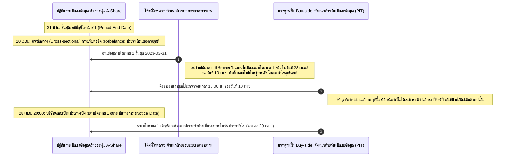
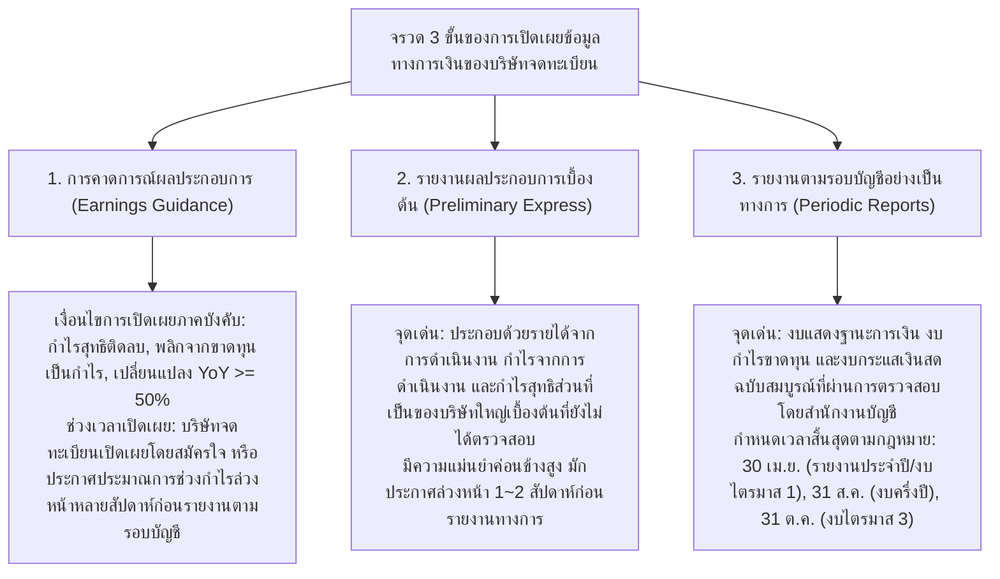

# บทที่ 6: การจัดแนวงบการเงินแบบ Point-in-Time (PIT) ปราศจาก Look-ahead Bias

> **เป้าหมายหลักของบทนี้**：  
> ผ่าโครงสร้างตัวการทำลายโมเดลที่ซ่อนเร้นและอันตรายที่สุดในงาน Quant เชิงปริมาณ (Quant) สายปัจจัยพื้นฐานแบบพหุแฟกเตอร์ (Factor) นั่นคือ **Look-ahead Bias ในงบการเงินข้ามงวด (Look-ahead Bias in Financials)** เข้าใจกลไกระดับจุลภาคของปรากฏการณ์การลอยตัวของราคาหลังประกาศผลกำไร (Post-Earnings-Announcement Drift, PEAD) และกำไรที่ผิดคาดแบบมาตรฐาน (Standardized Unexpected Earnings, SUE) จากงานวิจัยระดับคลาสสิก ทำความเข้าใจเชิงลึกเกี่ยวกับตรรกะ Timestamp สามมิติของ "ปรากฏการณ์คอขวดเดือนเมษายน", การคาดการณ์ผลประกอบการ (Earnings Guidance), รายงานผลประกอบการเบื้องต้น (Preliminary Express) และรายงานรอบบัญชีตามปกติ พร้อมฝึกใช้งานอัลกอริทึมการสืบค้นงบการเงินแบบ PIT ระดับ Production ที่รองรับการตรวจสอบเวอร์ชันย้อนหลังและการแก้ไขข้อมูล

---

## 1. ทำไมจึงไม่สามารถใช้รอบระยะเวลารายงานจัดแนวกับข้อมูลราคาตลาดโดยตรง?

ในการวิจัย Quant สายปัจจัยพื้นฐาน (การเลือกหุ้นเน้นคุณค่า, โมเมนตัมการเติบโต, แฟกเตอร์คุณภาพ Quality, กำไรผิดคาด SUE) ตัวชี้วัดทางการเงิน (เช่น รายได้จากการดำเนินงาน, กำไรสุทธิ, กำไรสุทธิหลังหักรายการพิเศษ, ROE, ROIC, กระแสเงินสดจากการดำเนินงาน) ล้วนเป็นต้นน้ำของการสร้างแฟกเตอร์ อย่างไรก็ตาม มือใหม่ส่วนใหญ่ที่ไม่เคยสัมผัสกับวิศวกรรมข้อมูลจริงของฝั่ง Buy-side มักจะพ่ายแพ้ตั้งแต่ก้าวแรกของการโหลดข้อมูล



### 1.1 ส่วนต่างเวลาระหว่างรอบระยะเวลารายงาน (Period Date) กับวันเปิดเผยข้อมูล (Notice Date)

- **วันสิ้นสุดรอบระยะเวลารายงาน (Period End Date)**：นี่คือวันสิ้นสุดรอบระยะเวลาทางบัญชี (03-31, 06-30, 09-30, 12-31) ซึ่ง**แสดงเฉพาะรอบระยะเวลาทางบัญชีเท่านั้น และไม่ได้หมายถึงเวลาที่ข้อมูลดังกล่าวจะถูกเปิดเผยต่อสาธารณะในตลาดเลย!**
- **วันเปิดเผยข้อมูลจริงตามประกาศ (Notice Date / Available Time)**: เวลาที่บริษัทจดทะเบียนอัปโหลดงบการเงินที่ผ่านการตรวจสอบหรือสอบทานแล้วเข้าสู่สื่อที่ตลาดหลักทรัพย์กำหนดอย่างเป็นทางการ เช่น Cninfo (巨潮资讯网 (เว็บไซต์ข้อมูลจูเฉา))
- **ช่วงเวลาความล่าช้าในการเปิดเผยตามกฎหมาย (Information Delay Window)**：
  - **งบไตรมาส 1**：เปิดเผยระหว่าง 1 เมษายน ถึง 30 เมษายน (ล่าช้า 1~30 วัน)；
  - **งบครึ่งปี**：เปิดเผยระหว่าง 1 กรกฎาคม ถึง 31 สิงหาคม (ล่าช้า 1~62 วัน)；
  - **งบไตรมาส 3**：เปิดเผยระหว่าง 1 ตุลาคม ถึง 31 ตุลาคม (ล่าช้า 1~31 วัน)；
  - **รายงานประจำปี**：เปิดเผยระหว่าง 1 มกราคม ถึง 30 เมษายนของปีถัดไป (ล่าช้านานถึง **1~120 วัน!**)

หากโค้ด Backtest ของคุณเขียนว่า `trade_date == report_date` หรือแบ่งส่วนข้อมูลตามไตรมาสของรอบระยะเวลารายงานโดยตรง คุณก็เท่ากับมอบ**พลังเหนือธรรมชาติในการ "ล่วงรู้ข้อมูลสถานะทางการเงินของทุกบริษัทจดทะเบียนทั่วทั้งตลาดล่วงหน้า 1 ถึง 4 เดือน"** ให้กับกลยุทธ์ ซึ่งเมื่อนำไปเทรดจริง (Live Trading) ย่อมพังทลายทันที!

---

## 2. วรรณกรรมวิชาการระดับคลาสสิก: ปรากฏการณ์ PEAD และกำไรผิดคาด SUE

เหตุใดการเปิดเผยงบการเงินจึงมีมูลค่ามหาศาลในการดึง Alpha? งานวิจัยระดับคลาสสิกในสาขาการบัญชีและการเงินเชิงประจักษ์ได้ให้คำตอบไว้อย่างลึกซึ้ง:

1. **จุดเริ่มต้นของเนื้อหาสารสนเทศทางบัญชี**：  
   Ball, R., & Brown, P. (1968). *An Empirical Evaluation of Accounting Income Numbers*. Journal of Accounting Research.  
   *คุณูปการสำคัญ*：พิสูจน์ด้วยวิธีสถิติเชิงประจักษ์เป็นครั้งแรกว่า การเปลี่ยนแปลงของกำไรสุทธิที่ตลาดไม่ได้คาดการณ์ไว้ล่วงหน้านั้นส่งผลกระทบต่อปฏิกิริยาของราคาอย่างรุนแรงทั้งก่อนและหลังการเปิดเผยงบการเงิน ซึ่งวางรากฐานทางวิชาการให้กับการลงทุน Quant ด้วยปัจจัยพื้นฐาน
2. **การลอยตัวของราคาหลังประกาศผลกำไร (Post-Earnings-Announcement Drift, PEAD)**：  
   Bernard, V. L., & Thomas, J. K. (1989, 1990). *Post-Earnings-Announcement Drift: Delayed Price Response or Risk Premium?* Journal of Accounting Research.  
   *ข้อค้นพบสำคัญ*：ตลาดไม่สามารถซึมซับข้อมูลกำไรที่ดีเกินคาดได้ทั้งหมดทันทีในวันที่ประกาศงบการเงิน ด้วยข้อจำกัดด้านความสนใจและอคติทางความคิดของนักลงทุน หุ้นที่มีผลกำไรเหนือความคาดหมายจึงเกิดการ**ลอยตัวของราคาไปในทิศทางเดียวอย่างต่อเนื่อง (Drift)** เป็นเวลา 30~60 วันทำการหลังการประกาศ
3. **แบบจำลองทางคณิตศาสตร์ของกำไรที่ผิดคาดแบบมาตรฐาน (SUE)**：  
   Livnat, J., & Mendenhall, R. R. (2006). *Comparing the Post-Earnings-Announcement Drift for Surprises Calculated from Analyst Forecasts and Time Series Models*. Journal of Accounting Research.  
   $$\text{SUE}_{i,t} = \frac{E_{i,t} - \mathbb{E}[E_{i,t}]}{\sigma(E_i - \mathbb{E}[E_i])}$$
   โดยที่ $E_{i,t}$ คือกำไรสุทธิจริงที่ประกาศในงวดปัจจุบัน, $\mathbb{E}[E_{i,t}]$ คือกำไรสุทธิจากการคาดการณ์ฉันทามติของนักวิเคราะห์หรือแบบจำลองอนุกรมเวลา (Time-series) และตัวส่วนคือส่วนเบี่ยงเบนมาตรฐานของความคลาดเคลื่อนในการคาดการณ์ในอดีต **หากการทำ Backtest ไม่ใช้ข้อมูล PIT อย่างเคร่งครัด ผลตอบแทนส่วนเกิน (Excess Return) ของกลยุทธ์ PEAD และ SUE จะถูกประเมินสูงเกินจริงถึง 3~5 เท่า!**

---

## 3. "ปรากฏการณ์คอขวดเดือนเมษายน" อันเป็นเอกลักษณ์ของหุ้น A-Share และสถาปัตยกรรมการเปิดเผยผลประกอบการแบบ 3 ระดับ

ในตลาดหุ้น A-Share ข้อมูลผลประกอบการของบริษัทจดทะเบียนไม่ได้มีเพียงรายงานประจำงวด 4 ฉบับเท่านั้น แต่ประกอบด้วยโครงสร้างแบบขั้นบันได 3 ระดับ:


### 3.1 “มหกรรมรถติดเดือนเมษายน (The April Nightmare)” ที่อันตรายถึงชีวิต
ในเดือนเมษายนของทุกปี หุ้น A-Share จะเกิดช่วงพีคของการเปิดเผยข้อมูลทางการเงินที่ไม่เหมือนที่ใดในโลก:
- **การเปิดเผยสองงบในวันเดียวกัน**: บริษัทจดทะเบียนเปิดเผย《รายงานประจำปี 2023》และ《รายงานไตรมาส 1 ปี 2024》ในวันเดียวกัน ณ วันที่ 28 เมษายน;
- **ประกาศแก้ไขย้อนหลัง (Revision Notice)**: บริษัทอาจได้รับหนังสือสอบถามจากตลาดหลักทรัพย์หลังจากเผยแพร่รายงานประจำปี แล้วจึงออก《ประกาศแก้ไขข้อผิดพลาดทางบัญชีในรายงานประจำปี》ในเดือนพฤษภาคม โดยปรับลดกำไรลง 40%
- **กฎเหล็กของฝั่ง Buy-side**: ก่อนที่จะมีการเผยแพร่ประกาศแก้ไขในเดือนพฤษภาคม การ Backtest ข้อมูลย้อนหลัง**ต้องใช้เฉพาะข้อมูลดิบที่รายงานผิดพลาด ณ เวลานั้นเท่านั้น** และห้ามนำ "ข้อมูลที่สมบูรณ์แบบไร้ที่ติ" ซึ่งเพิ่งได้รับการแก้ไขในปี 2024 มาใช้ในปี 2023 โดยเด็ดขาด!

---

## 4. ข้อกำหนดการออกแบบ Data Model แบบ PIT ระดับ Production

ในสถาปัตยกรรมการวิจัยและพัฒนาระบบเชิงปริมาณ (Quant) ประสิทธิภาพสูง งบการเงินแบบ PIT จะต้องใช้การออกแบบ Event Stream แบบ**เพิ่มข้อมูลเท่านั้นโดยไม่แก้ไข (Append-Only)** และใช้**ไทม์สแตมป์ท้องถิ่น Asia/Shanghai แบบไม่มีเขตเวลา**เป็นมาตรฐานเดียวกัน:

```text
pit_financials_schema:
├── symbol           : รหัสหุ้น (เช่น 600519.SH)
├── report_period    : วันสิ้นสุดรอบระยะเวลารายงานทางการเงิน (เช่น 2023-12-31, 2024-03-31)
├── available_at     : ไทม์สแตมป์การเปิดเผยจริงที่ภายนอกเข้าถึงได้ (เช่น 2024-04-26 20:00:00)
├── roe              : อัตราผลตอบแทนต่อส่วนของผู้ถือหุ้น
├── net_profit       : กำไรสุทธิส่วนที่เป็นของบริษัทใหญ่
├── net_profit_yoy   : อัตราการเติบโต YoY ของกำไรสุทธิส่วนที่เป็นของบริษัทใหญ่
└── is_revised       : เป็นเวอร์ชันที่ได้รับการแก้ไขหรือไม่
```

### 4.1 กฎเหล็ก 3 ข้อในการสืบค้นข้อมูล PIT:
1. **การตัดช่วงเวลาแบบสัมบูรณ์**: สำหรับภาคตัดขวาง (Cross-sectional) ณ เวลาปิดตลาดของวันทำการซื้อขาย $t$ ใดๆ (โดยทั่วไปคือ 15:00 น. ของวันนั้น) ระบบจะมองเห็นได้เฉพาะเรคอร์ดงบการเงินที่มี `available_at <= cutoff` เท่านั้น งบการเงินที่ประกาศในคืนนั้นเวลา 20:00 น. จะต้องมองไม่เห็นโดยเด็ดขาด!
2. **การเลือกเวอร์ชันอย่างอิสระ**: สำหรับแต่ละ `(symbol, report_period)` ให้เลือก**เวอร์ชันแก้ไขล่าสุด**ที่มองเห็นได้ ณ เวลาที่ทำการคิวรี;
3. **การจับคู่รอบรายงานล่าสุด**: ในบรรดาเวอร์ชันที่มีผลของแต่ละรอบรายงาน ให้เลือกรอบรายงานที่มีวันสิ้นสุดล่าสุดมาใช้เป็นตัวชี้วัดพื้นฐานปัจจุบัน (เช่น หลังจากงบไตรมาส 1 เผยแพร่ จะเข้าแทนที่รายงานประจำปีเดิมโดยอัตโนมัติ แต่งานเวอร์ชันแก้ไขของรายงานประจำปีเดิมจะยังคงถูกจัดเก็บถาวรไว้อย่างครบถ้วน)

---

## 5. ลงมือปฏิบัติ: การสร้าง PIT Financial Engine ที่รองรับการแก้ไขเวอร์ชัน

โค้ด Python ด้านล่างนี้ปฏิบัติตามมาตรฐานระดับสถาบันของฝั่ง Buy-side อย่างเคร่งครัด โดยได้ Encapsulate **การตัดช่วงอนุกรมเวลา (Time-series) อย่างเคร่งครัด**, **การแยกโครงสร้างงบสองฉบับในวันเดียว**, **การแยกเวอร์ชันแก้ไขในอดีต** และ**การตรวจสอบการรั่วไหลของข้อมูลเป็นศูนย์แบบอัตโนมัติ**

ในโฟลเดอร์รูทของโปรเจกต์ ให้รันคำสั่ง `PYTHONPATH=tutorial python3 -m examples.lecture_06_pit_financial_engine` ดูรายละเอียดการติดตั้ง Dependency, โมดูลที่ใช้ร่วมกัน และข้อกำหนดของข้อมูลได้ที่ [คำอธิบายโปรเจกต์](../README.md)

<<< @/examples/lecture_06_pit_financial_engine.py

### ผลลัพธ์การรันหลักและการตรวจสอบความสอดคล้องกับการเทรดจริง (Live Trading):
```
shape: (3, 4)
┌────────────┬───────────────┬─────────────────────┬──────┐
│ trade_date ┆ report_period ┆ available_at        ┆ roe  │
│ ---        ┆ ---           ┆ ---                 ┆ ---  │
│ date       ┆ date          ┆ datetime[μs]        ┆ f64  │
╞════════════╪═══════════════╪═════════════════════╪══════╡
│ 2023-03-31 ┆ null          ┆ null                ┆ null │
│ 2023-04-26 ┆ 2022-12-31    ┆ 2023-03-31 20:00:00 ┆ 0.3  │
│ 2023-04-27 ┆ 2023-03-31    ┆ 2023-04-26 20:00:00 ┆ 0.09 │
└────────────┴───────────────┴─────────────────────┴──────┘
```

1. **ภาคตัดขวาง ณ เวลาปิดตลาดวันที่ 31 มีนาคม 15:00 น.**: แม้รายงานประจำปีจะเผยแพร่ในคืนวันที่ 31 มีนาคม เวลา 20:00 น. แต่ ณ เวลาปิดตลาด ทั้งตลาดยังไม่ทราบข้อมูล Engine จึงส่งคืนค่า `null` ได้อย่างถูกต้อง และห้ามนำข้อมูลในอนาคตมาใช้ก่อนล่วงหน้าโดยเด็ดขาด!
2. **ภาคตัดขวาง ณ เวลาปิดตลาดวันที่ 26 เมษายน 15:00 น.**: ระบบสามารถอ่านได้เฉพาะรายงานประจำปี 2022 (ROE คือ 0.3) เท่านั้น ส่วนงบไตรมาส 1 ที่เพิ่งประกาศในคืนนั้นจะยังไม่สามารถมองเห็นได้;
3. **ภาคตัดขวาง ณ เวลาปิดตลาดวันที่ 27 เมษายน 15:00 น.**: หลังจากงบไตรมาส 1 ประกาศในคืนวันที่ 26 เมษายน พอถึงเวลาปิดตลาดวันที่ 27 เมษายน ระบบได้อัปเดตเป็นงบไตรมาส 1 ปี 2023 อย่างราบรื่น (ROE คือ 0.09) และการแก้ไขรายงานประจำปีเดิมในภายหลังจะไม่กระทบรอบรายงานล่าสุด

---

## 6. สรุปบทเรียนและแบบฝึกหัดท้ายบท

### สรุปแผนผังความรู้หลัก:
1. **การแยกไทม์สแตมป์**: จงจำความแตกต่างของช่วงเวลาอันมหาศาลระหว่างรอบระยะเวลารายงาน (Period Date) กับวันที่เปิดเผยข้อมูลตามประกาศ (Notice Date) ไว้เสมอ;
2. **ผลตอบแทนส่วนเกิน (Excess Return) ที่แท้จริงของ PEAD**: ประสิทธิภาพของกลยุทธ์ Post-Earnings-Announcement Drift (PEAD) และ SUE จะต้องสร้างอยู่บนรากฐานข้อมูล PIT ที่มั่นคงแข็งแกร่ง;
3. **สถาปัตยกรรมแบบ Append-Only**: ใช้รูปแบบ Append-Only ในการบันทึกทุกเวอร์ชันที่มีการแก้ไข และใช้ `available_at` เป็นเงื่อนไขบังคับทางกายภาพในการตัดช่วงการคิวรี

### แบบฝึกหัดภาคปฏิบัติหลังเรียน:
> **โจทย์ภาคปฏิบัติ**：  
> 1. เปิด `tutorial/examples/lecture_06_pit_financial_engine.py`  
> 2. จำลองการเพิ่มประกาศแก้ไขข้อมูลเข้าไปในชุดข้อมูล: ในวันที่ 2023-05-10 มีการออกประกาศแก้ไขทางบัญชีสำหรับรายงานประจำปี 2022 (ปรับลด ROE จาก 0.3 ลงเหลือ 0.15)  
> 3. รัน Engine เพื่อคิวรีภาคตัดขวาง ณ วันที่ 2023-04-20 และ 2023-05-15 ตามลำดับ เพื่อยืนยันว่าค่าประวัติศาสตร์ก่อนและหลังการเผยแพร่ประกาศแก้ไขสอดคล้องกับหลักความเป็นเหตุเป็นผลอย่างสมบูรณ์
