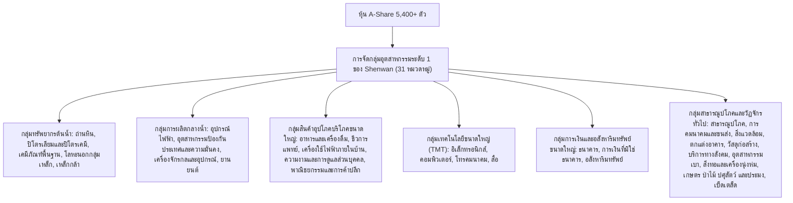

# บทที่ 7: วิวัฒนาการของการจัดกลุ่มอุตสาหกรรมและการดูแลรักษาแท็กคอนเซปต์

> **เป้าหมายหลักของบทนี้**:  
> ทำความเข้าใจอย่างลึกซึ้งเกี่ยวกับการบิดเบือนเชิงระบบของความเสี่ยงจากการเปิดรับอุตสาหกรรมที่มีต่อผลตอบแทนส่วนเกิน (Excess Return); จำแนกมาตรฐานการจัดกลุ่มอุตสาหกรรมกระแสหลักทั้งสองระบบอย่างชัดเจน ได้แก่ Shenwan (SW) และ CITIC พร้อมทั้งรับมือกับปัญหาความไม่สอดคล้องของการนิยามข้ามช่วงเวลาในอดีตที่เกิดจาก "การปรับปรุงโครงสร้างครั้งใหญ่ของ Shenwan ปี 2021"; ทำการพิสูจน์ทางคณิตศาสตร์ระดับรากฐานสำหรับ**กับดักตัวแปรหุ่น (Dummy Variable Trap)** ในการถดถอยพหุคูณ และการหาผลเฉลยของการถดถอยแบบมีข้อจำกัดถ่วงน้ำหนักของ Barra; เขียนเอนจินแมปปิ้งอุตสาหกรรมแบบ Point-in-Time และการสร้างเมทริกซ์ตัวแปรดัมมี่แบบ One-Hot ระดับ Production ด้วย Polars ด้วยตนเอง

---

## 1. ทำไมการทำ Neutralization ตามกลุ่มอุตสาหกรรมจึงเป็นหัวใจสำคัญของ Quant หุ้น A-Share?

ในตลาดหุ้น A-Share (A-Share) **ผลกระทบจากอุตสาหกรรมสามารถอธิบายความผันผวนของผลตอบแทนภาคตัดขวาง (Cross-sectional) ของหุ้นได้เป็นส่วนใหญ่** ในหลายๆ ปี การเลือกกลุ่มอุตสาหกรรมได้ถูกต้องมีความสำคัญยิ่งกว่าการคัดเลือกหุ้นรายตัวภายในอุตสาหกรรมอย่างละเอียดเสียอีก

นักวิจัยจำนวนมากที่ขาดการฝึกฝนจากฝั่ง Buy-side (Buy-side) เมื่อรันกลยุทธ์โมเมนตัมที่ได้ "ผลตอบแทนรายปี 45% และ Sharpe Ratio 3.2" แต่เมื่อกลับมาตรวจดูสถานะการถือครองพอร์ตกลับพบว่า:
- ปี 2020: กลยุทธ์ Overweight พอร์ตทั้งหมดไปที่กลุ่ม "อาหารและเครื่องดื่ม (กลุ่มเหล้าขาว)"
- ปี 2021: กลยุทธ์ Overweight พอร์ตทั้งหมดไปที่กลุ่ม "อุปกรณ์ไฟฟ้า (กลุ่มพลังงานใหม่และโซลาร์เซลล์)"
- ปี 2023: กลยุทธ์ Overweight พอร์ตทั้งหมดไปที่กลุ่ม "โทรคมนาคมและคอมพิวเตอร์ (กลุ่มฮาร์ดแวร์ประมวลผล AI)"

```
การตั้งคำถามเชิงลึกถึงแก่นแท้ของผลตอบแทน
ภาพเบื้องหน้า: โมเดลมีความสามารถในการเลือกหุ้นที่น่าทึ่ง สามารถคว้าหุ้นซูเปอร์สต็อกที่ราคาพุ่งเท่าตัวได้ทุกปี
ความจริงเบื้องหลัง: โมเดลไม่มี "Alpha จากการเลือกหุ้น" เลยแม้แต่น้อย มันแค่แทงข้างเดียวเพื่อเดิมพันกับการพุ่งขึ้นอย่างรุนแรงของ Sector Beta ในบางอุตสาหกรรมเท่านั้น!
ผลลัพธ์ร้ายแรง: ทันทีที่กระแสความนิยมของกลุ่มอุตสาหกรรมนั้นหมดลง (เช่น กลุ่มเหล้าขาวหลังปี 2021, โซลาร์เซลล์หลังปี 2022) พอร์ตจะเผชิญกับการดิ่งลงอย่างรุนแรงฝ่ายเดียวถึง 40%~60%!
```

### 1.1 การแยกย่อยแฟกเตอร์อุตสาหกรรมในแบบจำลองความเสี่ยงเชิงโครงสร้างของ Barra

ในแบบจำลองความเสี่ยง (Risk Model) สำหรับหุ้นจีนของ MSCI Barra (CNE5 / CNE6) ผลตอบแทนส่วนเกินของหุ้น $i$ ใดๆ ณ เวลา $t$ สามารถแยกย่อยได้อย่างรัดกุมเป็น:

$$R_{i,t} = \underbrace{\sum_{j=1}^J I_{i,j,t} \cdot f_{j,t}}_{\text{การมีส่วนร่วมของ Factor อุตสาหกรรม (Industry Factor Return)}} + \underbrace{\sum_{k=1}^K X_{i,k,t} \cdot g_{k,t}}_{\text{การมีส่วนร่วมของ Factor สไตล์ (Style Factor Return)}} + \underbrace{u_{i,t}}_{\text{ผลตอบแทนส่วนเกินจากการเลือกหุ้นเฉพาะตัว (Idiosyncratic Alpha)}}$$

โดยที่:
- $I_{i,j,t} \in \{0, 1\}$ คือ**ตัวแปรดัมมี่อุตสาหกรรม (Industry Dummy)** ที่บ่งบอกว่าหุ้น $i$ ณ เวลา $t$ สังกัดอยู่ในอุตสาหกรรม $j$ หรือไม่
- $f_{j,t}$ คือผลตอบแทนอุตสาหกรรมบริสุทธิ์ของอุตสาหกรรมที่ $j$ ณ วันที่ $t$
- $u_{i,t}$ จึงเป็น**ผลตอบแทนส่วนเกินเฉพาะตัวบริสุทธิ์ (Pure Alpha)** ที่สร้างขึ้นจากความสามารถในการเลือกหุ้นของ Quant อย่างแท้จริง หลังจากขจัด Beta ของตลาดรวม, การเปิดรับความเสี่ยงอุตสาหกรรม และการเปิดรับความเสี่ยงสไตล์ออกไปแล้ว!

---

## 2. การเปรียบเทียบภาพรวมของสองระบบอุตสาหกรรมหลักในตลาดหุ้น A-Share

| ชื่อระบบ | สถาบันผู้จัดทำ | จำนวนอุตสาหกรรมระดับ 1 | จำนวนอุตสาหกรรมระดับ 2 | กรณีการใช้งานหลักของสถาบัน |
| :--- | :--- | :--- | :--- | :--- |
| **การจัดกลุ่มอุตสาหกรรม Shenwan (SW)** | สถาบันวิจัย Shenwan Hongyuan | **31 กลุ่ม** (เวอร์ชัน 2021) | 134 กลุ่ม | **เกณฑ์มาตรฐานกองทุนดัชนีเสริมผลตอบแทน (Index Enhancement) ของกองทุนรวม, มาตรฐานโดยพฤตินัยของกองทุนเอกชน (Private Fund) ระดับหมื่นล้าน** |
| **การจัดกลุ่มอุตสาหกรรม CITIC (CITIC)** | ฝ่ายวิจัยหลักทรัพย์ CITIC | **30 กลุ่ม** | 100+ กลุ่ม | พอร์ตลงทุนเพื่อบริษัทหลักทรัพย์ (Proprietary Trading), กองทุนเฮดจ์ฟันด์ Quant อิสระบางแห่ง |



---

## 3. เหตุการณ์สะเทือนประวัติศาสตร์: "การปรับปรุงครั้งใหญ่ของอุตสาหกรรม Shenwan ปี 2021" กับ Look-ahead Bias เชิงมหภาคข้ามช่วงเวลา

ในเดือนกรกฎาคม 2021 Shenwan ได้ประกาศมาตรฐานการจัดกลุ่มอุตสาหกรรมรุ่นที่ 4 (เวอร์ชัน 2021) อย่างเป็นทางการ โดยมีการปรับโครงสร้างผังอุตสาหกรรมทั่วทั้งตลาดครั้งใหญ่:
1. **เพิ่มอุตสาหกรรมระดับ 1 ใหม่**: เพิ่ม "**ความงามและการดูแลส่วนบุคคล**" (แยกบริษัทเวชสำอางและเครื่องสำอาง เช่น Imeik, Proya ออกจากกลุ่มอุตสาหกรรมเบาและเคมีภัณฑ์พื้นฐานเดิม)
2. **แยกและปรับโครงสร้าง**: แยกหมวดหมู่ใหญ่ "เคมีภัณฑ์" เดิมออกเป็น "**ปิโตรเลียมและปิโตรเคมี**" และ "**เคมีภัณฑ์พื้นฐาน**" อย่างเป็นทางการ
3. **ยกเลิก ควบรวม และปรับเปลี่ยน**: เปลี่ยนชื่อจาก "อุปกรณ์เครื่องใช้ไฟฟ้า" เดิมเป็น "**อุปกรณ์ระบบไฟฟ้า**" และปรับโครงสร้างห่วงโซ่อุตสาหกรรมแบตเตอรี่ลิเธียม, โซลาร์เซลล์ และโครงข่ายสายส่งไฟฟ้า

```
กับดักร้ายแรงของการ Backtest ข้ามช่วงเวลา
วิธีที่ผิด: นำ [รายชื่ออุตสาหกรรมล่าสุดของ Shenwan เวอร์ชัน 2021] ที่ export ออกมาในวันนี้ ไปครอบลงบนข้อมูลราคาย้อนหลังปี 2015 แบบตรงไปตรงมา
การทะลุมิติที่ซ่อนเร้น: ในปี 2015 ทั่วทั้งตลาดไม่มีอุตสาหกรรม "ความงามและการดูแลส่วนบุคคล" อยู่เลย บริษัทผู้นำในกลุ่มนี้ ณ เวลานั้นถูกจัดอยู่ในกลุ่มเคมีภัณฑ์ดั้งเดิมหรืออุตสาหกรรมเบา
ผลลัพธ์ร้ายแรง: หากคุณทำ Neutralization อุตสาหกรรมบนข้อมูลย้อนหลังปี 2015 โมเดลของคุณจะเทียบเท่ากับการนำความเข้าใจทางอุตสาหกรรมใหม่ที่เพิ่งประกาศใช้ในอีก 6 ปีให้หลังมาใช้ล่วงหน้า ซึ่งก่อให้เกิด Look-ahead Bias เชิงมหภาคที่แฝงอยู่อย่างแนบเนียน!
```

### 3.1 การออกแบบตารางเหตุการณ์สถานะอุตสาหกรรมข้ามช่วงเวลา
```text
industry_events_schema:
├── symbol           : รหัสหุ้น (เช่น 000001.SZ)
├── taxonomy         : เวอร์ชันของระบบการจัดกลุ่ม (เช่น SW2014, SW2021)
├── industry_name    : ชื่อมาตรฐานของอุตสาหกรรม (เช่น ธนาคาร)
├── effective_date   : วันที่มีผลบังคับใช้อย่างเป็นทางการของการจัดกลุ่มอุตสาหกรรม
└── available_at     : Timestamp ทางกายภาพที่เหตุการณ์นี้ปรากฏให้เห็นในระบบ
```

ผ่านการบันทึกเหตุการณ์แบบเพิ่มต่อท้าย การสืบค้นข้อมูลอุตสาหกรรม ณ จุดเวลาใดๆ จะต้องเป็นไปตามเงื่อนไข:
$$\text{effective\_date} \le t_{\text{decision}} \quad \text{AND} \quad \text{available\_at} \le t_{\text{decision}}$$

---

## 4. กับดักตัวแปรหุ่น (Dummy Variable Trap) และการพิสูจน์ทางคณิตศาสตร์ของการถดถอยแบบมีข้อจำกัด (Constrained Regression)

เมื่อทำ Neutralization อุตสาหกรรมสำหรับหลายแฟกเตอร์ (Factor) ข้อผิดพลาดทางสถิติที่ผู้เริ่มต้นมักทำบ่อยที่สุดคือการเขียนสมการการถดถอยออกมาตรงๆ ดังนี้:

$$Y_i = \beta_0 + \sum_{j=1}^{31} \beta_j I_{i,j} + \epsilon_i$$

### 4.1 กับดักตัวแปรหุ่น (ภาวะร่วมเส้นตรงสมบูรณ์)
- เนื่องจากหุ้นแต่ละตัวจำเป็นต้องและสามารถสังกัดได้เพียง 1 ใน 31 อุตสาหกรรมเท่านั้น ดังนั้นสำหรับหุ้น $i$ ใดๆ จึงได้ว่า:
  $$\sum_{j=1}^{31} I_{i,j} = 1$$
- นั่นหมายความว่า เวกเตอร์จุดตัดแกน $\mathbf{1}$ ที่มีค่าเป็น 1 ทั้งหมด จะมีค่าเท่ากับผลรวมของตัวแปรดัมมี่ของทั้ง 31 อุตสาหกรรมพอดี! เมทริกซ์การออกแบบ $\mathbf{X}$ จะเกิด**ความสัมพันธ์เชิงเส้นตรงอย่างเคร่งครัด (การขาดอันดับ / Rank Deficient)** ส่งผลให้เมทริกซ์ $\mathbf{X}^T \mathbf{X}$ ไม่สามารถหาอินเวอร์สได้ และสัมประสิทธิ์การถดถอยจะไม่มีผลเฉลยที่เป็นเอกภาพ
### 4.2 สองโซลูชันทางคณิตศาสตร์แบบคลาสสิกของฝั่ง Buy-side

#### แนวทาง A: ตัดอุตสาหกรรมอ้างอิงออกหนึ่งกลุ่ม (วิธีตัวแปรดัมมี่ $J-1$)
- บังคับให้สัมประสิทธิ์ของบางอุตสาหกรรม (เช่น "เบ็ดเตล็ด") เป็น 0 และใส่ตัวแปรดัมมี่ของอุตสาหกรรมเพียง 30 ตัว ซึ่งในกรณีนี้ ค่า Intercept $\beta_0$ จะแทนผลตอบแทนเฉลี่ยของอุตสาหกรรมที่ถูกตัดออกไป ส่วนสัมประสิทธิ์ที่เหลือจะแทนผลตอบแทนส่วนเกิน (Excess Return) สัมพัทธ์กับอุตสาหกรรมอ้างอิง

#### แนวทาง B: การถดถอยแบบมีเงื่อนไขบังคับถ่วงน้ำหนักด้วยมูลค่าตลาดของ Barra (Restricted WLS - ตัวเลือกอันดับหนึ่งในภาคอุตสาหกรรม)
ในแบบจำลองความเสี่ยง (Risk Model) ของ Barra จะเก็บทั้งตัวแปรดัมมี่ทั้ง 31 อุตสาหกรรมและเก็บค่า Intercept ของทั้งตลาด (Market Beta) เอาไว้ พร้อมทั้งกำหนดเงื่อนไขบังคับดังนี้: **ผลรวมของผลตอบแทนแฟกเตอร์ (Factor) ทั้ง 31 อุตสาหกรรมทั่วทั้งตลาดหลังถ่วงน้ำหนักด้วยมูลค่าตลาดจะต้องเป็นศูนย์อย่างเคร่งครัด**!

$$\min_{\{f_j\}} \sum_{i=1}^N w_i \left( R_i - \sum_{j=1}^J I_{i,j} f_j \right)^2 \quad \text{s.t.} \quad \sum_{j=1}^J W_j f_j = 0$$

โดยที่ $w_i$ คือน้ำหนักสแควร์รูทของมูลค่าตลาดของหุ้นรายตัว และ $W_j = \sum_{i \in \text{Industry}_j} w_i$ คือน้ำหนักมูลค่าตลาดรวมของอุตสาหกรรม  
การแก้สมการด้วยวิธีตัวคูณลากรองจ์จะรับประกันความเป็นหนึ่งเดียวของคำตอบ พร้อมทั้งให้ความหมายเชิงกายภาพที่สมบูรณ์แบบที่สุดแก่ผลตอบแทนแฟกเตอร์อุตสาหกรรม: **Active Premium ของแต่ละอุตสาหกรรมเมื่อเทียบกับเกณฑ์มาตรฐานถ่วงน้ำหนักด้วยมูลค่าตลาดของทั้งตลาด**!

---

## 5. ลงมือปฏิบัติ: การทำ Industry Mapping แบบมีเวอร์ชันและเอนจินเมทริกซ์ตัวแปรดัมมี่แบบ One-Hot

โค้ด Python ด้านล่างนี้ใช้ **Polars** เพื่อทำแมปปิ้งหุ้นทั่วทั้งตลาดไปยังกลุ่มอุตสาหกรรมระดับ 1 ของ Shenwan ได้อย่างมีประสิทธิภาพสูง และสร้างเมทริกซ์ตัวแปรดัมมี่ (Dummy Matrix) มาตรฐานได้ทันที เพื่อนำไปใช้กับการถดถอย Neutralization หลายแฟกเตอร์ในขั้นตอนต่อไป

รันคำสั่ง `PYTHONPATH=tutorial python3 -m examples.lecture_07_industry_engine` ที่ไดเรกทอรีรูทของโปรเจกต์ ดูการติดตั้ง Dependency, โมดูลที่ใช้ร่วมกัน และ Data Contract ได้ที่ [คำอธิบายโปรเจกต์](../README.md)

<<< @/examples/lecture_07_industry_engine.py

### เจาะลึกประเด็นสำคัญของการนำไปใช้งานจริง:
1. **หมวดหมู่ที่ไม่ทราบค่าอย่างชัดเจน (`ind_未知`)**:
   - เมื่อหุ้นบางตัวในข้อมูลย้อนหลังไม่สามารถจับคู่อุตสาหกรรมได้เนื่องจากการพักการซื้อขาย (Suspension) หรือข้อมูลสูญหาย ห้ามจัดให้อยู่ในกลุ่มอุตสาหกรรม "เบ็ดเตล็ด" แบบส่งเดชโดยเด็ดขาด แต่ให้สร้างคอลัมน์ `ind_未知` แยกขึ้นมาโดยเฉพาะ และต้องรักษาผลรวมของแต่ละแถวให้เป็น 1 อย่างเคร่งครัด
2. **การขยาย Polars Expression แบบ Zero Memory Redundancy**:
   - `pd.get_dummies` ของ Pandas แบบดั้งเดิมจะสร้าง Shallow Copy จำนวนมากบน Single Core แต่การพัฒนานี้ใช้ Declarative Expression ของ Polars ในการสร้างคอลัมน์บูลีน 31 มิติแบบคู่ขนานได้ในครั้งเดียวและแปลงประเภทข้อมูลเป็น `UInt8` ซึ่งช่วยลดการใช้หน่วยความจำในขั้นตอน Feature Engineering ได้อย่างมหาศาล

---

## 6. สรุปเนื้อหาประจำบทและการบ้านปฏิบัติการท้ายบท

### สรุปแผนผังความรู้หลัก:
1. **ผลกระทบจากอุตสาหกรรมเป็นสิ่งที่ไม่ควรมองข้าม**: การคัดเลือกหุ้นเชิง Quant ที่ไม่ได้ผ่านการทำ Neutralization ตามอุตสาหกรรม ผลตอบแทนส่วนเกินจะกลายสภาพเป็นการเดิมพันความเสี่ยงทางเดียวในอุตสาหกรรมใดอุตสาหกรรมหนึ่งได้ง่ายมาก;
2. **มาตรฐาน 31 อุตสาหกรรมของ Shenwan**: ยึดตามโครงสร้างมาตรฐานเวอร์ชันปี 2021 ทำความเข้าใจตรรกะทางอุตสาหกรรมที่อยู่เบื้องหลังการแยกกลุ่มอุตสาหกรรมเบาและเคมีภัณฑ์ และป้องกันความคลาดเคลื่อนของการจับคู่ข้อมูลย้อนหลังข้ามช่วงเวลาอย่างเด็ดขาด;
3. **เงื่อนไขบังคับทางคณิตศาสตร์ของเมทริกซ์ตัวแปรดัมมี่**: ในแต่ละภาคตัดขวาง (Cross-sectional) ผลรวมแนวนอนของคอลัมน์อุตสาหกรรม (รวมถึงคอลัมน์ที่ไม่ทราบค่าอย่างชัดเจน) จะต้องเท่ากับ 1 อย่างเคร่งครัด เพื่อขจัดปัญหา Dummy Variable Trap ให้หมดสิ้นไปผ่านการถดถอยแบบมีเงื่อนไขบังคับ

### แบบฝึกหัดปฏิบัติการท้ายบท:
> **ภารกิจปฏิบัติการ**:  
> 1. เปิด `tutorial/examples/lecture_07_industry_engine.py`
> 2. เขียนฟังก์ชันทดสอบเพื่อตรวจสอบว่าผลรวมของตัวเลขในแต่ละแถวของเมทริกซ์ตัวแปรดัมมี่ที่สร้างขึ้นนั้นเท่ากับ 1 อย่างเคร่งครัดหรือไม่ (`assert (matrix.select(pl.all().sum_horizontal()) == 1).all()`)
> 3. คำถามชวนคิด: หากกลยุทธ์ Quant แบบหลายแฟกเตอร์คัดเลือกหุ้นเฉพาะภายในอุตสาหกรรมเดี่ยวอย่าง "ชีวการแพทย์และเภสัชกรรม" (การเสริมผลตอบแทนภายในอุตสาหกรรม) ในกรณีนี้ยังจำเป็นต้องทำ Neutralization ด้วยตัวแปรดัมมี่ของอุตสาหกรรมระดับ 1 ของ Shenwan อีกหรือไม่? เพราะเหตุใด?
