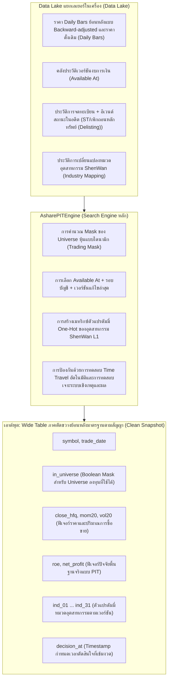
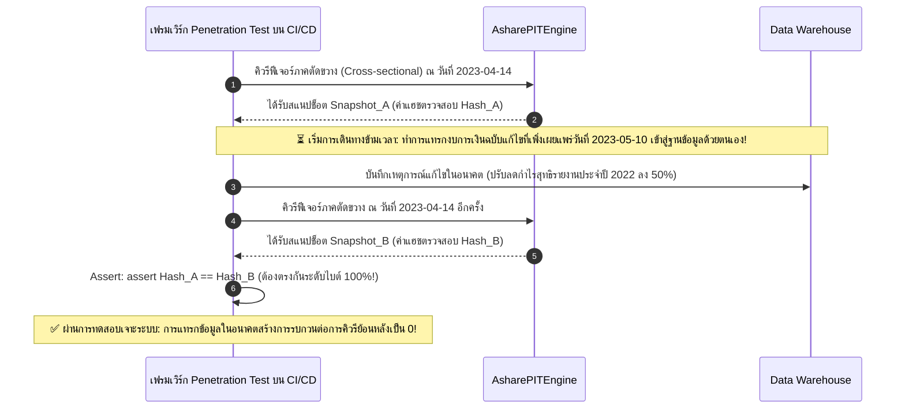

# บทที่ 8: 【ภาคปฏิบัติ】เขียน PIT Search Engine สำหรับหุ้น A-Share ด้วยตนเอง

> **เป้าหมายหลักของบทนี้**:  
> ผสานแก่นแท้ทั้งหมดของวิศวกรรมข้อมูลจาก 3 บทแรกในโมดูลที่สอง นำ**การกรอง Universe หุ้นแบบไดนามิก (หุ้นเข้าใหม่ / ST / พักการซื้อขาย (Suspension))**, **การจัดเรียงงบการเงินแบบ Point-in-Time (Notice Date As-of Join)** และ**เมทริกซ์ตัวแปรดัมมี่ของอุตสาหกรรมระดับ 1 ตามเกณฑ์ ShenWan** มา Encapsulate เป็นคลาสอ้างอิงระดับ Production ที่ Decouple อย่างเป็นระบบชื่อ `AsharePITEngine` โดยรับพารามิเตอร์เป็นวันทำการย้อนหลังใดๆ และส่งคืน Wide Table ของฟีเจอร์ที่สอดคล้องกับกรอบเวลาของฝั่ง Buy-side ได้ในคลิกเดียว พร้อมทั้งเขียนชุด**การทดสอบเจาะระบบแบบ Time Travel (Penetration Test)** เพื่อพิสูจน์ในระดับกายภาพว่าระบบไม่มีการรั่วไหลของ Look-ahead Bias อย่างแน่นอน!

---

## 1. ทำไมสถาบันฝั่ง Buy-side จึงจำเป็นต้องมี PIT Search Engine แยกเฉพาะของตนเอง?

ในทีม Quant สมัครเล่นที่ไม่มีการ Encapsulate โค้ดอย่างเป็นระบบ นักวิจัยแต่ละคนต่างเขียนตรรกะการอ่านข้อมูลของตนเองขึ้นมาเพื่อใช้คำนวณแฟกเตอร์ (Factor):
- นักวิจัย A ลืมคัดหุ้น ST ออก ทำให้หุ้นขยะปนเปื้อนเข้าไปในแฟกเตอร์มูลค่า (Value Factor)
- นักวิจัย B เข้าใจผิดนำรอบระยะเวลารายงานมาใช้แทนวันประกาศงบการเงิน ทำให้เกิด Look-ahead Bias ขั้นรุนแรง
- นักวิจัย C นำเกณฑ์การจัดกลุ่มอุตสาหกรรมมาตรฐานใหม่ปี 2021 ไปรันข้อมูลย้อนหลังปี 2016 ทำให้เกิด Macro Look-ahead Bias

ความสับสนจากการต่างคนต่างทำนี้ส่งผลให้**ผลงานของกลยุทธ์ในการ Backtest หลุดออกจากผลงานในการเทรดจริง (Live Trading) อย่างสิ้นเชิง** สถาบันฝั่ง Buy-side จึงสกัดกั้นช่องโหว่ทั้งหมดในระดับการนำเข้าข้อมูลอย่างเบ็ดเสร็จด้วยการใช้ PIT Search Engine ที่เป็นมาตรฐานเดียวกัน:



---

## 2. API Interface และพันธสัญญาทางกายภาพด้านเวลา

Search Engine นี้จะสืบค้น**สแนปช็อตภาคตัดขวางคงที่หลังตลาดปิดของวันทำการที่กำหนด** โดยใช้ข้อมูลราคาและปริมาณรายวันที่ก่อตัวสมบูรณ์แล้วในวันนั้น การตัดสินใจซื้อขายที่สร้างขึ้นจะถูกนำไป**ส่งคำสั่งเร็วที่สุดในรอบการซื้อขายถัดไป (ตอนเปิดตลาดหรือระหว่างวัน)**

```python
snapshot = engine.get_market_snapshot("2023-04-14", symbols=["OLD.SH", "NEW.SZ"])
```

### พันธสัญญาทางกายภาพด้านวิศวกรรมที่เข้มงวด:
1. **ปฏิเสธวันหยุดทำการอย่างเคร่งครัด**: หากใส่วันที่ไม่ใช่วันทำการ จะโยน `ValueError` ที่ชัดเจนออกมาทันที และห้ามเลื่อนวันถอยหลังหรือไปข้างหน้าโดยอัตโนมัติอย่างเงียบๆ โดยเด็ดขาด (การเลื่อนวันจะทำลายระยะห่างที่สม่ำเสมอของอนุกรมเวลา (Time-series))
2. **จัดเรียงวันเข้าจดทะเบียนกับอายุการซื้อขายนับจากวันแรก**: ปฏิทินที่ป้อนเข้ามาต้องครอบคลุมวันแรกที่หลักทรัพย์เข้าจดทะเบียนซื้อขาย หุ้นที่พักการซื้อขายยังคงนับอายุการจดทะเบียน แต่หากไม่สามารถจับคู่คำสั่งซื้อขายได้จะถูกระบุเป็น `in_universe = False`
3. **ตัดรอบด้วย Timestamp ของการประกาศงบการเงิน**: งบการเงินทั้งหมดจะยึดตามเงื่อนไข `available_at <= cutoff` (โดยทั่วไปคือเวลาปิดตลาด 15:00 น.) เป็นหลัก งบการเงินที่เปิดเผยหลังตลาดปิดเวลา 20:00 น. จะต้องไม่รั่วไหลเข้ามาในภาคตัดขวางของวันนั้นอย่างเด็ดขาด
4. **ครอบคลุมหมวดอุตสาหกรรมอย่างชัดเจนครบถ้วน**: หุ้นที่ซื้อขายในตลาดทั้งหมดต้องถูกแมปเข้ากับ 1 ใน 31 หมวดอุตสาหกรรม หุ้นที่ไม่ทราบหมวดจะถูกจัดเข้าสู่ `ind_未知` โดยอัตโนมัติ และผลรวมของแถวต้องเท่ากับ 1 เสมอ

---

## 3. ลงมือปฏิบัติ: การสร้าง PIT Search Engine ที่มีความน่าเชื่อถือสูง

โค้ด Python ด้านล่างนี้ปฏิบัติตามมาตรฐานระดับสถาบันฝั่ง Buy-side อย่างเคร่งครัด โดยผสานส่วนประกอบหลักจากบทที่ 5, 6 และ 7 เข้าด้วยกันอย่างไร้รอยต่อ พร้อมทั้งติดตั้งชุดการทดสอบเจาะระบบที่สมบูรณ์มาในตัว

รัน `PYTHONPATH=tutorial python3 -m examples.lecture_08_pit_engine_practice` ที่ไดเรกทอรีรากของโปรเจกต์ ดูการติดตั้ง Dependency, โมดูลที่ใช้ร่วมกัน และพันธสัญญาของข้อมูลได้ที่ [คำอธิบายโปรเจกต์](../README.md)

<<< @/examples/lecture_08_pit_engine_practice.py

### เอาต์พุตการทำงานหลักและการตรวจสอบความสอดคล้องกับการเทรดจริง:
```
shape: (3, 5)
┌─────────┬────────────┬─────────────┬───────────────┬───────────────┐
│ symbol  ┆ trade_date ┆ in_universe ┆ report_period ┆ industry_name │
│ ---     ┆ ---        ┆ ---         ┆ ---           ┆ ---           │
│ str     ┆ date       ┆ bool        ┆ date          ┆ str           │
╞═════════╪════════════╪═════════════╪═══════════════╪═══════════════╡
│ HALT.SZ ┆ 2023-04-14 ┆ false       ┆ null          ┆ 房地产        │
│ NEW.SZ  ┆ 2023-04-14 ┆ false       ┆ null          ┆ 电子          │
│ OLD.SH  ┆ 2023-04-14 ┆ true        ┆ 2022-12-31    ┆ 食品饮料      │
└─────────┴────────────┴─────────────┴───────────────┴───────────────┘
合成样例通过；完整边界验证请运行 python -m unittest discover -s tests -v
```

1. **`OLD.SH`**: มีระยะเวลาเข้าจดทะเบียนซื้อขายเพียงพอ ไม่มีคำเตือนความเสี่ยง ซื้อขายตามปกติ จึงผ่านเข้าสู่ Universe สำเร็จ (`in_universe = true`) และจัดเรียงตรงกับรายงานประจำปี 2022 อย่างถูกต้อง (กลุ่มอุตสาหกรรมอาหารและเครื่องดื่ม);
2. **`NEW.SZ`**: จดทะเบียนซื้อขายไม่ถึง 60 วันทำการ จึงถูกกลไกหุ้นเข้าใหม่ดักจับโดยอัตโนมัติ (`in_universe = false`);
3. **`HALT.SZ`**: ปริมาณการซื้อขายทั้งวันเป็น 0 (พักการซื้อขาย) จึงถูกกลไกปกป้องสภาพคล่องดักจับ (`in_universe = false`)

---
## 4. การทดสอบเจาะระบบข้ามเวลา (Time-Travel Penetration Test)

ในไปป์ไลน์ CI/CD ของฝั่ง Buy-side เราจะพิสูจน์ได้อย่างไรว่าระบบ Backtest ปราศจาก Look-ahead Bias 100%? คำตอบก็คือ**การทดสอบเจาะระบบข้ามเวลา**:



รันชุดทดสอบทั้งหมด:
```bash
PYTHONPATH=tutorial python3 -m unittest discover -s tutorial/tests -v
```

---

## 5. สรุปท้ายบทและภาพรวมแผนผังความรู้ของโมดูลที่ 2

ถึงจุดนี้ **โมดูลที่ 2: วิศวกรรมข้อมูลและการคลีนซิ่งแบบไร้การรั่วไหล (รากฐานของ PIT)** ทั้ง 4 บทเรียนหลักได้ถูกสร้างขึ้นอย่างสมบูรณ์!
- เราได้ทำความเข้าใจความแตกต่างที่แท้จริงระหว่างการขึ้นเครื่องหมายสิทธิ/เงินปันผล (Ex-Rights/Ex-Dividends) กับการปรับราคาแบบ Forward/Backward Adjustment ของหุ้น A-Share อย่างถ่องแท้ (บทที่ 4 และบทที่ 5);
- เชี่ยวชาญการสร้างกรวยคัดกรองด้วย Dynamic Trading Mask สำหรับหุ้นเข้าใหม่ (Sub-new Stocks), หุ้นติดเครื่องหมายเตือน ST และหุ้นที่พักการซื้อขาย (Suspension) (บทที่ 5);
- เอาชนะอัลกอริทึมงบการเงินแบบ PIT ในประเด็นความเหลื่อมล้ำระหว่างรอบบัญชีกับวันประกาศงบ, การประกาศงบคู่ในวันเดียวกัน และการแก้ไขงบย้อนหลัง (บทที่ 6);
- แก้ไขปัญหาการปรับปรุงเวอร์ชันของการจัดกลุ่มอุตสาหกรรม Shenwan 31 ข้ามช่วงเวลา และข้อจำกัดทางคณิตศาสตร์จากกับดักตัวแปรหุ่น (Dummy Variable Trap) (บทที่ 7);
- พัฒนา `AsharePITEngine` ที่มีความน่าเชื่อถือสูง และผ่านการทดสอบเจาะระบบข้ามเวลา (บทที่ 8)

ตั้งแต่โมดูลถัดไป เราจะเข้าสู่: **โมดูลที่ 3: การขุดค้นหลายแฟกเตอร์และวิศวกรรมฟีเจอร์แบบคลาสสิก** อย่างเป็นทางการ โดยจะต่อยอดจากฐานรากข้อมูลอันแข็งแกร่งนี้ เพื่อสร้างแฟกเตอร์ (Factor) ราคาและปริมาณแบบอนุกรมเวลา (Time-series), แฟกเตอร์คุณภาพเชิงปัจจัยพื้นฐาน, แฟกเตอร์โครงสร้างจุลภาคความถี่สูง (High-Frequency Microstructure) ตลอดจนไปป์ไลน์การทำ Orthogonalization สำหรับแฟกเตอร์ระดับ Production อย่างเป็นระบบ!
