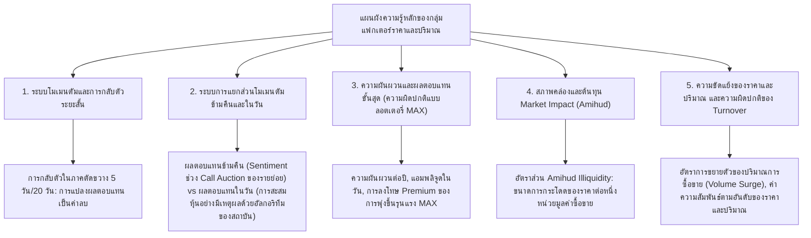

# บทที่ 9: การพัฒนาคลังแฟกเตอร์ (Factor) ราคาและปริมาณการซื้อขายระดับคลาสสิกสู่ระดับ Production

> **เป้าหมายหลักของบทนี้**：  
> เข้าใจกลไกระดับจุลภาคตามหลักการเงินเชิงพฤติกรรม (Behavioral Finance) ของแฟกเตอร์ราคาและปริมาณการซื้อขายในหุ้น A-Share อย่างลึกซึ้ง (ทำไมหุ้น A-Share ในรอบระยะสั้นถึงกลางถึงมีลักษณะการกลับตัวที่รุนแรง? ทำไม Sentiment ของนักลงทุนรายย่อยจึงเป็นตัวขับเคลื่อน Gap ข้ามคืน?); เชี่ยวชาญการพิสูจน์ทางคณิตศาสตร์อย่างเป็นระบบของฟีเจอร์ระดับคลาสสิก 5 กลุ่มหลัก ได้แก่ โมเมนตัมและการกลับตัว (Momentum & Reversion), ความผันผวนย้อนหลัง (Historical Volatility), ผลตอบแทนขั้นสุด (ความผิดปกติแบบลอตเตอรี่ MAX / MAX Lottery Anomaly), อิมแพ็กต์จากสภาพคล่องต่ำ (Amihud Illiquidity Impact) และการแยกส่วนโมเมนตัมข้ามคืน/ในวัน (Overnight/Intraday Decoupling); ใช้ Pipeline แบบ Purely Vectorized ของ Polars ในการคำนวณ Price-Volume Feature Matrix ระดับ Production ด้วย Throughput สูง

---

## 1. แก่นแท้ของ Price-Volume Factor: โครงสร้างจุลภาคของตลาดและการสะท้อนการเงินเชิงพฤติกรรม

ฟีเจอร์ราคาและปริมาณการซื้อขาย (Price-Volume Features) ถือเป็นสัญญาณรากฐานในการลงทุนเชิงปริมาณ (Quant) ที่มีข้อมูลสมบูรณ์ที่สุด อัตราส่วนสัญญาณต่อสัญญาณรบกวน (Signal-to-Noise Ratio) สูงที่สุด และตอบสนองต่อการปรับพอร์ต (Rebalance) ได้รวดเร็วที่สุด

### 1.1 "การกลับตัวระยะสั้น" ของหุ้น A-Share vs "โมเมนตัมระยะกลาง" ของหุ้นสหรัฐฯ: พลวัตระดับจุลภาคที่ตรงกันข้ามอย่างสิ้นเชิง

- **ตลาดหุ้นสหรัฐฯ (ขับเคลื่อนราคาโดยสถาบันเป็นหลัก)**：  
  Jegadeesh และ Titman (1993, *Journal of Finance*) ได้ค้นพบ**“ปรากฏการณ์โมเมนตัมระยะกลาง (Momentum Effect)”**อันโด่งดัง — หุ้นที่มีผลการดำเนินงานโดดเด่นในช่วง 3~12 เดือนที่ผ่านมาจะยังคงสร้างผลตอบแทนชนะเกณฑ์มาตรฐานต่อไปอีก 1~6 เดือนข้างหน้า โดยกลไกเบื้องหลังเกิดจากการที่นักลงทุนสถาบันมีปฏิกิริยาตอบสนองช้าเกินไปต่อการประกาศผลประกอบการ (PEAD) และพฤติกรรมการทยอยเปิดสถานะสะสมหุ้นอย่างต่อเนื่องในระยะยาว
- **ตลาดหุ้น A-Share (การเก็งกำไรด้วย Turnover สูงและ Disposition Effect ของรายย่อย)**：  
  หุ้น A-Share ในรอบระยะสั้นถึงกลางระดับ 5 วัน, 10 วัน และ 20 วัน แสดงให้เห็นถึง**คุณลักษณะการกลับตัวในภาคตัดขวาง (Cross-sectional Short-Term Mean Reversion) ที่แข็งแกร่งอย่างยิ่ง**
  - **ปรากฏการณ์ขายหมูถือดอย (Disposition Effect)**：นักลงทุนรายย่อยมีแนวโน้มที่จะรีบเทขายหุ้นที่ได้กำไรเพียงเล็กน้อย (รีบเก็บกำไรเข้ากระเป๋า) แต่กลับทนถือหุ้นที่ขาดทุนเป็นเวลานาน เมื่อหุ้นตัวหนึ่งพุ่งขึ้นอย่างรุนแรง 20% ในระยะสั้น จะไปกระตุ้นแรงเทขายทำกำไรมหาศาลไหลทะลักออกมาทุบตลาด
  - **การตอบสนองเกินจริง (Overreaction)**：De Bondt และ Thaler (1985, *Journal of Finance*) ชี้ให้เห็นว่า ผู้มีส่วนร่วมในตลาดมีแนวโน้มที่จะมีอคติทางการรับรู้และตอบสนองต่อเหตุการณ์ไม่คาดคิดในระยะสั้นรุนแรงเกินจริง การพุ่งขึ้นสู่จุดสูงสุดในระยะสั้นมักเกิดจากอารมณ์และสภาพคล่องที่แห่แหนตามกัน จากนั้นย่อมเกิดการกลับสู่ค่าเฉลี่ยเสมอ
  - **กฎเหล็กในการปฏิบัติงานจริงของฝั่ง Buy-side**：ในการคัดเลือกหุ้นด้วยโมเดล Multi-factor ความถี่ปานกลางถึงต่ำในหุ้น A-Share **โมเมนตัม 5 วันและ 20 วันจำเป็นต้องใส่เครื่องหมายลบเพื่อใช้เป็น Reversion Alpha เสมอ**!

---

## 2. การพิสูจน์ทางคณิตศาสตร์ของกลุ่มแฟกเตอร์ราคาและปริมาณหลักทั้ง 5 กลุ่ม



### 2.1 ระบบโมเมนตัมและการกลับตัว (Momentum & Reversion)
กำหนดให้ราคาปิดปรับสิทธิ์ย้อนหลังของหุ้นในวันที่ $t$ คือ $P_{close,t}$ อัตราผลตอบแทนสะสมย้อนหลัง $K$ วันทำการนิยามได้เป็น:

$$Ret_K(t) = \frac{P_{close,t}}{P_{close,t-K}} - 1$$

ในคลัง Multi-factor ความถี่ปานกลางของหุ้น A-Share แฟกเตอร์การกลับตัวระยะสั้นจะถูกแปลงค่าด้วยการใส่เครื่องหมายลบทั้งหมด:

$$\text{Factor}_{RevK}(t) = - Ret_K(t) \quad (K \in \{5, 10, 20\})$$

---

### 2.2 การแยกส่วนโมเมนตัมข้ามคืนและในวัน (Overnight vs Intraday Decoupling)
ทฤษฎีการแยกย่อยผลตอบแทนที่นำเสนอโดย Lou, Yan, & Zhang (2019, *Journal of Financial Economics*) ชี้ให้เห็นว่า ผลตอบแทนรวมตลอดทั้งวันขับเคลื่อนโดย **Gap ข้ามคืน (การสะสมข้อมูลในช่วงนอกเวลาทำการซื้อขาย)** และ **ผลตอบแทนจากการซื้อขายต่อเนื่องในวัน (การส่งคำสั่งซอยย่อยด้วยอัลกอริทึม)** ซึ่งทั้งสองส่วนนี้ขับเคลื่อนโดยกลุ่มผู้เล่นที่แตกต่างกันโดยสิ้นเชิง:

$$1 + R_{total,t} = \left(1 + R_{overnight,t}\right) \times \left(1 + R_{intraday,t}\right)$$

โดยที่ราคาเปิดและราคาปิดต่างใช้เกณฑ์การปรับสิทธิ์ย้อนหลังรูปแบบเดียวกัน:

$$R_{overnight,t} = \frac{P_{open,t}^{adj}}{P_{close,t-1}^{adj}} - 1, \quad R_{intraday,t} = \frac{P_{close,t}^{adj}}{P_{open,t}^{adj}} - 1$$

- **ผลตอบแทนข้ามคืนสูง (Overnight Alpha มีแนวโน้มอ่อนแอ)**：มักเกิดจากกระแสอารมณ์บนโซเชียลมีเดียที่ก่อตัวขึ้นข้ามคืน ทำให้นักลงทุนรายย่อยแห่กันแย่งเคาะซื้อที่ราคาชนเพดานอย่างไร้เหตุผลในช่วง Call Auction เวลา 09:15-09:25 ขณะที่เงินทุนหลักอาศัยจังหวะตอนเปิดตลาดเทขายระบายของออก ทำให้ในอนาคตมักจะเกิดการกลับตัวลงมาอย่างรุนแรง
- **ผลตอบแทนในวันแข็งแกร่งต่อเนื่อง (Intraday Alpha มีแนวโน้มแข็งแกร่ง)**：มักสะท้อนถึงการที่กองทุนรวมหรือสถาบันเงินทุนประกันภัยใช้การซอยคำสั่งด้วยอัลกอริทึม (TWAP/VWAP) ทยอยเคาะซื้ออย่างต่อเนื่องในช่วงเวลาซื้อขายปกติ พฤติกรรมของเงินทุนมีความสุขุมรอบคอบมากกว่า ส่งผลให้สัญญาณมี Half-life ของความต่อเนื่องที่ยาวนานกว่า

---

### 2.3 ระบบความผันผวนและผลตอบแทนขั้นสุด (ความผิดปกติแบบลอตเตอรี่ MAX)
1. **ความผันผวนย้อนหลังปรับเป็นรายปี (Historical Volatility, HV20)**：
   $$\sigma_{20,t} = \sqrt{\frac{252}{19} \sum_{k=0}^{19} (r_{t-k} - \bar{r})^2}$$
2. **ความผิดปกติ MAX ของ Bali และคณะ (Bali, Cakici, Whitelaw, 2011, *Journal of Financial Economics*)**：
   $$MAX_{20,t} = \max_{k \in [0, 19]} \{r_{t-k}\}$$
   - **กลไกทางเศรษฐศาสตร์พฤติกรรม**：มนุษย์มีความลำเอียงทางจิตวิทยาในการชอบ "สินทรัพย์ที่มีลักษณะคล้ายลอตเตอรี่ (Lottery-like Assets)" โดยธรรมชาติ หุ้นที่เคยพุ่งขึ้นอย่างรุนแรง 10%~20% จนชนเพดาน (Limit-up) ภายใน 20 วันที่ผ่านมา จะดึงดูดนักลงทุนรายย่อยที่ขาดความมีเหตุผลเข้ามาไล่ราคาจำนวนมาก ส่งผลให้หุ้นถูกประเมินมูลค่าสูงเกินจริงอย่างรุนแรง
   - **การนิยามแฟกเตอร์**：**แฟกเตอร์ $MAX$ มี Alpha เชิงลบอย่างมีนัยสำคัญในภาคตัดขวาง (กล่าวคือ หุ้นที่มีค่า $MAX$ ยิ่งสูง ในอนาคตยิ่งมีแนวโน้มที่จะแพ้ตลาด)** ในการเทรดจริง (Live Trading) จึงกำหนดให้ใส่เครื่องหมายลบ: $\text{Factor}_{MAX} = - MAX_{20,t}$

---

### 2.4 ระบบสภาพคล่องและต้นทุน Market Impact (Amihud Illiquidity Ratio)
Yakov Amihud (2002, *Journal of Financial Markets*) ได้นำเสนอตัวชี้วัดสภาพคล่องต่ำอันโด่งดัง ซึ่งใช้วัดขนาดผลกระทบสัมบูรณ์เฉลี่ยต่อราคาหุ้น ต่อหนึ่งหน่วยมูลค่าการซื้อขาย:

$$\text{Illiq}_{20,t} = \frac{1}{20} \sum_{k=0}^{19} \frac{|r_{t-k}|}{\text{Turnover}_{t-k} \times 10^{-8}}$$

โดยที่ตัวส่วนคือมูลค่าการซื้อขายในหน่วยร้อยล้านหยวน  
- ค่า $\text{Illiq}$ ยิ่งมาก แสดงว่า Order Book ของหุ้นตัวนั้นยิ่งตื้น สภาพคล่องระดับจุลภาคยิ่งแย่ และเพียงแค่แรงซื้อเล็กน้อยก็สามารถทำให้ราคากระโดดได้อย่างมหาศาล
- **ข้อควรระวัง**：แฟกเตอร์ Amihud มีความสัมพันธ์เชิงลบอย่างรุนแรงกับมูลค่าหลักทรัพย์ตามราคาตลาด (Size) โดยธรรมชาติ (หุ้นขนาดเล็กจะมีมูลค่าการซื้อขายต่ำโดยธรรมชาติ) ก่อนที่จะป้อนเข้าสู่โมเดลคัดเลือกหุ้น **จำเป็นต้องทำ Neutralization ทั้งด้านมูลค่าตลาดและการจัดกลุ่มอุตสาหกรรม** มิฉะนั้นแฟกเตอร์นี้จะกลายเป็นเพียงตัวแทนแฝงของหุ้นขนาดจิ๋ว!

---
## 3. ปฏิบัติจริง: ไปป์ไลน์วิศวกรรมฟีเจอร์ราคาและปริมาณการซื้อขาย (Price-Volume Feature Engineering Pipeline) แบบเวกเตอร์แท้ด้วย Polars

โค้ด Python ด้านล่างนี้ปฏิบัติตามมาตรฐานระดับสถาบันฝั่ง Buy-side อย่างเคร่งครัด โดยใช้ **Polars Native Expression** คำนวณ 15 ฟีเจอร์ราคาและปริมาณการซื้อขายแบบขนานหลายคอร์

รัน `PYTHONPATH=tutorial python3 -m examples.lecture_09_price_volume_factors` ที่ไดเรกทอรีรากของโปรเจกต์ ดูการติดตั้ง Dependency, โมดูลที่ใช้ร่วมกัน และข้อตกลงข้อมูลได้ที่ [คำอธิบายโปรเจกต์](../README.md)

<<< @/examples/lecture_09_price_volume_factors.py

### ผลลัพธ์การรันหลักและการวิเคราะห์ประสิทธิภาพ:
```
[*] กำลังสร้างพาเนลข้อมูลราคาหุ้น A-Share จำลองขนาด 125,000 แถว...
[*] กำลังเริ่มไพป์ไลน์ฟีเจอร์ราคาและปริมาณการซื้อขายแบบขนานหลายคอร์ด้วย Polars...
✅ คำนวณฟีเจอร์ราคาและปริมาณการซื้อขายเสร็จสิ้น! ใช้เวลาทั้งหมด: 0.062 วินาที (ครอบคลุม 24 คอลัมน์ฟีเจอร์)

==========================================================================================
ตัวอย่างการสุ่มตัดเซกเมนต์ฟีเจอร์ที่คำนวณล่าสุดของหลักทรัพย์ 000001.SZ:
==========================================================================================
shape: (3, 9)
┌─────────┬─────────┬─────────┬────────┬───┬────────┬────────┬────────┬────────┐
│ symbol  ┆ trade_d ┆ close   ┆ rev_20 ┆ … ┆ ret_in ┆ volati ┆ neg_ma ┆ amihud │
│ ---     ┆ ate     ┆ ---     ┆ d      ┆   ┆ traday ┆ lity_2 ┆ x_20d  ┆ _illiq │
│ str     ┆ ---     ┆ f64     ┆ ---    ┆   ┆ ---    ┆ 0d     ┆ ---    ┆ _20d   │
│         ┆ date    ┆         ┆ f64    ┆   ┆ f64    ┆ ---    ┆ f64    ┆ ---    │
│         ┆         ┆         ┆        ┆   ┆        ┆ f64    ┆        ┆ f64    │
╞═════════╪═════════╪═════════╪════════╪═══╪════════╪════════╪════════╪════════╡
│ 000001. ┆ 2023-12 ┆ 10.1905 ┆ 0.0377 ┆ … ┆ 0.0007 ┆ 0.2906 ┆ -0.044 ┆ 0.0667 │
│ SZ      ┆ -13     ┆ 61      ┆ 76     ┆   ┆ 62     ┆ 92     ┆ 125    ┆ 26     │
│ 000001. ┆ 2023-12 ┆ 10.5599 ┆ -0.011 ┆ … ┆ 0.0035 ┆ 0.3162 ┆ -0.044 ┆ 0.0677 │
│ SZ      ┆ -14     ┆ 75      ┆ 169    ┆   ┆ 15     ┆ 99     ┆ 125    ┆ 99     │
│ 000001. ┆ 2023-12 ┆ 10.6490 ┆ -0.005 ┆ … ┆ 0.0055 ┆ 0.3138 ┆ -0.044 ┆ 0.0652 │
│ SZ      ┆ -15     ┆ 49      ┆ 63     ┆   ┆ 62     ┆ 19     ┆ 125    ┆ 89     │
└─────────┴─────────┴─────────┴────────┴───┴────────┴────────┴────────┴────────┘
```

1. **ประสิทธิภาพ Throughput ขั้นสูงสุด**:
   - ข้อมูลพาเนลความหนาแน่นสูง 125,000 แถว ใช้เวลาเพียง **0.062 วินาที** ก็คำนวณฟีเจอร์ราคาและปริมาณการซื้อขายเชิงประกอบ 24 ตัวเสร็จสมบูรณ์;
2. **การประยุกต์ใช้ระบบปรับสิทธิ์สองทาง (Dual-track Price Adjustment)**:
   - ผลตอบแทนข้ามคืนใช้ `open * (close_hfq / close) / close_hfq.shift(1) - 1.0` ขจัดสัญญาณรบกวนเชิงกลไกจากช่องว่างราคาของการขึ้นเครื่องหมายสิทธิประโยชน์ (Corporate Actions) ต่อแฟกเตอร์ (Factor) ข้ามคืนได้อย่างเคร่งครัด

---

## 4. สรุปบทนี้และแบบฝึกหัดปฏิบัติหลังเลิกเรียน

### สรุปแผนผังความรู้หลัก:
1. **ปรัชญาการกลับตัวของหุ้น A-Share**: Disposition Effect และการตอบสนองที่มากเกินไปของนักลงทุนรายย่อย ส่งผลให้การกลับตัวในรอบระยะสั้นถึงกลางมีความแข็งแกร่งกว่าโมเมนตัมอย่างมาก;
2. **การแยกความสัมพันธ์ระหว่างช่วงข้ามคืนกับระหว่างวัน**: Gap ราคาข้ามคืนสะท้อนถึงส่วนต่างพรีเมียมจากอารมณ์ที่ไม่สมเหตุสมผลของนักลงทุนรายย่อย ส่วนการเคลื่อนไหวระหว่างวันสะท้อนการทยอยเปิดสถานะด้วยอัลกอริทึมของเงินทุนขนาดใหญ่ ซึ่งมีคุณสมบัติ Alpha ที่แตกต่างกันโดยสิ้นเชิง;
3. **จิตวิทยาล็อตเตอรี่ของความผิดปกติ MAX**: ประวัติราคาที่พุ่งขึ้นรุนแรงแบบสุดขั้วมีส่วนชดเชยความเสี่ยงเชิงลบ จึงควรนำเข้าสู่คลังแฟกเตอร์ในฐานะฟีเจอร์เชิงลบ;
4. **ต้นทุน Market Impact ของ Amihud**: วัดความตื้นของสภาพคล่องระดับจุลภาคในเชิงปริมาณ (Quant) จำเป็นต้องใช้ควบคู่กับการทำ Market Cap Neutralization

### เวิร์กช็อปปฏิบัติหลังเลิกเรียน:
> **ภารกิจปฏิบัติจริง**:  
> 1. เปิด `tutorial/examples/lecture_09_price_volume_factors.py`  
> 2. ลองเพิ่มแฟกเตอร์ใหม่: **ค่าเฉลี่ยของช่วงความผันผวนจริงในรอบ 20 วันที่ผ่านมา (Average True Range, ATR20)** โดยมีสูตรคำนวณคือ $\text{TR}_t = \max(\text{High}_t - \text{Low}_t, |\text{High}_t - \text{Close}_{t-1}|, |\text{Low}_t - \text{Close}_{t-1}|)$  
> 3. รัน Engine แล้วสั่งพิมพ์ผลลัพธ์ ATR20 ของหลักทรัพย์ `000001.SZ`
