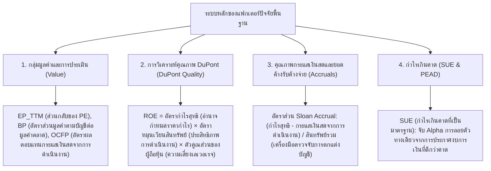

# บทที่ 10: การขุดแฟกเตอร์ปัจจัยพื้นฐานและคุณภาพการเติบโตแบบ DuPont

> **เป้าหมายหลักของบทนี้**:  
> ขจัดความเชื่องมงายต่ออัตราส่วนราคาต่อกำไรแบบสถิตดั้งเดิม (Static P/E) ให้หมดสิ้น เพื่อมองเห็นสาเหตุเบื้องลึกของ "กับดักมูลค่า (Value Trap)"; เข้าใจและใช้งานเฟรมเวิร์ก Quant เชิงปริมาณ (Quant) ปัจจัยพื้นฐานแบบหลายแฟกเตอร์ในระดับฝั่ง Buy-side (Buy-side): กลุ่มมูลค่า (EP/BP/OCFP), การแยกองค์ประกอบ 3 แฟกเตอร์ของ DuPont เชิงลึก (อัตรากำไรสุทธิ, อัตราหมุนเวียนของสินทรัพย์ และการลงโทษเลเวอเรจสูง), ความผิดปกติของกำไรค้างรับค้างจ่ายของ Sloan (Accruals Quality), อัตราส่วนกำไรขั้นต้นต่อสินทรัพย์ของ Novy-Marx (GP/A) ตลอดจนแฟกเตอร์กำไรเกินคาดที่เป็นมาตรฐาน (Standardized Unexpected Earnings: SUE) ที่อิงจากปรากฏการณ์ราคาลอยตัวหลังประกาศผลประกอบการ (Post-Earnings Announcement Drift: PEAD); คำนวณฟีเจอร์ปัจจัยพื้นฐานที่มีความทนทานสูงบนภาคตัดขวาง (Cross-sectional) ที่จัดแนวข้อมูลแบบ PIT เรียบร้อยแล้ว

---

## 1. ทำไมการดูเพียง PE/PB จึงตกลงไปใน "กับดักมูลค่า"?

นักวิจัย Quant มือใหม่จำนวนมากมักชอบเข้าซื้อตะกร้าหุ้นที่ "มี PE หรือ PB ต่ำที่สุดในตลาด" โดยตรง เพราะคิดว่านี่คือ "การลงทุนเน้นคุณค่าแบบบัฟเฟตต์" แบบคลาสสิก อย่างไรก็ตาม ในตลาดหุ้น A-Share ความเป็นจริงคือ **การเปิดสถานะ Long หุ้นที่มี PE/PB ต่ำอย่างสุ่มสี่สุ่มห้ามักจะเผชิญกับผลการดำเนินงานที่ต่ำกว่าตลาดอย่างย่อยยับในระยะยาว (Value Trap)**

```
เส้นทางวิวัฒนาการระดับจุลภาคของ "กับดักมูลค่า"
หุ้นกลุ่มวัฏจักรดั้งเดิม / หุ้นสินทรัพย์หนักที่มีกำลังการผลิตล้นเกิน
├── ปรากฏการณ์ผิวเผิน: PE สถิตมีเพียง 5 เท่า, PB เพียง 0.6 เท่า (ดูเหมือน "ถูก" อย่างยิ่ง)
├── ความจริงเบื้องหลัง: อุตสาหกรรมกำลังเผชิญกับการถูกปลดระวางอย่างถาวร, การคาดการณ์กำไรในอนาคตถูกปรับลดลงอย่างรุนแรงต่อเนื่อง, งบดุลเผชิญกับการด้อยค่าของสินค้าคงคลังและค่าความนิยมมหาศาล
└── การตั้งราคาของตลาด: เม็ดเงินของสถาบันที่ชาญฉลาดได้ชิงเทขายล่วงหน้าไปนานแล้ว, การประเมินมูลค่าต่ำจึงเป็น "ส่วนลดความเสี่ยงที่สมเหตุสมผล" สำหรับความเสี่ยงสูงลิ่วของการผิดนัดชำระหนี้และการล้มละลาย!
```

### 1.1 สถาปัตยกรรมสี่มิติที่ประสานกันของ Quant ปัจจัยพื้นฐานยุคใหม่
Quant ฝั่ง Buy-side ยุคใหม่ไม่ทำการคัดกรองมูลค่าราคาถูกแบบโดดเดี่ยวอีกต่อไป แต่สร้าง**ระบบสี่มิติที่ประสานกันของ "มูลค่า + คุณภาพ + การเติบโต + กระแสเงินสดที่แท้จริง"**:
1. **ความถูก (Value)**: มาร์เก็ตแคปหนึ่งหน่วยสามารถแลกเป็นกำไรสุทธิและกระแสเงินสดจากการดำเนินงานที่แท้จริงได้เท่าใด (EP, BP, OCFP);
2. **คุณภาพสูง (Quality)**: ROE ที่สูงมาจากโมเดลธุรกิจที่มีประสิทธิภาพและอัตราการหมุนเวียนของสินทรัพย์สูง หรือเกิดจากการก่อหนี้มหาศาลเพื่อเพิ่มเลเวอเรจจนกลายเป็นฟองสบู่;
3. **ความแท้จริง (Cash Quality)**: กำไรมีกระแสเงินสดจริงรองรับ หรือเป็นเพียง "ความมั่งคั่งบนหน้ากระดาษ" ที่พองขึ้นมาจากลูกหนี้การค้า;
4. **การเติบโตที่เหนือความคาดหมาย (Growth Surprise)**: อัตราการเติบโตของกำไรในไตรมาสปัจจุบันสูงกว่าประมาณการที่เป็นฉันทามติของนักวิเคราะห์อย่างมีนัยสำคัญหรือไม่ (SUE & PEAD)

---

## 2. งานวิชาการระดับหมุดหมายคลาสสิก: จาก Fama-French สู่ความผิดปกติของ Sloan Accruals

1. **แบบจำลองการกำหนดราคา 5 แฟกเตอร์และส่วนชดเชยด้านการทำกำไรและการลงทุน**:  
   Fama, E. F., & French, K. R. (2015). *A five-factor asset pricing model*. Journal of Financial Economics.  
   *คุณูปการหลัก*: บรรจุ**แฟกเตอร์ความสามารถในการทำกำไร (RMW, Robust Minus Weak)** และ**แฟกเตอร์สไตล์การลงทุน (CMA, Conservative Minus Aggressive)** เพิ่มเติมจาก 3 แฟกเตอร์แบบคลาสสิกอย่างเป็นทางการ เพื่อพิสูจน์ว่าบริษัทคุณภาพสูงและมีการทำกำไรสูงจะสร้างผลตอบแทนส่วนเกิน (Excess Return) ในระยะยาวอย่างมีนัยสำคัญ
2. **การทำลายล้างข้ามมิติของอัตราส่วนกำไรขั้นต้นต่อสินทรัพย์ (GP/A)**:  
   Novy-Marx, R. (2013). *The other side of value: The gross profitability premium*. Journal of Financial Economics.  
   *การค้นพบหลัก*: กำไรขั้นต้น/สินทรัพย์รวม (Gross Profits-to-Assets) มีความสามารถในการคาดการณ์ผลตอบแทนในอนาคตเหนือกว่ากำไรสุทธิดั้งเดิมอย่างมาก เนื่องจากกำไรขั้นต้นอยู่บนสุดของงบกำไรขาดทุน จึงถูกผู้บริหารตกแต่งบัญชีได้ยากที่สุด!
3. **ความผิดปกติของกำไรค้างรับค้างจ่ายของ Sloan (The Accrual Anomaly)**:  
   Sloan, R. G. (1996). *Do Stock Prices Fully Reflect Information in Accruals and Cash Flows about Future Earnings?* The Accounting Review.  
   *ข้อสรุปหลัก*: ความต่อเนื่องของกำไรที่ขับเคลื่อนด้วยกำไรตามเกณฑ์คงค้างมีความเปราะบางอย่างยิ่ง ในขณะที่ความต่อเนื่องของกำไรที่ขับเคลื่อนด้วยกระแสเงินสดจากการดำเนินงานนั้นแข็งแกร่งมาก **การ Long หุ้นที่มีกระแสเงินสดสูงและ Short หุ้นที่มี Accruals สูงสามารถสร้างผลตอบแทนส่วนเกินจากการเก็งกำไรเชิงสถิติได้สูงมาก!**
4. **Piotroski F-Score และ Mohanram G-Score**:  
   Piotroski, J. D. (2000). *Value Investing: The Use of Historical Financial Statement Information to Separate Winners from Losers*. Journal of Accounting Research.  
   Mohanram, P. S. (2005). *Separating Winners from Losers among Low Book-to-Market Stocks using Financial Statement Analysis*. Review of Accounting Studies.

---

## 3. ระบบแบบจำลองทางคณิตศาสตร์ของแฟกเตอร์ปัจจัยพื้นฐานหลัก



### 3.1 แฟกเตอร์กลุ่มมูลค่า (Value Multiples)
ทำไมสถาบันฝั่ง Buy-side จึงคุ้นเคยกับการใช้ **EP (E/P)**, **BP (B/P)** และ **OCFP** มากกว่า PE และ PB?
- **ความต่อเนื่องของค่าตัวเลข**: เมื่อบริษัทจดทะเบียนมีกำไรเพียงเล็กน้อยหรือขาดทุนเล็กน้อย $P/E$ จะมีแนวโน้มลู่เข้าสู่อนันต์ทั้งบวกและลบ หรือเกิดการขาดตอนอย่างรุนแรง ในขณะที่ $E/P$ เป็นการแมปปิงจำนวนจริงที่มีความต่อเนื่องอย่างสมบูรณ์ แม้ว่ากำไรจะติดลบ ส่วนกลับในเชิงการกระจายตัวทางสถิติของภาคตัดขวางก็ยังคงราบเรียบและเปรียบเทียบกันได้!
- **สูตรทางคณิตศาสตร์**:
  $$EP_t = \frac{\text{NetProfit\_TTM}_t}{\text{TotalMarketCap}_t}, \quad BP_t = \frac{\text{TotalEquity}_t}{\text{TotalMarketCap}_t}$$
  $$OCFP_t = \frac{\text{OperatingCashFlow\_TTM}_t}{\text{TotalMarketCap}_t}$$

---

### 3.2 การแยกองค์ประกอบ 3 แฟกเตอร์ของการวิเคราะห์ DuPont เชิงลึก (DuPont Decomposition)
อัตราผลตอบแทนต่อส่วนของผู้ถือหุ้น (ROE) คือดัชนีชี้วัดสูงสุดในการวัดผลตอบแทนจากเงินทุนของผู้ถือหุ้น อย่างไรก็ตาม **แม้จะมี ROE 20% เท่ากัน แต่คุณภาพทางธุรกิจและความเสี่ยงด้านการชำระหนี้เบื้องหลังกลับแตกต่างกันราวฟ้ากับเหว**:

$$\text{ROE} = \underbrace{\frac{\text{NetProfit}}{\text{Revenue}}}_{\text{อัตรากำไรสุทธิ (Profit Margin)}} \times \underbrace{\frac{\text{Revenue}}{\text{TotalAssets}}}_{\text{อัตราหมุนเวียนของสินทรัพย์ (Asset Turnover)}} \times \underbrace{\frac{\text{TotalAssets}}{\text{TotalEquity}}}_{\text{ตัวคูณส่วนของผู้ถือหุ้น (Financial Leverage)}}$$

```
เกณฑ์การตัดสินคุณภาพการแยกองค์ประกอบ DuPont (มุมมองสถาบันฝั่ง Buy-side)
├── 1. อัตรากำไรสุทธิจากการขายสูงมาก (สินค้าอุปโภคบริโภคระดับไฮเอนด์, เซมิคอนดักเตอร์หลัก, ผู้นำนวัตกรรมยา)
│     └── แก่นแท้ทางธุรกิจ: มีคูเมืองที่แข็งแกร่งและมีอำนาจกำหนดราคาผลิตภัณฑ์ได้เองแต่เพียงผู้เดียว [ฝั่ง Buy-side เพิ่มน้ำหนักการลงทุนระยะยาว]
├── 2. อัตราหมุนเวียนของสินทรัพย์สูงมาก (การผลิตขั้นสูง/ความแม่นยำสูง, ค้าปลีกยักษ์ใหญ่ที่มีสาขา)
│     └── แก่นแท้ทางธุรกิจ: มีความสามารถในการจัดการซัพพลายเชนที่ยอดเยี่ยม ควบคุมสินค้าคงคลังเป็นศูนย์ และมีประสิทธิภาพในการดำเนินงานที่รวดเร็วอย่างยิ่ง [ฝั่ง Buy-side เพิ่มน้ำหนักการลงทุนระยะยาว]
└── 3. ตัวคูณส่วนของผู้ถือหุ้นสูงผิดปกติ (อสังหาริมทรัพย์หนี้สินสูง, แพลตฟอร์มระดมทุนของรัฐบาลท้องถิ่น, บริษัทที่ใกล้ผิดนัดชำระหนี้)
      └── แก่นแท้ทางธุรกิจ: ตัวเองขาดความสามารถในการสร้างกระแสเงินสด อาศัยการกู้ยืมหนี้สินอย่างบ้าคลั่งเพื่อรักษา ROE บนฉากหน้า [ฝั่ง Buy-side ลงโทษเชิงลบอย่างเข้มงวด]
```

- **การนำไปใช้ในทางวิศวกรรม Quant**: สร้างแฟกเตอร์อัตรากำไรสุทธิและแฟกเตอร์อัตราหมุนเวียนของสินทรัพย์แยกกัน และกำหนด**การลงโทษเชิงลบ (ควบคุม Exposure ความเสี่ยงจากเลเวอเรจ)** ให้กับตัวคูณส่วนของผู้ถือหุ้น

---
### 3.3 คุณภาพของกำไรและความแท้จริงของกระแสเงินสด (Accruals Quality)
รูปแบบสุดคลาสสิกของการตกแต่งบัญชีของบริษัทจดทะเบียนคือ: **สร้างลูกหนี้การค้าจำนวนมหาศาลขึ้นมา รายได้และกำไรสุทธิตามบัญชีพุ่งกระฉูด แต่ในบัญชีธนาคารของบริษัทกลับไม่มีกระแสเงินสดจริงไหลเข้าแม้แต่แดงเดียว**

เครื่องมือตรวจจับกับระเบิดที่ Quant เชิงปริมาณ (Quant) ฝั่ง Buy-side ต้องมี — **อัตราส่วน Sloan Accrual (Sloan Accrual Ratio)**:

$$\text{AccrualRatio} = \frac{\text{NetProfit\_TTM} - \text{OperatingCashFlow\_TTM}}{\text{TotalAssets}}$$

- **เกณฑ์การตัดสิน**: ยิ่ง $\text{AccrualRatio}$ สูงมากเท่าใด ยิ่งบ่งชี้ว่าในกำไรสุทธิมี "เช็คเปล่าของลูกหนี้การค้า" ที่ไร้กระแสเงินสดรองรับมากเท่านั้น;
- กระแสเงินสดสุทธิจากกิจกรรมดำเนินงานของกิจการชั้นยอดมักจะ**มากกว่าหรือเท่ากับกำไรสุทธิ** ($\text{CashToNetProfit} \ge 1.0$)
- การสร้างแฟกเตอร์ (Factor): ติดเครื่องหมายลบ $\text{Factor}_{Accrual} = - \text{AccrualRatio}$ เพื่อเปิดสถานะ Long สินทรัพย์ที่มี Accrual ต่ำและมีกระแสเงินสดแท้จริงสูง

---

### 3.4 กำไรที่เหนือความคาดหมายแบบมาตรฐาน (Standardized Unexpected Earnings, SUE)
ปฏิกิริยาของผลตอบแทนส่วนเกิน (Excess Return) หลังการประกาศงบการเงิน:

$$Growth_t = \frac{Q_t - Q_{t-4}}{|Q_{t-4}|}, \quad SUE_t = \frac{Q_t - Q_{t-4}}{\sigma_{t-1}(\Delta Q)}$$

โดยที่ $Q_t$ และ $Q_{t-4}$ คือกำไรสุทธิส่วนที่เป็นของบริษัทใหญ่เฉพาะ**ไตรมาสเดี่ยว**ของงวดปัจจุบันและงวดเดียวกันของปีก่อนหน้าตามลำดับ ตัวส่วนคือส่วนเบี่ยงเบนมาตรฐานของการเปลี่ยนแปลงเมื่อเทียบกับปีก่อนหน้าแบบรายไตรมาสย้อนหลัง 8 ไตรมาส SUE สามารถทำ Standardization เพื่อขจัดความผันผวนตามวัฏจักร และตรวจจับม้ามืดที่มีกำไรเหนือความคาดหมายซึ่งนักวิเคราะห์คาดไม่ถึงได้อย่างแม่นยำ

---

## 4. ลงมือปฏิบัติจริง: เครื่องมือคำนวณมัลติแฟกเตอร์ปัจจัยพื้นฐานระดับ Buy-side

โค้ด Python ด้านล่างปฏิบัติตามมาตรฐานระดับสถาบันฝั่ง Buy-side อย่างเคร่งครัด โดยผสาน**มูลค่าหลักทรัพย์ตามราคาตลาด ณ วันปรับพอร์ต (Rebalance) (สถานะเรียลไทม์ของตลาด)** เข้ากับ**ตัวชี้วัดงบการเงินแบบ PIT ล่าสุดที่ประกาศแล้ว (สถานะทางการเงินที่ถูกต้องตามประวัติศาสตร์)** และคำนวณ EP, BP, แฟกเตอร์ดูปองท์ 3 ตัว รวมถึงตัวชี้วัดคุณภาพของ Accrual ด้วยวิธีเวกเตอร์ล้วน

ในไดเรกทอรีรากของโปรเจกต์ ให้รัน `PYTHONPATH=tutorial python3 -m examples.lecture_10_fundamental_factors` ดูการติดตั้ง Dependency, โมดูลที่ใช้ร่วมกัน และ Data Contract ได้ที่ [คำอธิบายโปรเจกต์](../README.md)

<<< @/examples/lecture_10_fundamental_factors.py

### ผลลัพธ์หลักจากการรันและมุมมองโมเดลธุรกิจ:
```
[*] 正在计算买方基本面与杜邦质量特征矩阵...
✅ 基本面特征矩阵计算完成！耗时: 0.026 秒
===============================================================================================
三类不同商业质量标的的杜邦拆解与基本面特征对比：
===============================================================================================
shape: (3, 7)
┌────────┬───────────┬──────────┬───────────┬───────────┬───────────┬──────────┐
│ symbol ┆ factor_ep ┆ roe_ttm  ┆ dupont_ma ┆ dupont_tu ┆ dupont_le ┆ cash_to_ │
│ ---    ┆ _ttm      ┆ ---      ┆ rgin      ┆ rnover    ┆ verage    ┆ profit_r │
│ str    ┆ ---       ┆ f64      ┆ ---       ┆ ---       ┆ ---       ┆ atio     │
│        ┆ f64       ┆          ┆ f64       ┆ f64       ┆ f64       ┆ ---      │
│        ┆           ┆          ┆           ┆           ┆           ┆ f64      │
╞════════╪═══════════╪══════════╪═══════════╪═══════════╪═══════════╪══════════╡
│ DEMO_A ┆ 0.031818  ┆ 0.333333 ┆ 0.5       ┆ 0.538462  ┆ 1.238095  ┆ 1.114286 │
│ DEMO_B ┆ 0.02      ┆ 0.075    ┆ 0.006667  ┆ 2.0       ┆ 5.625     ┆ 5.833333 │
│ DEMO_C ┆ 0.075     ┆ 0.5      ┆ 0.03      ┆ 0.416667  ┆ 40.0      ┆ -5.33333 │
│        ┆           ┆          ┆           ┆           ┆           ┆ 3        │
└────────┴───────────┴──────────┴───────────┴───────────┴───────────┴──────────┘
```

1. **หลักทรัพย์ DEMO_A (ตัวแทนของสินทรัพย์หลัก Core Asset)**:
   - อัตรากำไรสุทธิสูงถึง 50%, อัตราการหมุนเวียนของสินทรัพย์มั่นคง (0.54), ตัวคูณส่วนของผู้ถือหุ้นต่ำมาก (1.24 แทบไม่มีหนี้สิน), อัตราส่วนกระแสเงินสดต่อกำไรสุทธิสูงถึง 1.11, ROE ที่แท้จริงอยู่ที่ 33.3% จัดเป็นหลักทรัพย์ Alpha คุณภาพสูงระดับแถวหน้า;
2. **หลักทรัพย์ DEMO_C (ตัวแทนของบริษัทอสังหาริมทรัพย์เลเวอเรจสูงที่เสี่ยงล้มละลาย)**:
   - เมื่อมองจากภายนอก ค่า $EP = 0.075$ (PE เพียง 13 เท่า) และ ROE ผิวเผินสูงถึง **50.0%** อย่างน่าทึ่ง!
   - แต่เมื่อแยกโครงสร้างตามแบบดูปองท์อย่างละเอียด ตัวคูณส่วนของผู้ถือหุ้นสูงถึง **40.0** (ส่วนของผู้ถือหุ้นบางเฉียบ หนี้สินแตะระดับล้านล้าน) อัตราส่วนกระแสเงินสดต่อกำไรอยู่ที่ **-5.33** (กระแสเงินสดจากการดำเนินงานขาดทุนมหาศาลถึง -8 พันล้าน!)
   - หากขาดแฟกเตอร์ด้านคุณภาพมาช่วยตรวจจับกับระเบิด โมเดลแบบดั้งเดิมจะเข้าใจผิดคิดว่าเป็นหุ้นกระทิงตัวใหญ่ที่จะเติบโตหลายเท่าแล้วเข้าซื้อ ซึ่งสุดท้ายผลลัพธ์ที่ได้คือการผิดนัดชำระหนี้และราคาหุ้นพังทลายลงมา!

---

## 5. สรุปประจำบทและแบบฝึกหัดลงมือปฏิบัติหลังเรียน

### สรุปแผนผังองค์ความรู้หลัก:
1. **EP/BP เหนือกว่า PE/PB**: การใช้รูปแบบส่วนกลับเป็นแนวทางมาตรฐานของฝั่ง Buy-side เพื่อขจัดปัญหาค่าอนันต์หรือการถูกตัดทิ้งของตัวเลขเมื่อบริษัทมีกำไรน้อยมากหรือขาดทุน;
2. **การวิเคราะห์แบบดูปองท์เพื่อแยกของจริงออกจากของปลอม**: ROE สูงไม่ได้แปลว่าเป็นบริษัทที่ดีเสมอไป ต้องเฝ้าระวัง ROE เทียมที่ถูกปั่นให้สูงด้วยเลเวอเรจทางการเงินอย่างเข้มงวด และสนับสนุนโมเดล "อัตรากำไรสุทธิสูง + อัตราหมุนเวียนสินทรัพย์สูง";
3. **ตรวจจับกับระเบิดด้วยความผิดปกติของ Sloan Accrual**: กิจการที่กระแสเงินสดสุทธิจากการดำเนินงานน้อยกว่ากำไรสุทธิแฝงไปด้วยความเสี่ยงมหาศาลจากหนี้เสียและการตกแต่งตัวเลขทางบัญชี;
4. **SUE กำไรเหนือความคาดหมาย**: การเปลี่ยนแปลงของกำไรสุทธิรายไตรมาสที่เหนือความคาดหมายหลังผ่านการทำ Standardization สามารถสร้างผลตอบแทนส่วนเกินอย่างต่อเนื่องจากปรากฏการณ์ PEAD Drift

### แบบฝึกหัดลงมือปฏิบัติหลังเรียน:
> **โจทย์ฝึกปฏิบัติ**:  
> 1. เปิดไฟล์ `tutorial/examples/lecture_10_fundamental_factors.py`  
> 2. เขียนฟังก์ชันเพื่อสร้างคะแนนคุณภาพรวม (Composite Quality Score) จากแฟกเตอร์ดูปองท์ทั้ง 3 ตัว:  
>    $$\text{QualityScore} = \text{Rank}(\text{dupont\_margin}) + \text{Rank}(\text{dupont\_turnover}) - \text{Rank}(\text{dupont\_leverage})$$
> 3. เปรียบเทียบการจัดอันดับคะแนนรวมของ DEMO_A, DEMO_B และ DEMO_C เพื่อสังเกตว่าสินทรัพย์ขยะที่มีเลเวอเรจสูงถูกคัดออกไปอยู่อันดับสุดท้ายสำเร็จหรือไม่
