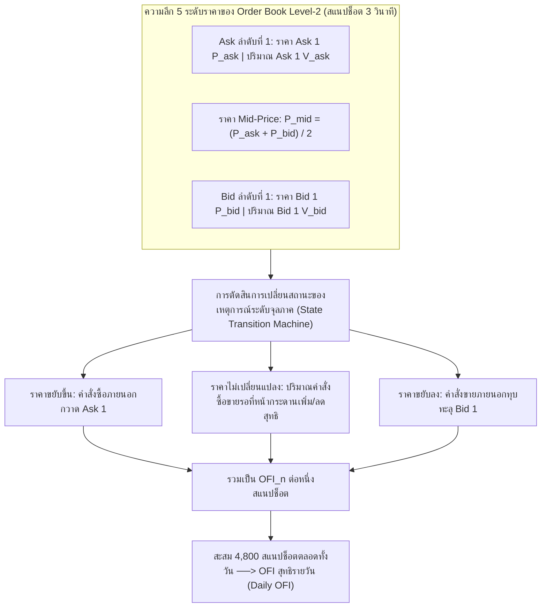

# บทที่ 11: Feature Engineering จากข้อมูลความถี่สูงสู่ความถี่ต่ำ: โครงสร้างจุลภาค และ OFI

> **เป้าหมายหลักของบทนี้**:  
> เจาะลึกสู่หัวใจของ Alpha ฝั่ง Buy-side ทำความเข้าใจคุณค่าเชิงกลยุทธ์ของการแปลงข้อมูลความถี่สูงสู่ความถี่ต่ำ (High-Frequency to Low-Frequency); เริ่มต้นจากวรรณกรรมคลาสสิกด้านโครงสร้างจุลภาคของตลาด (แบบจำลอง Kyle และงานวิจัยของ Cont-Kukanov-Stoikov) เพื่อพิสูจน์สมการการเปลี่ยนสถานะ (State Transition Equation) ของสมุดคำสั่งซื้อขายแบบจำกัดราคา (Limit Order Book, LOB) อย่างรัดกุม; เชี่ยวชาญอัลกอริทึมการรวมและลดมิติระดับจุลภาคระหว่างวันสำหรับ **Order Flow Imbalance ระดับเดียวและหลายช่วงราคา (Multi-Level OFI)** รวมถึง **แฟกเตอร์ Smart Money (Q-Factor)**; พัฒนาเอนจิน Feature Engineering ระดับจุลภาคในระดับมิลลิวินาทีด้วย Polars

---

## 1. ทำไม "การแปลงข้อมูลความถี่สูงสู่ความถี่ต่ำ" จึงเป็นคูเมืองหลักของ Quant ฝั่ง Buy-side ยุคใหม่?

ในแวดวงการลงทุนเชิงปริมาณ (Quant) มี "ไตรภาวะที่เป็นไปไม่ได้" (Trilemma) ของกลยุทธ์ที่รู้จักกันดี:
- **กลยุทธ์ความถี่ต่ำแบบรายวัน/รายสัปดาห์ล้วน**: มีขนาดความจุเงินทุน (Capacity) สูง (รองรับได้ถึงระดับหลายหมื่นล้าน) แต่ความละเอียดของข้อมูลหยาบ แฟกเตอร์มีความซ้ำซ้อนกันสูง (Sharpe Ratio มักอยู่ระหว่าง 1.5~2.2);
- **กลยุทธ์การเทรดความถี่สูง (HFT) ระดับไมโครวินาทีล้วน**: Sharpe Ratio สูงมาก (มักแตะ 5.0~8.0 ขึ้นไป) แต่ Capacity ต่ำมาก (มักรองรับได้เพียงระดับหลักสิบล้าน) และต้องพึ่งพาฮาร์ดแวร์ FPGA ราคาแพงรวมถึงการวางเซิร์ฟเวอร์แบบ Colocation ความเร็วสูงอย่างยิ่ง

```
แนวทางแก้ปัญหาของการแปลงข้อมูลความถี่สูงสู่ความถี่ต่ำ (HF to LF)
├── 1. แหล่งข้อมูล: รวบรวมสแนปช็อตแบบรายคำสั่งของ Level-2 ทุก 3 วินาที และข้อมูลความลึกของ Order Book ทั่วทั้งตลาด (เฉลี่ยหลายสิบ GB ต่อวัน)
├── 2. การคลีนและคำนวณ: สกัดฟีเจอร์ระดับจุลภาคที่มี Signal-to-Noise Ratio สูงมาก จาก State Machine ของราคาเสนอซื้อขาย (OFI, ยอดซื้อสุทธิของคำสั่งซื้อขนาดใหญ่เชิงรุก, อัตราส่วนการวางและยกเลิกคำสั่งซื้อ)
└── 3. การลดมิติและรวมข้อมูล: บีบอัดสแนปช็อตระดับจุลภาค 4,800 ภาพในระหว่างวันตามค่าทางสถิติให้เป็นฟีเจอร์รายวัน/รายสัปดาห์ แล้วป้อนเข้าโมเดล Neutralization หลายแฟกเตอร์เพื่อปรับพอร์ต (Rebalance)!
ผลลัพธ์: หลีกเลี่ยงข้อจำกัดเพดาน Capacity ระดับมิลลิวินาทีของ HFT แท้ๆ และดึงข้อดีของ Signal-to-Noise Ratio ที่สูงจากโครงสร้างจุลภาคความถี่สูงมาใช้ ทำให้เกิดการผสมผสานที่สมบูรณ์แบบระหว่าง "Capacity ระดับหมื่นล้าน + Sharpe Ratio สูง"!
```

---

## 2. วรรณกรรมวิชาการคลาสสิก: จากแบบจำลอง Kyle สู่ Cont-Kukanov-Stoikov (2014)

1. **ต้นทุน Market Impact ระดับจุลภาคของผู้ค้าที่มีข้อมูล (Informed Trader)**:  
   Kyle, A. S. (1985). *Continuous Auctions and Informed Trader*. Econometrica.  
   *คุณูปการสำคัญ*: นำเสนอแบบจำลอง Kyle คลาสสิก ซึ่งพิสูจน์ว่าการเปลี่ยนแปลงของราคาแปรผันตรงกับโฟลว์คำสั่งซื้อขายสุทธิ: $\Delta P_t = \lambda \cdot Q_t + \epsilon_t$ โดยพารามิเตอร์ $\lambda$ (Kyle's Lambda) วัดสภาพคล่องที่ต่ำของตลาดและความเสี่ยงจากการเลือกที่ไม่เป็นคุณ (Adverse Selection Risk) โดยตรง
2. **รากฐานทางคณิตศาสตร์ของ Order Flow Imbalance (OFI)**:  
   Cont, R., Kukanov, A., & Stoikov, S. (2014). *The Price Impact of Order Book Events*. Journal of Financial Econometrics.  
   *คุณูปการสำคัญ*: พิสูจน์สมการ OFI สุทธิจากทุกเหตุการณ์ระดับจุลภาคใน LOB (Limit Order, Market Order, การยกเลิกคำสั่ง) อย่างรัดกุมเป็นครั้งแรก และพิสูจน์เชิงประจักษ์ว่า OFI มีอำนาจในการอธิบาย ($R^2$) การเปลี่ยนแปลงของราคา Mid-Price สูงถึง 60%~80%!
3. **ความเป็นพิษของคำสั่งซื้อขายและความน่าจะเป็นในการซื้อขายโดยมีข้อมูล (VPIN)**:  
   Easley, D., López de Prado, M. M., & O'Hara, M. (2012). *Flow toxicity and liquidity in a high-frequency world*. The Review of Financial Studies.

---

## 3. การพิสูจน์ทางคณิตศาสตร์ระดับลึกของ Order Flow Imbalance (OFI)

ในช่วงเวลาการประมูลต่อเนื่อง แก่นแท้ทางกายภาพระดับจุลภาคของการเปลี่ยนแปลงราคา คือ **การถูกใช้งานและการผลักดันของคิวคำสั่งซื้อขายระหว่างฝั่งซื้อและฝั่งขายใน LOB**



### 3.1 สมการการเปลี่ยนสถานะของราคาเสนอซื้อขาย Bid/Ask

สมมติให้ ณ สแนปช็อตที่ $n$ ราคา Bid 1 คือ $P_{bid,n}$ และปริมาณคำสั่งรอซื้อคือ $V_{bid,n}$ เราจะพิสูจน์การเปลี่ยนแปลงสุทธิเชิงมูลค่าคำสั่งซื้อฝั่งซื้อ $I_{bid,n}$ จากสแนปช็อต $n-1$ ถึง $n$:

$$I_{bid,n} = \begin{cases}
V_{bid,n}, & \text{หาก } P_{bid,n} > P_{bid,n-1} \quad \text{（ฝั่งซื้อดันราคาสูงขึ้น มีคำสั่งซื้อใหม่ที่ราคาสูงกว่า）} \\
V_{bid,n} - V_{bid,n-1}, & \text{หาก } P_{bid,n} = P_{bid,n-1} \quad \text{（ราคาซื้อไม่เปลี่ยนแปลง คิว Bid 1 เพิ่ม/ลดสุทธิ）} \\
-V_{bid,n-1}, & \text{หาก } P_{bid,n} < P_{bid,n-1} \quad \text{（ฝั่งซื้อถอย คำสั่งซื้อก่อนหน้าถูกกวาดหมดหรือยกเลิก）}
\end{cases}$$

ในทำนองเดียวกัน สำหรับฝั่งขาย เราจะพิสูจน์ปริมาณการถูกใช้ไปสุทธิของคำสั่งฝั่งขาย $I_{ask,n}$:

$$I_{ask,n} = \begin{cases}
-V_{ask,n-1}, & \text{หาก } P_{ask,n} > P_{ask,n-1} \quad \text{（ราคาขายขยับขึ้น ฝั่งขายถูกผลักดันขึ้นด้านบน）} \\
V_{ask,n} - V_{ask,n-1}, & \text{หาก } P_{ask,n} = P_{ask,n-1} \quad \text{（ราคาขายไม่เปลี่ยนแปลง คิว Ask 1 เพิ่ม/ลดสุทธิ）} \\
V_{ask,n}, & \text{หาก } P_{ask,n} < P_{ask,n-1} \quad \text{（ฝั่งขายทุบราคา มีคำสั่งขายใหม่ที่ราคาต่ำกว่า）}
\end{cases}$$

### 3.2 ปริมาณ Order Flow Imbalance (OFI) สุทธิ
**OFI สุทธิ** ของรอบสแนปช็อตที่ $n$ นิยามเป็นแรงผลักดันสุทธิฝั่งซื้อลบด้วยแรงผลักดันสุทธิฝั่งขาย:

$$OFI_n = I_{bid,n} - I_{ask,n}$$

- $OFI_n > 0$: บ่งชี้ว่าในระดับจุลภาค **การเปลี่ยนแปลงอุปสงค์-อุปทานของ Best Quote ฝั่งซื้อเทียบกับฝั่งขายเป็นบวก** ราคาจึงมีโมเมนตัมผลักดันขึ้นในระดับจุลภาค;
- $OFI_n < 0$: บ่งชี้ว่าแรงขายรอส่งมอบของฝั่งขายในระดับจุลภาคมีความหนาแน่นสูง

---
## 4. อัลกอริทึมการรวม Snapshots ความถี่สูงระหว่างวันสู่ฟีเจอร์ความถี่ต่ำ

ในหุ้น A-Share แต่ละวันทำการซื้อขาย (09:30-11:30, 13:00-15:00) หุ้นแต่ละตัวจะสร้าง **Snapshot ระดับ Level-2 ทุก 3 วินาที ประมาณ 4,800 รายการ**

### 4.1 อัลกอริทึมที่ 1: แฟกเตอร์ (Factor) OFI สะสมและปรับเป็นมาตรฐาน (Standardization) ตลอดทั้งวัน (Norm OFI)
นำค่า $OFI_n$ จาก 4,800 Snapshots ตลอดวันมารวมสะสม แล้วหารด้วยค่าเฉลี่ยความลึกของ Order Book ตลอดวันเพื่อแปลงให้เป็นค่าไร้มิติ:

$$\text{OFI}_{daily} = \frac{\sum_{n=1}^N OFI_n}{\frac{1}{N} \sum_{n=1}^N (V_{bid,n} + V_{ask,n})}$$

### 4.2 อัลกอริทึมที่ 2: แฟกเตอร์ Smart Money (Smart Money / Q-Factor)
นอกจากสมุดคำสั่งซื้อขายระดับ L2 แล้ว ในรูปแบบจุลภาคของปริมาณการซื้อขายระดับนาทียังซ่อนร่องรอยการปะทะกันระหว่างนักลงทุนรายย่อยและนักลงทุนสถาบัน

- **กลไกเชิงพฤติกรรม**: เงินทุนขนาดใหญ่ของสถาบันมักส่งคำสั่งซื้อขายโดยใช้อัลกอริทึมซอยคำสั่ง (VWAP/TWAP) มีปริมาณการซื้อขายต่อรายการขนาดใหญ่ และมีความอดทนต่อราคาขณะเข้าซื้อมากกว่า ส่วนการเทรดของนักลงทุนรายย่อยส่วนใหญ่เป็นยอดเงินขนาดเล็กตามการตัดสินใจแบบสุ่มและอารมณ์ชั่ววูบ
- **ขั้นตอนการสร้าง**:
  1. นำแท่งเทียนระดับนาทีจำนวน 240 แท่งในแต่ละวันมาเรียงลำดับจากมากไปน้อยตาม**ความเข้มข้นเชิงประกอบของการเปลี่ยนแปลงราคาและปริมาณการซื้อขาย (Smart Metric $S_t = |R_t| / \sqrt{V_t}$)**;
  2. ตัดเลือกช่วง 20% แรกที่มีปริมาณการซื้อขายกระจุกตัวมากที่สุด ซึ่งเป็น "ช่วงเวลาเทรดของ Smart Money";
  3. คำนวณอัตราส่วนระหว่างราคาเฉลี่ยถ่วงน้ำหนักด้วยปริมาณการซื้อขายในช่วงเวลาดังกล่าว $VWAP_{smart}$ กับราคาเฉลี่ยถ่วงน้ำหนักด้วยปริมาณการซื้อขายตลอดทั้งวัน $VWAP_{all}$:
     $$Q_{smart} = \frac{VWAP_{smart}}{VWAP_{all}}$$
  4. **นัยทางเศรษฐศาสตร์**: เมื่อ $Q_{smart}$ มีค่ามากกว่า 1 อย่างมีนัยสำคัญ แสดงว่าเงินทุนหลักยังคงเข้าซื้ออย่างเด็ดเดี่ยวแม้ราคาจะอยู่ในระดับที่ค่อนข้างสูงของวัน บ่งชี้ว่ามีโมเมนตัมต่อเนื่องที่เปี่ยมล้น

---

## 5. ภาคปฏิบัติลงมือทำ: ตัวสกัดฟีเจอร์ระดับจุลภาคจาก Order Flow ระดับ Level-2 ความถี่สูง

โมดูล Python ด้านล่างนี้จะจำลอง Snapshots ความหนาแน่นสูงจำนวน 4,800 รายการตลอดทั้งวัน เพื่อสาธิต**ไปป์ไลน์การคำนวณ Order Flow Imbalance (OFI) ตามแบบจำลอง Cont-Kukanov-Stoikov และการรวมข้อมูลลดมิติสู่ระดับรายวัน**

ในไดเรกทอรีรากของโปรเจกต์ รัน `PYTHONPATH=tutorial python3 -m examples.lecture_11_high_freq_to_low_freq` ดูการติดตั้ง Dependency, โมดูลที่ใช้ร่วมกัน และ Data Contract ได้ที่[คำอธิบายโปรเจกต์](../README.md)

<<< @/examples/lecture_11_high_freq_to_low_freq.py

### ผลลัพธ์หลักจากการรันและการแปลผลฟีเจอร์ระดับจุลภาค:
```
[*] 正在生成高密度 Level-2 订单簿盘口快照仿真流 (共 4800 条快照)...
✅ 高频低频化聚合计算完毕！耗时: 0.056 秒

================================================================================
日频标准化订单流不平衡 (Norm OFI) 降维提取结果：
================================================================================
shape: (2, 6)
┌───────────┬────────────┬─────────────┬─────────────┬────────────┬────────────┐
│ symbol    ┆ trade_date ┆ daily_cum_o ┆ avg_lob_dep ┆ factor_nor ┆ factor_ofi │
│ ---       ┆ ---        ┆ fi          ┆ th          ┆ m_ofi      ┆ _volatilit │
│ str       ┆ date       ┆ ---         ┆ ---         ┆ ---        ┆ y          │
│           ┆            ┆ f64         ┆ f64         ┆ f64        ┆ ---        │
│           ┆            ┆             ┆             ┆            ┆ f64        │
╞═══════════╪════════════╪═════════════╪═════════════╪════════════╪════════════╡
│ 000001.SZ ┆ 2023-10-16 ┆ 19594.0     ┆ 423.572292  ┆ 46.258927  ┆ 365.979011 │
│ 600519.SH ┆ 2023-10-16 ┆ 11660.0     ┆ 424.070833  ┆ 27.495406  ┆ 367.300476 │
└───────────┴────────────┴─────────────┴─────────────┴────────────┴────────────┘
```

1. **ขับเคลื่อนด้วย State Machine ระดับจุลภาคในเสี้ยววินาที**:
   - อัลกอริทึมติดตามการเปลี่ยนแปลงของราคาและปริมาณคำสั่งซื้อขายช่วงราคาที่ดีที่สุด (Best Bid/Ask) แบบเฟรมต่อเฟรม โดยทำงานแบบขนานบน Multi-core ซึ่งใช้เวลาเพียง **0.056 วินาที** ในการอนุมานการเปลี่ยนสถานะของ 4,800 Snapshots ระดับจุลภาคตลอดทั้งวัน;
2. **การสกัดโมเมนตัมฝั่งซื้อและฝั่งขายอย่างแม่นยำ**:
   - หุ้นอ้างอิง `000001.SZ` มียอด OFI สะสมสุทธิตลอดวันอยู่ที่ +19,594 และมีค่าความเข้มข้นสัมพัทธ์หลัง Standardization สูงถึง **46.26** ซึ่งสะท้อนถึงแรงผลักดันมหาศาลจากฝั่งเสนอซื้อเชิงรุกในระดับจุลภาคอย่างชัดเจน;
   - อินดิเคเตอร์นี้สามารถนำไปใช้เป็นฟีเจอร์ภาคตัดขวาง (Cross-sectional) ระดับรายวันได้โดยตรง และป้อนเข้าสู่แบบจำลองการหาพอร์ตที่เหมาะสม (Portfolio Optimization) ร่วมกับฟีเจอร์โมเมนตัมและการประเมินมูลค่า

---

## 6. สรุปบทนี้และแบบฝึกหัดภาคปฏิบัติหลังเลิกเรียน

### สรุปแผนผังความรู้หลัก:
1. **คุณค่าเชิงกลยุทธ์ของการแปลงความถี่สูงสู่ความถี่ต่ำ**: หลีกเลี่ยงเพดานความจุระดับไมโครวินาทีของความถี่สูงล้วนได้อย่างชาญฉลาด ขณะเดียวกันก็ดึงเอา Signal-to-Noise Ratio ที่สูงของ Order Book ระดับจุลภาคมาใช้ นับเป็นอาวุธสำคัญที่สุดของกองทุน Quant ฝั่ง Buy-side ระดับหมื่นล้านในประเทศปัจจุบัน;
2. **OFI เผยแรงผลักดันอุปสงค์และอุปทานระดับจุลภาค**: สะท้อนการเปลี่ยนแปลงของราคาเสนอซื้อขายที่ดีที่สุดที่เกิดจากคำสั่งใหม่ การจับคู่คำสั่ง และการยกเลิกคำสั่งซื้อขายไปพร้อมกัน ผ่านเมทริกซ์การเปลี่ยนสถานะราคาและปริมาณของคำสั่งซื้อขาย;
3. **การลดมิติสู่ความถี่ต่ำคือกุญแจสำคัญ**: Snapshots นับพันรายการตลอดทั้งวัน หลังผ่านการรวมสะสมและการทำ Standardization ด้วยความลึกของตลาด จะถูกแปลงเป็นฟีเจอร์ระดับรายวัน/รายสัปดาห์ ซึ่งสามารถป้อนเข้าสู่โมเดลหลายแฟกเตอร์แบบ Cross-sectional ได้อย่างไร้รอยต่อ อีกทั้งยังต้านทานสัญญาณรบกวนจากความผันผวนแบบสุ่มระหว่างวันได้ดี

### แบบฝึกหัดภาคปฏิบัติหลังเลิกเรียน:
> **ภารกิจปฏิบัติการ**:  
> 1. เปิดไฟล์ `tutorial/examples/lecture_11_high_freq_to_low_freq.py`
> 2. สังเกตตรรกะของ State Machine ในฟังก์ชัน `compute_intraday_ofi` แล้วลองคิดว่า หากผู้ให้บริการข้อมูลตลาดจัดเตรียมข้อมูล Level-2 ระดับเสนอซื้อ 1 ถึงเสนอซื้อ 5 (ความลึก 5 ลำดับราคา) จะขยาย OFI แบบลำดับราคาเดียวให้เป็น **OFI หลายระดับแบบลดทอน (Multi-Level OFI)** ได้อย่างไร?
> 3. เพราะเหตุใดในหุ้น A-Share ปริมาณคำสั่งซื้อขายที่คงค้างในช่วงเวลาเงียบหลังสิ้นสุดการประมูลล่วงหน้าภาคเช้า (ช่วงระหว่าง 09:25 ที่กำหนดราคาเปิด จนถึง 09:30) จึงมีน้ำหนักต่อการค้นพบราคาตลอดทั้งวันสูงมาก?
