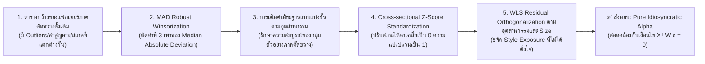

# บทที่ 12: กระบวนการ 4 ขั้นตอนระดับอุตสาหกรรมสำหรับการเตรียมข้อมูลแฟกเตอร์

> **เป้าหมายหลักของบทนี้**:  
> ทำความเข้าใจ "กระบวนการคลีนข้อมูล 4 ขั้นตอนระดับอุตสาหกรรม" ที่ขาดไม่ได้ก่อนนำฟีเจอร์ของแฟกเตอร์ (Factor) เข้าฐานข้อมูลของสถาบันฝั่ง Buy-side: **MAD (Median Absolute Deviation) Robust Winsorization**, **การเติมค่าด้วยมัธยฐานแบบแบ่งชั้นตามอุตสาหกรรม (Industry-Stratified Imputation)**, **Z-Score Standardization แบบไม่เอนเอียงในภาคตัดขวาง (Cross-sectional)**, และ**การทำ Residual Orthogonalization กับอุตสาหกรรมและลอการิทึมของ Market Cap ด้วย Weighted Least Squares (WLS)**; อนุพัทธ์ที่มาทางคณิตศาสตร์ของสัมประสิทธิ์ MAD 1.4826 จากควอนไทล์ของการแจกแจงแบบเกาส์เซียนอย่างเข้มงวด; พร้อมพิสูจน์คุณสมบัติทางคณิตศาสตร์ของเงื่อนไขการตั้งฉากแบบถ่วงน้ำหนักของ WLS $X^T W \hat{\epsilon} = 0$ อย่างเคร่งครัด

---

## 1. ทำไมถึงห้ามส่ง Raw Factor เข้าโมเดลโดยตรงอย่างเด็ดขาด?

ในบทเรียนก่อนหน้านี้ เราได้ขุดค้นตัวชี้วัดดั้งเดิม (Raw Factors) หลากหลายประเภทจากข้อมูลราคา ปริมาณการซื้อขาย และปัจจัยพื้นฐานขึ้นมา อย่างไรก็ตาม หากป้อนตัวชี้วัดดั้งเดิมเหล่านี้เข้าไปยัง Linear Scoring Model, Machine Learning หรือ Optimizer โดยตรง จะก่อให้เกิดความเสียหายร้ายแรงต่อข้อมูล:

```
4 ความเสี่ยงร้ายแรงของแฟกเตอร์ดั้งเดิมที่ยังไม่ผ่านการคลีน
├── 1. ค่าผิดปกติสุดโต่งแบบหางหนา (Fat-tail Outliers):
│     ├── กรณีตัวอย่าง: หุ้นปรับโครงสร้างพุ่งขึ้น 300% ในวันเดียว หรือหุ้นกำไรต่ำมี PE พุ่งทะลุ 10,000 เท่า
│     └── ผลกระทบเชิงทำลายล้าง: กำลังสองของความคลาดเคลื่อนจาก Outlier จุดเดียวจะครอบงำ OLS Linear Regression ทั้งหมด และทำลายการประมาณค่าพารามิเตอร์ทั่วทั้งตลาด!
├── 2. มลภาวะจาก Industry และ Sector Beta (Industry Bias):
│     └── ผลกระทบเชิงทำลายล้าง: แฟกเตอร์ที่เรียกว่า "ความสามารถในการทำกำไรสูง" แท้จริงแล้วกลับเลือกมาแต่หุ้นกลุ่มการเงินขนาดใหญ่และหุ้นสุราขาว กลายเป็นโมเดลกำลังเดิมพันกับอุตสาหกรรมฝั่งเดียว!
├── 3. สภาพร่วมเชิงเส้นแฝงจากสไตล์มาร์เก็ตแคป (Size Bias):
│     └── ผลกระทบเชิงทำลายล้าง: แฟกเตอร์ชอบหุ้น Micro-cap โดยธรรมชาติ กลยุทธ์แสดงผลตอบแทนส่วนเกิน (Excess Return) สูงเกินจริงในการ Backtest แต่ในการเทรดจริง (Live Trading) ต้องเจอกับการแย่งกันขายจนขาดสภาพคล่อง!
└── 4. หน่วยวัดที่ไม่สอดคล้องกันข้ามมิติ (Scale Inconsistency):
      └── ผลกระทบเชิงทำลายล้าง: แฟกเตอร์โมเมนตัมอยู่ในช่วง [-0.5, 0.5] ขณะที่แฟกเตอร์มูลค่าการซื้อขายอยู่ในช่วง [1e7, 1e10] จึงไม่สามารถรวมกันแบบถ่วงน้ำหนักเท่ากันได้!
```



---

## 2. การอนุพัทธ์ทางคณิตศาสตร์และขอบเขตของกระบวนการ 4 ขั้นตอนระดับอุตสาหกรรม

### 2.1 ขั้นตอนที่ 1: การทำ Robust Winsorization ด้วย Median Absolute Deviation (MAD)

#### ข้อบกพร่องร้ายแรงของการทำ Winsorization แบบดั้งเดิมด้วยค่าเฉลี่ย $3\sigma$:
สถิติแบบดั้งเดิมมักใช้การตัดค่าที่ $\mu \pm 3\sigma$ แต่ในข้อมูลการเงินจริง **Outliers จะดึงค่าเฉลี่ยกลุ่มตัวอย่าง $\mu$ ให้เบี่ยงเบนอย่างรุนแรง และทำให้ส่วนเบี่ยงเบนมาตรฐานกลุ่มตัวอย่าง $\sigma$ ขยายตัวมหาศาล**! การมีอยู่ของค่าผิดปกติสุดโต่งทำให้ $\mu$ และ $\sigma$ ปนเปื้อน จนไม่สามารถตรวจจับ Outliers ที่แท้จริงได้อย่างมีประสิทธิภาพ (Masking Effect)

#### นิยามทางคณิตศาสตร์ของ Robust MAD:
หามัธยฐาน $m$ ของกลุ่มตัวอย่างในภาคตัดขวาง แล้วคำนวณมัธยฐานของระยะห่างระหว่างกลุ่มตัวอย่างทั้งหมดกับค่ามัธยฐาน (Median Absolute Deviation, MAD):

$$m = \operatorname{median}(x), \quad \text{MAD} = \operatorname{median}\Big(|x - m|\Big)$$

$$x_i^{\text{clipped}} = \operatorname{clip}\Big(x_i, \; m - 3 \times 1.4826 \times \text{MAD}, \; m + 3 \times 1.4826 \times \text{MAD}\Big)$$

#### การอนุพัทธ์ทางคณิตศาสตร์ของสัมประสิทธิ์หลัก 1.4826:
ทำไมภายใต้การแจกแจงแบบปกติมาตรฐานถึงต้องคูณด้วย 1.4826?  
หากตัวแปรสุ่ม $X \sim \mathcal{N}(0, \sigma^2)$ มีมัธยฐานสมมาตรเป็น 0 มัธยฐานของค่าสัมบูรณ์ $|X|$ จะสอดคล้องกับ:

$$\mathbb{P}(|X| \le \text{MAD}) = 0.5 \implies \mathbb{P}\left(-\text{MAD} \le X \le \text{MAD}\right) = 0.5$$

จากความสมมาตรของการแจกแจงแบบปกติมาตรฐาน:

$$\Phi\left(\frac{\text{MAD}}{\sigma}\right) - \Phi\left(-\frac{\text{MAD}}{\sigma}\right) = 2\Phi\left(\frac{\text{MAD}}{\sigma}\right) - 1 = 0.5 \implies \Phi\left(\frac{\text{MAD}}{\sigma}\right) = 0.75$$

เมื่อเปิดตารางควอนไทล์ของการแจกแจงแบบปกติมาตรฐาน จะได้ว่า $\Phi^{-1}(0.75) \approx 0.67449$ ดังนั้น:

$$\frac{\text{MAD}}{\sigma} \approx 0.67449 \implies \sigma \approx \frac{1}{0.67449} \times \text{MAD} \approx \mathbf{1.4826} \times \text{MAD}$$

นั่นคือ ภายใต้เกณฑ์มาตรฐานการแจกแจงแบบปกติ $1.4826 \times \text{MAD}$ จะเป็น**ตัวประมาณค่าที่สอดคล้องและทนทาน (Consistent Robust Estimator)** ของส่วนเบี่ยงเบนมาตรฐานกลุ่มตัวอย่าง $\sigma$ โดยไม่ถูกปนเปื้อนจากค่าสุดโต่งเลยแม้แต่น้อย!

---

### 2.2 ขั้นตอนที่ 2: การเติมค่าสูญหายด้วยมัธยฐานแบบแบ่งชั้นตามอุตสาหกรรม (Industry-Stratified Imputation)
เมื่อค่าแฟกเตอร์ของหุ้นบางตัวสูญหายไป (เช่น หุ้นเข้าใหม่ขาดข้อมูลความผันผวนย้อนหลัง หรือหุ้นวัฏจักรมีกำไรสุทธิติดลบจนทำให้ตัวชี้วัดในรูปลอการิทึมบางตัวขาดหายไป):
- **หลักการของฝั่ง Buy-side**: ใช้**มัธยฐานของอุตสาหกรรมเดียวกัน**ในการเติมค่า (เนื่องจากหุ้นในอุตสาหกรรมเดียวกันมักมีลักษณะทางธุรกิจและอัตราส่วนการประเมินมูลค่าที่ใกล้เคียงกัน);
- หากข้อมูลขาดหายไปทั้งอุตสาหกรรม ให้ใช้มัธยฐานของทั้งตลาดเป็นแนวทางสำรอง;
- อุตสาหกรรมที่ไม่ทราบแน่ชัดต้องระบุอย่างชัดเจนเป็นหมวดหมู่แยกต่างหาก เช่น `ind_未知` ห้ามจัดกลุ่มที่ไม่ทราบแน่ชัดเข้าสู่หมวด "เบ็ดเตล็ด" โดยพลการ

---

### 2.3 ขั้นตอนที่ 3: การทำ Standardization แบบไม่เอนเอียงในภาคตัดขวาง (Cross-Sectional Z-Score)
เพื่อให้ฟีเจอร์จากมิติต่าง ๆ (เช่น โมเมนตัม, ROE, อัตรา Turnover) สามารถเปรียบเทียบกันได้ จึงต้องทำ Z-Score Transformation บนภาคตัดขวางของวันซื้อขาย:

$$z_i = \frac{x_i - \bar{x}}{s_x}, \quad \text{โดยที่ } s_x = \sqrt{\frac{1}{N-1}\sum_{i=1}^N (x_i - \bar{x})^2}$$

แฟกเตอร์หลังการแปลงจะสอดคล้องกับเงื่อนไขค่าเฉลี่ยเท่ากับ 0 และความแปรปรวนเท่ากับ 1 ในภาคตัดขวางอย่างเคร่งครัด

---

### 2.4 ขั้นตอนที่ 4: การทำ Residual Orthogonalization ตามอุตสาหกรรมและ Market Cap ด้วย Weighted Least Squares (WLS)

#### การสร้าง Design Matrix:
สมมติให้ภาคตัดขวางทั้งตลาดมีหุ้น $N$ ตัว ประกอบด้วยเวกเตอร์ลอการิทึมของ Free-float Market Cap $\ln(\text{FloatCap}) \in \mathbb{R}^N$ และเมทริกซ์ตัวแปรหุ่นของอุตสาหกรรมที่ไม่ทับซ้อนกัน $J$ กลุ่ม $\mathbf{I} \in \{0, 1\}^{N \times J}$ โดย**ไม่ต้องใส่พจน์จุดตัดแกนคงที่ใน Design Matrix อีก** (เพื่อหลีกเลี่ยง Dummy Variable Trap กับคอลัมน์อุตสาหกรรม):

$$\mathbf{X} = \Big[ \ln(\text{FloatCap}), \; \mathbf{I}_{:, 1}, \; \mathbf{I}_{:, 2}, \; \dots, \; \mathbf{I}_{:, J} \Big] \in \mathbb{R}^{N \times (1 + J)}$$

#### ทำไมถึงใช้ OLS ธรรมดาโดยตรงไม่ได้? การทดสอบ Heteroscedasticity ของ Breusch-Pagan และ White
จากงานวิจัยใน **Huatai Securities Multi-Factor Series ตอนที่ 1 (2016)** ข้อสมมติหลักของการถดถอยภาคตัดขวางทางการเงินคือต้องสอดคล้องกับสมมติฐานความแปรปรวนของความคลาดเคลื่อนคงที่ $\operatorname{Var}(u_i \mid \mathbf{X}) = \sigma^2$ อย่างไรก็ตาม ในภาคตัดขวางของตลาดหุ้น A-Share ทั้งหมด เนื่องจากความผันผวนจากการเก็งกำไรในหุ้น Micro-cap สูงกว่าหุ้น Large-cap มาก พจน์ Residual จึงมีภาวะ**ความแปรปรวนไม่คงที่ (Heteroscedasticity)** อย่างรุนแรง:
1. **การทดสอบ Breusch-Pagan**:
   ใช้ Auxiliary Regression $\hat{u}_i^2 = \alpha_0 + \sum_{k=1}^K \alpha_k X_{i, k} + v_i$ เพื่อสร้างค่าสถิติตัวคูณลากรองจ์ $LM = n R_u^2 \sim \chi^2(K)$ หากค่าสถิติมากกว่าค่าวิกฤตอย่างมีนัยสำคัญ จะปฏิเสธสมมติฐาน Homoscedasticity;
2. **การทดสอบ White**:
   นำพจน์ยกกำลังสองของตัวแปรอิสระและพจน์ผลคูณไขว้เข้ามาใน Auxiliary Regression เพิ่มเติม:
   $$\hat{u}_i^2 = \alpha_0 + \sum_{k=1}^K \alpha_k X_{i, k} + \sum_{k=1}^K \gamma_k X_{i, k}^2 + \sum_{j < k} \delta_{jk} X_{i, j} X_{i, k} + v_i$$
   แล้วสร้างค่าสถิติ $LM = n R_u^2 \sim \chi^2\left(\frac{K(K+3)}{2}\right)$ ซึ่งในภาคตัดขวางความถี่รายวันและรายเดือนของหุ้น A-Share สมมติฐาน Homoscedasticity ถูกปฏิเสธแทบจะ 100%!
3. **ผลกระทบร้ายแรงของ Heteroscedasticity ต่อ OLS**:
   - แม้ว่าตัวประมาณค่าพารามิเตอร์ของ OLS จะยังคงไม่เอนเอียง แต่**จะไม่ใช่ตัวประมาณค่าเชิงเส้นไม่เอนเอียงที่ดีที่สุด (BLUE) ที่มีความแปรปรวนต่ำสุดอีกต่อไป**;
   - Standard Error ของพารามิเตอร์จะถูกประเมินต่ำกว่าความเป็นจริงอย่างมาก ส่งผลให้ค่าสถิติ t บวมสูงเกินจริง และตัดสิน Noise ของหุ้น Micro-cap ที่ไม่มีพลังในการพยากรณ์ผิดไปว่าเป็น Alpha ที่มีนัยสำคัญสูง;
   - ดังนั้น ระบบ Barra และ Huatai จึงจำเป็นต้องใช้**การถดถอยแบบถ่วงน้ำหนักกำลังสองน้อยที่สุด (WLS)** โดยใช้สแควร์รูทของ Free-float Market Cap ของหุ้นแต่ละตัว ($\sqrt{\text{FloatCap}}$) เป็น Weight Matrix $W$ เพื่อขจัดความบิดเบือนจาก Heteroscedasticity อย่างสิ้นเชิง!

#### ฟังก์ชันวัตถุประสงค์ของการถดถอย WLS:
$$\min_{\boldsymbol{\beta}} \sum_{i=1}^N w_i \left( y_i - \mathbf{x}_i^T \boldsymbol{\beta} \right)^2 \iff \min_{\boldsymbol{\beta}} (\mathbf{y} - \mathbf{X}\boldsymbol{\beta})^T \mathbf{W} (\mathbf{y} - \mathbf{X}\boldsymbol{\beta})$$

โดยที่ Weight Matrix $\mathbf{W} = \operatorname{diag}(w_1, \dots, w_N)$ และสถาบันฝั่ง Buy-side มักใช้**สแควร์รูทของมูลค่าหลักทรัพย์ตามราคาตลาดหมุนเวียนของหุ้น ($\sqrt{\text{Cap}_i}$)** เป็นน้ำหนักในการถ่วงน้ำหนัก

#### การพิสูจน์ทางคณิตศาสตร์อย่างเข้มงวดของเงื่อนไข Orthogonality แบบถ่วงน้ำหนักของ WLS:
หาอนุพันธ์ย่อยของฟังก์ชันวัตถุประสงค์และกำหนดให้เท่ากับ 0:

$$\frac{\partial}{\partial \boldsymbol{\beta}} \left[ (\mathbf{y} - \mathbf{X}\boldsymbol{\beta})^T \mathbf{W} (\mathbf{y} - \mathbf{X}\boldsymbol{\beta}) \right] = -2 \mathbf{X}^T \mathbf{W} (\mathbf{y} - \mathbf{X}\boldsymbol{\beta}) = \mathbf{0}$$

แก้ Normal Equations จะได้:

$$\hat{\boldsymbol{\beta}} = \left( \mathbf{X}^T \mathbf{W} \mathbf{X} \right)^{-1} \mathbf{X}^T \mathbf{W} \mathbf{y}$$

นิยามเวกเตอร์เศษตกค้างจากการถดถอยเป็น Pure Idiosyncratic Factor $\hat{\boldsymbol{\epsilon}} = \mathbf{y} - \mathbf{X} \hat{\boldsymbol{\beta}}$ เมื่อแทนผลลัพธ์กลับเข้าไปใน Normal Equations:

$$\mathbf{X}^T \mathbf{W} \hat{\boldsymbol{\epsilon}} = \mathbf{X}^T \mathbf{W} \left( \mathbf{y} - \mathbf{X} \hat{\boldsymbol{\beta}} \right) \equiv \mathbf{0}$$

**การพิสูจน์เสร็จสิ้น!** สิ่งนี้แสดงให้เห็นว่า:
1. แฟกเตอร์เศษตกค้างที่เป็นค่าเฉพาะ $\hat{\boldsymbol{\epsilon}}$ มี**ความแปรปรวนร่วมเท่ากับ 0 อย่างเคร่งครัด**กับลอการิทึมของ Market Cap ภายใต้การถ่วงน้ำหนัก;
2. ภายในอุตสาหกรรมใด ๆ ผลรวมของเศษตกค้างแบบถ่วงน้ำหนักจะ**เท่ากับ 0 อย่างเคร่งครัด** ($\sum_{i \in \text{Industry}_j} w_i \hat{\epsilon}_i = 0$);
3. **ข้อสังเกตสำคัญ**: WLS รับประกันความเป็นมุมฉากแบบถ่วงน้ำหนัก ($\mathbf{X}^T \mathbf{W} \hat{\boldsymbol{\epsilon}} = \mathbf{0}$) แต่ไม่ได้การันตีว่าค่าสัมประสิทธิ์สหสัมพันธ์แบบไม่ถ่วงน้ำหนักจะเป็น 0 เหตุผลที่สถาบันเลือกใช้ WLS ก็เพื่อให้มั่นใจว่า Risk Exposure ของหุ้นมาร์เก็ตแคปขนาดใหญ่ที่มีน้ำหนักสูงจะได้รับการคลีนออกไปอย่างหมดจดที่สุด!

---
## 3. ลงมือปฏิบัติจริง: การสร้าง Pipeline Preprocessing แฟกเตอร์ (Factor) ระดับ Production

โค้ด Python ด้านล่างนี้ปฏิบัติตามมาตรฐานระดับสถาบันของฝั่ง Buy-side อย่างเคร่งครัด โดยใช้ Vectorization ด้วย NumPy ล้วนในการทำ Winsorization ด้วย MAD, การเติมค่าสูญหายด้วยค่ามัธยฐานระดับกลุ่มอุตสาหกรรม, Z-Score และการทำ Orthogonalization กับส่วนเหลือด้วย WLS พร้อมทั้งทำ Assertion อัตโนมัติว่า $\mathbf{X}^T \mathbf{W} \hat{\boldsymbol{\epsilon}} \approx 0$

รันคำสั่งต่อไปนี้ที่ Root ของโปรเจกต์: `PYTHONPATH=tutorial python3 -m examples.lecture_12_factor_preprocessing_pipeline` ดูการติดตั้ง Dependencies, โมดูลที่ใช้ร่วมกัน และ Data Contract ได้ที่ [คำอธิบายโปรเจกต์](../README.md)

<<< @/examples/lecture_12_factor_preprocessing_pipeline.py

### Output หลักจากการรันและการตรวจสอบความถูกต้องทางคณิตศาสตร์:
```
四步预处理完成；缺失值已填充，WLS 加权正交条件通过。
无权市值相关系数（不要求为零）： 0.005045665433964128
```

1. **การตรวจสอบความแม่นยำเชิงตัวเลข**:
   - โค้ดใช้ `np.testing.assert_allclose(X.T @ (weights * residuals), 0., atol=1e-7)` ในการทำ Assertion อย่างเข้มงวดเพื่อยืนยันว่าเงื่อนไข Weighted Orthogonality เป็นจริง
2. **การฟื้นฟูค่าสูญหายและ Outlier โดยอัตโนมัติ**:
   - ค่า 500.0 (ค่าสุดโต่งขนาดใหญ่มาก), -300.0, `np.nan` และ `np.inf` ที่ตั้งใจใส่เข้าไป ถูก Pipeline จัดการซ่อมแซมและตัดขอบได้อย่างราบรื่น โดยตลอดทั้งกระบวนการไม่มีการ Crash เกิดขึ้น

---

## 4. สรุปเนื้อหาประจำบทและแบบฝึกหัดลงมือปฏิบัติจริงท้ายบท

### สรุปทบทวนผังความรู้หลัก:
1. **MAD Winsorization**: คำนวณหาค่า $1.4826 \times \text{MAD}$ ตามความสอดคล้องกับการแจกแจงแบบปกติ (Normal Distribution) ซึ่งมี Robustness สูงมากในการต้านทานข้อมูลปนเปื้อน
2. **การเติมค่ามัธยฐานแบบแบ่งชั้น**: เติมค่าสูญหายแบบแบ่งชั้นตามกลุ่มอุตสาหกรรมที่สังเกตได้ในขณะนั้น เพื่อหลีกเลี่ยงไม่ให้ค่ามัธยฐานรวมทำให้เกิดการเลื่อนไหลของลักษณะเฉพาะทางอุตสาหกรรม (Industry Feature Drift)
3. **การทำ Standardization ภาคตัดขวาง (Cross-sectional Standardization) ด้วย Z-Score**: ปรับมิติและสเกลของฟีเจอร์ต่างๆ ให้เป็นหนึ่งเดียว เพื่อวางรากฐานสำหรับการรวมแฟกเตอร์
4. **การทำ Neutralization อุตสาหกรรมและมูลค่าตลาดด้วย WLS**: พิสูจน์ทางคณิตศาสตร์ได้ว่า $\mathbf{X}^T \mathbf{W} \hat{\boldsymbol{\epsilon}} = \mathbf{0}$ เพื่อขจัด Style Beta ของมูลค่าตลาดและอุตสาหกรรมออกไปอย่างสิ้นเชิง

### แบบฝึกหัดลงมือปฏิบัติจริงท้ายบท:
> **ภารกิจปฏิบัติจริง**:  
> 1. เปิดไฟล์ `tutorial/examples/lecture_12_factor_preprocessing_pipeline.py`
> 2. แทนที่พารามิเตอร์น้ำหนัก `weights` ด้วยเวกเตอร์ที่มีค่าเป็น 1 ทั้งหมด (`weights = np.ones(n)`) แล้วสังเกตว่า WLS จะลดรูปลงไปเป็น Ordinary Least Squares (OLS)
> 3. หลังรันคำสั่ง ให้สังเกตว่าค่าสหสัมพันธ์กับมูลค่าตลาดแบบไม่ถ่วงน้ำหนัก (`np.corrcoef(residuals, log_mcap)[0, 1]`) ลดลงเหลือ 0.000000 แบบแม่นยำหรือไม่? ลองคิดดูว่าทำไม Orthogonality แบบถ่วงน้ำหนักและแบบไม่ถ่วงน้ำหนักจึงไม่สามารถเกิดขึ้นพร้อมกันได้?
