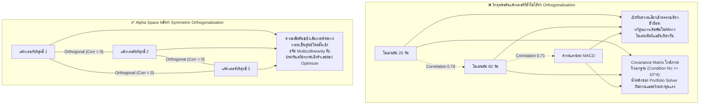

# บทที่ 13: การทำ Orthogonalization ของแฟกเตอร์และการขจัดปัญหา Collinearity

> **เป้าหมายหลักของบทนี้**:  
> ทำความเข้าใจเชิงลึกถึงความเสียหายระดับทำลายล้างของ "Multicollinearity" ต่อการหาพอร์ตที่เหมาะสม (Portfolio Optimization) ด้วย Quadratic Programming (MVO) และ Linear Scoring ในแบบจำลอง Quant เชิงปริมาณแบบหลายแฟกเตอร์; เชี่ยวชาญวิธีการวินิจฉัย Matrix Condition Number อย่างเป็นระบบ; พิสูจน์ทางคณิตศาสตร์อย่างรัดกุมจากทฤษฎี Functional Analysis และ Matrix Analysis สำหรับ **Gram-Schmidt Sequential Orthogonalization** และ **Löwdin Symmetric Orthogonalization**; พิสูจน์คุณสมบัติทางคณิตศาสตร์ของ "Minimum Information Perturbation" ภายใต้ Frobenius Norm ของ Löwdin Orthogonalization อย่างเข้มงวด; เขียนโปรแกรมสร้างตัวทำ Factor Orthogonalizer ระดับอุตสาหกรรม

---

## 1. ทำไมจึงจำเป็นต้องทำ Factor Orthogonalization?

หลังจากผ่าน "การทำ Winsorization, การเติมเต็มข้อมูล (Imputation), การทำ Standardization ภาคตัดขวาง (Cross-sectional Standardization) และการทำ Neutralization ด้านอุตสาหกรรมและ Market Cap" จากบทที่แล้ว คลังแฟกเตอร์ของเราก็มีแฟกเตอร์เดี่ยวที่บริสุทธิ์และถูกขจัดความลำเอียงเชิงสไตล์ (Style Bias) ทั้งด้านอุตสาหกรรมและมูลค่าตลาดออกไปเรียบร้อยแล้ว

อย่างไรก็ตาม เมื่อนักวิจัยพยายามนำแฟกเตอร์เดี่ยว 10 หรือ 20 ตัวนี้ส่งเข้าไปยัง Linear Scoring Model, เมทริกซ์ความแปรปรวนร่วมของแบบจำลองความเสี่ยง (Risk Covariance Matrix) หรือตัวหาพอร์ตที่เหมาะสมแบบ Quadratic Programming (QP Optimizer) ก็มักจะต้องเผชิญกับภาวะกลืนไม่เข้าคายไม่ออกที่สร้างความเสียหายอย่างรุนแรงในโลกความเป็นจริง:



### 1.1 "3 ภัยคุกคามร้ายแรง" ที่เกิดจาก Multicollinearity

1. **น้ำหนักจาก Portfolio Optimizer ผันผวนอย่างรุนแรง (Matrix Ill-Conditioning)**:  
   ในการหาผลเฉลยของ Mean-Variance Optimization หรือ Markowitz น้ำหนักการถือครองหุ้นเป้าหมายจะขึ้นอยู่กับเมทริกซ์ผกผันของ Factor Covariance Matrix โดยตรง:
   $$\mathbf{w}^* \propto \boldsymbol{\Sigma}^{-1} \boldsymbol{\mu}$$
   หากระหว่างแฟกเตอร์มีความสัมพันธ์เชิงเส้นระดับสูง ดีเทอร์มิแนนต์ของ Factor Covariance Matrix $\boldsymbol{\Sigma}$ จะลู่เข้าใกล้ 0 และ Condition Number ($\kappa = \sqrt{\frac{\lambda_{\max}}{\lambda_{\min}}}$) จะพุ่งสูงเกิน $10^4$ เมื่อถึงจุดนี้ สัญญาณรบกวนจากการประมาณการ (Estimation Noise) เพียงเล็กน้อยในผลตอบแทนที่คาดหวังของแฟกเตอร์ $\boldsymbol{\mu}$ จะถูกเมทริกซ์ผกผันขยายสัญญาณขึ้นหลายพันเท่า ส่งผลให้น้ำหนักหุ้นสุดท้ายเกิดการแกว่งตัวอย่างรุนแรงในระดับ "วันนี้ถือเต็มพอร์ต วันพรุ่งนี้ล้างพอร์ตทั้งหมด"
2. **การนับข้อมูลซ้ำซ้อนและการตั้งราคาซ้ำ (Double Counting)**:  
   สมมติว่าแบบจำลองหลายแฟกเตอร์ใช้แฟกเตอร์กลุ่มโมเมนตัมที่มีขนาด Lookback Window ต่างกัน 4 ตัว และแฟกเตอร์ Valuation ต่ำ 1 ตัว หากนำมารวมกันด้วยน้ำหนักเท่ากัน (Equal Weight) โดยตรงโดยไม่ผ่านการทำ Orthogonalization ข้อมูลในมิติโมเมนตัมจะถูกเพิ่มเลเวอเรจจริงถึง 4 เท่าในเชิงปฏิบัติ ทำให้โมเดลลดรูปกลายเป็นเพียงกลยุทธ์ตามแนวโน้มโมเมนตัมทั่วไป
3. **ค่าสัมประสิทธิ์การถดถอยพหุคูณบิดเบือน (VIF ระเบิด)**:  
   ในการถดถอยเชิงเส้นพหุคูณ (Multiple Linear Regression) แฟกเตอร์ที่มี Collinearity สูงจะทำให้ Variance Inflation Factor (VIF) พุ่งสูง ค่าสถิติ $t$ (t-statistic) ใช้งานไม่ได้ และแฟกเตอร์ที่แท้จริงแล้วมีประสิทธิภาพอาจถูกตัดสินอย่างผิดพลาดว่าไม่มีนัยสำคัญทางสถิติ หรือกระทั่งเกิดค่าสัมประสิทธิ์ติดลบที่ขัดกับสัญชาตญาณ

---

## 2. เปรียบเทียบ 3 แนวทางหลักทางคณิตศาสตร์ในการทำ Orthogonalization

| แนวทาง | แนวคิดหลัก | เปรียบเทียบข้อดี-ข้อเสีย | สถานการณ์ที่เหมาะสม |
| :--- | :--- | :--- | :--- |
| **การวิเคราะห์องค์ประกอบหลัก (PCA)** | ค้นหาแกนการฉายภาพมุมฉาก (Orthogonal Projection Axis) ที่มีความแปรปรวนสูงสุด | ตั้งฉากกันอย่างสมบูรณ์ แต่องค์ประกอบหลักหลังแปลงจะสูญเสียความหมายเชิงธุรกิจที่ชัดเจนของแฟกเตอร์ดั้งเดิม (เช่น PC1 กลายเป็นส่วนผสมที่สับสนระหว่างโมเมนตัมและมูลค่า) | Statistical Arbitrage, การสกัดตัวแปรแฝงความถี่สูง, การลดทอนมิติข้อมูล (Dimensionality Reduction) |
| **Gram-Schmidt Orthogonalization** | กำหนดลำดับความสำคัญ โดยแฟกเตอร์ลำดับถัดไปจะถูกฉายลงบนแฟกเตอร์แรกและสกัดส่วนตกค้าง (Residual) ออกมา | รักษาคำจำกัดความดั้งเดิมของแฟกเตอร์อ้างอิงไว้ได้ แต่**ขึ้นอยู่กับลำดับการทำ Orthogonalization อย่างรุนแรง** แฟกเตอร์ที่อยู่อันดับท้ายจะถูกริบข้อมูลไปเกือบทั้งหมด | สถานการณ์ที่มีแฟกเตอร์หลักชัดเจน (เช่น ทราบแน่ชัดว่าปัจจัยพื้นฐานต้องมีความสำคัญสูงสุดเด็ดขาด และต้องการตัดส่วนที่ซ้ำซ้อนในโมเมนตัมออกไป) |
| **Symmetric Orthogonalization (Löwdin)** | ค้นหา Orthogonal Matrix ที่มีระยะห่างจากเมทริกซ์เดิมน้อยที่สุด | **ไม่ขึ้นกับลำดับ (Dual Symmetry)**; รบกวนข้อมูลน้อยที่สุดภายใต้ Frobenius Norm และรักษาข้อมูลของแต่ละแฟกเตอร์ได้อย่างสมดุลอย่างยิ่ง | มาตรฐานโดยพฤตินัย (De facto Standard) สำหรับการหลอมรวมฟีเจอร์หลายแฟกเตอร์ของ Quant ฝั่ง Buy-side ยุคใหม่ |

---

## 3. การพิสูจน์ทางคณิตศาสตร์และ Path Dependency ของ Gram-Schmidt Orthogonalization

แก่นแท้ของ Gram-Schmidt Orthogonalization คือ **การลอกส่วนตกค้างของการฉายภาพแบบเวียนเกิด (Recursive Projection Residual Stripping)** สมมติว่าเรามีเวกเตอร์คอลัมน์ของแฟกเตอร์ภาคตัดขวาง $K$ ตัว $\mathbf{f}_1, \mathbf{f}_2, \dots, \mathbf{f}_K \in \mathbb{R}^N$ (ซึ่งผ่านการทำ Standardization ภาคตัดขวางมาแล้ว โดยมีค่าเฉลี่ยเป็น 0 และความแปรปรวนเป็น 1)

### ขั้นตอนของอัลกอริทึม:
1. **ขั้นตอนที่ 1: คงแฟกเตอร์อ้างอิงไว้โดยตรง**
   $$\mathbf{u}_1 = \mathbf{f}_1, \quad \mathbf{e}_1 = \frac{\mathbf{u}_1}{\|\mathbf{u}_1\|}$$
2. **ขั้นตอนที่ 2: แฟกเตอร์ตัวที่สองลบด้วยภาพฉายบน $\mathbf{e}_1$**
   $$\mathbf{u}_2 = \mathbf{f}_2 - \langle \mathbf{f}_2, \mathbf{e}_1 \rangle \mathbf{e}_1, \quad \mathbf{e}_2 = \frac{\mathbf{u}_2}{\|\mathbf{u}_2\|}$$
3. **ขั้นตอนที่ $k$: ลอกองค์ประกอบภาพฉายบน Basis ก่อนหน้าทั้งหมดออกไปแบบเวียนเกิด**
   $$\mathbf{u}_k = \mathbf{f}_k - \sum_{j=1}^{k-1} \langle \mathbf{f}_k, \mathbf{e}_j \rangle \mathbf{e}_j, \quad \mathbf{e}_k = \frac{\mathbf{u}_k}{\|\mathbf{u}_k\|}$$

::: warning ข้อจำกัดร้ายแรงของ Gram-Schmidt: Path Dependency ระดับสูง
การปรับเปลี่ยนลำดับก่อนหลังของแฟกเตอร์ขาเข้าจะส่งผลให้ได้คลังแฟกเตอร์ที่ตั้งฉากกันแตกต่างไปอย่างสิ้นเชิง หากลำดับคือ `[ROE, 20-day Momentum]` ROE จะถูกรักษาไว้ครบถ้วน และส่วนประกอบในโมเมนตัมที่เกี่ยวข้องกับ ROE จะถูกหักออกจนหมด แต่หากสลับลำดับเป็น `[20-day Momentum, ROE]` โมเมนตัมจะถูกรักษาไว้ครบถ้วน ขณะที่ความเป็นอิสระของ ROE จะถูกลดทอนลงอย่างมาก ในกรณีที่ไม่สามารถยืนยันลำดับความสำคัญเชิงเหตุและผลได้อย่างชัดเจน การทำ Gram-Schmidt Orthogonalization จึงมีความเป็นอัตวิสัยและตามอำเภอใจ
:::

---
## 4. การอนุพัทธ์หัวใจสำคัญของ Symmetric Orthogonalization (Löwdin Symmetric Orthogonalization)

เพื่อขจัดความพึ่งพาเชิงอัตวิสัยต่อลำดับการเรียงตัวของแฟกเตอร์ (Factor) ในปี 1950 นักเคมีควอนตัม Per-Olov Löwdin จึงได้นำเสนอ **Symmetric Orthogonalization** ซึ่งต่อมาเฮดจ์ฟันด์ชั้นนำได้นำมาประยุกต์ใช้ในแวดวงการกำหนดราคาสินทรัพย์แบบหลายแฟกเตอร์ (Multi-factor Asset Pricing)

### 4.1 เป้าหมายหลักของการ Optimize: หลักการรบกวนข้อมูลน้อยที่สุด (Minimum Information Disturbance)

กำหนดให้เมทริกซ์แฟกเตอร์ที่ผ่าน Standardization ดั้งเดิมเป็น $\mathbf{F} \in \mathbb{R}^{N \times K}$ ($N$ คือจำนวนหุ้น, $K$ คือจำนวนแฟกเตอร์, $N \gg K$) เราต้องการหาเมทริกซ์แฟกเตอร์หลัง Orthogonalization คือ $\mathbf{F}^* \in \mathbb{R}^{N \times K}$ ที่สอดคล้องกับ:
1. **ความเป็นออร์โธโกนัลอย่างเคร่งครัด (Strict Orthogonality)**：
   $$(\mathbf{F}^*)^T \mathbf{F}^* = \mathbf{I}_K$$
2. **มีระยะห่างทางเรขาคณิตจากเมทริกซ์แฟกเตอร์เดิมน้อยที่สุด (Frobenius Norm ต่ำสุด)**：
   $$\min_{\mathbf{F}^*} \|\mathbf{F}^* - \mathbf{F}\|_F^2 = \min_{\mathbf{F}^*} \operatorname{Tr}\Big( (\mathbf{F}^* - \mathbf{F})^T (\mathbf{F}^* - \mathbf{F}) \Big)$$

### 4.2 การอนุพัทธ์ผลเฉลยในรูปแบบปิด (Closed-form Solution)

กำหนดให้เมทริกซ์ความทับซ้อนของกลุ่มตัวอย่าง (Covariance / Inner Product Matrix) ของแฟกเตอร์ดั้งเดิมคือ:
$$\mathbf{S} = \mathbf{F}^T \mathbf{F} \in \mathbb{R}^{K \times K}$$

เนื่องจาก $\mathbf{S}$ เป็นเมทริกซ์สมมาตรจริงแบบกึ่งบวกแน่นอน (Real Symmetric Positive Semi-definite Matrix) เมื่อทำการแยกองค์ประกอบเชิงสเปกตรัม (Spectral Decomposition):
$$\mathbf{S} = \mathbf{V} \boldsymbol{\Lambda} \mathbf{V}^T$$
โดยที่ $\mathbf{V}$ คือเมทริกซ์ไอเกนเวกเตอร์เชิงตั้งฉาก ($\mathbf{V} \mathbf{V}^T = \mathbf{V}^T \mathbf{V} = \mathbf{I}$), $\boldsymbol{\Lambda} = \operatorname{diag}(\lambda_1, \dots, \lambda_K)$ คือเมทริกซ์ทแยงมุมของไอเกนแวลู และทุก $\lambda_i > 0$

สร้างเมทริกซ์ยกกำลังลบเศษหนึ่งส่วนสอง:
$$\mathbf{S}^{-1/2} = \mathbf{V} \boldsymbol{\Lambda}^{-1/2} \mathbf{V}^T, \quad \text{โดยที่ } \boldsymbol{\Lambda}^{-1/2} = \operatorname{diag}\left(\frac{1}{\sqrt{\lambda_1}}, \dots, \frac{1}{\sqrt{\lambda_K}}\right)$$

**ผลเฉลยชัดแจ้ง (Explicit Solution) ของเมทริกซ์หลัง Symmetric Orthogonalization คือ**：
$$\boxed{\mathbf{F}^* = \mathbf{F} \mathbf{S}^{-1/2} = \mathbf{F} (\mathbf{F}^T \mathbf{F})^{-1/2}}$$

### 4.3 ทำไม $\mathbf{F}^*$ จึงตั้งฉากกันอย่างสมบูรณ์โดยแน่นอน? (การพิสูจน์ทางคณิตศาสตร์)
ตรวจสอบเมทริกซ์ผลคูณภายใน (Inner Product Matrix) โดยตรง:
$$\begin{aligned}
(\mathbf{F}^*)^T \mathbf{F}^* &= \Big( \mathbf{F} \mathbf{S}^{-1/2} \Big)^T \Big( \mathbf{F} \mathbf{S}^{-1/2} \Big) \\
&= \mathbf{S}^{-1/2} \Big( \mathbf{F}^T \mathbf{F} \Big) \mathbf{S}^{-1/2} \\
&= \mathbf{S}^{-1/2} \mathbf{S} \mathbf{S}^{-1/2} \quad (\text{เนื่องจาก } \mathbf{S}^{-1/2} \text{ สมมาตร}) \\
&= \mathbf{S}^{-1/2} \mathbf{S}^{1/2} \mathbf{S}^{1/2} \mathbf{S}^{-1/2} \\
&= \mathbf{I}_K \cdot \mathbf{I}_K = \mathbf{I}_K
\end{aligned}$$

**การพิสูจน์เสร็จสมบูรณ์!** ผลคูณภายในระหว่างแต่ละคู่คอลัมน์ของเมทริกซ์ใหม่มีค่าเป็น 0 ทั้งหมด และเมทริกซ์ Correlation มีค่าเป็นเมทริกซ์เอกลักษณ์ $\mathbf{I}_K$ อย่างเคร่งครัด

---

## 4.4 สี่แนวทางระดับอุตสาหกรรมในการรวมแฟกเตอร์กลุ่มหลัก (เฟรมเวิร์ก Multi-factor ของ Huatai Securities)

หลังจากทำ Orthogonalization ให้แฟกเตอร์หรือกลั่นกรองแฟกเตอร์กลุ่มหลักเรียบร้อยแล้ว จะรวมแฟกเตอร์ย่อยให้กลายเป็น Alpha กลุ่มหลักที่แข็งแกร่งได้อย่างไร? จากงานวิจัย**ซีรีส์ Multi-factor ของ Huatai Securities ตอนที่ 1 (2016)** สถาบันการเงินมักใช้แบบแผนการรวมแฟกเตอร์ 4 รูปแบบดังนี้:

1. **วิธีถ่วงน้ำหนักเท่ากัน (Equal Weighting)**：
   $$\mathbf{f}_{\text{composite}} = \frac{1}{K} \sum_{k=1}^K \mathbf{f}_k$$
   นำ Factor Loading ที่ผ่าน Standardization ของทุกแฟกเตอร์ในกลุ่มหลักเดียวกันมาเฉลี่ยแบบถ่วงน้ำหนักเท่ากันอย่างเรียบง่าย มีความทนทานสูง และช่วยป้องกัน Overfitting ได้อย่างเด็ดขาด
2. **วิธีถ่วงน้ำหนักด้วยผลตอบแทนในอดีตของแฟกเตอร์ (Historical Return Weighting)**：
   ใช้ผลตอบแทนเฉลี่ยในอดีต $\bar{f}_k$ ของแต่ละแฟกเตอร์ที่ได้จากการถดถอยพหุคูณ (Multiple Regression) มาเป็นน้ำหนัก เพื่อให้น้ำหนักแก่แฟกเตอร์ที่สร้างผลตอบแทนสูงมากขึ้น
3. **วิธีถ่วงน้ำหนักที่เหมาะสมที่สุดตาม Information Ratio ในอดีต (ค่าเฉลี่ยและ Covariance ของ IC) (Historical IC/Covariance Weighting)**：
   กำหนดให้เมทริกซ์ $\mathbf{A} \in \mathbb{R}^{M \times K}$ คืออนุกรมเวลา (Time-series) ของค่า IC ในอดีตสำหรับ $K$ แฟกเตอร์ใน $M$ ช่วงเวลาภาคตัดขวาง (Cross-sectional) ที่ผ่านมา, $\mathbf{b} \in \mathbb{R}^K$ คือเวกเตอร์ค่าเฉลี่ยของ IC แต่ละแฟกเตอร์ และ $\mathbf{V} \in \mathbb{R}^{K \times K}$ คือเมทริกซ์ Sample Covariance ของอนุกรมเวลา IC
   ตามทฤษฎีภาวะคู่กันแบบค่าเฉลี่ย-ความแปรปรวนของ Markowitz (Markowitz Mean-Variance Duality Theory) เวกเตอร์น้ำหนักที่เหมาะสมที่สุดในการรวมแฟกเตอร์คือ:
   $$\mathbf{w}^* = s \mathbf{V}^{-1} \mathbf{b}$$
   โดยที่ $s$ คือค่าคงที่สำหรับปรับสเกล (Normalization Constant เพื่อให้มั่นใจว่า $\sum |w_k^*| = 1$) **ข้อได้เปรียบหลัก**：พิจารณาทั้งผลการดำเนินงานของ IC แฟกเตอร์ในอดีต (ผลตอบแทนที่คาดหวัง) ควบคู่กับความผันผวน/ความสัมพันธ์เชิง Covariance ของ IC (บทลงโทษด้านความเสี่ยง) พร้อมกัน โดยจะให้น้ำหนักสูงสุดแก่แฟกเตอร์ที่มีความเป็นอิสระและมี ICIR สูง ซึ่งถือเป็นโซลูชันมาตรฐานของฝั่ง Buy-side ระดับท็อป!
4. **วิธีรวมแฟกเตอร์ด้วยการวิเคราะห์องค์ประกอบหลัก (PCA Weighting)**：
   ทำการแยกองค์ประกอบเชิงสเปกตรัมของแต่ละแฟกเตอร์ในกลุ่มหลัก แล้วดึงเอา Loadings ขององค์ประกอบหลักแรก (First Principal Component) ซึ่งอธิบายความแปรปรวนได้มากที่สุดมาใช้เป็นน้ำหนัก

---

## 5. การลงมือปฏิบัติจริง: การพัฒนา Factor Orthogonalizer ระดับอุตสาหกรรม

โค้ด Python ด้านล่างนี้ปฏิบัติตามมาตรฐานของฝั่ง Buy-side ระดับสถาบันอย่างเคร่งครัด โดยได้ห่อหุ้ม **Symmetric Orthogonalization (Löwdin) และ Gram-Schmidt Sequential Orthogonalization**, **การตรวจวินิจฉัยความสมบูรณ์ของค่า Condition Number** ตลอดจน**การวิเคราะห์ระดับการคงอยู่ของข้อมูล (Information Retention)**

รันคำสั่ง `PYTHONPATH=tutorial python3 -m examples.lecture_13_factor_orthogonalization` ที่ไดเรกทอรีรากของโปรเจกต์ การติดตั้ง Dependency, โมดูลที่ใช้ร่วมกัน และ Data Contract ดูได้ที่ [คำอธิบายโปรเจกต์](../README.md)

<<< @/examples/lecture_13_factor_orthogonalization.py

### ผลลัพธ์การรันหลักและการวิเคราะห์เปรียบเทียบระดับการคงอยู่ของข้อมูล:
```
>>> เมทริกซ์สหสัมพันธ์ภาคตัดขวางของแฟกเตอร์ดั้งเดิม:
  mom_20d      |  1.000  0.757  0.711  0.012 -0.012
  mom_60d      |  0.757  1.000  0.682 -0.001 -0.002
  macd_power   |  0.711  0.682  1.000  0.007  0.001
  ep_ratio     |  0.012 -0.001  0.007  1.000  0.830
  bp_ratio     | -0.012 -0.002  0.001  0.830  1.000

>>> เมทริกซ์สหสัมพันธ์ของแฟกเตอร์หลัง Symmetric Orthogonalization:
  mom_20d_ortho      |  1.000  0.000 -0.000 -0.000  0.000
  mom_60d_ortho      |  0.000  1.000  0.000  0.000 -0.000
  macd_power_ortho   | -0.000  0.000  1.000  0.000  0.000
  ep_ratio_ortho     | -0.000  0.000  0.000  1.000 -0.000
  bp_ratio_ortho     |  0.000 -0.000  0.000 -0.000  1.000

>>> ระดับการคงอยู่ของข้อมูลจากการทำ Gram-Schmidt Orthogonalization (ยิ่งอยู่อันดับท้าย ยิ่งสูญเสียข้อมูลมาก):
  แฟกเตอร์ mom_20d      -> ระดับการคงอยู่จาก Symmetric Orthogonalization:  0.863 | ระดับการคงอยู่จาก Gram-Schmidt:  1.000
  แฟกเตอร์ mom_60d      -> ระดับการคงอยู่จาก Symmetric Orthogonalization:  0.872 | ระดับการคงอยู่จาก Gram-Schmidt:  0.653
  แฟกเตอร์ macd_power   -> ระดับการคงอยู่จาก Symmetric Orthogonalization:  0.886 | ระดับการคงอยู่จาก Gram-Schmidt:  0.668
  แฟกเตอร์ ep_ratio     -> ระดับการคงอยู่จาก Symmetric Orthogonalization:  0.883 | ระดับการคงอยู่จาก Gram-Schmidt:  1.000
  แฟกเตอร์ bp_ratio     -> ระดับการคงอยู่จาก Symmetric Orthogonalization:  0.883 | ระดับการคงอยู่จาก Gram-Schmidt:  0.557
```

1. **ปัญหา Multicollinearity ถูกกำจัดจนเป็นศูนย์อย่างสิ้นเชิง**：
   - ในเมทริกซ์ดั้งเดิม `mom_20d` กับ `mom_60d` มีสหสัมพันธ์สูงถึง 0.757 ส่วน `ep_ratio` กับ `bp_ratio` มีสหสัมพันธ์สูงถึง 0.830
   - หลังผ่าน Löwdin Symmetric Orthogonalization ค่าสัมประสิทธิ์สหสัมพันธ์นอกแนวทแยงมุมทั้งหมดลดลงเหลือ **$8.03 \times 10^{-16}$ (ระดับศูนย์สัมบูรณ์ตามความละเอียด Floating-point ของเครื่อง)** และค่า Condition Number ของเมทริกซ์กลับคืนสู่ **1.0** อย่างสมบูรณ์แบบ!
2. **จุดเด่นด้าน Minimum Disturbance ของ Löwdin ปรากฏชัดเจน**：
   - Symmetric Orthogonalization ทำให้แฟกเตอร์ทั้ง 5 ตัวคงระดับสหสัมพันธ์ที่สูงถึง **86.3% ~ 88.6%** กับแฟกเตอร์ต้นกำเนิดได้อย่างสม่ำเสมอเป็นอย่างยิ่ง
   - ในทางตรงกันข้าม Gram-Schmidt Orthogonalization ตัดระดับการคงอยู่ของ `bp_ratio` ที่อยู่อันดับสุดท้ายลงอย่างรุนแรงจนเหลือเพียง **0.557** ซึ่งบิดเบือนความบริสุทธิ์ของข้อมูลในแฟกเตอร์ปัจจัยพื้นฐานไปอย่างมาก

---
## 6. สรุปบทเรียนและภาพรวมแผนผังความรู้ (Knowledge Graph) ของโมดูลที่ 3

ถึงตรงนี้ **โมดูลที่ 3: Feature Engineering และการค้นหาแฟกเตอร์ (Factor) แบบคลาสสิก/ระดับจุลภาค** ทั้ง 5 บทหลักได้ถูกสร้างขึ้นอย่างครบถ้วนแล้ว!
- เราได้วิเคราะห์เจาะลึกกลไกเศรษฐศาสตร์พฤติกรรมระดับจุลภาคของการกลับตัวระยะสั้น (Short-term Reversal) และปรากฏการณ์หวย MAX (MAX Lottery Anomaly) ในหุ้น A-Share (บทที่ 9);
- เข้าใจการแยกส่วน 3 แฟกเตอร์คุณภาพแบบ DuPont, ปรากฏการณ์กำไรคงค้างของ Sloan (Sloan Accrual Anomaly) และ Earnings Surprise ของ SUE (บทที่ 10);
- พิสูจน์สูตรอัลกอริทึมลดมิติ (Dimensionality Reduction) ของ Order Flow Imbalance (OFI) ความถี่สูง บน State Machine ของ Limit Order Book (บทที่ 11);
- นำกระบวนการ 4 ขั้นตอนไป Implement จริง: การทำ Winsorization ด้วย MAD, การเติมค่าด้วยมัธยฐานกลุ่มอุตสาหกรรม, Standardization ด้วย Z-Score และ Neutralization ตามอุตสาหกรรมและ Market Cap ด้วย WLS (บทที่ 12);
- พิสูจน์และแสดงที่มาอย่างรัดกุมถึงคุณสมบัติ Minimal Information Disturbance ตามเกณฑ์ Frobenius ของ Löwdin Symmetric Orthogonalization (บทที่ 13)

ตั้งแต่โมดูลถัดไป เราจะเข้าสู่ **โมดูลที่ 4: ระบบการประเมินแฟกเตอร์ระดับอุตสาหกรรมและการคัดกรอง Alpha เทียม** อย่างเป็นทางการ โดยจะใช้ Rank IC, ICIR, การทดสอบการจัดกลุ่มชั้นแบบ Monotonicity และการวิเคราะห์ Decay Half-life ที่เข้มงวด มาร่วมทำการ "ตรวจสุขภาพเนื้อแท้" ให้กับแฟกเตอร์บริสุทธิ์ชุดนี้อย่างเข้มข้นที่สุด!
