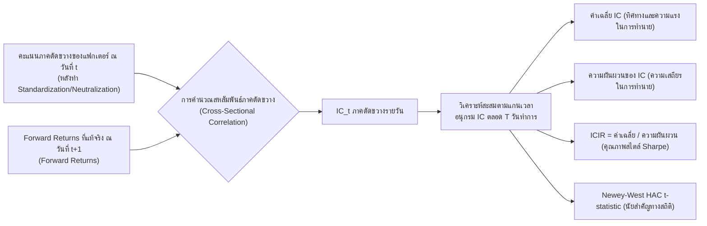

# บทที่ 14: ตัวชี้วัดหลักวัดพลังการทำนายของแฟกเตอร์ (IC / Rank IC / ICIR)

> **เป้าหมายหลักของบทนี้**:  
> ทำความเข้าใจอย่างลึกซึ้งเกี่ยวกับเครื่องมือวัดความสัมพันธ์ในการทำนายที่เป็นหัวใจสำคัญที่สุดในระบบการตั้งราคาสินทรัพย์แบบหลายแฟกเตอร์ (Multi-factor Asset Pricing) ยุคใหม่: **Information Coefficient (IC)**; เข้าใจความแตกต่างทางคณิตศาสตร์ระหว่าง Pearson IC ทั่วไป กับ Spearman Rank IC อย่างถ่องแท้ รวมถึงความเหมาะสมในการนำไปใช้กับลักษณะการแจกแจงแบบหางหนา (Fat-tailed Distribution) ของหุ้น A-Share; เชี่ยวชาญการหาค่าเฉลี่ย, ส่วนเบี่ยงเบนมาตรฐาน, ICIR, t-statistic ของอนุกรม IC ตลอดจนการอนุพัทธ์การปรับแก้ Autocorrelation แบบหน่วงเวลาด้วย Newey-West (HAC); เขียนโค้ดเครื่องมือประเมิน IC เชิงขนานระดับภาคตัดขวาง (Cross-sectional) ด้วย Polars เกรดอุตสาหกรรมและตัวติดตาม Cumulative IC ด้วยตนเอง

---

## 1. ทำไม IC ถึงเป็น "First Principles" ของการวิจัยและลงทุนเชิงปริมาณ (Quant)?

ในทฤษฎีการลงทุนเชิงรุก (Active Investment) แบบคลาสสิก Richard Grinold และ Ronald Kahn ได้เสนอ**กฎพื้นฐานของการบริหารเชิงรุก (Fundamental Law of Active Management, FLOAM)** อันโด่งดังไว้ในคัมภีร์ Quant อย่าง *Active Portfolio Management*:

$$\text{IR} \approx \text{IC} \times \sqrt{\text{Breadth}} \times \text{TC}$$

โดยที่:
- $\text{IR}$ (Information Ratio): Information Ratio รายปีที่พอร์ตการลงทุนสามารถทำได้ (ผลตอบแทนส่วนเกิน (Excess Return) เชิงรุก / Tracking Error เชิงรุก);
- $\text{Breadth}$ (Strategy Breadth): **จำนวนครั้งของการตัดสินใจลงทุนที่มีประสิทธิผลและเป็นอิสระต่อกัน**ในหนึ่งปี;
- $\text{TC}$ (Transfer Coefficient): ประสิทธิภาพการแปลงผลตอบแทนของพอร์ตภายใต้ข้อจำกัดด้านการห้ามชอร์ต, ราคาชนเพดาน/พื้น (Price Limit) และ Turnover;
- $\text{IC}$ (Information Coefficient): ค่าสัมประสิทธิ์สหสัมพันธ์ระหว่างคะแนนแฟกเตอร์ (Factor) ในงวดปัจจุบันกับผลตอบแทนจริงในงวดถัดไป ซึ่งสะท้อนถึง**ทักษะ (Skill) และความแม่นยำในการทำนายดิบในแต่ละมิติของการตัดสินใจ**



::: warning ทำไมถึงห้ามตัดสินแฟกเตอร์จากมูลค่าสินทรัพย์สุทธิ (NAV) จากการ Backtest เด็ดขาด?
มือใหม่จำนวนมากหลังจากขุดค้นแฟกเตอร์ออกมาได้ ปฏิกิริยาแรกคือการโยนเข้าไปในซอฟต์แวร์ Backtest ทันทีเพื่อพล็อตเส้น NAV ซึ่งในระดับอุตสาหกรรมถือเป็นการกระทำที่มือสมัครเล่นและอันตรายอย่างยิ่ง:
1. **NAV ถูกบดบังด้วยสไตล์ของตลาดที่รุนแรงได้ง่าย**: ตัวอย่างเช่น แฟกเตอร์คุณภาพต่ำที่ไม่มีความสามารถในการเลือกหุ้นเลย แต่บังเอิญ Overweight หุ้น Micro-cap หรือหุ้นปันผลสูงที่พุ่งขึ้นอย่างรุนแรงในช่วงปลายปี 2024 ทำให้ NAV ของพอร์ตพุ่งสูงขึ้น ทั้งที่แท้จริงแล้วเป็นเพียง "Alpha ปลอม" ที่เกิดจากการเปิดรับความเสี่ยงเชิงสไตล์ (Style Exposure);
2. **NAV บดบังคุณภาพที่แท้จริงของการเรียงลำดับภาคตัดขวาง**: NAV สะท้อนเพียงผลการดำเนินงานของพอร์ต Top เท่านั้น ไม่สามารถสะท้อนความสามารถในการจัดเรียงตามลำดับแบบทางเดียว (Monotonicity) ของหุ้นทั้งตลาดกว่า 5,000 ตัวได้;
3. **Backtest นำสัญญาณรบกวนจากการตั้งสมมติฐานระดับการเทรดเข้ามา**: Slippage, รูปแบบการจับคู่คำสั่ง (Matching) และวิธีการจัดสรรน้ำหนัก ล้วนรบกวนความบริสุทธิ์ของแฟกเตอร์ **IC คือการตรวจสุขภาพ "พลังการทำนายดิบล้วน ๆ" ที่ถูกลอกกฎเกณฑ์การเทรดออกไปทั้งหมด!**
:::

---

## 2. หลักการทางคณิตศาสตร์ของ Pearson IC vs Spearman Rank IC

ในภาคตัดขวาง กำหนดให้ ณ วันที่ $t$ ใน Stock Universe มีหุ้น $N$ ตัว โดยค่าของแฟกเตอร์ดังกล่าวในภาคตัดขวาง ณ วันที่ $t$ แทนด้วยเวกเตอร์ $\mathbf{f}_t = [f_{1,t}, f_{2,t}, \dots, f_{N,t}]^T$ และผลตอบแทนล่วงหน้าจริงของหุ้นแต่ละตัวในช่วง $t \to t+1$ (หรือถือครอง $h$ รอบเวลา) แทนด้วย $\mathbf{r}_{t+1} = [r_{1,t+1}, r_{2,t+1}, \dots, r_{N,t+1}]^T$

### 2.1 ค่าสัมประสิทธิ์สหสัมพันธ์เพียร์สัน (Pearson IC)

$$\text{Pearson IC}_t = \frac{\operatorname{Cov}(\mathbf{f}_t, \mathbf{r}_{t+1})}{\sigma_{\mathbf{f}_t} \cdot \sigma_{\mathbf{r}_{t+1}}} = \frac{\sum_{i=1}^N (f_{i,t} - \bar{f}_t)(r_{i,t+1} - \bar{r}_{t+1})}{\sqrt{\sum_{i=1}^N (f_{i,t} - \bar{f}_t)^2} \sqrt{\sum_{i=1}^N (r_{i,t+1} - \bar{r}_{t+1})^2}}$$

- **ข้อบกพร่องในการใช้งานจริงกับหุ้น A-Share**: ผลตอบแทนของหุ้น A-Share มีลักษณะ Fat-tailed Distribution อย่างเด่นชัดและมีความผันผวนรุนแรงที่เกิดขึ้นเป็นครั้งคราว (เช่น หุ้นบางตัวประกาศปรับโครงสร้างกะทันหันแล้วกลับมาซื้อขายและชนเพดาน (Limit-up) $+20\%$ ภายในวันเดียว) เพียงแค่มีหุ้น Outlier สุดโต่งเพียง 1-2 ตัวพุ่งขึ้น ก็สามารถอาศัยผลคูณของค่าเบี่ยงเบนที่มหาศาล บิดเบือน Pearson IC ของทั้งภาคตัดขวางให้เปลี่ยนเครื่องหมายได้ทันที!

### 2.2 ค่าสัมประสิทธิ์สหสัมพันธ์อันดับสเปียร์แมน (Spearman Rank IC - เกณฑ์มาตรฐานหลักของฝั่ง Buy-side)

Spearman Rank IC **ละทิ้งขนาดสัมบูรณ์ของตัวเลขอย่างสิ้นเชิง และแปลงเป็นลำดับอันดับ (Rank) ของภาคตัดขวางแทน**

กำหนดให้ $\operatorname{rank}(f_{i,t}) \in \{1, 2, \dots, N\}$, $\operatorname{rank}(r_{i,t+1}) \in \{1, 2, \dots, N\}$ โดยผลต่างของอันดับทั้งสองคือ $d_i = \operatorname{rank}(f_{i,t}) - \operatorname{rank}(r_{i,t+1})$ ในกรณีที่ไม่มีอันดับเสมอกัน สูตรคลาสสิกคือ:

$$\text{Rank IC}_t = 1 - \frac{6 \sum_{i=1}^N d_i^2}{N(N^2 - 1)} \equiv \operatorname{Corr}\Big(\operatorname{rank}(\mathbf{f}_t), \; \operatorname{rank}(\mathbf{r}_{t+1})\Big)$$

### 2.3 ความแตกต่างเชิงแก่นแท้ของสัมประสิทธิ์สหสัมพันธ์ทั้งสองแบบ

| มิติการเปรียบเทียบ | Pearson IC | Spearman Rank IC |
| :--- | :--- | :--- |
| **แก่นแท้ของการวัด** | ความแรงของความสัมพันธ์เชิงเส้น (Linear Correlation) | **ความแรงของความสัมพันธ์แบบทางเดียว (Monotonicity)** |
| **ความสามารถในการต้านทาน Noise** | แย่มาก (อ่อนไหวอย่างยิ่งต่อ Outlier ที่พุ่งขึ้นหรือดิ่งลงแรงที่ส่วนหาง) | **แข็งแกร่งมาก (มีความ Robust โดยธรรมชาติ อันดับไม่ระเบิดตามสเกลของค่าผิดปกติ)** |
| **ความสอดคล้องกับการคัดเลือกหุ้นขั้นปลายน้ำ** | ค่อนข้างแย่ (มุ่งเน้นการฟิตติ้งเชิงเส้นสัมบูรณ์ของตัวเลข) | **ยอดเยี่ยมมาก (สอดคล้องอย่างสมบูรณ์กับแก่นของธุรกิจการคัดเลือกหุ้นตามควอนไทล์ หรือการเลือก Top 10%)** |
| **สถานะทั่วไปในอุตสาหกรรม** | ใช้เป็นเพียงข้อมูลอ้างอิงเสริม หรือใช้วินิจฉัยโมเดลเชิงเส้นล้วน | **มาตรฐานโดยพฤตินัย (De Facto Standard) สำหรับการขุดค้นแฟกเตอร์, การคัดเลือกเข้า Factor Library และการประเมินผลของฝั่ง Buy-side** |

---
## 3. สถิติอนุกรมเวลา (Time-series) ของ IC และการทดสอบ Newey-West HAC

หลังจากคำนวณ $\text{Rank IC}_t$ ระดับภาคตัดขวาง (Cross-sectional) รายวันแล้ว เราจะได้ลำดับอนุกรมเวลาที่มีความยาว $T$ วันทำการซื้อขาย: $\{\text{IC}_1, \text{IC}_2, \dots, \text{IC}_T\}$

### 3.1 ค่าเฉลี่ย IC และ Information Ratio (ICIR)

$$\overline{\text{IC}} = \frac{1}{T} \sum_{t=1}^T \text{IC}_t, \quad \sigma_{\text{IC}} = \sqrt{\frac{1}{T - 1} \sum_{t=1}^T (\text{IC}_t - \overline{\text{IC}})^2}$$

$$\text{ICIR}_{\text{daily}} = \frac{\overline{\text{IC}}}{\sigma_{\text{IC}}}, \quad \text{Annualized ICIR} = \text{ICIR}_{\text{daily}} \times \sqrt{250}$$

- **แก่นแท้ของ ICIR ก็คือ "Sharpe Ratio ของแฟกเตอร์ (Factor)"** แม้ว่าค่าเฉลี่ย IC ของแฟกเตอร์จะมีค่าถึง 0.05 แต่ถ้าวันนี้ $+0.25$ พรุ่งนี้ $-0.20$ ความผันผวนจะรุนแรงมาก แฟกเตอร์ลักษณะนี้ในการเทรดจริง (Live Trading) จะทำให้กลยุทธ์เกิด Drawdown ของผลการดำเนินงานอย่างมหาศาล
- ประสบการณ์ในอุตสาหกรรม: ในตลาดหุ้น A-Share หลังจากหักความเสี่ยงด้านอุตสาหกรรมและมูลค่าหลักทรัพย์ตามราคาตลาด (Market Cap Exposure) ออกแล้ว **ค่าเฉลี่ย Rank IC อยู่ที่ $0.03 \sim 0.06$ และ Annualized Rank ICIR ทรงตัวอยู่ที่ $1.5 \sim 3.0$ ขึ้นไป** ซึ่งจัดว่าเป็นแฟกเตอร์ชั้นยอดที่มี Signal-to-Noise Ratio สูง

### 3.2 การละเมิดสมมติฐาน IID และการแก้ไข Autocorrelation ด้วย Newey-West (HAC)

ในสถิติดั้งเดิม สถิติทดสอบ Student's t ภายใต้สมมติฐานหลัก $H_0: \overline{\text{IC}} = 0$ คำนวณได้เป็น:
$$t_{\text{iid}} = \frac{\overline{\text{IC}}}{\sigma_{\text{IC}} / \sqrt{T}} = \text{ICIR}_{\text{daily}} \times \sqrt{T}$$

**อย่างไรก็ตาม ลำดับ IC ทางการเงินมีความสัมพันธ์ในตัวเองทางอนุกรมเวลา (Autocorrelation) อย่างมีนัยสำคัญ (โดยเฉพาะการซ้อนทับของผลตอบแทนล่วงหน้าจากการปรับพอร์ต (Rebalance) ข้ามรอบ 5 วันหรือ 20 วัน)**! หากละเลย Autocorrelation ความแปรปรวนประสิทธิผล (Effective Variance) ของกลุ่มตัวอย่างจะถูกประเมินต่ำเกินไปอย่างมาก ส่งผลให้ค่าสถิติ $t$ สูงเกินจริงไปหลายเท่าตัว

ตาม Newey & West (1987, *Econometrica*) จะใช้การประมาณการแบบทนทานต่อ Heteroskedasticity และ Autocorrelation (HAC):

$$\hat{\sigma}_{\text{HAC}}^2 = \hat{\gamma}_0 + 2 \sum_{l=1}^L \left( 1 - \frac{l}{L + 1} \right) \hat{\gamma}_l$$

โดยที่ $\hat{\gamma}_l$ คือ Autocovariance ลำดับที่ $l$ (Lag $l$) ของลำดับ IC, $L$ คือความยาวของ Lag Window (การลดทอนด้วย Bartlett Kernel Function) และค่าสถิติ $t$ แบบทนทาน (Robust $t$-statistic) ที่ผ่านการแก้ไขแล้วคือ:

$$t_{\text{HAC}} = \frac{\overline{\text{IC}}}{\sqrt{\hat{\sigma}_{\text{HAC}}^2 / T}}$$

---

### 3.3 ความหมายเชิงการวินิจฉัยของเส้นโค้ง IC สะสม (Cumulative IC Curve)

$$\text{CumIC}_t = \sum_{\tau=1}^t \text{IC}_\tau$$

```
การวินิจฉัย 3 รูปแบบทั่วไปของเส้นโค้ง Cumulative IC
├── 1. รูปแบบเติบโตแข็งแรงยั่งยืน: เส้นโค้งไต่ขึ้น 45 องศาไปทางขวาบนอย่างราบเรียบ มี Drawdown ต่ำมาก (Alpha ทนทานสูง)
├── 2. รูปแบบวัฏจักรสไตล์: เส้นโค้งสอดคล้องกับวัฏจักรมหภาคอย่างสูง พุ่งแรงในตลาดกระทิงและดิ่งลงหนักในตลาดหมี (เนื้อแท้คือ Style Beta แฝงตัวมา)
└── 3. รูปแบบเสื่อมถอยจากความแออัด: เส้นโค้งดิ่งลงเหวอย่างกะทันหัน ณ จุดเวลาใดเวลาหนึ่ง หรือนิ่งสนิทเป็นเวลานาน (แฟกเตอร์แออัดเกินไป ถูก Arbitrage เก็บเกี่ยวผลตอบแทนไปหมดทั้งตลาดแล้ว)
```

---

## 4. ลงมือปฏิบัติจริง: การพัฒนา Engine ประเมิน IC ของแฟกเตอร์ระดับอุตสาหกรรมด้วย Polars

โค้ด Python ด้านล่างนี้ปฏิบัติตามมาตรฐานระดับสถาบันของฝั่ง Buy-side อย่างเคร่งครัด โดยอิงตาม **Polars Cross-sectional Parallel Expressions** ในการคำนวณ Pearson และ Spearman Rank IC รายวัน พร้อมทั้งแสดงผลค่าสถิติอนุกรมเวลาฉบับสมบูรณ์, การทดสอบ HAC และเส้นโค้ง Cumulative IC

รัน `PYTHONPATH=tutorial python3 -m examples.lecture_14_factor_ic_metrics` ที่ Root Directory ของโปรเจกต์ ดูการติดตั้ง Dependency, โมดูลที่ใช้ร่วมกัน และสัญญาข้อมูลได้ที่ [คำอธิบายโปรเจกต์](../README.md)

<<< @/examples/lecture_14_factor_ic_metrics.py

### ผลลัพธ์การรันหลักและการตีความรายงานระดับมืออาชีพ:
```
>>> อนุกรมเวลา IC รายวันและ Cumulative IC (5 แถวแรก):
shape: (5, 7)
┌───────────┬───────────┬──────────┬──────────┬──────────┬──────────┬──────────┐
│ trade_dat ┆ stock_cou ┆ ic       ┆ rank_ic  ┆ valid_ic ┆ cum_ic   ┆ cum_rank │
│ e         ┆ nt        ┆ ---      ┆ ---      ┆ ---      ┆ ---      ┆ _ic      │
│ ---       ┆ ---       ┆ f64      ┆ f64      ┆ bool     ┆ f64      ┆ ---      │
│ date      ┆ u32       ┆          ┆          ┆          ┆          ┆ f64      │
╞═══════════╪═══════════╪══════════╪══════════╪══════════╪══════════╪══════════╡
│ 2025-01-0 ┆ 500       ┆ 0.002531 ┆ -0.04284 ┆ true     ┆ 0.002531 ┆ -0.04284 │
│ 1         ┆           ┆          ┆          ┆          ┆          ┆          │
│ 2025-01-0 ┆ 500       ┆ -0.01412 ┆ 0.02631  ┆ true     ┆ -0.01159 ┆ -0.01653 │
│ 2         ┆           ┆ 8        ┆          ┆          ┆ 8        ┆          │
│ 2025-01-0 ┆ 500       ┆ 0.059053 ┆ 0.054961 ┆ true     ┆ 0.047455 ┆ 0.03843  │
│ 3         ┆           ┆          ┆          ┆          ┆          ┆          │
│ 2025-01-0 ┆ 500       ┆ 0.024464 ┆ 0.04229  ┆ true     ┆ 0.071919 ┆ 0.080721 │
│ 6         ┆           ┆          ┆          ┆          ┆          ┆          │
│ 2025-01-0 ┆ 500       ┆ 0.068176 ┆ 0.121035 ┆ true     ┆ 0.140095 ┆ 0.201756 │
│ 7         ┆           ┆          ┆          ┆          ┆          ┆          │
└───────────┴───────────┴──────────┴──────────┴──────────┴──────────┴──────────┘
=================================================================
📊 รายงานการประเมิน IC ของแฟกเตอร์ฉบับสมบูรณ์: [alpha_robust_momentum] (วันทำการที่ประเมิน: 250 วัน)
=================================================================
Cross-section ที่ไม่ถูกต้อง: 0; การทดสอบค่าเฉลี่ย HAC lag=0 (0 หมายถึง iid t)
【Spearman Rank IC (แกนหลักของ Buy-side)】
  • ค่าเฉลี่ย Rank IC       :   0.0408
  • ส่วนเบี่ยงเบนมาตรฐาน Rank IC :   0.0458
  • Rank ICIR รายวัน       :   0.8909
  • Annualized Rank ICIR   :  14.0864
  • สถิติทดสอบค่าเฉลี่ย     :  14.0864 (p-value: 1.5480e-33)
  • สัดส่วน IC ที่เป็นบวก (Win Rate) :   78.80%
-----------------------------------------------------------------
【Pearson Normal IC (การอ้างอิงเชิงเส้น)】
  • ค่าเฉลี่ย Pearson IC    :   0.0169
  • Annualized Pearson ICIR :   6.2713
  • ค่าสถิติ t               :   6.2713 (p-value: 1.5712e-09)
  • Win Rate               :   64.80%
-----------------------------------------------------------------
【รูปแบบการแจกแจงและความทนทาน】
  • ความเบ้ของ IC (Skewness) :  -0.0765
  • ความโด่งของ IC (Kurtosis) :  -0.2228
=================================================================
```

1. **การเปรียบเทียบที่ชัดเจนระหว่าง Rank IC vs Pearson IC**:
   - แฟกเตอร์นี้มีค่าเฉลี่ย Rank IC สูงถึง **0.0408** (Win Rate สูงถึง 78.8%) ในขณะที่ค่าเฉลี่ย Pearson IC เชิงเส้นอยู่ที่เพียง 0.0169 สิ่งนี้พิสูจน์ให้เห็นอย่างชัดเจนว่าแฟกเตอร์นี้มีความสามารถในการจัดเรียงความสัมพันธ์แบบโมโนโทนิกในภาคตัดขวาง (**Cross-sectional Monotonic Ranking**) ที่แข็งแกร่งอย่างยิ่ง แต่การแจกแจงโดยรวมมีลักษณะที่ไม่เป็นเชิงเส้น โดย Rank IC สะท้อนความสามารถในการคัดเลือกหุ้นได้ตรงตามความเป็นจริงมากกว่า!
2. **การทดสอบนัยสำคัญทางสถิติ**:
   - สถิติทดสอบค่าเฉลี่ยสูงถึง 14.08 และมีค่า p-value น้อยกว่า 0.001 อย่างมาก ซึ่งมีนัยสำคัญอย่างยิ่งทางสถิติ

---
## 5. สรุปประจำบทและแบบฝึกหัดภาคปฏิบัติ

### ทบทวนผังความรู้หลัก:
1. **IC คือพลังการทำนายแบบดิบ (Raw Predictive Power)**: สังเกตความสัมพันธ์ภาคตัดขวาง (Cross-sectional) ระหว่างแฟกเตอร์ (Factor) กับผลตอบแทนในอนาคตโดยตรง ตัดสัญญาณรบกวนจากการจับคู่คำสั่ง (Matching) ในการทำ Backtest และกฎเกณฑ์การถือครองสถานะออกไปอย่างสิ้นเชิง;
2. **Spearman Rank IC คือตัวเลือกอันดับแรก**: สัมประสิทธิ์สหสัมพันธ์อันดับที่อิงตามตำแหน่ง Rank มีภูมิคุ้มกันตามธรรมชาติต่อการพุ่งขึ้นหรือดิ่งลงอย่างรุนแรงของค่า Outlier ส่วนหาง ถือเป็นตัวชี้วัดการประเมินหลักที่สุดของสถาบันฝั่ง Buy-side;
3. **ICIR คือตัวชี้วัดคุณภาพ**: ค่าเฉลี่ยของแฟกเตอร์หารด้วยความผันผวน วัดความเสถียรของพลังการทำนายในลักษณะเดียวกับ Sharpe Ratio;
4. **การปรับแก้ด้วย HAC ช่วยขจัดภาพลวงตาของ Autocorrelation**: ในสภาวะผลตอบแทนคาบเกี่ยวกันหลายรอบระยะเวลา จำเป็นต้องใช้ Newey-West HAC ปรับแก้ค่าสถิติ t

### แบบฝึกหัดภาคปฏิบัติหลังเรียน:
> **ภารกิจปฏิบัติจริง**:  
> 1. เปิด `tutorial/examples/lecture_14_factor_ic_metrics.py`
> 2. ตั้งค่าพารามิเตอร์เริ่มต้นของ Engine `hac_lags` ให้เป็น 5 (จำลองการปรับแก้ Autocorrelation สำหรับช่วงเวลาถือครองที่คาบเกี่ยวกัน 5 วัน) สังเกตว่าค่า `rank_t_stat` ที่ได้ในครั้งนี้หดตัวอย่างมีนัยสำคัญ (Robust Shrinkage) มากน้อยเพียงใดเมื่อเทียบกับ 14.08 ภายใต้สมมติฐาน i.i.d?
> 3. คำถามชวนคิด: หากแฟกเตอร์ตัวหนึ่งมีค่าเฉลี่ย Rank IC สูงถึง 0.08 แต่เส้นกราฟ IC สะสมกลับแสดงรูปแบบ "ราบเรียบในช่วง 3 ปีแรก แล้วจู่ๆ ก็พุ่งกระฉูดในเดือนล่าสุด" แฟกเตอร์ลักษณะนี้สามารถนำไปเทรดจริง (Live Trading) ได้โดยตรงหรือไม่? เพราะเหตุใด?
