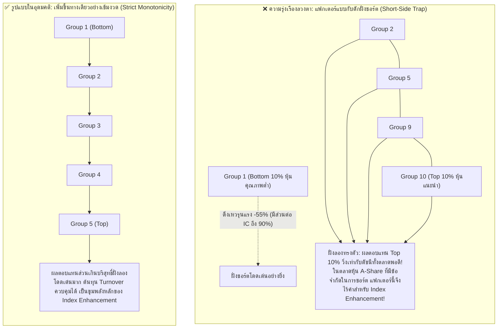
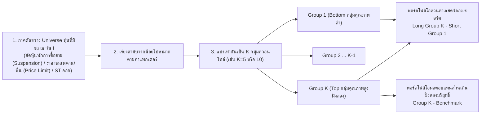

# บทที่ 15: การ Backtest แบบแบ่งกลุ่ม (Quantile Backtest) และการทดสอบ Monotonicity

> **เป้าหมายหลักของบทนี้**:  
> หาก IC คือ "เทอร์โมมิเตอร์ระดับมหภาค" ที่ใช้วัดพลังการคาดการณ์ของแฟกเตอร์ เช่นนั้น**การ Backtest แบบแบ่งกลุ่มพอร์ตโฟลิโอ (Quantile Portfolio Analysis)** ก็เปรียบเสมือน "เครื่อง CT Scan" ที่เอกซเรย์เจาะลึกโครงสร้างผลตอบแทนระดับจุลภาคของแฟกเตอร์ บทนี้จะผ่าโครงสร้างอย่างละเอียดว่าสถาบันฝั่ง Buy-side แบ่งภาคตัดขวาง (Cross-sectional) ของหุ้นทั้งตลาดออกเป็น 5 หรือ 10 กลุ่มอย่างไร พร้อมคำนวณการแบ่งระดับ NAV ของแต่ละกลุ่ม; ทำการอนุพัทธ์สูตรที่เข้มงวดของ**คะแนน Monotonicity ของสเปียร์แมน (Spearman Monotonicity Score)** และ**อัตราการเพิ่มขึ้นแบบขั้นบันได (Step Ratio)**; เจาะลึกกลลวงอันตรายของ "กับดักฝั่งชอร์ต (Short-Side Trap)" ที่มีต่อกลยุทธ์ฝั่งลองภายใต้บริบทของหุ้น A-Share ที่มีข้อจำกัดในการขายชอร์ต เพื่อให้บรรลุการประเมินที่แยกขาดจากกันอย่างสิ้นเชิงระหว่าง**ส่วนต่างการทำเฮดจ์ลอง-ชอร์ต (Long-Short Spread)** และ**ผลตอบแทนส่วนเกินบริสุทธิ์ฝั่งลอง (Long-Only Active Excess)**

---

## 1. ทำไมแฟกเตอร์ที่มีค่า IC สูงจึงยังอาจไม่ทำเงินเลยแม้แต่น้อยในการเทรดจริง (Live Trading)?

นักวิจัยที่เพิ่งเข้าสู่วงการ Quant มักเกิดความสับสนอยู่บ่อยครั้ง: *“ค่าเฉลี่ย Rank IC ของแฟกเตอร์ผมอยู่ที่ 0.045 และมีค่า Annualized ICIR สูงถึง 3.5 ทำไมพอเทรดจริงเพื่อสร้างกลยุทธ์กองทุนดัชนีเสริมผลตอบแทน (Index Enhancement) ถึงแพ้เบนช์มาร์กขาดลอย?”*

คำตอบอยู่ที่ว่า: **IC เป็นค่าสถิติระดับมหภาคของความสัมพันธ์โดยรวมของหุ้น 5,000 ตัวทั่วทั้งตลาด ซึ่งไม่สามารถบอกคุณได้เลยว่าผลตอบแทนส่วนเกิน (Excess Return) นั้นมาจากฝั่งลองหรือฝั่งชอร์ตกันแน่!**



### 1.1 ความจริงอันโหดร้ายของข้อจำกัดเชิงสถาบันในการชอร์ตของหุ้น A-Share
ในตลาดต่างประเทศที่พัฒนาแล้ว เฮดจ์ฟันด์สามารถยืมหุ้นมาชอร์ต Group 1 (กลุ่มคุณภาพต่ำ) ได้โดยตรงด้วยต้นทุนต่ำ พร้อมกับเปิดสถานะลองใน Group 10 (กลุ่มคุณภาพสูง) เพื่อรับ Long-Short Spread เต็มจำนวน แต่ในตลาดหุ้น A-Share:
1. **แหล่งหุ้นสำหรับการยืมชอร์ตมีจำกัดอย่างยิ่งและมีดอกเบี้ยสูงมาก** (อัตราดอกเบี้ย 6%~10% ต่อปี);
2. **สัญญาของกองทุนรวมและผลิตภัณฑ์ Index Enhancement ของกองทุนเอกชน (Private Fund) ส่วนใหญ่มีข้อกำหนดบังคับว่าต้องถือฝั่งลองขาเดียวเท่านั้น** (สัดส่วนการถือหุ้น 95%~100%)
3. **ข้อสรุป**: หาก Excess Return ทั้งหมดของแฟกเตอร์มาจากการ "ชี้เป้าหุ้นขยะที่กำลังจะเพิกถอนหลักทรัพย์ (Delisting) หรือดิ่งเหวได้อย่างแม่นยำ" แต่**หุ้นชั้นดีกลุ่ม Top ที่แนะนำกลับวิ่งไม่ชนะเบนช์มาร์กแบบถ่วงน้ำหนักเท่ากันของตลาดเลย** แฟกเตอร์นี้ก็มีมูลค่าเชิงพาณิชย์เป็นศูนย์ในระบบ Index Enhancement ที่เปิดได้เฉพาะฝั่งลองขาเดียว!

---

## 2. ขั้นตอนการทำงานมาตรฐานระดับอุตสาหกรรมของการ Backtest แบบแบ่งกลุ่ม (Quantile Analysis)

ในแต่ละภาคตัดขวาง ณ วันปรับพอร์ต (Rebalance) $t$ (โดยทั่วไปคือความถี่รายวันหรือรายสัปดาห์):



### 2.1 กฎการจัดกลุ่มย่อยแบบแบ่งเท่ากันในภาคตัดขวาง
กำหนดให้จำนวนหุ้นที่มีผลในภาคตัดขวางของ Stock Universe คือ $N$ และเป้าหมายคือแบ่งเป็น $K$ กลุ่ม (มาตรฐานอุตสาหกรรมนิยมใช้ $K=5$ หรือ $K=10$):
- จัดเรียงหุ้นจากค่าแฟกเตอร์ต่ำไปสูงแบบเรียงลำดับขึ้น;
- กลุ่มที่ $k$ ($k \in \{1, 2, \dots, K\}$) จะประกอบด้วยหุ้นที่มีอันดับอยู่ในช่วง $\left[ \frac{k-1}{K} \cdot N, \; \frac{k}{K} \cdot N \right)$;
- หากแฟกเตอร์เป็นแบบทิศทางบวก, **Group $K$ จะเป็นกลุ่มแนะนำฝั่งลอง (Top)** และ **Group 1 จะเป็นกลุ่มที่ควรหลีกเลี่ยงฝั่งชอร์ต (Bottom)**

### 2.2 การคำนวณผลตอบแทนถ่วงน้ำหนักเท่ากันรายวันและมูลค่าสินทรัพย์สุทธิแบบทบต้นของแต่ละกลุ่ม

ในช่วงเวลาถือครอง ($t \to t+1$) อัตราผลตอบแทนแบบถ่วงน้ำหนักเท่ากันของกลุ่มที่ $k$ คือ:
$$R_{k, t+1} = \frac{1}{N_k} \sum_{i \in \text{Group}_k} r_{i, t+1}$$

อัตราผลตอบแทนของเบนช์มาร์กแบบถ่วงน้ำหนักเท่ากันของหุ้นทั้งหมดใน Universe (Benchmark) คือ:
$$R_{\text{bench}, t+1} = \frac{1}{N} \sum_{i=1}^N r_{i, t+1}$$

เส้นโค้งสินทรัพย์มูลค่าสุทธิแบบทบต้นสะสม (Wealth Index) ของแต่ละกลุ่มคือ:
$$\text{NAV}_{k, T} = \prod_{t=1}^T (1 + R_{k, t})$$

---

## 3. แบบจำลองคณิตศาสตร์เชิงปริมาณสำหรับการทดสอบ Monotonicity (Monotonicity Score)

การดูกราฟแนวโน้ม NAV แบบแบ่งกลุ่มเป็นการตรวจสอบเชิงคุณภาพ แต่ใน Pipeline การวิจัยและพัฒนา Quant อัตโนมัติ (AutoML Alpha Pipeline) จำเป็นต้องมี**อัลกอริทึมการให้คะแนนทางคณิตศาสตร์ที่ไม่เอนเอียง**เพื่อวัดค่าความเป็น Monotonicity ออกมาเป็นตัวเลข

### 3.1 คะแนน Monotonicity จากอันดับของสเปียร์แมน (Rank Monotonicity Score)
กำหนดให้เวกเตอร์ผลตอบแทนรายวันเฉลี่ยตลอดช่วงเวลาของกลุ่มควอนไทล์ $K$ กลุ่มหลังเรียงลำดับตามแฟกเตอร์ คือ $\mathbf{g} = [g_1, g_2, \dots, g_K]$ และเวกเตอร์ลำดับนับของกลุ่ม คือ $\mathbf{k} = [1, 2, \dots, K]$

นิยามคะแนน Monotonicity ของแฟกเตอร์ในภาคตัดขวาง คือ ค่าสัมประสิทธิ์สหสัมพันธ์อันดับของสเปียร์แมนระหว่างเวกเตอร์ทั้งสอง:
$$\text{MonoScore} = \operatorname{SpearmanCorr}\Big([1, 2, \dots, K], \; [g_1, g_2, \dots, g_K]\Big)$$

- **Monotonicity สมบูรณ์แบบ**: $\text{MonoScore} = +1.0$ (แฟกเตอร์ทิศทางบวก กลุ่มยิ่งสูงผลตอบแทนยิ่งเพิ่มขึ้นอย่างเข้มงวด) หรือ $-1.0$ (แฟกเตอร์ทิศทางลบ);
- **เกณฑ์ขั้นต่ำที่ยอมรับได้**: ฝั่ง Buy-side มักกำหนดเงื่อนไขว่า $|\text{MonoScore}| \ge \mathbf{0.80}$;
- **ผิดปกติขั้นรุนแรง**: หาก $|\text{MonoScore}| < 0.60$ แสดงว่าผลตอบแทนของกลุ่มตรงกลางสลับกลับตาลปัตรและยุ่งเหยิง (เช่น Group 3 ชนะ Group 5) ตรรกะเบื้องลึกของแฟกเตอร์ขาดความต่อเนื่องทั่วทั้งตลาด
### 3.2 อัตราส่วนความเป็นโมโนโทนิกตามขั้นบันได (Monotonic Step Ratio)
คำนวณสัดส่วนของขั้นบันไดระหว่างกลุ่มที่อยู่ติดกันซึ่งมีผลตอบแทนเพิ่มขึ้นอย่างเคร่งครัด:
$$\text{StepRatio} = \frac{1}{K - 1} \sum_{j=1}^{K-1} \mathbb{I}(g_{j+1} > g_j)$$

- เมื่อ $K=5$ จะมี 4 ขั้นบันได หากทั้ง 4 ขั้นเพิ่มขึ้นทั้งหมด $\text{StepRatio} = 100\%$ แต่หากมีจุดกลับทิศ 1 จุด จะลดลงเหลือ $75\%$

---

## 4. สเปรด Long-Short Hedging vs การวัดผลตอบแทนส่วนเกิน (Excess Return) ฝั่ง Long แบบแยกส่วน

### 4.1 พอร์ตสเปรด Long-Short (Long-Short Spread)
$$R_{\text{L/S}, t} = R_{\text{Top}, t} - R_{\text{Bottom}, t}$$
- วัด**เพดานการทำกำไรเชิงทฤษฎีสูงสุด**ของแฟกเตอร์ (Factor)
- ตัวชี้วัดที่รายงาน: ผลตอบแทนทบต้นต่อปีของ Long-Short (CAGR), Sharpe Ratio ต่อปีของ Long-Short (L/S Sharpe) และ Maximum Drawdown ของ Long-Short (L/S MDD)

### 4.2 พอร์ตผลตอบแทนส่วนเกินฝั่ง Long (Long-Only Active Excess)
$$R_{\text{Active}, t} = R_{\text{Top}, t} - R_{\text{bench}, t}$$
- วัด**ความสามารถในการสร้างผลตอบแทนส่วนเกินที่แท้จริง**เมื่อนำแฟกเตอร์ไปใช้สร้างกองทุนดัชนีเสริมผลตอบแทน (Index Enhancement) แบบ Long-Only โดยตรง
- ตัวชี้วัดที่รายงาน: ผลตอบแทนส่วนเกินต่อปีฝั่ง Long และ Information Ratio ฝั่ง Long บริสุทธิ์ (Active IR)

### 4.3 อัตราส่วนการแยกส่วนการสร้างผลตอบแทนฝั่ง Long/Short (Alpha Asymmetry Ratio)
ตัวชี้วัด "กระจกส่องความจริง" ที่เป็นหัวใจสำคัญที่สุดของฝั่ง Buy-side:
$$\text{Long Contribution Ratio} = \frac{\overline{R}_{\text{Top}} - \overline{R}_{\text{bench}}}{\overline{R}_{\text{Top}} - \overline{R}_{\text{Bottom}}}$$

```
เกณฑ์การประเมินสัดส่วนการสร้างผลตอบแทนฝั่ง Long
├── 1. แบบสมดุลและแข็งแกร่ง (40% ~ 60%): ฝั่ง Long สามารถสร้างผลตอบแทนส่วนเกินได้ ฝั่ง Short ช่วยหลบการร่วงแรง จัดเป็นแฟกเตอร์รอบด้านที่สมบูรณ์แบบ
├── 2. แบบขับเคลื่อนด้วยฝั่ง Long (> 60%): ได้รับความนิยมสูงมากในกองทุนดัชนีเสริมผลตอบแทน หุ้นที่คัดเลือกได้มีพลังระเบิดตัวสูง วิ่งชนะดัชนีตลาดกว้างได้อย่างขาดลอย
└── 3. แบบกับดักฝั่ง Short (< 20%): สัญญาณเตือนภัยขั้นวิกฤต! ผลตอบแทนเกือบทั้งหมดมาจากการ Short หุ้นคุณภาพแย่ ฝั่ง Long แทบไม่มีผลตอบแทนส่วนเกินเลย!
```

---

## 5. ลงมือปฏิบัติจริง: การพัฒนาเอนจิน Backtest แบบแบ่งกลุ่มระดับอุตสาหกรรมด้วย Polars

โค้ด Python ด้านล่างนี้ปฏิบัติตามมาตรฐานระดับสถาบันของฝั่ง Buy-side อย่างเคร่งครัด โดยใช้ **นิพจน์การแบ่งกลุ่มแบบเนทีฟของ Polars** ในการคำนวณเส้น NAV ของแต่ละกลุ่มในแบบ 5 ควอนไทล์/10 ควอนไทล์, สเปรด Long-Short, ผลตอบแทนส่วนเกินฝั่ง Long และคะแนนความเป็นโมโนโทนิกด้วย Throughput ระดับสูง

รัน `PYTHONPATH=tutorial python3 -m examples.lecture_15_quantile_and_monotonicity` ที่ไดเรกทอรีรากของโปรเจกต์ ดูการติดตั้ง Dependency, โมดูลที่ใช้ร่วมกัน และสัญญาข้อมูลได้ที่ [คำอธิบายโปรเจกต์](../README.md)

<<< @/examples/lecture_15_quantile_and_monotonicity.py

### การแปลผลลัพธ์การรันหลักและการสแกนวิเคราะห์แบบแบ่งกลุ่ม:
```
======================================================================
📈 รายงานวิเคราะห์เชิงลึกการ Backtest แฟกเตอร์แบบแบ่งกลุ่ม: [factor_score] (5 ควอนไทล์)
======================================================================
กลุ่ม (Quantile)      | ผลตอบแทนทบต้นต่อปี   | Sharpe Ratio ต่อปี   | Maximum Drawdown สูงสุดในอดีต        
----------------------------------------------------------------------
Group 1  (Bottom กลุ่มคุณภาพแย่) |     -86.00%   |       -9.345   |     -86.12%
Group 2            |     -55.12%   |       -3.824   |     -59.22%
Group 3            |     -11.47%   |       -0.570   |     -28.74%
Group 4            |      88.58%   |        3.036   |      -7.95%
Group 5  (Top กลุ่ม Long คุณภาพสูง) |     490.76%   |        8.478   |      -5.21%
----------------------------------------------------------------------
【การวัดผลสเปรด Long-Short และส่วนเกินฝั่ง Long แบบแยกส่วน】
  • สเปรด Long-Short ต่อปี (L/S Spread) :  3996.09%
  • Sharpe Ratio ของ Long-Short (L/S Sharpe)     :  122.566
  • Maximum Drawdown ของ Long-Short (L/S MDD)        :     0.00%
  • ผลตอบแทนส่วนเกินฝั่ง Long แบบเฉลี่ยเลขคณิตต่อปี (Top-Bench):   187.50%
  • Information Ratio ฝั่ง Long บริสุทธิ์ (Active IR)    :   95.418
  • สัดส่วนการสร้างผลตอบแทนฝั่ง Long              :    50.12%
----------------------------------------------------------------------
【การทดสอบความแข็งแกร่งของความเป็นโมโนโทนิก (Monotonicity)】
  • คะแนนความเป็นโมโนโทนิกของสเปียร์แมน (MonoScore) :    1.000
  • อัตราการเพิ่มขึ้นตามขั้นบันได (StepRatio)    :   100.00%
======================================================================
```

1. **การเพิ่มขึ้นตามขั้นบันไดแบบโมโนโทนิกที่สมบูรณ์แบบ**:
   - ตั้งแต่ Group 1 ถึง Group 5 อัตราผลตอบแทนทบต้นต่อปีแสดงการเพิ่มขึ้นแบบโมโนโทนิกอย่างเคร่งครัด (-86.0% $\rightarrow$ -55.1% $\rightarrow$ -11.5% $\rightarrow$ +88.6% $\rightarrow$ +490.8%), `MonoScore = 1.000`, `StepRatio = 100%`
2. **สัดส่วนการสร้างผลตอบแทนระหว่างฝั่ง Long และ Short สมมาตรกันอย่างสมบูรณ์**:
   - สัดส่วนการสร้างผลตอบแทนฝั่ง Long อยู่ที่ **50.12%** แสดงให้เห็นว่าความสามารถในการเลือกหุ้นฝั่ง Long และความสามารถในการคัดหุ้นแย่ออกฝั่ง Short สูสีกันอย่างสมบูรณ์ ไม่ตกอยู่ในกับดักฝั่ง Short

---

## 6. สรุปบทเรียนและแบบฝึกหัดลงมือปฏิบัติหลังเรียน

### สรุปแผนผังความรู้หลัก:
1. **การ Backtest แบบแบ่งกลุ่มเจาะลึกโครงสร้างจุลภาค**: การแบ่งกลุ่มเป็นเครื่องมือสำคัญเพียงหนึ่งเดียวในการตรวจสอบว่าแฟกเตอร์มีความสามารถในการจัดเรียงลำดับแบบโมโนโทนิกในแต่ละควอนไทล์หรือไม่
2. **ระวังกับดักฝั่ง Short**: ภายใต้ข้อจำกัดในการทำ Short ในหุ้น A-Share จำเป็นต้องตรวจสอบสัดส่วนการสร้างผลตอบแทนส่วนเกินของกลุ่ม Top เทียบกับ Benchmark แยกต่างหาก
3. **วัดค่าความเป็นโมโนโทนิกเชิงปริมาณด้วยคณิตศาสตร์**: ใช้คะแนนความเป็นโมโนโทนิกจากอันดับของสเปียร์แมนและอัตราการเพิ่มขึ้นตามขั้นบันได เพื่อทำ Pipeline คัดกรองแฟกเตอร์โดยอัตโนมัติ

### แบบฝึกหัดลงมือปฏิบัติหลังเรียน:
> **ภารกิจปฏิบัติจริง**:  
> 1. เปิดไฟล์ `tutorial/examples/lecture_15_quantile_and_monotonicity.py`  
> 2. ปรับพารามิเตอร์เริ่มต้น `n_quantiles` จาก 5 เป็น 10 (เพื่อทำการ Backtest แบบ 10 ควอนไทล์ที่ละเอียดยิ่งขึ้น) รันใหม่อีกครั้งแล้วสังเกตขั้นบันไดผลตอบแทนของแต่ละกลุ่ม  
> 3. คำถามชวนคิด: เมื่อซอยควอนไทล์จาก 5 กลุ่มเป็น 10 กลุ่ม หรือกระทั่ง 20 กลุ่ม ผลตอบแทนต่อปีของกลุ่ม Top มักจะเพิ่มขึ้นหรือลดลง? เพราะเหตุใด? และมีความสัมพันธ์แบบ Trade-off กับ Turnover อย่างไร?
