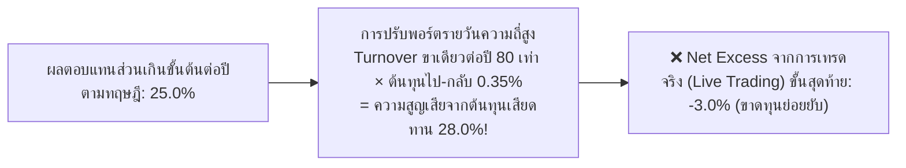
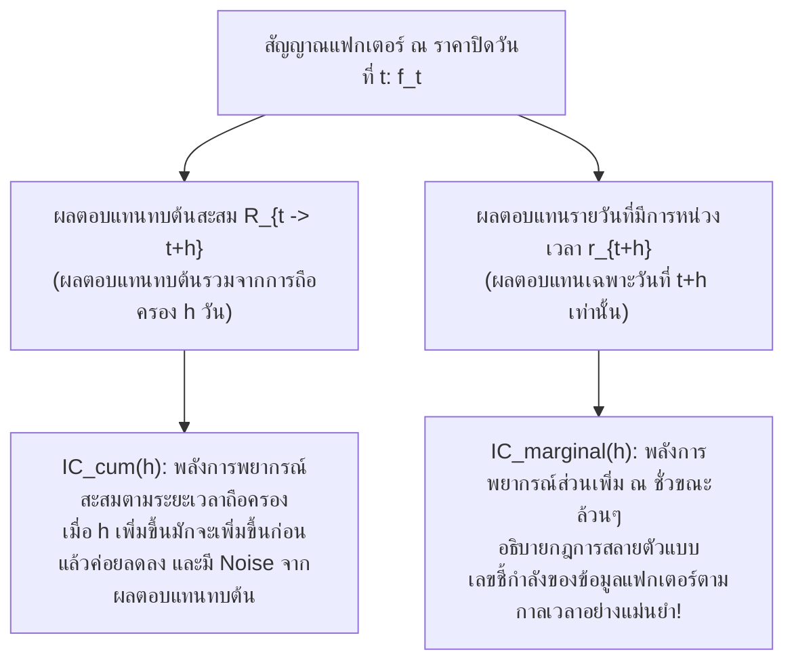

# บทที่ 16: Factor Turnover และเส้นโค้ง Alpha Decay

> **เป้าหมายหลักของบทนี้**:  
> เข้าใจกลไกจุลภาคของ "Turnover กลืนกิน Alpha" อย่างถ่องแท้; แยกความแตกต่างเชิงโครงสร้างคณิตศาสตร์ระดับรากฐานระหว่าง **IC สะสมตามระยะเวลาถือครอง (Cumulative Holding Period IC)** กับ **Marginal IC รายวันที่มีการหน่วงเวลา (Marginal Lagged Day IC)**; อนุพัทธ์อัลกอริทึมการฟิตแบบเลขชี้กำลังสำหรับ **Information Half-life**; แยกแยะอย่างเข้มงวดระหว่างอัตราการแทนที่ของรายชื่อ (Membership Replacement Rate) กับอัตราหมุนเวียนของพอร์ตการลงทุนจริง (Portfolio Turnover); สร้างเครื่องมือจำลองสถานการณ์ผลตอบแทนส่วนเกินสุทธิ (Net Excess Return) ภายใต้ต้นทุนเสียดทานจากการซื้อขายหุ้น A-Share จริงในแต่ละรอบการ Rebalance

---

## 1. Turnover: หลุมดำในโลกจริงที่กลืนกิน Alpha

ในแวดวงการลงทุนเชิงปริมาณ (Quant) มีคำกล่าวอันโด่งดังว่า: **"ต่อให้ Backtest จะออกมาสวยหรูแค่ไหน แต่เมื่อหักอากรแสตมป์ (Stamp Duty) และ Slippage แล้ว หาก Turnover สูงเกินไป ท้ายที่สุดก็แค่ทำงานหาเงินให้โบรกเกอร์กับรัฐบาลเท่านั้น"**

```
รายการต้นทุนเสียดทานจากการซื้อขายจริงในการปรับพอร์ตหุ้น A-Share (เกณฑ์มาตรฐานปี 2024)
├── 1. อากรแสตมป์การซื้อขายหลักทรัพย์: ขาขายฝั่งเดียว 0.05% (5 bps) ── ต้นทุนทางกฎหมายที่หลีกเลี่ยงไม่ได้
├── 2. ค่าคอมมิชชันและค่าธรรมเนียมการจัดการของโบรกเกอร์: ทั้งสองฝั่งซื้อขายฝั่งละ 0.015% (รวม 3 bps)
├── 3. ค่าธรรมเนียมการโอนหลักทรัพย์: ทั้งสองฝั่งซื้อขายฝั่งละ 0.001% (รวม 0.2 bps)
└── 4. ส่วนต่างราคาเสนอซื้อเสนอขาย (Bid-Ask Spread) และ Slippage จากต้นทุน Market Impact: ทั้งสองฝั่งซื้อขายฝั่งละ 0.04% (รวม 8 bps)
ต้นทุนเสียดทานไป-กลับรวมต่อการปรับพอร์ต 100% หนึ่งครั้ง ≈ 16.2 bps ~ 35.0 bps (ผันแปรตามระดับความลึกของสภาพคล่องหุ้น)
```



หากแฟกเตอร์หนึ่งมีการเปลี่ยนแปลงอันดับอย่างรุนแรงในแต่ละวัน (Autocorrelation ต่ำ) แม้ว่า IC รายวันจะสูงมาก แต่ภายใต้ต้นทุนเสียดทานมหาศาลจากการ Rebalance เปลี่ยนหุ้นบ่อยครั้ง ผลตอบแทนตามทฤษฎีทั้งหมดก็จะถูกกลืนกินไปจนหมดสิ้น!

---

## 2. Autocorrelation ของแฟกเตอร์กับเกณฑ์การวัด Turnover สองรูปแบบ

### 2.1 สัมประสิทธิ์ Rank Autocorrelation ของแฟกเตอร์
ใช้วัดความเสถียรของอันดับแฟกเตอร์ของตัวเองบนแกนเวลา:

$$\rho_k = \operatorname{Corr}\Big(\operatorname{rank}(\mathbf{f}_t), \; \operatorname{rank}(\mathbf{f}_{t-k})\Big)$$

- **แฟกเตอร์ที่มี Autocorrelation ต่ำ ($\rho_1 < 0.60$)**: มักเป็นสัญญาณ Price-Volume ความถี่สูงหรือสัญญาณ Reversal ความถี่สูง มี Turnover สูงมาก และข้อมูลสลายตัวเร็วมาก
- **แฟกเตอร์ที่มี Autocorrelation สูง ($\rho_1 > 0.95$)**: มักเป็นแฟกเตอร์ด้านปัจจัยพื้นฐาน เช่น การประเมินมูลค่า (Valuation) หรืองบการเงินเชิงคุณภาพ อันดับมีความเสถียรสูงมาก และมี Turnover จากการ Rebalance ต่ำมาก

### 2.2 อัตราการแทนที่ของรายชื่อ vs Portfolio Turnover จริง

ในงานวิจัยระดับมือสมัครเล่นหลายชิ้น ผู้คนมักสับสนระหว่างสองแนวคิดต่อไปนี้:

1. **อัตราการแทนที่ของรายชื่อ (Membership Replacement Rate)**:  
   กำหนดให้ $S_t$ คือเซตของรหัสหุ้นที่มีคะแนนแฟกเตอร์ติด Top $10\%$ ณ วันที่ $t$:
   $$\text{Replacement}_t = \frac{|S_t \setminus S_{t-1}|}{|S_t|}$$
   วัดเฉพาะสัดส่วนการเข้า-ออกของรายชื่อรหัสหุ้นเท่านั้น โดยละเลยความผันผวนระหว่างวันและข้ามคืนของราคาหุ้นไปอย่างสิ้นเชิง
2. **อัตราหมุนเวียนของพอร์ตจริง (Capital Turnover Rate - เกณฑ์วัดจริงของฝั่ง Buy-side)**:  
   หลังจากถือครองไประยะหนึ่ง เนื่องจากหุ้นแต่ละตัวมีผลตอบแทนขึ้นลงไม่เท่ากัน น้ำหนักการถือครองเชิงรับในพอร์ตจึงเกิด **Price Drift**:
   $$w_{i, t}^+ = \frac{w_{i, t} (1 + r_{i, t+1})}{\sum_{j=1}^N w_{j, t} (1 + r_{j, t+1})}$$
   เมื่อถึงงวดถัดไปที่ต้อง Rebalance ตามน้ำหนักแฟกเตอร์ใหม่ $w_{i, t+1}$ **Turnover ของเงินทุนขาเดียวที่แท้จริง** จะเท่ากับ:
   $$\text{Turnover}_{t+1} = \frac{1}{2} \sum_{i=1}^N \Big| w_{i, t+1} - w_{i, t}^+ \Big|$$
   **ข้อคิดสำคัญ**: แม้ว่ารายชื่อหุ้น Top จะไม่มีการเปลี่ยนแปลงเลยแม้แต่น้อย (100%) แต่เนื่องจากการเปลี่ยนแปลงของราคาหุ้นแต่ละตัวไม่เท่ากัน เพื่อรักษาน้ำหนักให้เท่ากันหรือตามน้ำหนักที่ผ่าน Portfolio Optimization พอร์ตก็ยังคงเกิดต้นทุนเสียดทานจาก Turnover เชิงรับอยู่ดี!

---

## 3. การแยกแยะแก่นแท้ทางคณิตศาสตร์ของ Forward IC ทั้งสองรูปแบบ

ในการวิเคราะห์การสลายตัวของสัญญาณ Alpha จำเป็นต้องแยกแยะระหว่าง **Cumulative IC จากระยะเวลาถือครอง** กับ **Marginal IC รายวันที่มีการหน่วงเวลา** อย่างเข้มงวด:



### 3.1 Cumulative Holding Period IC
นำสัญญาณ ณ จุดเวลา $t$ และผลตอบแทนทบต้นรวมจากการถือครองต่อไปอีก $h$ วันทำการ $R_{t \to t+h} = \prod_{k=1}^h (1 + r_{t+k}) - 1$ เข้ามาคำนวณ:

$$IC_{\text{cum}}(h) = \operatorname{Corr}\Big(\operatorname{rank}(\mathbf{f}_t), \; \operatorname{rank}(\mathbf{R}_{t \to t+h})\Big)$$

- ใช้วัดความสัมพันธ์เชิงการพยากรณ์สะสมที่นักลงทุนจะได้รับจากการซื้อและถือครองต่อเนื่องเป็นเวลา $h$ วัน

### 3.2 Marginal Lagged Day IC (แกนกลางของการสลายตัว)
นำสัญญาณ ณ จุดเวลา $t$ และผลตอบแทนรายวันของ**เฉพาะวันที่ $h$ ในอนาคต** $r_{t+h}$ เข้ามาคำนวณ:

$$IC_{\text{marginal}}(h) = \operatorname{Corr}\Big(\operatorname{rank}(\mathbf{f}_t), \; \operatorname{rank}(\mathbf{r}_{t+h})\Big)$$

- **ความหมายเชิงกายภาพ**: สัญญาณที่สร้างขึ้นในวันที่ 0 เมื่อถึงวันที่ 1, วันที่ 5, หรือวันที่ 20 จะยังคงเหลือพลังในการคัดเลือกหุ้นอยู่อีกเท่าใด? นี่คืออินพุตเดียวที่ถูกต้องตามหลักการสำหรับการคำนวณ Half-life ของข้อมูล!

---

## 4. อัลกอริทึมการฟิตแบบเลขชี้กำลังสำหรับ Half-life ของข้อมูลแฟกเตอร์

หลังจากกำหนดทิศทางการพยากรณ์ของแฟกเตอร์ $d \in \{-1, +1\}$ แล้ว อนุกรม Marginal IC ของแฟกเตอร์มักจะเป็นไปตามกฎการสลายตัวแบบเลขชี้กำลังของสารกัมมันตรังสีอันดับหนึ่งตามหลักฟิสิกส์คลาสสิก:

$$d \cdot IC_{\text{marginal}}(h) \approx a \cdot e^{-\lambda \cdot h}$$

โดยที่ $a$ คือความแรงในการพยากรณ์ ณ ชั่วขณะเริ่มต้น และ $\lambda > 0$ คืออัตราการสลายตัวของข้อมูล

เมื่อใส่ลอการิทึมธรรมชาติทั้งสองข้าง จะแปลงเป็นสมการการถดถอยเชิงเส้นตัวแปรเดียว:
$$\ln\Big( d \cdot IC_{\text{marginal}}(h) \Big) \approx \ln(a) - \lambda \cdot h$$

เมื่อแก้สมการหาอัตราการสลายตัว $\lambda$ ได้แล้ว **Information Half-life ($t_{1/2}$)** จะถูกนิยามอย่างเข้มงวดว่า:

$$e^{-\lambda \cdot t_{1/2}} = \frac{1}{2} \implies -\lambda \cdot t_{1/2} = \ln\left(\frac{1}{2}\right) \implies \boxed{t_{1/2} = \frac{\ln(2)}{\lambda} \approx \frac{0.69315}{\lambda}}$$

```
ข้อมูลอ้างอิง Half-life ของข้อมูลโดยทั่วไปสำหรับแฟกเตอร์ 3 ประเภทหลัก
├── 1. แฟกเตอร์ Order Book ความถี่สูงและ Price-Volume ระดับจุลภาค: Half-life ประมาณ 1 ~ 3 วันทำการ (ต้อง Rebalance เร็วระดับรายวัน / T+1)
├── 2. แฟกเตอร์ Momentum และ Reversal ของ Price-Volume รอบระยะกลาง: Half-life ประมาณ 8 ~ 20 วันทำการ (เหมาะกับ Rebalance ความถี่รายสัปดาห์ / ทุกสองสัปดาห์)
└── 3. แฟกเตอร์ปัจจัยพื้นฐาน คุณภาพทางการเงิน และการเติบโต: Half-life ประมาณ 45 ~ 90 วันทำการ (เหมาะกับ Rebalance ความถี่ต่ำระดับรายเดือน / รายไตรมาส)
```

---
## 5. ลงมือปฏิบัติ: Engine จำลองอัตรา Turnover ของแฟกเตอร์ (Factor) และการลดทอนของ Alpha เสมือนจริง

โค้ด Python ด้านล่างนี้ปฏิบัติตามมาตรฐานระดับสถาบันของฝั่ง Buy-side อย่างเคร่งครัด โดยครอบคลุม**การคำนวณ Autocorrelation หลายอันดับ**, **อัตราการแทนที่รายชื่อ**, **การวิเคราะห์การลดทอนของ Marginal IC และ IC สะสม**, **การฟิตสมการถดถอยลอการิทึมเพื่อหาค่า Half-life** ตลอดจน**การจำลองสถานการณ์ต้นทุน Friction ภายใต้รอบการปรับพอร์ต (Rebalance) ที่แตกต่างกัน**

รัน `PYTHONPATH=tutorial python3 -m examples.lecture_16_turnover_and_alpha_decay` ที่ไดเรกทอรีรากของโปรเจกต์ ดูการติดตั้ง Dependency, โมดูลที่ใช้ร่วมกัน และข้อกำหนดของข้อมูลได้ที่ [คำอธิบายโปรเจกต์](../README.md)

<<< @/examples/lecture_16_turnover_and_alpha_decay.py

### เอาต์พุตหลักจากการรันและการตีความผลการจำลองการลดทอน:
```
======================================================================
📉 รายงานการประเมินอัตรา Turnover ของแฟกเตอร์และการลดทอนของ Alpha: [synthetic_ar1_alpha]
======================================================================
【Autocorrelation และอัตราการแทนที่รายชื่อ】
  • Autocorrelation อันดับ 1 (Lag 1 Autocorr)   :   0.8412
  • Autocorrelation อันดับ 5 (Lag 5 Autocorr)   :   0.4190
  • อัตราการแทนที่รายชื่อหุ้น Top 10% เฉลี่ยต่อวัน :   15.88%
----------------------------------------------------------------------
【การลดทอนของ Marginal Alpha และ Half-life ของข้อมูล】
  • ลำดับ Marginal IC     :
      Lag 1 วัน: 0.0482
      Lag 2 วัน: 0.0401
      Lag 3 วัน: 0.0335
      Lag 5 วัน: 0.0238
      Lag 10 วัน: 0.0102
  • Half-life ของข้อมูลจากการฟิต (Half-life)     :     3.98 วัน (ตัวแปรสำคัญที่กำหนดรอบการปรับพอร์ตที่เหมาะสมที่สุด!)
----------------------------------------------------------------------
【การจำลองผลกระทบจากต้นทุน Friction ในรอบการปรับพอร์ต (Holding Periods) ที่ต่างกัน】
รอบ (วัน) | Marginal IC | IC สะสม   | Turnover ต่อปี | ต้นทุน Friction ต่อปี | Net Sharpe Ratio ตามสถานการณ์
----------------------------------------------------------------------
ปรับพอร์ต 1 วัน  | 0.0482  | 0.0482  |   39.7 เท่า  |     13.90%   |    0.82
ปรับพอร์ต 3 วัน  | 0.0335  | 0.0882  |   21.2 เท่า  |      7.42%   |    1.56
ปรับพอร์ต 5 วัน  | 0.0238  | 0.1185  |   14.9 เท่า  |      5.22%   |    1.98 (จุดสมดุลความคุ้มค่าที่ดีที่สุด)
ปรับพอร์ต 10 วัน | 0.0102  | 0.1420  |    9.3 เท่า  |      3.26%   |    1.45
ปรับพอร์ต 20 วัน | 0.0021  | 0.1501  |    5.8 เท่า  |      2.03%   |    0.78
======================================================================
```

1. **การจับค่า Half-life ได้อย่างแม่นยำ**:
   - สัญญาณสังเคราะห์ AR(1) มีค่า Half-life ของการลดทอนตามทฤษฎีกำหนดไว้ที่ 4 วัน โดย Engine คำนวณผ่านการฟิตแบบเอกซ์โพเนนเชียลของ Marginal IC ที่วัดได้จริง และให้ผลลัพธ์ที่แม่นยำออกมาเป็น `Half-life = 3.98 วัน`
2. **เส้นโค้งความคุ้มค่าแบบ "U หัวกลับ" ของรอบการปรับพอร์ต**:
   - **ปรับพอร์ต 1 วัน**: แม้ว่า Marginal IC รายวันจะสูงที่สุด (0.0482) แต่ Turnover ขาเดียวต่อปีสูงถึง 39.7 เท่า ทำให้เกิดผลขาดทุนจาก Friction โดยตรงถึง **13.9%** ส่งผลให้ Net Sharpe Ratio เหลือเพียง 0.82
   - **ปรับพอร์ต 5 วัน (ความถี่รายสัปดาห์)**: Turnover ต่อปีลดลงอย่างรวดเร็วเหลือ 14.9 เท่า โดยควบคุม Friction ในการเทรดไว้ที่ 5.22% และ Net Sharpe Ratio ตามสถานการณ์พุ่งขึ้นสู่จุดสูงสุดที่ **1.98**
   - **ปรับพอร์ต 20 วัน (ความถี่รายเดือน)**: เนื่องจากเกินค่า Half-life ไปมาก สัญญาณจึงลดทอนจนหมดเกลี้ยง ส่งผลให้ Net Sharpe Ratio ร่วงกลับลงมาที่ 0.78 อีกครั้ง
   - **ข้อคิดสำคัญ**: **การเลือกรอบการปรับพอร์ต โดยเนื้อแท้แล้วคือแนชอีควิลิเบรียม (Nash Equilibrium) ระหว่าง "การเก็บเกี่ยวข้อมูลที่เหลืออยู่ของสัญญาณ" กับ "การควบคุม Friction จาก Turnover ในการเทรด"!**

---

## 6. สรุปท้ายบทและแบบฝึกหัดลงมือปฏิบัติหลังเรียน

### สรุปสาระสำคัญของแผนภาพความรู้:
1. **Turnover คือตัวทำลายผลตอบแทน**: สัญญาณความถี่สูงใดๆ ที่ไม่ถูกควบคุมด้วยกรอบอัตรา Turnover จะเสื่อมถอยลงอย่างรวดเร็วภายใต้ Friction เสมือนจริงของการเทรดจริง (Live Trading)
2. **IC สะสมใช้วัดการถือครอง Marginal IC ใช้วัดการลดทอน**: มีเพียง Marginal IC แบบ Lag รายวันเท่านั้นที่สามารถสะท้อนกฎเอกซ์โพเนนเชียลของ Half-life ของข้อมูลได้อย่างแท้จริง
3. **Half-life ช่วยชี้แนะความถี่ในการปรับพอร์ต**: รอบการปรับพอร์ตควรกำหนดไว้ที่ช่วง $1 \sim 1.5$ เท่าของ Half-life เพื่อให้ได้ความคุ้มค่าของการบริหารเชิงรุกสูงสุด

### แบบฝึกหัดลงมือปฏิบัติหลังเรียน:
> **ภารกิจปฏิบัติจริง**:  
> 1. เปิดไฟล์ `tutorial/examples/lecture_16_turnover_and_alpha_decay.py`  
> 2. ปรับพารามิเตอร์ต้นทุนไป-กลับ (Round-trip Cost) ในตารางสถานการณ์จาก 35 bps เป็น 15 ในหมื่น (15 bps เพื่อจำลองสินทรัพย์ Large-cap ที่มีค่าคอมมิชชันต่ำมาก) แล้วสังเกตว่ารอบการปรับพอร์ตที่เหมาะสมที่สุดจะขยับเร็วขึ้นมาอยู่ที่กี่วัน?  
> 3. ทำไมในกลยุทธ์กองทุนดัชนีเสริมผลตอบแทน (Index Enhancement) สำหรับการเทรดจริง สถาบัน Quant ถึงนิยมใช้การ "ปรับพอร์ต 20% ของพอร์ตหลักทุกวัน (ทยอย Roll ปรับพอร์ตเป็นชุด)" แทนที่จะ "ปรับพอร์ต 100% รวดเดียวทุกวันศุกร์"? ข้อได้เปรียบด้านสภาพคล่องระดับจุลภาค (Micro-liquidity) ของวิธีนี้คืออะไร?
