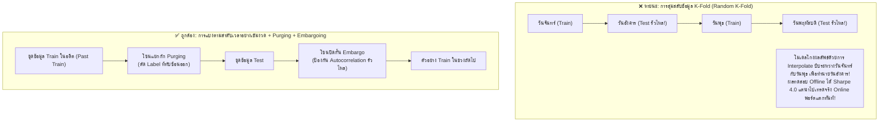
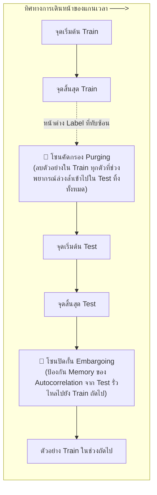

# บทที่ 18: วิธีการแบ่งข้อมูลแบบ Cross-Validation (CV) สำหรับอนุกรมเวลาทางการเงินที่ถูกต้อง

> **เป้าหมายหลักของบทนี้**:  
> เข้าใจอย่างลึกซึ้งว่าทำไมการทำ Random K-Fold Cross-Validation มาตรฐานที่ใช้ได้ผลดีใน Computer Vision (CV) หรือ Natural Language Processing (NLP) ถึงกลายเป็น**หายนะการรั่วไหลของข้อมูลเวลา (Time-Series Leakage) ขั้นรุนแรง**เมื่อนำมาใช้กับข้อมูลอนุกรมเวลาทางการเงิน; เข้าใจการพังทลายของสมมติฐานข้อมูลที่มีการแจกแจงแบบอิสระและเหมือนกัน (I.I.D.) รวมถึงกลไกการแทรกซึมของฉลากข้อมูลที่ทับซ้อนกัน (Overlapping Labels); ศึกษาหลักการและอนุพัทธ์ทางคณิตศาสตร์ของ**การคัดกรองข้อมูลทับซ้อน (Purging)** และ**การตั้งเขตกันชน (Embargoing)** ที่เสนอโดย Marcos López de Prado ผู้บุกเบิกวงการ Quant; พร้อมทั้งลงมือเขียนโค้ดสร้าง **Combinatorial Purged Cross-Validation (CPCV)** ระดับ Production ด้วยตนเอง

---

## 1. ทำไม K-Fold ทั่วไปถึงเป็นยาพิษร้ายแรงในสาย Quant?

วิศวกร Machine Learning จำนวนมากเมื่อผันตัวเข้าสู่วงการ Quant มักติดนิสัยเรียกใช้ `sklearn.model_selection.KFold(shuffle=True)` เพื่อทำ Hyperparameter Tuning แล้วได้ "โมเดลสุดเทพ" บน Jupyter Notebook ที่มีความแม่นยำบน Test Set ถึง $85\%$ และ Sharpe Ratio พุ่งสูงถึง $4.0$ แต่ทว่าตั้งแต่วันแรกที่นำไปเทรดจริง (Live Trading) โมเดลกลับเริ่มขาดทุนอย่างต่อเนื่อง

### 1.1 การพังทลายโดยสิ้นเชิงของสมมติฐาน I.I.D.

ข้อสมมติทางคณิตศาสตร์ที่เป็นหัวใจสำคัญของ Cross-Validation ใน Machine Learning มาตรฐานคือ: **ตัวอย่างข้อมูลต้องเป็นอิสระและมีการแจกแจงแบบเดียวกัน (Independent and Identically Distributed: I.I.D.)** แต่ในตลาดการเงิน ข้อสมมตินี้กลับถูกทำลายลงอย่างสิ้นเชิง:

```
2 กลไกหลักที่ทำลายสมมติฐาน I.I.D. ของข้อมูลทางการเงิน
├── 1. การทับซ้อนของช่วงเวลา Label นำไปสู่การแอบดูอนาคตโดยตรง (Information Leakage via Overlapping Labels):
│     ├── ความเป็นจริงในทางปฏิบัติ: หากเป้าหมายการทำนายคือผลตอบแทน 5 วันข้างหน้า R_{t -> t+5} ตัว Label ของวัน t จะครอบคลุมช่วง [t+1, t+5]
│     └── ความจริงของการรั่วไหล: การสลับข้อมูลแบบสุ่ม (Shuffle) แยกวัน t กับ t+2 ให้อยู่คนละฝั่งใน Training Set และ Test Set ทำให้ Training Set มองเห็นสภาวะตลาดล่วงหน้าของ Test Set ไปแล้วถึง 3 วัน!
└── 2. สหสัมพันธ์ในตัวเองทั้งในมิติเวลาและภาคตัดขวาง (Serial & Cross-Sectional Correlation):
      ├── ความเป็นจริงในทางปฏิบัติ: Sentiment ระดับมหภาค และการเกาะกลุ่มของความผันผวน (ปรากฏการณ์ GARCH) ทำให้สภาวะของวันจันทร์ส่งผลต่อเนื่องไปถึงวันพุธโดยตรง
      └── ความจริงของการรั่วไหล: การนำวันจันทร์กับวันพุธไปเป็น Training Set แล้วใช้วันอังคารเป็น Test Set แท้จริงแล้วโมเดลกำลังทำ "การประมาณค่าในช่วงเวลา (Interpolation)" 
          ไม่ใช่ "การพยากรณ์คาดการณ์อนาคต (Forecasting)" ที่แท้จริง!
```



---

## 2. หลักการทางคณิตศาสตร์ของ Purging และ Embargoing

เพื่อขจัดปัญหาข้อมูลรั่วไหลที่เกิดจากการทับซ้อนกันของ Label ให้หมดสิ้น Marcos López de Prado ผู้บุกเบิกวงการ Quant ได้กำหนด 2 หลักการปฏิบัติการหลักไว้อย่างเป็นทางการในหนังสือระดับคลาสสิก 《Advances in Financial Machine Learning (2018)》:



### 2.1 การคัดกรองข้อมูลทับซ้อน (Purging): กำจัด Label ทับซ้อนที่ยื่นไปข้างหน้า
กำหนดให้วันที่สร้าง Feature ของตัวอย่าง $i$ คือ $t_i$ และวันที่ชำระราคาหรือปิดสถานะเพื่อคำนวณ Label การพยากรณ์คือ $e_i$ ในทางคณิตศาสตร์ ช่วงเวลาที่ข้อมูลของตัวอย่างนี้ถูกเปิดเผยคือช่วงปิด $[t_i, e_i]$

สำหรับเซตของตัวอย่างใน Test Set ใดๆ $\text{Test}$ นิยาม**ส่วนปิดของการครอบคลุมข้อมูลทั้งหมด (Global Information Coverage Closure)** ของ Test Set บนแกนเวลาได้เป็น:
$$\Omega_{\text{Test}} = \bigcup_{j \in \text{Test}} [t_j, e_j]$$

**เกณฑ์การทำ Purging**: ตัวอย่าง $i$ ใน Training Set ใดๆ หากช่วงเวลาข้อมูลของตัวอย่างนั้นมีส่วนทับซ้อนกับส่วนปิดของข้อมูลใน Test Set ตัวอย่างใน Training Set ดังกล่าวจะต้องถูก**ตัดทิ้งจริง (Physically Removed)**:
$$\text{Train}_{\text{purged}} = \left\{ i \in \text{Train} \;\middle|\; [t_i, e_i] \cap \Omega_{\text{Test}} = \emptyset \right\}$$

- ในการคัดเลือกหุ้นด้วยแบบจำลองพหุแฟกเตอร์ (Factor) เนื่องจากเราคาดการณ์ผลตอบแทนส่วนเกิน (Excess Return) ในอีก 5 วันข้างหน้า ($e_i = t_i + 5$) หรือ 20 วันข้างหน้า ($e_i = t_i + 20$) ดังนั้นก่อนที่ Test Set จะเริ่มต้นขึ้น จึงจำเป็นต้องทำ Purging คัดกรองตัวอย่างใน Training Set ย้อนหลังออกไปอย่างน้อย $h$ วันทำการซื้อขาย!

### 2.2 การตั้งเขตกันชน (Embargoing): สกัดกั้นการเอ่อล้นย้อนหลังของ Autocorrelation
เมื่อ Test Set อยู่ตรงกลางของช่วงเวลา (เช่น ในการทำ Cross-Validation ที่ Training Set ครอบคลุมทั้งช่วงเวลาก่อนหน้าและหลังจาก Test Set) เนื่องจากกระบวนการ Autoregressive (AR) และความจำของความผันผวน (Volatility Memory) สภาวะตลาด ณ จุดสิ้นสุดของ Test Set จะยังคงส่งอิทธิพลต่อเนื่องไปยังตลาดในช่วงถัดไปทันที

**เกณฑ์การทำ Embargoing**: หลังจากจุดชำระราคา Label ล่าสุดของ Test Set ให้กำหนดระยะเวลาของเขตกันชนป้องกันเพิ่มเติม (Embargo Window) เป็นความยาว $E$ วันทำการซื้อขาย:
$$\Omega_{\text{Embargo}} = \left[ \max_{j \in \text{Test}} e_j, \;\; \max_{j \in \text{Test}} e_j + E \right]$$
ตัวอย่างใน Training Set ช่วงถัดไปใดๆ ที่ตกอยู่ในเขตกันชนนี้จะถูกตัดทิ้งทั้งหมด เพื่อตัดตอนการรั่วไหลของ Memory จาก Autocorrelation อย่างเด็ดขาด!

---
## 3. Combinatorial Purged Cross-Validation (CPCV): บอกลาข้อจำกัดของเส้นทางเดี่ยว

นักวิจัยจำนวนมากใช้ `TimeSeriesSplit` แบบ Naive (การแบ่งข้อมูลแบบ Rolling ไปข้างหน้า) แต่กลับมีจุดอ่อนสำคัญ 2 ประการ:
1. **เส้นทาง Backtest ในอดีตมีเพียงเส้นเดียว (Single Backtest Path)**: สุดท้ายจะสร้างเส้นทางการทดสอบตั้งแต่ต้นจนจบได้เพียงเส้นเดียว ทำให้ไม่สามารถประเมินความแปรปรวนของการวางนัยทั่วไป (Generalization Variance) ของกลยุทธ์ภายใต้สถานการณ์ตลาดในอดีตที่แตกต่างกันได้;
2. **การใช้ประโยชน์จากข้อมูลช่วงแรกต่ำมาก**: ตัวอย่างในชุด Train ของ Fold แรกๆ มีขนาดเล็กเกินไป ส่งผลให้ขีดความสามารถของโมเดลถูกจำกัด

### 3.1 กลไก CPCV (Combinatorial Purged Cross-Validation)
CPCV จะแบ่งอนุกรมเวลา (Time-series) ในอดีตออกเป็น $N$ บล็อกเวลา (Blocks) หากกำหนดให้ชุด Test แต่ละชุดประกอบด้วย $k$ บล็อกเวลา ก็จะสามารถสร้าง:

$$C_N^k = \binom{N}{k} = \frac{N!}{k!(N - k)!}$$

ชุดคู่ Train/Test ที่ไม่ซ้ำกันได้ โดยในแต่ละชุดจะดำเนินกระบวนการ **Purging** และ **Embargoing** อย่างเข้มงวด

- ตัวอย่างเช่น หากกำหนด $N = 6, k = 2$ จะได้รูปแบบการแบ่งข้อมูลที่ไม่ซ้ำกัน $\binom{6}{2} = 15$ แบบ;
- การทดสอบแต่ละครั้งครอบคลุม $\frac{2}{6} = 33.3\%$ ของกลุ่มตัวอย่างทั้งหมด ในทางทฤษฎีจึงสามารถสร้าง:
  $$\varphi = \binom{N}{k} \times \frac{k}{N} = 15 \times \frac{2}{6} = 5 \text{ เส้นทาง Backtest ที่ครอบคลุมประวัติศาสตร์ครบทุกวัฏจักรอย่างสมบูรณ์!}$$
- **คุณค่าหลัก**: สามารถประเมินความอ่อนไหวของกลยุทธ์ต่อสถานการณ์ตลาดในอดีตที่แตกต่างกัน และเป็นรากฐานข้อมูลที่มั่นคงสำหรับการคำนวณ**ความน่าจะเป็นที่จะเกิด Overfitting จากการ Backtest (Probability of Backtest Overfitting: PBO)**

---

## 4. ลงมือปฏิบัติจริง: การพัฒนาตัวแบ่งข้อมูลอนุกรมเวลาแบบ Purged Group ระดับฝั่ง Buy-side

ในโมเดลเชิงปริมาณ (Quant) แบบภาคตัดขวาง (Cross-sectional) หุ้นทั้ง 5,000 ตัวในตลาดของวันทำการซื้อขายเดียวกันจะถูกนำมาตัดสินใจร่วมกัน ดังนั้น **การแบ่งข้อมูลต้องใช้ "วันที่ (Date Group)" เป็นหน่วยย่อยที่สุด (Atomic Unit) และต้องไม่แยกหุ้นของวันเดียวกันไปไว้ใน Fold ที่ต่างกันโดยเด็ดขาด!**

ในโฟลเดอร์รากของโปรเจกต์ ให้รันคำสั่ง `PYTHONPATH=tutorial python3 -m examples.lecture_18_financial_cv_purging_embargo` ดูการติดตั้ง Dependency, โมดูลที่ใช้ร่วมกัน และข้อกำหนดของข้อมูล (Data Contract) ได้ที่[คำอธิบายโปรเจกต์](../README.md)

<<< @/examples/lecture_18_financial_cv_purging_embargo.py

### คำอธิบายผลลัพธ์การรันหลักและขอบเขตการแบ่งข้อมูล:
```
前向折 1: 训练 2023-01-02～2023-09-13，测试 2023-09-21～2024-06-10
前向折 2: 训练 2023-01-02～2024-06-03，测试 2024-06-11～2025-02-26
前向折 3: 训练 2023-01-02～2025-02-19，测试 2025-02-27～2025-11-14
CPCV 生成 15 组有标签清洗的研究切分；不等同于独立样本或实盘前向路径。
```

1. **โซนคั่น Purging ชัดเจนอย่างเห็นได้ชัด**:
   - ใน Fold 1 ชุด Train สิ้นสุด ณ `2023-09-13` ขณะที่ชุด Test เริ่มต้นอย่างเป็นทางการในวันที่ `2023-09-21` โดยมีโซนคั่นทางกายภาพเว้นไว้เต็มๆ 6 วันทำการ เพื่อให้มั่นใจว่า Label ที่มีระยะเวลาถือครอง 5 วันได้รับการชำระราคาอย่างสมบูรณ์ก่อนที่ชุด Test จะเริ่มต้นขึ้น!
2. **CPCV ครอบคลุมการจัดหมู่ทั้งหมด**:
   - อัลกอริทึมจะสร้างชุดการแบ่งเพื่อการวิจัยที่ผ่านการทำ Purging ป้ายกำกับข้อมูลแล้ว 15 ชุดโดยอัตโนมัติ ซึ่งช่วยกำหนดขอบเขตข้อมูลที่รัดกุมที่สุดสำหรับการทำ Stress Test ของโมเดลภายใต้สภาวะตลาดกระทิงและตลาดหมีในระดับมหภาคที่หลากหลาย

---

## 5. สรุปบทนี้และแบบฝึกหัดลงมือปฏิบัติท้ายบท

### สรุปแผนผังความรู้หลัก:
1. **สมมติฐาน I.I.D. ทางการเงินพังทลาย**: K-Fold แบบสุ่มทั่วไปจะทำให้ได้คะแนนสูงเกินจริงบนอนุกรมเวลาทางการเงิน เนื่องจากปัญหา Label ซ้อนทับกันและความสัมพันธ์ในตัวเอง (Autocorrelation);
2. **Purging กำจัดการรุกล้ำของ Label ในอนาคต**: กำจัดตัวอย่างในชุด Train ทั้งหมดที่ช่วงเวลาคาดการณ์รุกล้ำเข้าไปในชุด Test อย่างเข้มงวด;
3. **Embargoing ปิดกั้นความจำจาก Autocorrelation**: เพิ่มพื้นที่กันชน (Buffer) หลังจุดชำระราคาของชุด Test เพื่อป้องกันไม่ให้สภาวะจุลภาคส่งผลล้นย้อนหลัง;
4. **CPCV Cross-Validation เชิงจัดหมู่**: สร้างเส้นทางในอดีตที่ไม่ซ้อนทับกันหลายเส้นทาง เพื่อเป็นเครื่องมือทางคณิตศาสตร์สำหรับการทำ Stress Test ความทนทาน (Robustness) ของกลยุทธ์

### แบบฝึกหัดลงมือปฏิบัติท้ายบท:
> **ภารกิจปฏิบัติการ**:  
> 1. เปิด `tutorial/examples/lecture_18_financial_cv_purging_embargo.py`  
> 2. เพิ่มระยะเวลาการถือครองไปข้างหน้าของ Label `forward_horizon` จาก 5 วันเป็น 20 วัน (จำลองโมเดลที่มีการปรับพอร์ต (Rebalance) รายเดือน) แล้วสังเกตว่าความกว้างของโซนคั่น Purging ระหว่างวันสิ้นสุดของชุด Train และวันเริ่มต้นของชุด Test ใน Fold 1 มีการขยายตัวสอดคล้องกันอย่างไร?  
> 3. คำถามชวนคิด: ในการ Train แบบ Rolling (Walk-Forward Validation) หากเพิ่มความถี่ในการ Train โมเดลจาก "Rolling ทุกเดือน" เป็น "Rolling ทุกสัปดาห์" การใช้ทรัพยากรการประมวลผล (Compute) และความทันกาลของการอัปเดตฟีเจอร์ (Feature Freshness) มีการแลกเปลี่ยน (Trade-off) กันอย่างไร?
