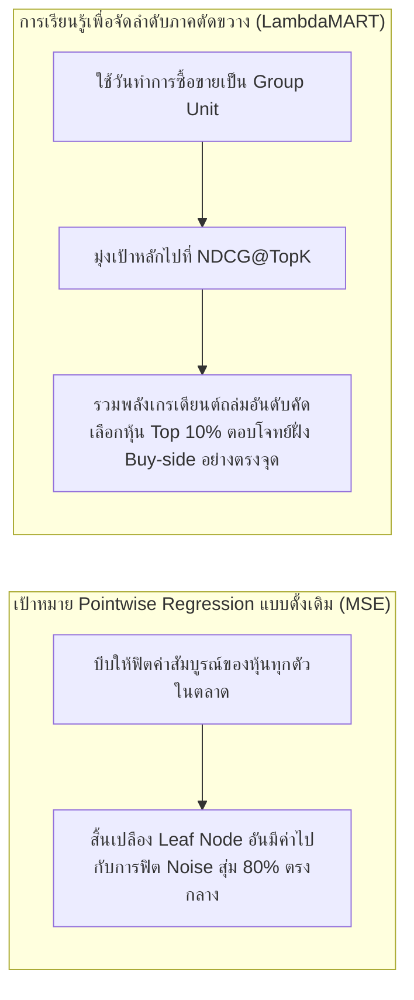
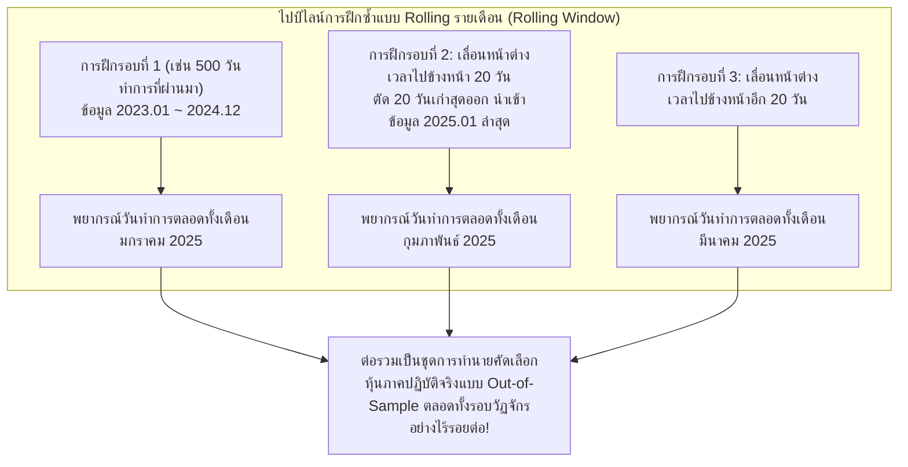

# บทที่ 19: ปฏิบัติการ Gradient Boosted Tree สำหรับข้อมูลตาราง (LightGBM / CatBoost)

> **เป้าหมายหลักของบทนี้**:  
> ในระบบการผสานรวมฟีเจอร์แบบหลายแฟกเตอร์ (Multi-factor) ยุคใหม่ โมเดล Gradient Boosted Decision Tree (GBDT โดยมี **LightGBM** และ **CatBoost** เป็นตัวแทนชั้นนำ) ครองตำแหน่งราชาของ Quant ฝั่ง Buy-side แบบหลายแฟกเตอร์มาอย่างยาวนาน ทำความเข้าใจอย่างลึกซึ้งว่าเหตุใดโมเดลแบบต้นไม้จึงเอาชนะ Fully Connected Neural Network บนข้อมูลตารางทางการเงินได้อย่างขาดลอย; อนุพันธ์ความแตกต่างระดับรากฐานระหว่าง**เป้าหมายการถดถอยระดับจุดทั่วไป (Pointwise Regression: MSE/Huber)** กับ**การเรียนรู้เพื่อจัดลำดับภาคตัดขวาง (Cross-sectional Learning to Rank: LambdaMART)** อย่างรัดกุม; เจาะลึกหลักคณิตศาสตร์เบื้องหลัง **NDCG@K** และ**เกรเดียนต์เสมือน ($\lambda$-Gradient)**; พร้อมทั้งเชี่ยวชาญชุดไฮเปอร์พารามิเตอร์สไตล์ Buy-side ฉบับกระชับสำหรับป้องกัน Overfitting บนข้อมูลที่มี Signal-to-Noise Ratio ต่ำ

---

## 1. ทำไม GBDT ถึงเป็น "ราชา" ตลอดกาลของข้อมูลตารางทางการเงิน?

ในวงการ Computer Vision หรือ NLP โมเดล Deep Learning อาจครองความเป็นใหญ่ แต่ในบริบทของข้อมูลตารางทางการเงิน (Tabular Data) ที่มีแฟกเตอร์ภาคตัดขวางเป็นแกนหลัก **อัลกอริทึม Ensemble แบบต้นไม้ (GBDT) ได้แสดงให้เห็นในทางปฏิบัติของระดับอุตสาหกรรมแล้วว่าสามารถเอาชนะ Deep Neural Network ได้อย่างเหนือชั้น**

เปเปอร์ระดับตำนานจากงานประชุมวิชาการ NeurIPS 2022 หัวข้อ *Why do tree-based models still outperform deep learning on typical tabular data?* (Grinsztajn et al.) ได้อธิบายถึง Inductive Bias สำคัญในเชิงทฤษฎีไว้ดังนี้:

```
ข้อได้เปรียบโดยธรรมชาติของโมเดลต้นไม้บนข้อมูลตารางทางการเงิน
├── 1. ไม่ได้รับผลกระทบจากการแปลงแบบทางเดียว (Monotonic Transformation) และหน่วยวัดอย่างสิ้นเชิง:
│     └── ค้นหาจุดตัดแยก (Split Point) ที่ดีที่สุดจาก Histogram Binning โดยไม่จำเป็นต้องทำ Normalization ตัวแปรต่อเนื่องอย่างเข้มงวด
├── 2. มีความถนัดโดยธรรมชาติในการฟิตระนาบการตัดสินใจไม่เป็นเชิงเส้นแบบขั้นบันได:
│     └── ตัวอย่างเช่น: สัดส่วนหนี้สินต่อทุน (D/E) เกิน 85% ความเสี่ยงการผิดนัดชำระหนี้จะพุ่งสูงทันที, PE ต่ำกว่า 0 เกิดการเปลี่ยนเชิงคุณภาพ โมเดลต้นไม้สามารถตัดแบ่งได้อย่างสมบูรณ์แบบด้วย Threshold เพียงค่าเดียว
├── 3. มีความทนทาน (Robustness) สูงมากต่อฟีเจอร์ที่ไม่มีประโยชน์ (Uninformative Features):
│     └── Neural Network จะพยายามกำหนดค่าน้ำหนักให้กับทุกฟีเจอร์และอัปเดตผ่าน Backpropagation ในขณะที่ Decision Tree สามารถมองข้ามแฟกเตอร์สัญญาณรบกวนที่ไม่เกี่ยวข้องได้ตั้งแต่ที่ Root Node
└── 4. การแบ่งไฮเปอร์เพลนที่ขนานตามแนวแกน (Axis-Aligned Split):
      └── แฟกเตอร์ทางการเงินส่วนใหญ่มักเป็นมิติทางเศรษฐศาสตร์ที่มีความเป็นอิสระต่อกันหรือกึ่งตั้งฉาก (Orthogonal) เครือข่ายที่อิงคุณสมบัติความไม่แปรเปลี่ยนตามการหมุน (Rotation Invariance) จึงมักเพิ่มสัญญาณรบกวนจากการฟิตโดยไม่จำเป็น
```

---

## 2. การเลือก Objective Function: การถดถอยระดับจุด (Pointwise) vs การเรียนรู้เพื่อจัดลำดับ (Listwise LambdaMART)

ในการสร้างโมเดล LightGBM ผู้เริ่มต้นส่วนใหญ่มักจะตั้งค่าเริ่มต้นเป็น `objective = "regression"` (Mean Squared Error: MSE) แต่ในงานคัดเลือกหุ้นเชิงปริมาณที่มีเป้าหมายเพื่อ "คัดเลือกหุ้นชั้นยอด Top 10%" นี่ถือเป็นความคลาดเคลื่อนของเป้าหมายในระดับรากฐาน!

### 2.1 จุดตายของ Pointwise Regression (MSE / Huber)

$$\mathcal{L}_{\text{MSE}}(y, \hat{y}) = \frac{1}{2N} \sum_{i=1}^N (y_i - \hat{y}_i)^2$$

- **กับดักของการลงโทษความผิดพลาดแบบกระจายสม่ำเสมอ**: ในบรรดาหุ้น 5,000 ตัวทั่วทั้งตลาด หุ้น 80% ตรงกลางมีความต่างของผลตอบแทนในอนาคตที่น้อยมากและเต็มไปด้วยสัญญาณรบกวนแบบ Random Walk;
- MSE บีบให้ Decision Tree ต้องสิ้นเปลือง Leaf Node จำนวนมหาศาลเพื่อไปฟิตความผันผวนของค่าตัวเลขเล็กๆ น้อยๆ ในกลุ่มตัวอย่างขยะตรงกลาง (เช่น สรุปแล้วมันคือ $+0.2\%$ หรือ $+0.4\%$) ส่งผลให้**คุณภาพการคัดเลือกหุ้นหัวแถว Top 10% ซึ่งเป็นตัวกำหนดผลตอบแทนส่วนเกิน (Excess Return) ของพอร์ตฝั่ง Long ที่แท้จริง ถูกลดทอนลงอย่างรุนแรง**!

### 2.2 การก้าวกระโดดทางคณิตศาสตร์ของ Listwise LambdaMART

การเรียนรู้เพื่อจัดลำดับจะมองว่า**แต่ละวันทำการซื้อขายคือหนึ่ง Query ของการค้นหา** โดยมีหุ้น 5,000 ตัวในวันทำการนั้นเป็นเอกสารตัวเลือก (Documents) ที่รอการจัดลำดับ

เป้าหมายสูงสุดของการปรับพารามิเตอร์คือ **Normalized Discounted Cumulative Gain (NDCG@K)**:

$$\text{DCG}@K = \sum_{i=1}^K \frac{2^{rel_i} - 1}{\log_2(i + 1)}, \quad \text{NDCG}@K = \frac{\text{DCG}@K}{\text{IDCG}@K}$$

โดยที่ $rel_i$ คือระดับความเกี่ยวข้องของผลตอบแทนของหุ้น $i$ (เช่น แบ่งเป็น 0~4 ระดับตามอัตราผลตอบแทนในอนาคต) และ $i$ คืออันดับที่โมเดลทำนายได้

- **กลไกลดทอนตามตำแหน่งของตัวส่วน $\log_2(i + 1)$**: หุ้นที่อยู่อันดับที่ 1 จะได้รับน้ำหนักสูงสุด ส่วนหุ้นที่อยู่อันดับหลังที่ 100 น้ำหนักจะลดลงอย่างรวดเร็วจนแทบเป็นศูนย์!
- **การอนุพันธ์ทางคณิตศาสตร์ของเกรเดียนต์เสมือนใน LambdaRank ($\lambda$-Gradient)**:  
  เนื่องจาก NDCG เป็นฟังก์ชันขั้นบันไดที่ไม่ต่อเนื่องและไม่สามารถหาอนุพันธ์ได้โดยตรง นักวิจัยจาก Microsoft อย่าง Christopher Burges และคณะ จึงได้เสนอแนวคิดเรื่อง**เกรเดียนต์เสมือน $\lambda_{ij}$**:

$$\lambda_{ij} = \frac{-\sigma}{1 + e^{\sigma(s_i - s_j)}} |\Delta \text{NDCG}|$$

โดยที่:
- $s_i, s_j$ คือคะแนนการทำนายของโมเดลสำหรับหุ้น $i$ และ $j$;
- $|\Delta \text{NDCG}|$ แสดงถึง**ผลต่างการเปลี่ยนแปลงของ NDCG ทั้งภาคตัดขวาง หากทำการสลับตำแหน่งอันดับการทำนายระหว่างหุ้น $i$ และหุ้น $j$**!

```
กลไกทางกายภาพระดับจุลภาคของเกรเดียนต์ LambdaMART
├── อันดับหัวแถวคลาดเคลื่อน: หากตัดสินหุ้นอันดับ 1 ของตลาดผิดไปเป็นอันดับ 10 ค่า |ΔNDCG| จะมหาศาลมาก เกรเดียนต์ λ จะพุ่งขึ้นอย่างรุนแรง ขับเคลื่อนให้โมเดลต้นไม้ทุ่มกำลังแก้ไขข้อผิดพลาดทันที!
└── อันดับท้ายแถวคลาดเคลื่อน: หากสลับอันดับระหว่างอันดับ 2,500 และ 2,501 ค่า |ΔNDCG| จะแทบเป็น 0 อย่างแท้จริง โมเดลต้นไม้จะข้ามไปโดยไม่สนใจเลย!
```



---

## 3. ระบบควบคุมไฮเปอร์พารามิเตอร์ป้องกัน Overfitting ระดับ Buy-side

ข้อมูลทางการเงินมีอัตราส่วนสัญญาณต่อสัญญาณรบกวนต่ำมาก (โดยทั่วไป SNR น้อยกว่า 0.05) จึงห้ามใช้พารามิเตอร์ของโมเดลต้นไม้ทั่วไปที่แนะนำตามอินเทอร์เน็ตโดยเด็ดขาด! "เช็กลิสต์พารามิเตอร์เอาชีวิตรอดเพื่อป้องกัน Overfitting" ของสถาบันการลงทุนเชิงปริมาณมีดังนี้:

| ชื่อพารามิเตอร์ | ช่วงปลอดภัยที่สถาบันแนะนำ | ค่าเริ่มต้นของไลบรารี | ความหมายเชิงกายภาพในการปรับจูนและหัวใจสำคัญสไตล์ Buy-side |
| :--- | :--- | :--- | :--- |
| `max_depth` | **3 ~ 5** | -1 (ไม่จำกัด) | **บังคับใช้ Weak Learner ที่ตื้นมาก** ขจัดปัญหาต้นไม้ลึกท่องจำสัญญาณรบกวนในอดีต |
| `num_leaves` | **8 ~ 20** | 31 | ขีดจำกัดสูงสุดของ Leaf Node สำหรับต้นไม้ตื้นต้องสอดคล้องกับเงื่อนไข $\le 2^{\text{max\_depth}}$ |
| `min_child_samples` | **100 ~ 500** | 20 | **จำนวนแถวตัวอย่างขั้นต่ำต่อหนึ่ง Leaf Node** ป้องกันไม่ให้ต้นไม้สร้างเส้นทาง Split เฉพาะกิจสำหรับหุ้นเก็งกำไรผิดปกติบางตัว |
| `feature_fraction` | **0.50 ~ 0.70** | 1.0 | สุ่มตัวอย่างฟีเจอร์แฟกเตอร์ในแต่ละรอบการ Split เพื่อทำลาย Multicollinearity ระหว่างฟีเจอร์ |
| `bagging_fraction` | **0.60 ~ 0.80** | 1.0 | สุ่มตัวอย่างแถวข้อมูล (Subsample) เสริมความสามารถในการสรุปผลทั่วไป ต้านทานความผันผวนของอนุกรมเวลา |
| `learning_rate` | **0.01 ~ 0.03** | 0.1 | เดินช้าแต่งานละเอียด ใช้ควบคู่กับ `early_stopping` เพื่อป้องกันไม่ให้พุ่งข้ามจุดที่เหมาะสมเร็วเกินไป |
| `reg_alpha` (L1) | **0.5 ~ 2.0** | 0.0 | การลงโทษด้วยค่าสัมบูรณ์ของน้ำหนักใน Leaf Node เพื่อสร้างความเบาบาง (Sparsity) |
| `reg_lambda` (L2) | **2.0 ~ 10.0** | 0.0 | การลงโทษด้วยค่ายกกำลังสองของน้ำหนักใน Leaf Node เพื่อปรับให้การกระจายของคะแนนทำนายภาคตัดขวางมีความเรียบเนียน |

---
## 4. สถาปัตยกรรมการฝึกซ้ำแบบ Rolling Walk-Forward (Rolling Walk-Forward Retraining)

ตลาดการเงินมีคุณสมบัติเด่นคือ**ความไม่นิ่ง (Non-stationarity) และการเปลี่ยนภาวะตลาด (Regime Shift)** อย่างเห็นได้ชัด ตรรกะหุ้นบลูชิปขนาดใหญ่เน้นมูลค่า (Large-cap Value) ที่เคยใช้ได้ผลก่อนปี 2021 กลับถูก Quant สายหุ้นขนาดไมโครแคป (Micro-cap) พลิกคว่ำอย่างสิ้นเชิงในปี 2023

สถาบัน Quant มักจะใช้กลไก**การฝึกฝนแบบเลื่อนหน้าต่างรายเดือน (Rolling Window)**:



---

## 5. ลงมือปฏิบัติจริง: ตัวจัดอันดับภาคตัดขวาง (Cross-sectional Ranker) ด้วย LightGBM LambdaMART ภาคปฏิบัติ

โค้ด Python ด้านล่างนี้เป็นไปตามมาตรฐานระดับสถาบันฝั่ง Buy-side อย่างเคร่งครัด โดยอิงตาม**โหมดการจัดอันดับแบบ Group ดั้งเดิมของ LightGBM** และใช้ชุดข้อมูลที่มีการแยกด้วย Purging เพื่อฝึกโมเดลจัดอันดับ LambdaMART

รัน `PYTHONPATH=tutorial python3 -m examples.lecture_19_lightgbm_catboost_ranking` ที่รูทของโปรเจกต์ สำหรับการติดตั้ง Dependency, โมดูลที่ใช้ร่วมกัน และข้อตกลงข้อมูล ดูได้ที่ [คำอธิบายโปรเจกต์](../README.md)

<<< @/examples/lecture_19_lightgbm_catboost_ranking.py

### สรุปผลลัพธ์การรันหลักและการวิเคราะห์ Feature Gain:
```
训练集规模: 43,500 行 | 验证集规模: 14,700 行

>>> 开始训练 LightGBM LambdaMART 截面排序器...
✅ 验证集平均 Rank IC:   0.2398 (树模型最佳迭代步数: 173)

>>> 模型特征分裂增益 (Gain) 排名:
shape: (8, 3)
┌──────────┬─────────────────┬─────────────┐
│ feature  ┆ gain_importance ┆ split_count │
│ ---      ┆ ---             ┆ ---         │
│ str      ┆ f64             ┆ i32         │
╞══════════╪═════════════════╪═════════════╡
│ factor_0 ┆ 2832.001484     ┆ 354         │
│ factor_1 ┆ 2229.821462     ┆ 347         │
│ factor_2 ┆ 396.601158      ┆ 359         │
│ factor_3 ┆ 66.493592       ┆ 177         │
│ factor_4 ┆ 54.932583       ┆ 169         │
│ factor_7 ┆ 54.615559       ┆ 173         │
│ factor_6 ┆ 42.035421       ┆ 117         │
│ factor_5 ┆ 37.808619       ┆ 154         │
└──────────┴─────────────────┴─────────────┘
```

1. **Rank IC บนชุดตรวจสอบที่มีความเสถียรสูง**:
   - โมเดลต้นไม้ทริกเกอร์ Early Stopping ที่การวนซ้ำรอบที่ 173 โดยได้ค่าเฉลี่ย Rank IC บนชุดตรวจสอบสูงถึง **0.2398** แสดงให้เห็นถึงขีดความสามารถอันทรงพลังในการผสานฟีเจอร์แบบไม่เป็นเชิงเส้นของมัลติแฟกเตอร์ (Multi-factor)
2. **การปรากฏของลำดับชั้นที่ไม่เป็นเชิงเส้นของมัลติแฟกเตอร์**:
   - Split Gain ของ `factor_0` และ `factor_1` ครองสัดส่วนหลักอย่างเด็ดขาด ในขณะที่แฟกเตอร์ที่มีความสัมพันธ์ต่ำจะถูกผลักไปอยู่โหนดชั้นล่าง ทำให้เกิดการถ่วงน้ำหนักแบบปรับตัวได้เอง

---

## 6. สรุปเนื้อหาบทนี้และการบ้านลงมือปฏิบัติ

### สรุปแผนผังความรู้หลัก:
1. **ความเป็นผู้นำบนข้อมูลแบบตารางของ GBDT**: มีภูมิคุ้มกันตามธรรมชาติต่อความไม่เป็นเชิงเส้น การแปลงแบบโมโนโทนิก และความต่างของสเกลข้อมูลต่อเนื่อง จึงเป็นตัวเลือกอันดับหนึ่งในการสร้างโมเดลจากข้อมูลตารางทางการเงิน
2. **LambdaMART เหนือกว่า MSE**: ด้วย Position Discount แบบ $\log_2(i+1)$ และ Virtual Gradient แบบ $|\Delta \text{NDCG}|$ ทำให้โมเดลพุ่งเป้าไปที่การปรับปรุงอันดับของหุ้นกลุ่มหัวแถว Top 10% ได้อย่างแม่นยำ
3. **การจำกัด Hyperparameter อย่างเข้มงวด**: ความลึกของต้นไม้ที่ตื้นมาก (3~5), จำนวนตัวอย่างต่อใบขนาดใหญ่ (100~500) และบทลงโทษ Regularization ระดับสูง คือหัวใจสำคัญในการต้านทาน Overfitting จากสัญญาณที่มีอัตราส่วนสัญญาณต่อสัญญาณรบกวนต่ำในตลาดการเงิน

### แบบฝึกหัดลงมือปฏิบัติหลังเลิกเรียน:
> **ภารกิจปฏิบัติจริง**:  
> 1. เปิด `tutorial/examples/lecture_19_lightgbm_catboost_ranking.py`
> 2. สลับโหมด Objective Function จาก `objective="lambdarank"` เป็น `objective="regression"` (Mean Squared Error: MSE) โดยคง Hyperparameter อื่นๆ ไว้เหมือนเดิมทุกประการ
> 3. รันการฝึกใหม่อีกครั้ง แล้วเปรียบเทียบความแตกต่างของค่าเฉลี่ย Rank IC บนชุดตรวจสอบ และอัตรา Hit Rate ของหุ้นชั้นดี Top 10% ระหว่างทั้งสองโหมด
