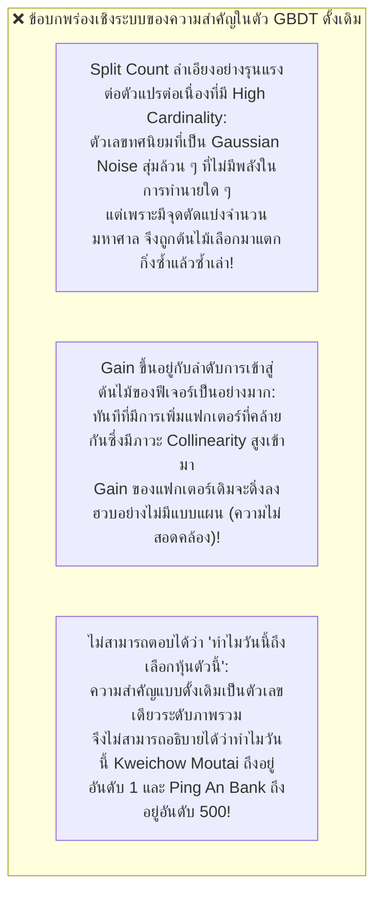
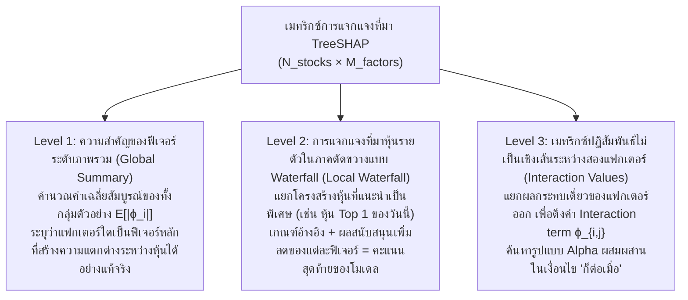

# บทที่ 20: ความสำคัญของฟีเจอร์และความสามารถในการอธิบายผล (ค่า SHAP)

> **เป้าหมายหลักของบทนี้**:  
> ในการวิจัยและลงทุนเชิงปริมาณ (Quant) แบบมัลติแฟกเตอร์ (Factor) ระดับสถาบัน โมเดล "ไม่เพียงแต่ต้องทำนายได้แม่นยำ แต่ยังต้องอธิบายได้อย่างชัดเจน" ทำลายอคติความสำคัญปลอม ๆ ของจำนวนครั้งการแตกกิ่ง (Split) และเกนจากการแตกกิ่ง (Gain) แบบดั้งเดิมใน GBDT อย่างสิ้นเชิง; พิสูจน์ 4 สัจพจน์ทองคำของระบบ **SHAP (SHapley Additive exPlanations)** ซึ่งมีที่มาจากทฤษฎีเกมร่วมมือ (Cooperative Game Theory) ที่ได้รับรางวัลโนเบลสาขาเศรษฐศาสตร์; ทำความเข้าใจอย่างลึกซึ้งใน**อัลกอริทึม TreeSHAP** ที่มีประสิทธิภาพการคำนวณระดับพหุนามอันทรงพลัง; ลงมือเขียนเอ็นจินการแจกแจงที่มาของฟีเจอร์ระดับ Production ด้วยตนเอง เพื่อตรวจวินิจฉัยฟีเจอร์ระดับภาพรวมทั้งตลาด, แจกแจงที่มาการคัดเลือกหุ้นรายตัวในรูปแบบ Waterfall และวิเคราะห์ปฏิสัมพันธ์ที่ไม่เป็นเชิงเส้นระหว่างสองแฟกเตอร์ (Interaction)

---

## 1. "3 คำลวงร้ายแรง" ของ Feature Importance ใน GBDT แบบดั้งเดิม

เฟรมเวิร์ก GBDT กระแสหลักเกือบทั้งหมด (LightGBM, XGBoost, CatBoost) มีอินเทอร์เฟซ `feature_importance()` ในตัว ซึ่งโดยหลักจะมีโหมดเอาต์พุต 2 แบบ:
1. **Split Count (จำนวนครั้งการแตกกิ่ง)**: นับความถี่สะสมที่ฟีเจอร์หนึ่ง ๆ ถูกเลือกเป็นเงื่อนไขการตัดแบ่งบนทุกโหนดของต้นไม้ตัดสินใจทั้งหมด;
2. **Gain (เกนจากการแตกกิ่ง)**: รวมผลรวมของปริมาณการลดลงของ Objective Function (เช่น ความแปรปรวน หรือ Information Gain) ที่ฟีเจอร์นั้นสร้างขึ้นในการแตกกิ่งแต่ละครั้ง

แต่ในการเทรด Quant จริง ตัวชี้วัดดั้งเดิมทั้งสองนี้เต็มไปด้วยการหลอกลวงทางสถิติที่ร้ายแรง:



ในการดีเฟนด์ด้านการบริหารความเสี่ยงกับฝั่ง Buy-side ที่เข้มงวด ประธานเจ้าหน้าที่ฝ่ายการลงทุนจะไม่มีทางยอมรับข้ออ้างที่ไร้สาระอย่าง "โมเดลซื้อหุ้นตัวนี้เพราะ Gain ของมันสูงมาก" เด็ดขาด **สิ่งที่เราจำเป็นต้องรู้คือ: ภายใต้สภาวะมหภาคและตลาด ณ เวลานั้น มีแฟกเตอร์ใดบ้างที่ร่วมพลังกันในเชิงบวกจนผลักดันให้หุ้นตัวนี้ขึ้นมาอยู่บนอันดับที่ต้องซื้อ!**

---

## 2. ทฤษฎีเกมร่วมมือและหลักการทางคณิตศาสตร์ของ Shapley Values

ในปี 1953 ลอยด์ แชปลีย์ (Lloyd Shapley) ผู้ได้รับรางวัลโนเบลสาขาเศรษฐศาสตร์ ได้ตั้งคำถามคลาสสิกขณะศึกษาวิจัยทฤษฎีเกมร่วมมือ: **เมื่อกลุ่มผู้เล่นร่วมมือกันจนได้ผลตอบแทนรวมก้อนหนึ่ง เราจะจัดสรรความมั่งคั่งนี้อย่างยุติธรรมที่สุดตามผลสนับสนุนส่วนเพิ่ม (Marginal Contribution) ของแต่ละคนได้อย่างไร?**

ในปี 2017 Scott Lundberg และ Su-In Lee จาก University of Washington ได้นำทฤษฎีนี้เข้าสู่วงการการอธิบายผลของ Machine Learning และก่อตั้งระบบการอธิบายผล **SHAP** ขึ้นมาอย่างเป็นทางการ

### 2.1 สูตรคณิตศาสตร์ที่รัดกุมของ Shapley Value

กำหนดให้เซตของฟีเจอร์ขาเข้าทั้งหมดคือ Grand Coalition $N = \{1, 2, \dots, M\}$ สำหรับฟีเจอร์ $i$ ใด ๆ ค่าผลสนับสนุนส่วนเพิ่ม Shapley $\phi_i$ ถูกนิยามอย่างรัดกุมไว้ดังนี้:

$$\phi_i = \sum_{S \subseteq N \setminus \{i\}} \frac{|S|! \cdot (M - |S| - 1)!}{M!} \Big( v(S \cup \{i\}) - v(S) \Big)$$

โดยที่:
- $S$ คือสับเซตใด ๆ ของฟีเจอร์ที่ไม่รวมฟีเจอร์ $i$;
- $v(S)$ คือค่าการทำนายที่คาดหวังของโมเดลเมื่อใช้เฉพาะฟีเจอร์ในสับเซต $S$;
- $v(S \cup \{i\}) - v(S)$ คือ**ผลสนับสนุนส่วนเพิ่มสุทธิ (Marginal Contribution)** ที่เกิดขึ้นหลังจากเพิ่มฟีเจอร์ $i$ เข้าไป;
- สัมประสิทธิ์ค่าน้ำหนัก $\frac{|S|! \cdot (M - |S| - 1)!}{M!}$ คือน้ำหนักความน่าจะเป็นที่สับเซตของฟีเจอร์นั้นจะปรากฏขึ้นจากการเรียงสับเปลี่ยนทั้งหมด

### 2.2 สี่สัจพจน์ (Axioms) ที่ไม่อาจทดแทนได้ของ SHAP

1. **คุณสมบัติการบวกเข้ากันได้อย่างมีประสิทธิภาพ (Efficiency / Additivity - คุณสมบัติหลัก)**:
   $$\sum_{i=1}^M \phi_i(x) = f(x) - \mathbb{E}[f(X)]$$
   ผลรวมสะสมของค่า SHAP ของฟีเจอร์ทั้งหมด **จะเท่ากับค่าการทำนายของหุ้นปัจจุบัน $f(x)$ ลบด้วยค่าคาดหวังของเอาต์พุตโมเดลจากเกณฑ์อ้างอิงของทั้งตลาด $\mathbb{E}[f(X)]$ อย่างสมบูรณ์แบบไร้รอยต่อ**! ทุกส่วนของส่วนต่างการทำนายสามารถถูกแยกย่อยได้อย่างแม่นยำ 100% โดยไม่มี Residual ตกค้างแม้แต่น้อย!
2. **ความสมมาตร (Symmetry)**: หากฟีเจอร์สองตัวมีผลสนับสนุนส่วนเพิ่มเท่ากันในทุกสับเซตของฟีเจอร์ ค่า SHAP ที่จัดสรรให้แก่ทั้งสองจะต้องเท่ากันอย่างแน่นอน;
3. **ความเป็นตัวแปรหุ่น (Dummy)**: หากแฟกเตอร์หนึ่งไม่ได้เพิ่มส่วนเพิ่มการทำนายให้แก่สับเซตใด ๆ เลย ค่า SHAP ของแฟกเตอร์นั้นจะเท่ากับ 0 โดยเคร่งครัด;
4. **ความสอดคล้องทางเดียว (Consistency)**: หากโมเดลเปลี่ยนไปในลักษณะที่ทำให้ผลสนับสนุนส่วนเพิ่มของฟีเจอร์ $i$ ไม่ลดลงในทุกกรณี ค่า SHAP ที่จัดสรรให้จะไม่ลดลงอย่างแน่นอน (ขจัดข้อบกพร่องเรื่องความไม่สอดคล้องของตัวชี้วัด Gain แบบดั้งเดิมอย่างสิ้นเชิง)

---

## 3. อัลกอริทึม TreeSHAP: ก้าวกระโดดจากการระเบิดแบบเอกซ์โพเนนเชียลสู่ระดับพหุนาม

การคำนวณค่า Shapley ดั้งเดิมจำเป็นต้องวนลูปผ่านสับเซตของฟีเจอร์ทั้งหมด $2^M$ สับเซต เมื่อจำนวนแฟกเตอร์เพิ่มขึ้นถึง 50 ตัว จำนวนสับเซตจะสูงถึง $2^{50} \approx 10^{15}$ ซึ่งความซับซ้อนในการคำนวณในระดับนี้เป็นไปไม่ได้เลยในทางปฏิบัติ

ในปี 2020 Lundberg และคณะได้ตีพิมพ์**อัลกอริทึม TreeSHAP** ในวารสาร *Nature Machine Intelligence* ซึ่งออกแบบมาสำหรับโมเดลประเภทต้นไม้โดยเฉพาะ:
- ใช้ประโยชน์จากโครงสร้างของต้นไม้ตัดสินใจ โดยทำ Dynamic Programming แบบเรียกซ้ำ (Recursive) บนเส้นทางไปยังโหนดใบ (Leaf Node) ของต้นไม้;
- ลด Time Complexity จากระดับเอกซ์โพเนนเชียล $O(T \cdot 2^M)$ ลงมาอยู่ที่ระดับพหุนาม **$O(T \cdot L \cdot D^2)$** อย่างมหาศาล (โดยที่ $T$ คือจำนวนต้นไม้, $L$ คือจำนวนใบ และ $D$ คือความลึกสูงสุดของต้นไม้);
- **ความสำคัญในทางปฏิบัติ**: ในโมเดลที่ซับซ้อนซึ่งครอบคลุมหุ้นทั้งตลาด 5,000 ตัว และ 50 แฟกเตอร์ TreeSHAP ใช้เวลาเพียงไม่กี่วินาทีในการคำนวณการแจกแจงที่มาทั่วทั้งภาคตัดขวางจนเสร็จสิ้น!

---

## 4. สถาปัตยกรรมการอธิบายผล 3 ระดับในการวิจัยและลงทุน Quant ฝั่ง Buy-side



---
## 5. ภาคปฏิบัติลงมือทำ: การพัฒนา Engine การแจกแจงที่มา (Attribution) ของแฟกเตอร์ (Factor) ด้วย TreeSHAP ระดับฝั่ง Buy-side

โค้ด Python ด้านล่างปฏิบัติตามมาตรฐานระดับสถาบันของฝั่ง Buy-side อย่างเคร่งครัด โดยพัฒนาบน `shap.TreeExplainer` เพื่อทำ**การจัดอันดับความสำคัญของฟีเจอร์ระดับภาพรวม (Global Feature Importance)**, **การแจกแจงการตัดสินใจของหุ้นรายตัวแบบ Waterfall** และ**การสกัด Interaction Matrix ของสองแฟกเตอร์**

รัน `PYTHONPATH=tutorial python3 -m examples.lecture_20_shap_interpretability` ที่ไดเรกทอรีรากของโปรเจกต์ ดูการติดตั้ง Dependency, โมดูล (Module) ที่ใช้ร่วมกัน และ Data Contract ได้ที่ [คำอธิบายโปรเจกต์](../README.md)

<<< @/examples/lecture_20_shap_interpretability.py

### เอาต์พุตการทำงานหลักและการแปลผลบันทึกการแจกแจงที่มา:
```
解释器参考基线 E[f(X)]: -0.00013

>>> [全局归因] 全市场平均绝对 SHAP 贡献值排名:
shape: (5, 2)
┌──────────────┬───────────────┐
│ feature      ┆ mean_abs_shap │
│ ---          ┆ ---           │
│ str          ┆ f64           │
╞══════════════╪═══════════════╡
│ mom_20d      ┆ 0.006281      │
│ turnover_vol ┆ 0.003822      │
│ ep_ratio     ┆ 0.003183      │
│ bp_ratio     ┆ 0.000248      │
│ amihud_illiq ┆ 0.000144      │
└──────────────┴───────────────┘

>>> [局部归因] 股票 000001.SH 在 2025-01-08 的预测打分驱动拆解:
  • mom_20d        -> SHAP 贡献: -0.01123 | 🔴 拖累抑制
  • ep_ratio       -> SHAP 贡献: -0.00147 | 🔴 拖累抑制
  • turnover_vol   -> SHAP 贡献: +0.00132 | 🟢 增益助力
  • amihud_illiq   -> SHAP 贡献: +0.00036 | 🟢 增益助力
  • bp_ratio       -> SHAP 贡献: +0.00009 | 🟢 增益助力
  ──────────────────────────────────────────
  • 基准均值 (Base)  : -0.00013
  • 特征合力 (Shap)  : -0.01092
  • 最终预测 (Score) : -0.01104 (加和效率性严格闭合！)

>>> [交互归因] 双因子非线性耦合强度 Top 3:
shape: (3, 3)
┌──────────┬──────────────┬──────────────────────┐
│ factor_A ┆ factor_B     ┆ interaction_strength │
│ ---      ┆ ---          ┆ ---                  │
│ str      ┆ str          ┆ f64                  │
╞══════════╪══════════════╪══════════════════════╡
│ mom_20d  ┆ ep_ratio     ┆ 0.001599             │
│ mom_20d  ┆ turnover_vol ┆ 0.000271             │
│ ep_ratio ┆ turnover_vol ┆ 0.000179             │
└──────────┴──────────────┴──────────────────────┘
```

1. **ความสมบูรณ์แบบบวกเพิ่ม (Additivity) ที่ลงตัวอย่างแม่นยำ**:
   - หุ้น `000001.SH` มีคะแนนฐานอยู่ที่ -0.00013 และผลรวมการมีส่วนร่วมสุทธิของแต่ละแฟกเตอร์อยู่ที่ -0.01092 เมื่อนำทั้งสองมารวมกันจะได้เท่ากับคะแนนคาดการณ์สุดท้ายของโมเดลที่ **-0.01104** พอดี! พิสูจน์ให้เห็นถึงความรัดกุมสมบูรณ์แบบในเชิงคณิตศาสตร์ของ SHAP;
2. **เห็นแรงขับเคลื่อนการตัดสินใจของหุ้นรายตัวได้อย่างชัดเจน**:
   - เหตุผลที่สินทรัพย์นี้มีอันดับรั้งท้าย ปัจจัยฉุดรั้งหลักมาจาก `mom_20d` (มีส่วนร่วม -0.01123) และ `ep_ratio` (มีส่วนร่วม -0.00147) ในขณะที่ Turnover ให้ผลบวกเล็กน้อย ฝ่ายควบคุมความเสี่ยงและผู้จัดการกองทุนสามารถเรียกดูตารางนี้ได้ตลอดเวลาเพื่อตรวจสอบความสมเหตุสมผลของการตัดสินใจ;
3. **ค้นพบ Interaction แบบไม่เป็นเชิงเส้นของสองแฟกเตอร์ (Interaction Alpha)**:
   - Interaction Matrix แสดงให้เห็นว่าระหว่าง `mom_20d` กับ `ep_ratio` มี Coupling แบบไม่เป็นเชิงเส้นที่แข็งแกร่งที่สุด (ความแรง 0.0016) ซึ่งหมายความว่าโมเดลได้ค้นพบตรรกะเชิงซ้อนขั้นสูงที่ว่า "พลังในการสร้างผลตอบแทนส่วนเกิน (Excess Return) จะระเบิดออกมาได้สูงสุด ก็ต่อเมื่อ Momentum สูงผสานเข้ากับ Valuation ต่ำเท่านั้น"!

---

## 6. สรุปบทนี้และแบบฝึกหัดภาคปฏิบัติท้ายบท

### สรุปแผนผังความรู้หลัก:
1. **ละทิ้ง Gain/Split แบบดั้งเดิม**: Feature Importance ของโมเดล Tree แบบดั้งเดิมมีปัญหาความลำเอียงต่อฟีเจอร์ที่มีจำนวนค่าไม่ซ้ำสูง (High-cardinality Bias) และข้อบกพร่องเรื่องความไม่สอดคล้องกันอย่างรุนแรง;
2. **รากฐานทฤษฎีเกมของ SHAP**: อิงตามสัจพจน์ Additivity, Symmetry และ Dummy เพื่อจัดสรรค่าการคาดการณ์อย่างละเอียดครบถ้วนโดยไม่มีการสูญเสียข้อมูล;
3. **การคำนวณความเร็วสูงของ TreeSHAP**: Dynamic Programming ที่มีความซับซ้อนระดับพหุนามทำให้การอธิบายโมเดลทั้งตลาดขนาดใหญ่ในความถี่รายวันเกิดขึ้นได้จริง;
4. **ระบบการแจกแจงที่มาภาคปฏิบัติ 3 ระดับ**: ภาพรวมความสำคัญระดับ Global กำหนดทิศทางใหญ่, แผนภาพ Waterfall รายหุ้นตรวจสอบการตัดสินใจ, เมทริกซ์ Interaction สำรวจ Alpha เชิงซ้อน

### แบบฝึกหัดลงมือปฏิบัติท้ายบท:
> **ภารกิจปฏิบัติจริง**:  
> 1. เปิด `tutorial/examples/lecture_20_shap_interpretability.py`
> 2. คัดเลือกหุ้นที่มีคะแนนคาดการณ์สูงสุดทั้งตลาด (Top 1) สั่งพิมพ์กราฟ SHAP Waterfall ระดับ Local ที่สอดคล้องกัน และสังเกตว่าแฟกเตอร์หลักที่เป็นตัวขับเคลื่อนให้หุ้นตัวนี้ขึ้นสู่อันดับหนึ่งคือแฟกเตอร์ใดบ้าง?
> 3. คำถามชวนคิด: ในการควบคุมความเสี่ยงของการเทรดจริง (Live Trading) หากหุ้นตัวหนึ่งได้คะแนนคาดการณ์สุดท้ายสูงมาก แต่การแจกแจง SHAP แสดงให้เห็นว่า 90% ของคะแนนมาจากแฟกเตอร์เดี่ยวเท่านั้น (เช่น ฟีเจอร์ที่เกี่ยวข้องกับหุ้น Micro-cap) ขณะที่แฟกเตอร์พื้นฐานอีก 20 ตัวมีส่วนร่วมเป็นลบทั้งหมด การถือสถานะในลักษณะนี้มีความเสี่ยงต่อความเปราะบางจาก "การเปิดรับความเสี่ยงต่อแฟกเตอร์เดี่ยวมากเกินไป (Single-factor Exposure Overload)" หรือไม่? และควรตั้งเกณฑ์ความเสี่ยงอย่างไร?
