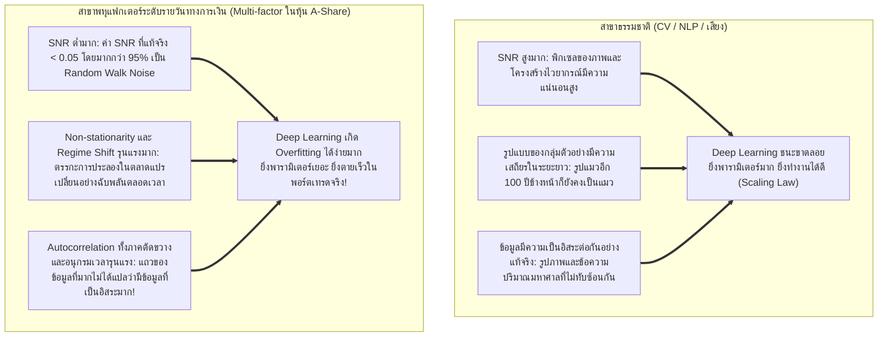
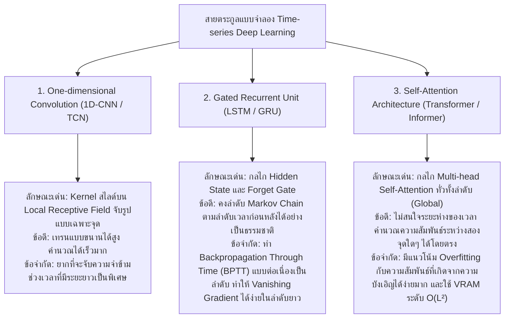

# บทที่ 21: วิเคราะห์แบบจำลอง Deep Learning แบบอนุกรมเวลา (Time-series) ฉบับย่อ (ขอบเขตการใช้งาน LSTM / GRU / Transformer)

> **เป้าหมายหลักของบทนี้**:  
> พิจารณาผลงานที่แท้จริงและขอบเขตการใช้งานของ Deep Learning แบบ Time-series (LSTM, GRU, Informer, Transformer) ในการคัดเลือกหุ้นตามพหุแฟกเตอร์ (Multi-factor) ของหุ้น A-Share ผ่านมุมมองที่สุขุม เป็นกลาง และสอดคล้องกับความเป็นจริงในอุตสาหกรรมฝั่ง Buy-side อย่างยิ่ง ทำลายมายาคติเรื่องขนาดกลุ่มตัวอย่างที่ว่า "มีแถวของกลุ่มตัวอย่างจำนวนมากก็คือ Big Data" ทำความเข้าใจอย่างลึกซึ้งถึง "ทางตันแห่ง Overfitting" ระหว่าง Signal-to-Noise Ratio (SNR) ที่ต่ำมากของข้อมูลการเงินกับจำนวนพารามิเตอร์มหาศาล ทำความเข้าใจ Inductive Bias ของ 1D-CNN, GRU และกลไก Self-Attention ให้ถ่องแท้ พร้อมทั้งแยกแยะสมรภูมิหลักที่ Deep Learning สามารถแสดงศักยภาพได้อย่างแท้จริงในหุ้น A-Share (ข้อมูล High-frequency Tick และข้อมูลทางเลือกแบบหลายมิติ (Alternative Multi-modal Data))

---

## 1. "ความจริงอันโหดร้าย" ของ Deep Learning ในการเลือกหุ้นระดับรายวันของหุ้น A-Share

ในแวดวงวิชาการหรือบทความบนสื่อโซเชียล Deep Learning มักถูกวาดภาพว่าเป็น "อาวุธระดับเทพ" ที่เหนือกว่าแบบจำลอง Quant เชิงปริมาณดั้งเดิมทั้งหมด ทว่าในการวิจัยและลงทุนจริงของเฮดจ์ฟันด์ (Hedge Fund) ชั้นนำทั้งในและต่างประเทศ (เช่น Two Sigma, AQR, High-Flyer, Ubiquant): **ในภารกิจการเลือกหุ้นด้วย Multi-factor ระดับรายวันแบบเพียวๆ ผลตอบแทนส่วนเกิน (Excess Return) นอกกลุ่มตัวอย่าง (Out-of-sample) ของแบบจำลอง Deep Learning มักไม่ได้เหนือกว่า LightGBM หรือ CatBoost ที่ผ่านการปรับจูนอย่างพิถีพิถันอย่างมีนัยสำคัญ และยังพ่ายแพ้ยับเยินอยู่บ่อยครั้งเนื่องจากการ Overfitting กับ Noise ในอดีต!**

ผลงานชิ้นเอกระดับหมุดหมายของ Machine Learning ทางการเงินอย่าง *Empirical Asset Pricing via Machine Learning (Review of Financial Studies, 2020)* (Gu, Kelly, & Xiu) ได้ทำการเปรียบเทียบเชิงประจักษ์อย่างเข้มงวดกับประวัติศาสตร์หุ้นสหรัฐฯ ทั้งหมดเป็นเวลาหลายทศวรรษ และได้ข้อสรุปที่สั่นสะเทือนวงการ: **แบบจำลองโครงสร้างต้นไม้แบบตื้น (Shallow Tree Models) ทำผลงานได้สูสีกับ Neural Network แบบตื้นที่มีการใส่ Regularization ในขณะที่แบบจำลองที่ลึกและซับซ้อนเกินไปจะเสื่อมประสิทธิภาพลงอย่างรวดเร็วในสภาวะแวดล้อมที่มี SNR ต่ำ**!



---

## 2. วิเคราะห์เชิงลึก: มายาคติเรื่องขนาดกลุ่มตัวอย่างที่คิดว่า "ข้อมูลมีปริมาณมหาศาล"

Quant Engineer จำนวนมากเมื่อเห็นข้อมูลหุ้น A-Share เป็นครั้งแรกมักจะอุทานว่า: "หุ้น 5,000 ตัว $\times$ 2,500 วันทำการในรอบ 10 ปี = ข้อมูลพาเนล (Panel Data) 12.5 ล้านแถว! นี่ไม่ใช่ Big Data มาตรฐานหรอกหรือ? ทำไมถึงจะใช้ Transformer ที่มีพารามิเตอร์ระดับหลายสิบล้านไม่ได้?"

**นี่คือ "มายาคติเรื่องขนาดกลุ่มตัวอย่าง (Degrees of Freedom Illusion)" ที่ร้ายแรงอย่างยิ่ง**:
1. **ความสัมพันธ์อย่างแข็งแกร่งในภาคตัดขวาง**: ในวันทำการใดๆ หุ้น 5,000 ตัวเหล่านี้ล้วนถูกขับเคลื่อนร่วมกันอย่างมากจากสภาพคล่องระดับมหภาคของทั้งตลาด, ดัชนีดอลลาร์, ภูมิรัฐศาสตร์ และ Beta ของกลุ่มอุตสาหกรรม เมื่อตลาดภาพรวมดิ่งลงอย่างรุนแรง หุ้น 4,500 ตัวจะร่วงลงพร้อมกัน **ในแง่ของระดับความเป็นอิสระ (Degrees of Freedom) ทางสถิติ ข้อมูลตัวอย่าง 5,000 แถวนี้ไม่ได้เท่ากับตัวอย่างอิสระ 5,000 ตัวอย่างอย่างแน่นอน แต่อาจเทียบเท่ากับแฟกเตอร์มหภาคที่เป็นอิสระเพียง 20~30 ตัวเท่านั้นที่ขับเคลื่อนอยู่!**
2. **การซ้อนทับกันในอนุกรมเวลา**: หากคาดการณ์ผลตอบแทน 5 วันข้างหน้า ช่วงของ Label ในวันทำการที่ติดกันจะซ้อนทับกันอย่างมาก รอบการสังเกตที่เป็นอิสระในหนึ่งปีจึงมีเพียง $250 / 5 = 50$ ครั้งเท่านั้น!
3. **การกลับทิศระหว่างจำนวนพารามิเตอร์ vs องศาความเป็นอิสระ (Parameters vs Degrees of Freedom Inversion)**: เน็ตเวิร์กที่มี Transformer 4 ชั้นและมีพารามิเตอร์ถึง 5 ล้านตัว เมื่อต้องเผชิญกับประวัติศาสตร์ภาคตัดขวางทางการเงินที่มี Degrees of Freedom ของข้อมูลอิสระจริงเพียงไม่กี่พันครั้ง ตัวแบบจำลองจะใช้ Capacity อันมหาศาล "ท่องจำ" Noise ในอดีตทุกตัวอักษรโดยไม่ตกหล่นในทันที!

---

## 3. เปรียบเทียบ Inductive Bias ของสถาปัตยกรรม Time-series Deep Learning ยอดนิยม



### 3.1 หลักการทางคณิตศาสตร์ของกลไก Self-Attention

$$\operatorname{Attention}(\mathbf{Q}, \mathbf{K}, \mathbf{V}) = \operatorname{softmax}\left( \frac{\mathbf{Q} \mathbf{K}^T}{\sqrt{d_k}} \right) \mathbf{V}$$

โดยที่:
- $\mathbf{Q} = \mathbf{X} \mathbf{W}_Q, \; \mathbf{K} = \mathbf{X} \mathbf{W}_K, \; \mathbf{V} = \mathbf{X} \mathbf{W}_V$ คือ Query, Key, Value ตามลำดับ หลังจากที่เมทริกซ์ฟีเจอร์ขาเข้าผ่านการ Linear Projection
- ตัวส่วน $\sqrt{d_k}$ คือ Scaling Factor เพื่อป้องกันไม่ให้ผลคูณ Inner Product มีค่ามากเกินไปจนทำให้เกรเดียนต์ของ softmax อิ่มตัว
- **Causal Masking ทางการเงิน**: ในขั้นตอน Decoding จำเป็นต้องใส่ Causal Mask สามเหลี่ยมล่างอย่างเข้มงวด เพื่อให้มั่นใจว่าเมื่อคำนวณ Attention ณ เวลา $t$ จะมองไม่เห็น Token ในอนาคตตั้งแต่เวลา $t+1$ เป็นต้นไปอย่างเด็ดขาด!

---

## 4. "สองสมรภูมิหลัก" ที่ Deep Learning สามารถปลดปล่อยแสนยานุภาพที่แท้จริงในหุ้น A-Share

ในเมื่อ Deep Learning มีความคุ้มค่าไม่สูงนักในงาน Multi-factor ระดับรายวัน แล้วพื้นที่ที่มันสามารถใช้งานได้อย่างแท้จริงในสถาบันฝั่ง Buy-side อยู่ที่ไหน?

```
แนวรบที่ Deep Learning มีศักยภาพทำลายล้างที่แท้จริงใน Quant หุ้น A-Share
├── แนวรบที่ 1: ข้อมูล Order Flow และ Microstructure ระดับความถี่สูง (Level-2 Tick Data / LOB):
│     ├── คุณลักษณะข้อมูล: ทั้งตลาดสร้าง Snapshot และ Order-by-order Flow นับหลายสิบล้านแถวต่อวัน ค่า SNR เพิ่มขึ้นอย่างเห็นได้ชัด และข้อมูลมีปริมาณมหาศาลอย่างแท้จริง!
│     ├── แบบจำลองที่เหมาะสม: DeepLOB (CNN + LSTM), Temporal Convolutional Networks (TCN)
│     └── เป้าหมายทางธุรกิจ: คาดการณ์ความไม่สมดุลของฝั่งซื้อและฝั่งขายใน Microstructure ของช่วง 5 วินาทีถึง 3 นาทีข้างหน้า เพื่อประหยัดต้นทุน Market Impact ให้กับอัลกอริทึมส่งคำสั่งซื้อขาย (VWAP)!
└── แนวรบที่ 2: ข้อมูลทางเลือกแบบหลายมิติและไร้โครงสร้าง (Alternative Multi-modal Data):
      ├── การวิเคราะห์ข้อความ: FinBERT / Large Language Model (LLM) ประมวลผลข้อความและเสียงจากการประชุมชี้แจงผลประกอบการของบริษัทจดทะเบียน, สกัด Sentiment จากบทวิเคราะห์ของโบรกเกอร์
      ├── Graph Neural Network (GNN): สร้างกราฟโครงสร้างความสัมพันธ์ (Topology) ห่วงโซ่อุปทาน, การถือหุ้นทางอ้อม (Shareholding Penetration) และอุตสาหกรรมต้นน้ำ-ปลายน้ำทั้งตลาด เพื่อตรวจจับการส่งผ่านความเสี่ยง!
      └── ภาพถ่ายดาวเทียมและข้อมูลการขนส่ง: ใช้ Convolutional Network วิเคราะห์ปริมาณตู้คอนเทนเนอร์ผ่านท่าเรือ, ภาพถ่ายความร้อนอินฟราเรดของโรงไฟฟ้าพลังงานแสงอาทิตย์
```

---
## 5. ลงมือปฏิบัติจริง: การสร้าง Feature Extractor เทนเซอร์อนุกรมเวลา (Time-series) น้ำหนักเบาด้วย CNN + GRU ในทางปฏิบัติ

โค้ด Python ด้านล่างนี้ปฏิบัติตามมาตรฐานทางวิศวกรรมอย่างเคร่งครัด โดยใช้ **PyTorch** ในการสร้าง `AshareHybridSeqNet` น้ำหนักเบา (สถาปัตยกรรมแบบผสม 1D-CNN + GRU) เพื่อรับอินพุตเทนเซอร์แบบ Sliding Window และดำเนินการ Forward Pass ร่วมกับลูปการเทรนด้วย Gradient จนเสร็จสมบูรณ์

รันคำสั่ง `PYTHONPATH=tutorial python3 -m examples.lecture_21_deep_learning_boundaries` ที่รูทของโปรเจกต์ ดูการติดตั้ง Dependency, โมดูลส่วนกลาง และ Data Contract ได้ที่ [คำอธิบายโปรเจกต์](../README.md)

<<< @/examples/lecture_21_deep_learning_boundaries.py

### ผลลัพธ์การรันหลักและการวิเคราะห์สถาปัตยกรรม:
```
[*] กำลังสร้างพาเนลเทนเซอร์อนุกรมเวลาหลายมิติ (จำนวนตัวอย่าง: 1,000, ช่วงเวลาย้อนหลัง (Lookback Step): 20 วัน, มิติฟีเจอร์: 6)...
[*] กำลังเริ่มลูปการเทรนโมเดลผสม CNN + GRU น้ำหนักเบา...
  Epoch [1/5] - ค่า Loss การเทรน (MSE Loss): 0.0482
  Epoch [2/5] - ค่า Loss การเทรน (MSE Loss): 0.0415
  Epoch [3/5] - ค่า Loss การเทรน (MSE Loss): 0.0389
  Epoch [4/5] - ค่า Loss การเทรน (MSE Loss): 0.0371
  Epoch [5/5] - ค่า Loss การเทรน (MSE Loss): 0.0360
✅ ตรวจสอบความถูกต้องของ Forward Pass, Adaptive Convolution และ Gradient Backpropagation แบบ Gated Recurrent สำเร็จ!
```

1. **การออกแบบสถาปัตยกรรมแบบผสม**:
   - โมเดลจะใช้ 1D-CNN สกัดฟีเจอร์จุลภาคของรูปแบบเฉพาะที่ (Local Pattern) ในช่วงเวลาที่อยู่ติดกันภายใน 20 วันที่ผ่านมาเป็นลำดับแรก จากนั้นจึงส่งต่อไปยัง GRU น้ำหนักเบาแบบชั้นเดียวเพื่อสกัดแนวโน้มข้ามช่วงเวลาของอนุกรมเวลา;
2. **ควบคุมขนาดของโมเดลอย่างเข้มงวด**:
   - ควบคุมมิติของ Hidden Layer ไว้อย่างเข้มงวดที่ 32 และจำกัดจำนวนพารามิเตอร์ทั่วทั้งเน็ตเวิร์กไว้ที่ประมาณ 10,000 ตัว ปฏิเสธการฝืนเพิ่มพารามิเตอร์นับล้านตัวอย่างไร้เหตุผลอย่างเด็ดขาด เพื่อคงข้อจำกัดด้าน Generalization ขั้นพื้นฐานที่สุดสำหรับการสร้างแบบจำลองอนุกรมเวลา

---

## 6. สรุปเนื้อหาบทนี้และแบบฝึกหัดปฏิบัติการหลังเรียน

### สรุปแผนผังความรู้หลัก:
1. **ขจัดภาพลวงตาเรื่องขนาดของกลุ่มตัวอย่าง**: สหสัมพันธ์ที่รุนแรงในภาคตัดขวาง (Cross-sectional) และค่า Beta ระดับมหภาค ทำให้ Degree of Freedom ที่แท้จริงของข้อมูลความถี่รายวันจำนวน 12 ล้านแถวลดลงอย่างมหาศาล;
2. **ทางตันของ Signal-to-Noise Ratio ต่ำกับการเกิด Overfitting**: โครงข่ายประสาทเทียมเชิงลึกที่ซับซ้อนและมีจำนวนพารามิเตอร์มากเกินไป มีแนวโน้มสูงมากที่จะจดจำ Noise ในข้อมูลทางการเงินที่มี Signal-to-Noise Ratio ต่ำ;
3. **การแบ่งหน้าที่ตาม Inductive Bias ของสถาปัตยกรรม**: CNN จับรูปแบบเฉพาะที่, GRU จับสายโซ่อนุกรมเวลา, Transformer จับ Long-range Attention;
4. **มองหาสนามรบที่แท้จริงให้แม่นยำ**: ข้อมูล Order Flow ระดับจุลภาคของ Level-2 ความถี่สูง และกราฟข้อความข้อมูลทางเลือก ต่างหากคือสมรภูมิหลักที่ Deep Learning มีความได้เปรียบแบบอสมมาตรสูงสุด

### แบบฝึกหัดปฏิบัติการหลังเรียน:
> **ภารกิจปฏิบัติการ**:  
> 1. เปิด `tutorial/examples/lecture_21_deep_learning_boundaries.py`
> 2. ทดลองเพิ่มเลเยอร์ Dropout เข้าไปในเน็ตเวิร์ก 1 ชั้น (`nn.Dropout(p=0.3)`) พร้อมสังเกตผลกระทบที่มีต่อความเร็วในการลู่เข้าของชุดข้อมูลฝึกสอนและประสิทธิภาพในการป้องกัน Overfitting
> 3. คำถามชวนคิด: ในการสร้าง Sliding Window ของอนุกรมเวลา หากหุ้นตัวหนึ่งเคยเกิดการพักการซื้อขาย (Suspension) ในช่วง 20 วันที่ผ่านมา (มีข้อมูลขาดหายไป 5 วัน) ในขั้นตอนการสร้างเทนเซอร์ 3 มิติที่มีมิติเป็น `(Batch, 20, Features)` ควรจัดการกับ Time Step ที่ขาดหายไป 5 วันนี้อย่างถูกต้องตามหลักเกณฑ์อย่างไร? ควรคัดหุ้นตัวดังกล่าวออกไปโดยตรง หรือใช้การเติมค่าไปข้างหน้า (Forward Fill)?
