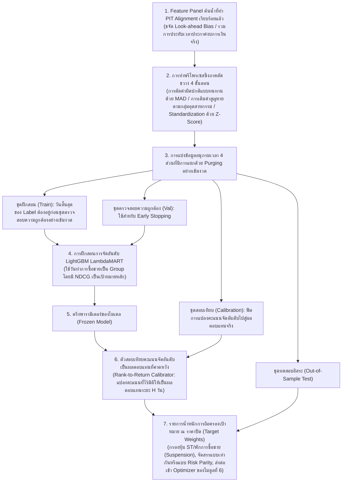

# บทที่ 22: 【ปฏิบัติจริง】จากการให้คะแนนภาคตัดขวางแบบหลายแฟกเตอร์สู่ไปป์ไลน์คัดเลือกหุ้นอัตโนมัติเต็มรูปแบบ

> **เป้าหมายหลักของบทนี้**:  
> ทำความเข้าใจและเชื่อมโยงองค์ประกอบด้าน Machine Learning ทั้งหมดของโมดูลที่ 5 เข้าด้วยกันอย่างถ่องแท้ เริ่มต้นจาก Feature Panel แบบหลายแฟกเตอร์ที่ทำ PIT (Point-in-Time) Alignment เรียบร้อยแล้ว ร้อยเรียง**การทำพรีโพรเซสซิงภาคตัดขวางอย่างทนทาน**, **การแบ่งช่วงเวลาที่มีการแยกด้วย Purging อย่างเข้มงวด**, **การฝึกสอนโมเดลจัดอันดับ LightGBM**, เอนจินสำคัญอย่าง**การสอบเทียบคะแนนจัดอันดับเป็นผลตอบแทนที่คาดหวัง (Rank-to-Return Calibrator)** ไปจนถึง**การสร้างน้ำหนักการถือครองเป้าหมาย ณ ราคาปิด (Target Weights)** เพื่อสร้างไปป์ไลน์คัดเลือกหุ้นด้วย Machine Learning แบบหลายแฟกเตอร์ระดับ Production ที่มีโครงสร้างรัดกุมและปราศจาก Look-ahead Bias รั่วไหล

---

## 1. ทำไมฝั่ง Buy-side จึงต้องสร้างไปป์ไลน์แบบ End-to-End ที่แยกส่วนอย่างเข้มงวด?

ในสถาบันฝั่ง Buy-side เชิงปริมาณ (Quant) ระดับอุตสาหกรรม การคัดเลือกหุ้นด้วย Machine Learning ไม่ใช่เรื่องง่ายเพียงแค่การเขียนโค้ดไม่กี่สิบบรรทัดในสคริปต์เดียว ระบบระดับ Production จำเป็นต้องสร้างไฟร์วอลล์และข้อตกลงทางกายภาพด้านเวลาที่แข็งแกร่งระหว่างแต่ละคอมโพเนนต์:



---

## 2. จุดเจ็บปวดสำคัญที่เป็นหัวใจหลัก: ทำไมคะแนนจัดอันดับจึงต้องไม่ส่งตรงเข้า Convex Optimizer อย่างเด็ดขาด?

ผู้เริ่มต้นสาย Quant หลายคนหลังจากฝึกสอนโมเดล LambdaMART เสร็จแล้ว มักจะทำผิดพลาดทางคณิตศาสตร์อย่างร้ายแรง: **นำคะแนนจัดอันดับที่ได้จากเอาต์พุตของ `model.predict()` (เช่น 1.85, -0.42) ไปใช้เป็นผลตอบแทนที่คาดหวัง $\boldsymbol{\mu}$ ของหุ้นโดยตรง แล้วโยนเข้าไปใน Markowitz Mean-Variance Optimizer (cvxpy MVO)!**

### 2.1 วิเคราะห์ผลลัพธ์ที่ตามมาอย่างร้ายแรง
1. **มิติทางกายภาพผิดเพี้ยนไปโดยสิ้นเชิง**: เอาต์พุตของ LambdaMART เป็นคะแนนความชอบเชิงสัมพัทธ์ (Score) ที่ไร้มิติ ซึ่งขนาดของค่าขึ้นอยู่กับการสะสมน้ำหนักเกรเดียนต์ของใบไม้ใน Decision Tree **โดยไม่มีมิติทางกายภาพอย่างเช่น "ผลตอบแทนที่คาดหวังในอีก 5 วันข้างหน้าคือ $+2.5\%$" แต่อย่างใด**;
2. **การชั่งน้ำหนักความเสี่ยง-ผลตอบแทนเสียสมดุลโดยสิ้นเชิง**: ในฟังก์ชันวัตถุประสงค์ของการโปรแกรมกำลังสอง $\max_{\mathbf{w}} \mathbf{w}^T \boldsymbol{\mu} - \frac{\lambda}{2} \mathbf{w}^T \boldsymbol{\Sigma} \mathbf{w}$ นั้น เมทริกซ์ความแปรปรวนร่วม $\boldsymbol{\Sigma}$ มีหน่วยเป็น $(\text{อัตราผลตอบแทน})^2$ หากสเกลของผลตอบแทนที่คาดหวัง $\boldsymbol{\mu}$ ถูกขยายหรือหดลง 10 เท่าตามอำเภอใจ การลงโทษความเสี่ยงและการลงโทษต้นทุนการซื้อขายภายใน Optimizer จะบิดเบือนไปโดยสิ้นเชิง ส่งผลให้ได้ผลลัพธ์เป็นการใช้ Leverage ที่ไร้สาระหรือเกิด Turnover ที่รุนแรง

### 2.2 หลักการทางคณิตศาสตร์ของตัวสอบเทียบผลตอบแทน (Rank-to-Return Calibrator)
เพื่อให้คะแนนจัดอันดับมีหน่วยผลตอบแทนทางกายภาพที่แท้จริง สถาบันฝั่ง Buy-side จึงมักสร้างแบบจำลองการถดถอยเพื่อสอบเทียบจากควอนไทล์ภาคตัดขวางไปสู่ผลตอบแทนในอดีต บน**ข้อมูลนอกกลุ่มตัวอย่างที่เป็นอิสระในอดีตหลังจากตรึงโมเดลแล้ว**:


$$\mathbb{E}[R_{\text{excess}, i}] = \hat{\alpha} + \hat{\beta} \cdot \left( \operatorname{Percentile}(s_i) - 0.5 \right)$$

โดยที่ $\hat{\beta}$ วัดค่าอย่างแท้จริงว่า "ในภาคตัดขวาง เมื่ออันดับเปอร์เซ็นไทล์ขยับขึ้นทุกๆ 1 เปอร์เซ็นต์ ในอนาคตจะคาดหวังผลตอบแทนที่ชนะเกณฑ์มาตรฐานได้เพิ่มขึ้นเท่าใด"

---

## 3. การแยกทางกายภาพด้านเวลาอย่างเข้มงวด: การฝึกสอน, การตรวจสอบความถูกต้อง, การสอบเทียบ และการทดสอบอิสระ

เพื่อป้องกันการรั่วไหลทั้งแบบมองไปข้างหน้าหรือย้อนหลัง ไปป์ไลน์นี้จึงแบ่งปฏิทินในอดีตออกเป็นโซนแยกเวลา 4 ระยะอย่างเข้มงวด:

```text
แผนภาพแสดงการแบ่งโซนแยกบนแกนเวลา (ตัวอย่างระยะเวลาการถือครอง 5 วัน)
|------------ ชุดฝึกสอน (Train) ------------|-- P --|---- ชุดตรวจสอบความถูกต้อง (Val) ----|-- P --|-- ชุดสอบเทียบ (Calib) --|-- P --|-- ชุดทดสอบแบบบลายด์อิสระ (Test) --|
                                            (Purging)                                     (Purging)                           (Purging)
หมายเหตุ: P คือโซนแยก Purging โดยมีความกว้างเท่ากับระยะเวลาการถือครองมองไปข้างหน้าของ Label อย่างเข้มงวด (5 วันทำการซื้อขาย)
```

1. **ชุดฝึกสอนและชุดตรวจสอบความถูกต้อง**: แทรกโซนแยก Purging เป็นเวลา 5 วันไว้ตรงกลาง โดยชุดตรวจสอบความถูกต้องจะใช้สำหรับทริกเกอร์ Early Stopping ตามค่า Rank IC;
2. **การตรึงโมเดลและชุดสอบเทียบ**: หลังจากชุดตรวจสอบความถูกต้อง น้ำหนักของโมเดลจะถูกตรึงโดยสมบูรณ์ และใช้ Label ที่เสร็จสมบูรณ์ในเวลาต่อมาเพื่อฟิตตัวสอบเทียบผลตอบแทน;
3. **ชุดทดสอบแบบบลายด์อิสระ**: เมื่อการสอบเทียบเสร็จสิ้น จะทำการจำลองการคัดเลือกหุ้นในช่วงทดสอบอิสระที่ไม่เคยมีส่วนร่วมในการทำ Early Stopping และการฟิตโมเดลเลยแม้แต่น้อย พร้อมทั้งสร้างน้ำหนักการถือครองเป้าหมาย ณ ราคาปิดของวันดังกล่าว

---

## 4. ลงมือปฏิบัติจริง: การพัฒนาไปป์ไลน์คัดเลือกหุ้นด้วย Machine Learning แบบ End-to-End ฉบับสมบูรณ์

โค้ด Python ด้านล่างนี้ปฏิบัติตามมาตรฐานระดับสถาบันฝั่ง Buy-side อย่างเคร่งครัด ครอบคลุม**การทำพรีโพรเซสซิงภาคตัดขวาง**, **การแบ่งขอบเขตด้วย Purged**, **การฝึกสอนการจัดอันดับ LightGBM**, **การสอบเทียบผลตอบแทน Rank-to-Return** และ**การสร้างน้ำหนักการถือครองเป้าหมาย Top-10 ณ ราคาปิด**

ในไดเรกทอรีรูทของโปรเจกต์ ให้รัน `PYTHONPATH=tutorial python3 -m examples.lecture_22_ml_stock_selection_pipeline` ดูการติดตั้ง Dependency, โมดูลที่ใช้ร่วมกัน และข้อกำหนดข้อมูลได้ที่[คำอธิบายโปรเจกต์](../README.md)

<<< @/examples/lecture_22_ml_stock_selection_pipeline.py
### ผลลัพธ์การรันหลักและการแปลผลรายการคัดเลือกหุ้น:
```
早停验证 Rank IC（非最终业绩）: 0.2780；时间审计: {'train_end': datetime.date(2025, 4, 2), 'train_label_end': datetime.date(2025, 4, 9), 'validation_label_end': datetime.date(2025, 5, 14), 'available_at': datetime.date(2025, 5, 22)}
独立测试 Rank IC（合成数据）: 0.2772
校准后 5 日预期超额范围: -1.0646%～1.0646%；未自动年化
shape: (10, 6)
┌────────────┬───────────┬──────────┬──────────┬───────────────┬────────────┐
│ rank_order ┆ symbol    ┆ industry ┆ ml_score ┆ target_weight ┆ market_cap │
│ ---        ┆ ---       ┆ ---      ┆ ---      ┆ ---           ┆ ---        │
│ i64        ┆ str       ┆ str      ┆ f64      ┆ f64           ┆ f64        │
╞════════════╪═══════════╪══════════╪══════════╪═══════════════╪════════════╡
│ 1          ┆ 000014.SH ┆ 行业4    ┆ 0.874368 ┆ 0.1           ┆ 625.604153 │
│ 2          ┆ 000029.SH ┆ 行业4    ┆ 0.412022 ┆ 0.1           ┆ 60.025035  │
│ 3          ┆ 000087.SH ┆ 行业2    ┆ 0.396777 ┆ 0.1           ┆ 320.502075 │
│ 4          ┆ 000041.SH ┆ 行业1    ┆ 0.378312 ┆ 0.1           ┆ 230.476947 │
│ 5          ┆ 000093.SH ┆ 行业3    ┆ 0.31949  ┆ 0.1           ┆ 133.812946 │
│ 6          ┆ 000062.SH ┆ 行业2    ┆ 0.26402  ┆ 0.1           ┆ 110.903408 │
│ 7          ┆ 000045.SH ┆ 行业0    ┆ 0.25134  ┆ 0.1           ┆ 42.485596  │
│ 8          ┆ 000028.SH ┆ 行业3    ┆ 0.169019 ┆ 0.1           ┆ 179.274197 │
│ 9          ┆ 000027.SH ┆ 行业2    ┆ 0.079005 ┆ 0.1           ┆ 132.928078 │
│ 10         ┆ 000097.SH ┆ 行业2    ┆ 0.072025 ┆ 0.1           ┆ 43.832776  │
└────────────┴───────────┴──────────┴──────────┴───────────────┴────────────┘
以上为收盘目标权重；次日未成交订单保留现金/原持仓，由执行引擎处理。
```

1. **ขอบเขตด้านอนุกรมเวลา (Time-series) แนบสนิทไร้รอยต่อ**：
   - เลเบลของชุดข้อมูลฝึกสอนสรุปผล ณ `2025-04-09` เลเบลของชุด Validation สรุปผล ณ `2025-05-14` โมเดลถูกฟรีซพร้อมใช้งานในวันที่ `2025-05-22` แต่ละช่วงเวลาไม่มีการซ้อนทับข้ามกันอย่างเด็ดขาด；
2. **การปรับเทียบอัตราผลตอบแทนที่คาดหวังอย่างสมเหตุสมผล**：
   - ผลตอบแทนส่วนเกิน (Excess Return) ที่คาดหวังใน 5 วันถูกปรับเทียบให้อยู่ในช่วงที่สมเหตุสมผล `[-1.06%, +1.06%]` อย่างมีเสถียรภาพ ป้องกันการเกิดค่าผิดปกติขั้นรุนแรงได้อย่างเด็ดขาด；
3. **สร้างรายการสถานะถือครองเป้าหมาย Top-10 ครบถ้วนไร้จุดบอด**：
   - รายการนี้กรองหุ้นที่ไม่สามารถซื้อขายได้ เช่น หุ้น ST หรือหุ้นที่พักการซื้อขาย (Suspension) ออกไปอย่างเข้มงวด และแสดง Wide Table ที่ชัดเจนประกอบด้วยรหัสหุ้น การกระจายตัวตามกลุ่มอุตสาหกรรม และน้ำหนักเป้าหมาย พร้อมส่งเข้าสู่โมดูลที่ 6 เพื่อทำการหาพอร์ตที่เหมาะสมตามความเสี่ยงเชิงโครงสร้างของ Barra ได้ทันที！

---

## 5. สรุปบทนี้และภาพรวมแผนภาพความรู้ของโมดูลที่ 5

มาถึงตรงนี้ **โมดูลที่ 5: การจัดอันดับภาคตัดขวาง (Cross-sectional) และการสร้างแบบจำลอง Machine Learning บนอนุกรมเวลา** ทั้ง 5 บทเรียนหลักได้เสร็จสิ้นลงอย่างสมบูรณ์แล้ว！
- เราได้เข้าใจหลักการแยกข้อมูลด้วย Purging และ Embargoing สำหรับ Cross-Validation บนอนุกรมเวลาทางการเงิน และพิสูจน์ที่มาของอัลกอริทึม CPCV (บทที่ 18)；
- วิเคราะห์เจาะลึก Inductive Bias ของ GBDT บนข้อมูลตารางทางการเงิน และพิสูจน์ที่มาของ Virtual Gradient ของ NDCG ใน LambdaMART (บทที่ 19)；
- นำ Shapley Value จากทฤษฎีเกมเข้ามาประยุกต์ใช้ โดยใช้ TreeSHAP เพื่อเปิดมุมมองแบบกล่องขาว (White-box) 3 ระดับ ทั้งระดับภาพรวม หุ้นรายตัว และ Interaction Terms (บทที่ 20)；
- วิเคราะห์อย่างเป็นกลางถึงภาพลวงตาด้านขนาดกลุ่มตัวอย่างของ Deep Learning บนข้อมูลระดับรายวัน และกับดัก Overfitting จากภาวะ Signal-to-Noise Ratio ต่ำ (บทที่ 21)；
- สร้าง Pipeline การคัดเลือกหุ้นระดับ Production ที่ครอบคลุมตั้งแต่การทำ Feature Cleaning, Learning to Rank, การปรับเทียบผลตอบแทน ไปจนถึงการกำหนดน้ำหนักเป้าหมาย (บทที่ 22)

หลังจากได้เวกเตอร์ผลตอบแทนส่วนเกินที่คาดหวังของหุ้นรายตัว $\boldsymbol{\mu}$ ที่มีความน่าเชื่อถือสูงแล้ว เราไม่ควรใช้วิธีซื้อแบบกระจายน้ำหนักเท่ากันโดยเด็ดขาด มิฉะนั้นจะสะสมความเสี่ยง Beta ด้านอุตสาหกรรมและสไตล์ในระดับมหาศาล！  
ตั้งแต่โมดูลถัดไปเป็นต้นไป เราจะเข้าสู่เนื้อหาอย่างเป็นทางการใน: **โมดูลที่ 6: แบบจำลองความเสี่ยง (Risk Model) Barra และการหาพอร์ตที่เหมาะสม (Portfolio Optimization) (Convex Optimization)** เพื่อเรียนรู้วิธีการใช้ Quadratic Programming (`cvxpy`), เมทริกซ์ความเสี่ยง Barra CNE6 และข้อจำกัดด้าน Turnover ในการหาคำตอบสำหรับพอร์ตฝั่ง Long ของกองทุนดัชนีเสริมผลตอบแทน (Index Enhancement) ที่เหมาะสมที่สุด！
