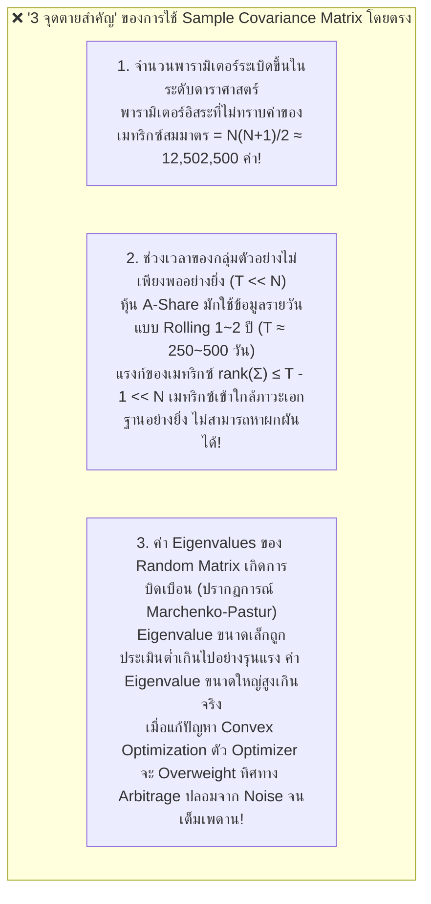
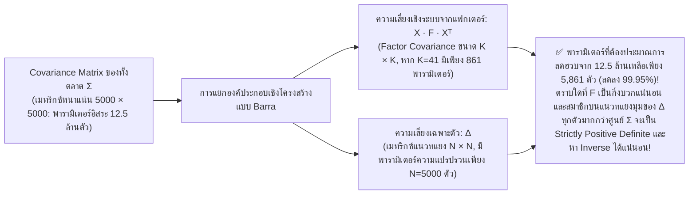
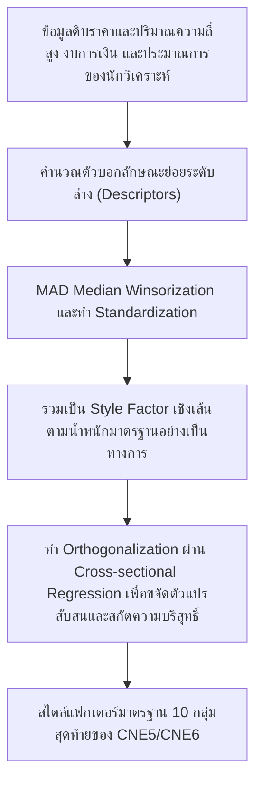
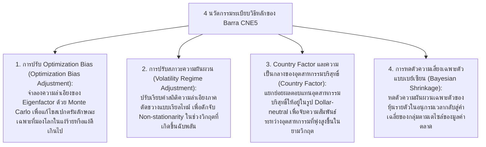

# บทที่ 23: การถอดรหัสคณิตศาสตร์ของแบบจำลองความเสี่ยงเชิงโครงสร้าง Barra

::: tip เป้าหมายหลักของบทนี้
ในสถาบันบริหารสินทรัพย์เชิงปริมาณ (Quant) ฝั่ง Buy-side ยุคใหม่ “การควบคุมความเสี่ยงมีความสำคัญเทียบเท่ากับการแสวงหาผลตอบแทนส่วนเกิน (Excess Return)” หากใช้ผลตอบแทนในอดีตของหุ้น A-Share ทั้งตลาดกว่า 5,000 ตัวในการคำนวณ Sample Covariance Matrix โดยตรง จะเผชิญกับ**คำสาปแห่งมิติ (Curse of Dimensionality)** และ**สัญญาณรบกวนจาก Random Matrix** อย่างรุนแรงทันที ซึ่งทำให้ Optimizer ขยายโอกาสทำ Arbitrage เชิงสถิติแบบลวงตาจนกลายเป็นการขาดทุนมหาศาล

บทนี้ได้ผสานเอกสารทางเทคนิคเชิงประจักษ์ (Empirical Notes) ของ **MSCI Barra CNE5/CNE6** ซึ่งเป็นมาตรฐานระดับโลก, **คู่มือแบบจำลองความเสี่ยง BARRA US-E3 (Risk Model Handbook)** และแนวปฏิบัติทางวิศวกรรมชั้นนำของฝั่ง Sell-side ในประเทศอย่าง**ระบบ Multi-factor ของ Huatai Securities (ซีรีส์ที่ 1)** เพื่อถอดรหัสคณิตศาสตร์ของแบบจำลองความเสี่ยง (Risk Model) เชิงโครงสร้างอย่างละเอียด:
1. เจาะลึกสูตรมาตรฐานและน้ำหนักการรวมตัวที่แน่นอนของ**ตัวอธิบายย่อย (Descriptors) ทั้งหมดใน 10 แฟกเตอร์ (Factor) สไตล์ของ Barra CNE5/CNE6**;
2. อนุพัทธ์**อัลกอริทึมการทำความสะอาดด้วย Regression Orthogonalization** ของ Residual Volatility เทียบกับ Beta/Size, สภาพคล่อง (Liquidity) เทียบกับ Size และ Non-linear Size;
3. เข้าใจ 4 นวัตกรรมระดับแนวหน้าของ Barra CNE5 เพื่อแก้ปัญหา Optimizer ประเมินความเสี่ยงต่ำเกินไป: **การปรับความลำเอียงจากการหาค่าที่เหมาะสมที่สุด (Optimization Bias Adjustment / Eigenfactor Adjustment)**, **การปรับตามสภาวะความผันผวน (Volatility Regime Adjustment, VRA)**, **การแยก Country Factor และ Pure Industry ออกจากกันอย่างเป็นกลาง (Neutral)** และ**การหดตัวของความเสี่ยงเฉพาะตัวแบบเบย์เซียน (Bayesian Shrinkage) ตามควอนไทล์ของมูลค่าตลาด**;
4. ตรวจสอบความถูกต้องแบบครบวงจร (Closed-loop Verification) ตลอดกระบวนการโดยอิงจากโค้ดระดับ Production ที่รันได้จริง
:::

---

## 1. วรรณกรรมคลาสสิกและรากฐานทฤษฎีในอุตสาหกรรม

ก่อนจะลงลึกถึงการพิสูจน์สูตร ขอแนะนำให้อ่านวรรณกรรมคลาสสิกและ White Paper ที่น่าเชื่อถือในอุตสาหกรรม ซึ่งวางรากฐานให้กับการจัดการความเสี่ยงแบบหลายแฟกเตอร์ยุคใหม่:

1. **Orr, D. J., Mashtaler, Igor, & Nagy, Adam (2012)**. *"The Barra China Equity Model (CNE5) Empirical Notes"*, MSCI Research.  
   > White Paper เชิงประจักษ์ระดับคลาสสิกที่ปรับแต่งให้เข้ากับโครงสร้างจุลภาคของตลาดหุ้น A-Share ในจีนโดยเฉพาะ อธิบาย 10 Style Factors ของ CNE5, องค์ประกอบของ Descriptors ย่อย, การแก้ไข Optimization Bias ของ Eigenvalues และการปรับ Volatility Regime ไว้อย่างละเอียด
2. **BARRA Inc. (1998)**. *United States Equity Version 3 (US-E3) Risk Model Handbook*. BARRA Research.  
   > วางมาตรฐานทางอุตสาหกรรมสำหรับแบบจำลองความเสี่ยงเชิงโครงสร้างของ Barra โดยแจกแจง Data Flow ของแบบจำลองหลายแฟกเตอร์, การทำ Standardization ของ Descriptors, Non-linear Size, กรอบการสร้างแบบจำลองความแปรปรวนเฉพาะตัวสองระดับ (อนุกรมเวลา-ภาคตัดขวาง) และลูกบาศก์การแยกย่อยความเสี่ยง 4 มิติ
3. **Huatai Securities Research Institute (Lin Xiaoming, Chen Ye, 2016)**. 《华泰多因子模型体系初探——华泰多因子系列之一》 (การสำรวจเบื้องต้นเกี่ยวกับระบบโมเดล Multi-Factor ของ Huatai — ซีรีส์ Huatai Multi-Factor ตอนที่ 1).  
   > ผลงานบุกเบิกระบบ Multi-factor ในประเทศจีน ซึ่งอธิบายการกลั่นแฟกเตอร์ (Factor Purification), การทดสอบ Heteroskedasticity แบบ Breusch-Pagan / White, Weighted Least Squares (WLS), Factor Covariance และ Factor Marginal Contribution to Absolute Risk (FMCAR) ในเชิงวิศวกรรมอย่างเป็นระบบ
4. **Rosenberg, Barr (1974)**. *"Extra-Market Components of Covariance in Security Returns"*, *Journal of Financial and Quantitative Analysis*, 9(2): 263-274.  
   > เสนอแบบจำลอง Structural Multi-factor Covariance เป็นครั้งแรก โดยแยกผลตอบแทนของสินทรัพย์ออกเป็นตัวแปรหุ่นอุตสาหกรรม (Industry Dummy Variables) และ Style Factors แบบต่อเนื่อง
5. **Menchero, Jose, Wang, Jun, & Orr, D. J. (2011)**. *"Eigen-Adjusted Covariance Matrices"*, MSCI Research Insight.  
   > เผยกลไกที่ Sample Covariance ประเมินความเสี่ยงต่ำไปอย่างเป็นระบบในทิศทางของ Eigenvalue ขนาดเล็ก พร้อมทั้งอนุพัทธ์อัลกอริทึมการสอบเทียบความเสี่ยงของ Eigenfactors ด้วยการจำลองมอนติคาร์โล (Monte Carlo Simulation)
6. **Shepard, Peter (2009)**. *"Second Order Risk"*, Working Paper, arXiv:0908.2455.  
   > อนุพัทธ์ทางคณิตศาสตร์เชิงวิเคราะห์ว่าเหตุใด Quadratic Programming Optimizer จึงประเมินความเสี่ยงที่คาดการณ์ของพอร์ตต่ำเกินไปเสมอเมื่อมีขนาดกลุ่มตัวอย่างจำกัด

---

## 2. "คำสาปแห่งมิติ" ของ Sample Covariance มิติสูงและทฤษฎีเมทริกซ์สุ่ม

ในทฤษฎีพอร์ตการลงทุนสมัยใหม่ (Modern Portfolio Theory, MPT) แบบ Mean-Variance ของมาร์โควิทซ์ (Markowitz, 1952) ความแปรปรวนที่คาดหวังของพอร์ตการลงทุนจะถูกกำหนดโดยเวกเตอร์น้ำหนักของหุ้น $\mathbf{w} \in \mathbb{R}^N$ และเมทริกซ์ความแปรปรวนร่วม (Covariance Matrix) ของผลตอบแทนหุ้น $\boldsymbol{\Sigma} \in \mathbb{R}^{N \times N}$:

$$\sigma_p^2 = \mathbf{w}^T \boldsymbol{\Sigma} \mathbf{w}$$

หากใช้การประมาณการแบบไม่เอนเอียงของ Sample Covariance จากผลตอบแทนในอดีตของหุ้นทั้งตลาดโดยตรง:

$$\boldsymbol{\Sigma}_{\text{sample}} = \frac{1}{T - 1} \sum_{t=1}^T (\mathbf{r}_t - \bar{\mathbf{r}})(\mathbf{r}_t - \bar{\mathbf{r}})^T$$

ในตลาดหุ้น A-Share ปัจจุบัน (จำนวนหุ้น $N \approx 5,000$ ตัว) การใช้ Sample Covariance Matrix โดยตรงจะต้องเผชิญกับอุปสรรคทางคณิตศาสตร์ที่ไม่สามารถเอาชนะได้:



ตาม**ทฤษฎีเมทริกซ์สุ่ม (Random Matrix Theory, RMT)** ใน **ทฤษฎีบท Marchenko-Pastur (1967)**: เมื่ออัตราส่วนมิติต่อขนาดตัวอย่าง $\gamma = N / T > 0$ การกระจายตัวของ Eigenvalues ของเมทริกซ์ Pure White Noise จะกระจายอยู่ในช่วง $[\lambda_-, \lambda_+]$:

$$\lambda_{\pm} = \sigma^2 (1 \pm \sqrt{\gamma})^2$$

เมื่อ $N = 5,000, T = 250$ จะได้ $\gamma = 20$ ค่า Eigenvalue ที่ใหญ่ที่สุดจะถูกขยายเกินจริงไปหลายสิบเท่า ในขณะที่ Eigenvalue ที่เล็กที่สุดจะถูกบีบอัดจนเกือบเป็น 0 ตัว Optimizer จะเข้าใจผิดว่าทิศทางของ Eigenvector ที่เล็กที่สุดมี "ผลตอบแทนส่วนเกินที่ปราศจากความเสี่ยง" จึงทุ่ม Leverage ทั้งหมดลงไปในทิศทางนี้ ซึ่งเมื่อนำไปเทรดจริง (Live Trading) ย่อมเกิดความเสียหายอย่างแน่นอน

---
## 3. สถาปัตยกรรมทางคณิตศาสตร์หลักของแบบจำลองความเสี่ยง (Risk Model) เชิงโครงสร้างของ Barra

เพื่อกำจัดปัญหา Curse of Dimensionality อย่างสิ้นเชิง แบบจำลองความเสี่ยงเชิงโครงสร้างของ Barra เสนอว่า: **ความผันผวนส่วนใหญ่ของผลตอบแทนสินทรัพย์มาจากแฟกเตอร์ (Factor) ร่วมระดับมหภาค อุตสาหกรรม และสไตล์ (Style) ที่สามารถระบุได้เพียงไม่กี่ตัว โดยส่วนที่เหลือเพียงเล็กน้อยถูกควบคุมโดยเหตุการณ์เฉพาะตัวของหุ้นแต่ละตัว (Idiosyncratic Events)**

### 3.1 การแยกองค์ประกอบเชิงเส้นของผลตอบแทนมัลติแฟกเตอร์แบบภาคตัดขวาง (Cross-sectional)

ในแต่ละวันทำการซื้อขาย $t$ เวกเตอร์ผลตอบแทนของหุ้น $N$ ตัวในภาคตัดขวางสามารถแยกองค์ประกอบได้เป็น:

$$r_{i, t} = \sum_{k=1}^K X_{i, k, t} f_{k, t} + u_{i, t}$$

สามารถเขียนในรูปเมทริกซ์แบบกระชับได้ดังนี้:

$$\mathbf{r}_t = X_t \mathbf{f}_t + \mathbf{u}_t$$

โดยที่:
- $\mathbf{r}_t \in \mathbb{R}^N$: เวกเตอร์ผลตอบแทนของหุ้น $N$ ตัวทั้งตลาดในวันทำการซื้อขาย $t$
- $X_t \in \mathbb{R}^{N \times K}$: **เมทริกซ์การเปิดรับความเสี่ยงต่อแฟกเตอร์ (Factor Exposure Matrix)** โดยแต่ละแถวแทน Exposure ของหุ้นรายตัวต่อ $K$ Risk Factors (รวมถึงตัวแปรหุ่นของอุตสาหกรรม (Industry Dummy Variables) และ Style Factors ที่ผ่านการ Standardization แล้ว ซึ่งโดยทั่วไป $K \approx 40 \sim 60 \ll N$)
- $\mathbf{f}_t \in \mathbb{R}^K$: **เวกเตอร์ผลตอบแทนของแฟกเตอร์ร่วม (Factor Returns)**
- $\mathbf{u}_t \in \mathbb{R}^N$: **เวกเตอร์ผลตอบแทนส่วนตกค้างเฉพาะตัวของหุ้น (Specific / Idiosyncratic Returns)**

### 3.2 ข้อสมมติทางสถิติหลักของแบบจำลองเชิงโครงสร้าง

แบบจำลอง Barra ตั้งอยู่บนข้อสมมติด้านความตั้งฉาก (Orthogonality) แบบคลาสสิก 2 ประการ:
1. **แฟกเตอร์กับส่วนตกค้างเฉพาะตัวไม่มีความสัมพันธ์กัน**: $\operatorname{Cov}(\mathbf{f}_t, \mathbf{u}_t) = \mathbf{0} \in \mathbb{R}^{K \times N}$
2. **ส่วนตกค้างเฉพาะตัวของหุ้นแต่ละตัวไม่มีความสัมพันธ์กันเอง**: กล่าวคือ ความแปรปรวนร่วมข้ามหุ้นเฉพาะตัวเป็นศูนย์, $\operatorname{Cov}(u_{i, t}, u_{j, t}) = 0, \; \forall i \neq j$ ดังนั้น เมทริกซ์ความเสี่ยงเฉพาะตัวของหุ้นจึงเป็น**เมทริกซ์แนวทแยงแบบเคร่งครัด (Strict Diagonal Matrix)**:
   $$\Delta_t = \operatorname{diag}(\sigma_{u, 1}^2, \sigma_{u, 2}^2, \dots, \sigma_{u, N}^2) \in \mathbb{R}^{N \times N}$$

### 3.3 สมการการสร้างเมทริกซ์ความแปรปรวนร่วมขึ้นใหม่

จากคุณสมบัติทวิเชิงเส้น (Bilinearity) ของ Covariance:

$$\boldsymbol{\Sigma} = \operatorname{Cov}(\mathbf{r}) = \operatorname{Cov}(X \mathbf{f} + \mathbf{u}) = X \operatorname{Cov}(\mathbf{f}) X^T + \operatorname{Cov}(\mathbf{u})$$

$$\boxed{\boldsymbol{\Sigma} = X F X^T + \Delta}$$

โดยที่:
- $F = \operatorname{Cov}(\mathbf{f}) \in \mathbb{R}^{K \times K}$: **เมทริกซ์ความแปรปรวนร่วมของแฟกเตอร์ (Factor Covariance Matrix)**
- $\Delta \in \mathbb{R}^{N \times N}$: **เมทริกซ์แนวทแยงของความแปรปรวนเฉพาะตัว (Specific Variance Matrix)**



---

## 4. สไตล์แฟกเตอร์ 10 กลุ่มหลักและตัวบอกลักษณะย่อย (Descriptors) ของ MSCI Barra CNE5/CNE6

ตามคู่มือเชิงประจักษ์อย่างเป็นทางการของ MSCI Barra CNE5 (Appendix A) และระบบ US-E3 สไตล์แต่ละกลุ่มหลักไม่ได้เป็นเพียงดัชนีเดี่ยวๆ แต่เกิดจากการ**ถ่วงน้ำหนักรวมกันของตัวบอกลักษณะย่อยระดับล่าง (Descriptors)** ที่มีความหมายลึกซึ้งทางการเงินและพฤติกรรมการซื้อขาย และผ่านการทำความสะอาดข้อมูลด้วยการตัดค่าสุดโต่ง (Winsorization), การปรับให้เป็นมาตรฐาน (Standardization) และการทำให้ตั้งฉาก (Orthogonalization) อย่างเข้มงวด:

### 4.1 ข้อกำหนดโครงสร้างและสูตรคณิตศาสตร์ของสไตล์แฟกเตอร์ 10 กลุ่มหลัก



#### 1. Size (แฟกเตอร์ขนาด)
- **สูตรนิยาม**: $1.0 \times \text{LNCAP}$
- **การแจกแจงสูตร**: มูลค่าหลักทรัพย์ตามราคาตลาดรวม (Price $\times$ Total Shares) ของหุ้นที่ออกจำหน่ายทั้งหมด นำมาหาค่าลอการิทึมธรรมชาติ:
  $$\text{LNCAP} = \ln(\text{MarketCap})$$
- **นัยสำคัญทางเศรษฐศาสตร์**: แฟกเตอร์หลักที่มีพลังอธิบายความแปรปรวนภาคตัดขวางของผลตอบแทนสินทรัพย์ได้สูงที่สุด ใช้แยกความแตกต่างระหว่างหุ้นบลูชิพขนาดใหญ่กับส่วนต่างผลตอบแทนของหุ้นขนาดกลางและขนาดเล็ก

#### 2. Beta (แฟกเตอร์เบต้า)
- **สูตรนิยาม**: $1.0 \times \text{BETA}$
- **การแจกแจงสูตร**: นำผลตอบแทนส่วนเกิน (Excess Return) ของหุ้นรายตัวย้อนหลัง 252 วันทำการ $r_{i, t} - r_{f, t}$ มาทำ **การถดถอยแบบอนุกรมเวลา (Time-series Regression) ถ่วงน้ำหนักลดลงแบบเอ็กซ์โพเนนเชียล (EWMA)** เทียบกับผลตอบแทนส่วนเกินของดัชนีอ้างอิงถ่วงน้ำหนักด้วยมูลค่าตลาดของทั้งตลาด $R_t$ (กำหนด Half-life ไว้ที่ 63 วันทำการ):
  $$r_{i, t} - r_{f, t} = \alpha_i + \beta_i R_t + e_{i, t}$$
  ความชันของการถดถอย $\beta_i$ คือ Beta Exposure ของหุ้นตัวนั้น

#### 3. Momentum (แฟกเตอร์โมเมนตัม)
- **สูตรนิยาม**: $1.0 \times \text{RSTR}$ (Relative Strength)
- **การแจกแจงสูตร**: ผลรวมของผลตอบแทนส่วนเกินในรูปลอการิทึมถ่วงน้ำหนักแบบเอ็กซ์โพเนนเชียลในช่วง $T = 504$ วันทำการย้อนหลัง (2 ปี) โดยหน่วงเวลา $L = 21$ วันทำการ (กำหนด Half-life ไว้ที่ 126 วันทำการ):
  $$\text{RSTR} = \sum_{t=L}^{T+L} w_t \left[ \ln(1 + r_{i, t}) - \ln(1 + r_{f, t}) \right]$$
- **การออกแบบสำคัญ**: **บังคับตัดช่วง 21 วันทำการล่าสุด (1 เดือน) ออก** เพื่อหลีกเลี่ยงการรบกวนจากผลกระทบของการกลับตัวตามสภาพคล่องระยะสั้นที่รุนแรงมากในหุ้น A-Share

#### 4. Residual Volatility (แฟกเตอร์ความผันผวนของส่วนตกค้าง)
- **น้ำหนักการรวม**: $0.74 \times \text{DASTD} + 0.16 \times \text{CMRA} + 0.10 \times \text{HSIGMA}$
- **นิยามตัวบอกลักษณะย่อย**:
  1. **DASTD (ความผันผวนของผลตอบแทนรายวัน)**: ค่าเบี่ยงเบนมาตรฐานถ่วงน้ำหนัก EWMA ของผลตอบแทนส่วนเกินย้อนหลัง 252 วันทำการ (Half-life 42 วันทำการ):
     $$\text{DASTD} = \sqrt{\sum_{t=1}^{252} w_t (r_{i, t} - \bar{r}_i)^2}$$
  2. **CMRA (พิสัยผลตอบแทนสะสม)**: พิสัยความผันผวนสูงสุดของอนุกรมผลตอบแทนส่วนเกินในรูปลอการิทึมสะสมในรอบ 12 เดือนที่ผ่านมา (โดย 21 วันนับเป็น 1 เดือนทบต้น $\tau$):
     $$Z(T) = \sum_{\tau=1}^T \left[ \ln(1 + r_{i, \tau}) - \ln(1 + r_{f, \tau}) \right], \quad T = 1, \dots, 12$$
     $$\text{CMRA} = \ln(1 + Z_{\max}) - \ln(1 + Z_{\min})$$
  3. **HSIGMA (ส่วนเบี่ยงเบนมาตรฐานของส่วนตกค้างในอดีต)**: ค่าเบี่ยงเบนมาตรฐานถ่วงน้ำหนัก EWMA ของพจน์ส่วนตกค้าง $e_{i, t}$ จากสมการประมาณการ Beta ข้างต้น (Half-life 63 วันทำการ): $\text{HSIGMA} = \operatorname{std}(e_{i, t})$
- **กฎเหล็กเรื่อง Orthogonalization**: หลังจากรวมเป็น Residual Volatility ดิบแล้ว **จำเป็นต้องทำ Cross-sectional Weighted Least Squares Orthogonalization เทียบกับ Beta Factor และ Size Factor** แล้วนำเฉพาะส่วนตกค้างที่บริสุทธิ์มาใช้ เพื่อป้องกันปัญหา Multicollinearity (VIF ระเบิด) กับแฟกเตอร์ Beta และ Size

#### 5. Non-linear Size (แฟกเตอร์มูลค่าตลาดแบบไม่เป็นเชิงเส้น)
- **สูตรนิยาม**: $1.0 \times \text{NLSIZE}$
- **การแจกแจงสูตร**: นำค่า Exposure ของแฟกเตอร์ขนาดที่ผ่าน Standardization แล้ว ($X_{\text{size}}$) มายกกำลังสาม:
  $$Y_i = (X_{i, \text{size}})^3$$
  นำ $Y$ มาถดถอยกับ $X_{\text{size}}$ ในภาคตัดขวางโดยถ่วงน้ำหนักด้วยรากที่สองของมูลค่าตลาด:
  $$Y_i = a + b X_{i, \text{size}} + \epsilon_i$$
  ดึงเอาค่าส่วนตกค้างของการถดถอย $\epsilon_i$ มาผ่าน Winsorization และ Standardization ใหม่อีกครั้ง จะได้ค่า $\text{NLSIZE}$ ขั้นสุดท้าย
- **นัยสำคัญทางเศรษฐศาสตร์**: Barra พบว่าโมเดล Size เชิงเส้นล้วนทำนายหุ้น 500 อันดับแรกได้ดีเยี่ยม แต่ประเมินความเสี่ยงต่ำกว่าความเป็นจริงอย่างเป็นระบบในหุ้นขนาดเล็กและหุ้นขนาดจิ๋วทั้งตลาด แฟกเตอร์ Non-linear Size จึงเข้ามาอธิบายความเสี่ยงส่วนโค้ง (Curvature Risk) ของ "พอร์ตการลงทุนแบบดัมเบลล์ (Long หุ้นขนาดกลาง, Short หุ้นขนาดใหญ่และขนาดจิ๋ว)"

#### 6. Book-to-Price (อัตราส่วนมูลค่าตามบัญชีต่อราคาตลาด / แฟกเตอร์มูลค่า)
- **สูตรนิยาม**: $1.0 \times \text{BTOP}$
- **การแจกแจงสูตร**: ส่วนของผู้ถือหุ้นสามัญของบริษัทใหญ่ตามมูลค่าตามบัญชีจากงบการเงินล่าสุดที่เปิดเผย (Point-in-Time) หารด้วยมูลค่าตลาดรวม ณ ปัจจุบัน:
  $$\text{BTOP} = \frac{\text{Common Equity}}{\text{Total MarketCap}}$$

#### 7. Liquidity (แฟกเตอร์สภาพคล่อง)
- **น้ำหนักการรวม**: $0.35 \times \text{STOM} + 0.35 \times \text{STOQ} + 0.30 \times \text{STOA}$
- **นิยามตัวบอกลักษณะย่อย**:
  1. **STOM (ลอการิทึมของ Turnover รายเดือน)**: ค่าลอการิทึมของผลรวม Turnover เฉลี่ยรายวันย้อนหลัง 21 วันทำการ:
     $$\text{STOM} = \ln\left( \sum_{t=1}^{21} \frac{\text{Volume}_t}{\text{SharesOutstanding}_t} \right)$$
  2. **STOQ (ลอการิทึมของ Turnover เฉลี่ยรายไตรมาส)**: ค่าลอการิทึมของค่าเฉลี่ยเอ็กซ์โพเนนเชียลของ Turnover ในรอบ 3 เดือนที่ผ่านมา:
     $$\text{STOQ} = \ln\left( \frac{1}{3} \sum_{\tau=1}^3 \exp(\text{STOM}_\tau) \right)$$
  3. **STOA (ลอการิทึมของ Turnover เฉลี่ยรายปี)**: ค่าลอการิทึมของค่าเฉลี่ยเอ็กซ์โพเนนเชียลของ Turnover ในรอบ 12 เดือนที่ผ่านมา:
     $$\text{STOA} = \ln\left( \frac{1}{12} \sum_{\tau=1}^{12} \exp(\text{STOM}_\tau) \right)$$
- **กฎเหล็กเรื่อง Orthogonalization**: หลังจากรวมแล้ว **จำเป็นต้องทำ Cross-sectional Orthogonalization เทียบกับ Size Factor**

#### 8. Earnings Yield (แฟกเตอร์ผลตอบแทนจากกำไร)
- **น้ำหนักการรวม**: $0.68 \times \text{EPFWD} + 0.21 \times \text{CETOP} + 0.11 \times \text{ETOP}$
- **นิยามตัวบอกลักษณะย่อย**:
  1. **EPFWD (Forward Earnings-to-Price จาก Consensus)**: กำไรสุทธิคาดการณ์ล่วงหน้า 12 เดือนจากฉันทามติของนักวิเคราะห์ หารด้วยมูลค่าตลาดรวม (น้ำหนักสูงถึง 68%)
  2. **CETOP (อัตราส่วนกระแสเงินสดจากการดำเนินงานต่อราคา)**: กระแสเงินสดสุทธิจากกิจกรรมดำเนินงานย้อนหลัง 12 เดือน หารด้วยมูลค่าตลาดรวม
  3. **ETOP (ส่วนกลับของ Trailing P/E)**: กำไรสุทธิส่วนที่เป็นของบริษัทใหญ่ย้อนหลัง 12 เดือน (TTM) หารด้วยมูลค่าตลาดรวม

#### 9. Growth (แฟกเตอร์การเติบโต)
- **น้ำหนักการรวม**: $0.18 \times \text{EGRLF} + 0.11 \times \text{EGRSF} + 0.24 \times \text{EGRO} + 0.47 \times \text{SGRO}$
- **นิยามตัวบอกลักษณะย่อย**:
  1. **EGRLF**: อัตราการเติบโตทบต้นของกำไรสุทธิระยะยาว (3~5 ปี) จาก Consensus ของนักวิเคราะห์
  2. **EGRSF**: อัตราการเติบโตของกำไรสุทธิระยะสั้น (1 ปี) จาก Consensus ของนักวิเคราะห์
  3. **EGRO**: ความชันของการถดถอยเชิงเส้นของ EPS จากงบการเงินประจำปีย้อนหลัง 5 ปีเทียบกับเวลา หารด้วยค่าเฉลี่ย 5 ปี
  4. **SGRO**: ความชันของการถดถอยเชิงเส้นของรายได้จากการดำเนินงานต่อหุ้นจากงบการเงินประจำปีย้อนหลัง 5 ปีเทียบกับเวลา หารด้วยค่าเฉลี่ย 5 ปี (น้ำหนักสูงสุดถึง 47%)

#### 10. Leverage (แฟกเตอร์เลเวอเรจ)
- **น้ำหนักการรวม**: $0.38 \times \text{MLEV} + 0.35 \times \text{DTOA} + 0.27 \times \text{BLEV}$
- **นิยามตัวบอกลักษณะย่อย**:
  1. **MLEV (เลเวอเรจตามมูลค่าตลาด)**: $(\text{ME} + \text{PE} + \text{LD}) / \text{ME}$ โดยที่ ME คือมูลค่าตลาดของส่วนของผู้ถือหุ้น, PE คือหุ้นบุริมสิทธิ, LD คือมูลค่าตามบัญชีของหนี้สินระยะยาว
  2. **DTOA (อัตราส่วนหนี้สินต่อสินทรัพย์)**: $(\text{LD} + \text{DCL}) / \text{TA}$ โดยที่ DCL คือหนี้สินหมุนเวียน, TA คือสินทรัพย์รวม
  3. **BLEV (เลเวอเรจตามมูลค่าบัญชี)**: $(\text{BE} + \text{PE} + \text{LD}) / \text{BE}$ โดยที่ BE คือมูลค่าตามบัญชีของส่วนของผู้ถือหุ้นสามัญ

---
## 5. การทดสอบ Heteroscedasticity และ Restricted WLS (Restricted Weighted Least Squares)

เมื่อทราบผลตอบแทนรายวัน $\mathbf{r}_t$ และ Exposure Matrix $X_t$ ในแต่ละวันแล้ว ผลตอบแทนของแฟกเตอร์ (Factor Return) $\mathbf{f}_t$ จะต้องถูกดึงออกมาผ่านการถดถอยแบบภาคตัดขวาง (Cross-sectional Regression)

### 5.1 การทดสอบ Heteroscedasticity (การทดสอบ Breusch-Pagan และ White)
งานวิจัยของ Huatai Securities ชี้ว่า การถดถอยด้วย OLS ทั่วไปเมื่อมีหุ้นขนาดใหญ่และหุ้นขนาดเล็กมากปะปนกัน ค่าความคลาดเคลื่อนสุ่ม $\mathbf{u}$ จะเกิดปัญหา**ความไม่เท่ากันของความแปรปรวน (Heteroscedasticity)** อย่างรุนแรง:
$$Var(u_i \mid X) = \sigma_i^2 \neq \sigma^2$$
Heteroscedasticity ส่งผลให้ตัวประมาณค่าพารามิเตอร์ของ OLS สูญเสียประสิทธิภาพ ค่าความคลาดเคลื่อนมาตรฐานถูกประเมินต่ำกว่าจริง และสถิติ t ใช้งานไม่ได้ การทำ**การถดถอยเสริมของ Breusch-Pagan (Breusch-Pagan Auxiliary Regression)**:
$$u_i^2 = \alpha_0 + \sum_{k=1}^K \alpha_k X_{i, k} + v_i$$
สร้างสถิติตัวคูณลากรองจ์ (Lagrange Multiplier Statistic) $LM = n R_u^2 \sim \chi^2(K)$ ซึ่งจากการทดสอบเชิงประจักษ์บนภาคตัดขวางความถี่รายวันของหุ้น A-Share มีอัตราการปฏิเสธสมมติฐาน Homoscedasticity สูงเกินกว่า $95\%$!

ดังนั้น Barra จึงใช้ระเบียบวิธี WLS ทั้งหมด โดยกำหนดเมทริกซ์น้ำหนัก $W = \operatorname{diag}(w_1, \dots, w_N)$ ด้วยการนำสแควร์รูทของมูลค่าหลักทรัพย์ตามราคาตลาดที่หมุนเวียนในตลาดของหุ้นรายตัว $w_i = \sqrt{\text{FloatCap}_i}$ (หรือค่าส่วนกลับ $hsigma_i^{-2}$ ที่ใช้ใน US-E3) มาใช้เพื่อขจัดความผันผวนผิดปกติของหุ้นขนาดเล็กมากได้อย่างราบคาบ

### 5.2 Country Factor, การแยกอุตสาหกรรม และสมการทางคณิตศาสตร์ของการถดถอยแบบมีเงื่อนไขบังคับ (Restricted Regression)
ใน CNE5 ตัวแบบได้นำ**แฟกเตอร์ประเทศ (Country Factor)** เข้ามาอย่างชัดเจน เพื่อแยกทิศทางการเคลื่อนไหวร่วมของตลาดโดยรวมออกไป
เพื่อหลีกเลี่ยงกับดักตัวแปรหุ่น (Dummy Variable Trap) จึงมีการกำหนดเงื่อนไขบังคับความเป็นกลางของอุตสาหกรรม (Industry-neutral Constraint): ผลรวมถ่วงน้ำหนักด้วยมูลค่าตลาดของ Factor Return รายอุตสาหกรรมทั่วทั้งตลาดต้องเท่ากับ 0 เสมอ:
$$\sum_{j=1}^{J} c_j f_j^{\text{ind}} = 0, \quad c_j = \frac{\sum_{i \in \text{Ind}_j} \text{FloatCap}_i}{\sum_{i=1}^N \text{FloatCap}_i}$$

นำตัวคูณลากรองจ์ $\lambda$ เข้ามาเพื่อสร้างระบบสมการจุดอานม้าของ KKT สำหรับหาผลเฉลย:

$$\begin{pmatrix} X_t^T W_t X_t & C^T \\ C & 0 \end{pmatrix} \begin{pmatrix} \mathbf{f}_t \\ \lambda \end{pmatrix} = \begin{pmatrix} X_t^T W_t \mathbf{r}_t \\ 0 \end{pmatrix}$$

- **ข้อได้เปรียบของผลตอบแทนอุตสาหกรรมบริสุทธิ์**: Factor Return ของอุตสาหกรรมบริสุทธิ์ที่แก้สมการออกมาได้ จะสะท้อน**ผลตอบแทนส่วนเกิน (Excess Return) สุทธิของอุตสาหกรรมนั้นเมื่อเทียบกับเกณฑ์มาตรฐานของตลาดโดยรวม (Dollar-Neutral Industry Return)** ทำให้พอร์ต Long-only ที่มี Exposure ต่ออุตสาหกรรมเป็น 0 ไม่เกิดความคลาดเคลื่อนเทียมของอุตสาหกรรมในขั้นตอนการแจกแจงที่มา (Attribution) ของผลการดำเนินงาน (Davis & Menchero, 2011)

---

## 6. 4 นวัตกรรมระเบียบวิธีระดับแนวหน้าของ Barra CNE5 (Methodology Highlights)

เมื่อเทียบกับ CHE2 รุ่นก่อนหน้าหรือโมเดลแฟกเตอร์แบบดั้งเดิม MSCI Barra CNE5 ได้สร้างการปรับปรุงระดับประวัติศาสตร์ 4 ด้านในแง่ของความแม่นยำในการคาดการณ์ความเสี่ยง:



### 6.1 การปรับ Optimization Bias (Optimization Bias Adjustment / Eigenfactor Adjustment)
- **แก่นแท้ของปัญหา**: Muller (1993) และ Shepard (2009) พิสูจน์แล้วว่า ตัวหาพอร์ตที่เหมาะสม (Portfolio Optimizer) คือ “**ตัวการที่ประเมินความเสี่ยงต่ำเกินจริงอย่างร้ายกาจ**” โดยในขณะที่ Optimizer พยายามลดทอน $\mathbf{w}^T \boldsymbol{\Sigma} \mathbf{w}$ ให้ต่ำที่สุด มันจะเสาะหา “โอกาสการป้องกันความเสี่ยงเทียม (Spurious Hedges)” ในเมทริกซ์ความแปรปรวนร่วมที่เกิดจากความคลาดเคลื่อนในการสุ่มตัวอย่างในทุกซอกทุกมุม ส่งผลให้ความผันผวนจริงนอกกลุ่มตัวอย่างของพอร์ตที่ผ่านการ Optimize สูงกว่าความผันผวนที่คาดการณ์ไว้ล่วงหน้าเป็นอย่างมาก
- **การแยกส่วน Eigenfactor**:
  สมมติให้การสลายตัวเชิงสเปกตรัมของ Sample Covariance Matrix ของแฟกเตอร์เป็น $F = U \Lambda U^T$ โดยแต่ละคอลัมน์ของเมทริกซ์เวกเตอร์ลักษณะเฉพาะที่ตั้งฉากกัน $U$ จะนิยามพอร์ตของแฟกเตอร์ลักษณะเฉพาะ (Eigenfactor Portfolio) ซึ่งมีความแปรปรวนตรงกับค่าลักษณะเฉพาะ $\lambda_k$
- **กลไกความลำเอียง**: Menchero, Wang & Orr (2011) พิสูจน์ว่า ความแปรปรวนของ Eigenfactor ที่มีความผันผวนต่ำจะถูกประเมินต่ำกว่าความเป็นจริงอย่างเป็นระบบ และความแปรปรวนของ Eigenfactor ที่มีความผันผวนสูงจะถูกประเมินสูงกว่าความเป็นจริงอย่างเป็นระบบ
- **วิธีปรับด้วย Monte Carlo**: การจำลองแบบ Monte Carlo โดยกำหนดกระบวนการสร้างกระแสเงินสดที่แท้จริง จะช่วยวัดอัตราส่วนการประเมินต่ำกว่าจริงเชิงระบบของ Eigenfactor แต่ละลำดับ และเข้าปรับแก้เมทริกซ์ Eigenvalue โดยตรงเป็น $\tilde{\Lambda} = D \Lambda D$ ซึ่งช่วยรักษาอาการเรื้อรังที่ Optimizer ประเมินความเสี่ยงต่ำเกินจริงได้อย่างเบ็ดเสร็จ โดยไม่ทำลายความหมายทางเศรษฐศาสตร์ของแฟกเตอร์บริสุทธิ์

### 6.2 การปรับสภาวะความผันผวน (Volatility Regime Adjustment, VRA)
อนุกรมเวลาทางการเงินมีคุณสมบัติไม่นิ่ง (Non-stationarity) ในช่วงการเปลี่ยนผ่านระหว่างตลาดกระทิงและตลาดหมีอย่างรุนแรง หรือเมื่อเกิดเหตุการณ์ Black Swan กะทันหัน แบบจำลอง EWMA ที่พึ่งพาข้อมูลคงที่ในอดีต 1 ปีจะเกิดความล่าช้าอย่างรุนแรง:
- ในช่วงที่ความผันผวนพุ่งสูงขึ้นอย่างรวดเร็ว (เช่น วิกฤตการเงินปี 2008 หรือความผันผวนผิดปกติของหุ้น A-Share ในปี 2015) ความเสี่ยงที่ตัวแบบคาดการณ์จะล่าช้าและประเมินต่ำกว่าจริงอย่างมาก
- ในช่วงที่ความผันผวนลดระดับลง ตัวแบบจะคาดการณ์ความเสี่ยงสูงเกินจริงอย่างมาก

CNE5 ได้นำ**ค่าสถิติความลำเอียงภาคตัดขวางรายวัน (Cross-Sectional Bias Statistic)** เข้ามา:
$$B_t = \sqrt{ \frac{1}{N} \sum_{i=1}^N \left( \frac{u_{i, t}}{\hat{\sigma}_{u, i, t}} \right)^2 }$$
การคำนวณค่าเฉลี่ยถ่วงน้ำหนักเอ็กซ์โพเนนเชียลของ $B_t$ ในกรอบเวลาที่เหมาะสมเพื่อใช้เป็นตัวปรับแบบเรียลไทม์ จะช่วยสเกลเมทริกซ์ความแปรปรวนร่วมของแฟกเตอร์และเมทริกซ์ Specific Risk แบบไดนามิก ทำให้การคาดการณ์ความเสี่ยงสามารถ "ปรับตัวได้ในระดับวินาที" ให้เข้ากับสภาวะความผันผวนของภาพรวมเศรษฐกิจในปัจจุบัน

### 6.3 การหดตัวแบบเบย์เซียนตามเดไซล์ของมูลค่าตลาดสำหรับความเสี่ยงเฉพาะตัว (Bayesian Shrinkage)
ความแปรปรวนเฉพาะตัวของหุ้นรายตัวที่ประมาณการจากอนุกรมเวลาเพียงอย่างเดียว จะมีแนวโน้มการเคลื่อนตัวกลับสู่ค่าเฉลี่ย (Mean Reversion) อย่างมีนัยสำคัญ โดยหุ้นที่เดิมทีมีความผันผวนต่ำมากมักมีความเสี่ยงเฉพาะตัวพุ่งสูงขึ้นอย่างมากในอนาคต ส่วนหุ้นที่มีความผันผวนสูงมาก ความเสี่ยงเฉพาะตัวมักจะปรับลดลงอย่างมาก

ขั้นตอนการประมวลผลของ CNE5:
1. แบ่งหุ้นทั้งตลาดตามขนาด Float Market Cap ออกเป็น **10 กลุ่มเดไซล์ที่เท่ากัน (Size Deciles)**
2. ภายในแต่ละกลุ่มมูลค่าตลาด ให้คำนวณค่าเฉลี่ย $\mu_d$ และส่วนเบี่ยงเบนมาตรฐานภาคตัดขวาง $\sigma_d$ ของค่าคาดการณ์ความผันผวนเฉพาะตัวจากอนุกรมเวลา
3. ทำการหดตัวความผันผวนเฉพาะตัวจากอนุกรมเวลาของหุ้นรายตัว $\sigma_{u, i}$ เข้าหาค่าเฉลี่ย $\mu_d$ ของกลุ่มมูลค่าตลาดที่หุ้นนั้นสังกัดอยู่:
   $$\sigma_{u, i}^* = (1 - v_i) \sigma_{u, i} + v_i \mu_d$$
   โดยที่น้ำหนักการหดตัว $v_i \in [0, 1]$ จะเพิ่มขึ้นตามจำนวนเท่าของส่วนเบี่ยงเบนมาตรฐานที่ความผันผวนเฉพาะตัวของหุ้นตัวนั้นเบี่ยงเบนออกจากค่าเฉลี่ย $| \sigma_{u, i} - \mu_d | / \sigma_d$ ในลักษณะฟังก์ชันเพิ่มทางเดียว
## 7. เกณฑ์มาตรฐานการประเมินความแม่นยำในการคาดการณ์: ค่าสถิติความเอนเอียง (Bias Statistic) และ MRAD

ในรายงาน CNE5 ส่วนที่ 5 และ Appendix C ทาง MSCI ได้เปิดเผย**ดัชนีมาตรฐานระดับอุตสาหกรรม**ที่ฝั่ง Buy-side ใช้ประเมินคุณภาพของแบบจำลองความเสี่ยง (Risk Model) ไว้อย่างละเอียด:

### 7.1 ผลตอบแทนมาตรฐานและค่าสถิติความเอนเอียงแบบหน้าต่างเดี่ยว
สำหรับพอร์ตการลงทุน $n$ ใด ๆ (เช่น พอร์ตแฟกเตอร์ล้วน (Pure Factor Portfolio), พอร์ต Active แบบสุ่ม, พอร์ตเอียงเข้าหาแฟกเตอร์แบบ Long-only, พอร์ตที่หาค่าเหมาะสมแบบ Minimum Variance) ผลตอบแทนมาตรฐาน (Standardized Return) ในงวดที่ $t$ จะมีค่าเป็น:
$$b_{nt} = \frac{R_{nt}}{\sigma_{nt}}$$
โดยที่ $R_{nt}$ คือผลตอบแทน Active ที่เกิดขึ้นจริง และ $\sigma_{nt}$ คือความเสี่ยงที่คาดการณ์ล่วงหน้า (Ex-ante Risk) ณ ต้นงวด

ภายในหน้าต่างการประเมินที่มีความยาว $T$ **ค่าสถิติความเอนเอียง (Bias Statistic)** ถูกนิยามเป็นส่วนเบี่ยงเบนมาตรฐานตัวอย่างที่เกิดขึ้นจริงของ Standardized Return:
$$B_n = \sqrt{ \frac{1}{T - 1} \sum_{t=1}^T (b_{nt} - \bar{b}_n)^2 }$$

- **เกณฑ์ในอุดมคติ**: Risk Model ที่สมบูรณ์แบบควรทำให้ $B_n \equiv 1.0$；
- **ช่วงความเชื่อมั่นทางทฤษฎี 95%**: ภายใต้สมมติฐานการแจกแจงแบบปกติของผลตอบแทน เมื่อระยะเวลาหน้าต่างประเมินคือ $T$:
  $$B_n \in \left[ 1 - \sqrt{\frac{2}{T}}, \; 1 + \sqrt{\frac{2}{T}} \right]$$
- **การปรับแก้สำหรับหางหนา (Kurtosis Impact)**: ผลตอบแทนทางการเงินมีค่าความโด่งส่วนเกิน (Fat Tails) อย่างมีนัยสำคัญ เมื่อค่าความโด่ง $k = 4$ ขอบล่างของช่วงความเชื่อมั่น 95% จะขยับลงจาก 0.66 เป็น 0.61 และขอบบนจะขยับขึ้นจาก 1.34 เป็น 1.40

### 7.2 ค่าเบี่ยงเบนสัมบูรณ์เฉลี่ยแบบกลิ้ง 12 เดือน (MRAD)
เพื่อป้องกันไม่ให้ความคลาดเคลื่อนที่เป็นบวกและลบในระยะยาวหักล้างกันเอง CNE5 จึงเน้นพิจารณา**ค่าเบี่ยงเบนสัมบูรณ์เฉลี่ยแบบกลิ้ง (Mean Rolling Absolute Deviation, MRAD)** 12 งวด ครอบคลุมพอร์ตทดสอบ $N$ พอร์ต:

$$\text{MRAD}^\tau = \frac{1}{N} \sum_{n=1}^N \left| B_n^\tau - 1 \right|$$

- ภายใต้การแจกแจงแบบปกติและการคาดการณ์ที่สมบูรณ์แบบ $\mathbb{E}[\text{MRAD}] \approx 0.17$；เมื่อค่าความโด่งอยู่ที่ $3.5 \sim 4.0$ ค่า $\mathbb{E}[\text{MRAD}] \approx 0.19$ ยิ่งค่า MRAD ต่ำ ก็ยิ่งบ่งชี้ว่าแบบจำลองความเสี่ยงมีความแม่นยำในการคำนวณสัมบูรณ์สูงขึ้นเท่านั้น!

---

## 8. การพัฒนา Barra Structural Risk Engine ระดับอุตสาหกรรม

ใน `tutorial/examples/lecture_23_barra_risk_model_architecture.py` เราได้สร้าง `AshareBarraRiskEngine` ระดับ Production ขึ้น โดย implement ตามข้อกำหนดอย่างเคร่งครัด:
1. การจัดแนวข้อมูลรายวันของ Historical Exposure ขนาด `(T, N, K)` และการถดถอย WLS ถ่วงน้ำหนักด้วย Market Cap；
2. การประมาณค่า Factor Covariance Matrix $F$ ด้วย EWMA；
3. การทำ Residual Centering สำหรับความแปรปรวนเฉพาะตัว (Specific Variance) และการหดตัวแบบปรับเรียบด้วย Empirical Bayes；
4. อินเทอร์เฟซแยกย่อยความผันผวนต่อปีของพอร์ตและ Tracking Error (TE) อย่างแม่นยำ

สามารถรันตรวจสอบได้โดยตรงบนเทอร์มินัล:

```bash
python3 -m examples.lecture_23_barra_risk_model_architecture
```

<<< @/examples/lecture_23_barra_risk_model_architecture.py

---

## 9. สรุปบทเรียนและการทดสอบตนเองที่สำคัญ

| ประเด็นสำคัญที่ต้องทดสอบ | ประเด็นคำตอบมาตรฐานระดับอุตสาหกรรม | กับดักทางวิศวกรรม/วิชาการที่พบบ่อย |
| :--- | :--- | :--- |
| **ทำไมแฟกเตอร์โมเมนตัม (RSTR) จึงต้องตัดข้อมูล 21 วันล่าสุดออก?** | หุ้น A-Share ในระยะสั้นมีผลกระทบของการกลับตัว (Reversal) จากสภาพคล่องของนักลงทุนรายย่อยที่รุนแรงมาก หากนับรวมช่วง 1 เดือนล่าสุดเข้าไป การกลับตัวระยะสั้นจะหักล้างโมเมนตัมระยะกลาง-ยาวอย่างรุนแรง จนทำให้แฟกเตอร์ (Factor) สูญเสียประสิทธิภาพ | สะสมผลตอบแทนตลอดทั้งรอบ 12 เดือนที่ผ่านมาแบบทื่อ ๆ โดยละเลยการปนเปื้อนของสัญญาณรบกวนจากการกลับตัวระยะสั้น |
| **ทำไม Residual Volatility และแฟกเตอร์สภาพคล่องจึงต้องทำ Orthogonalization เทียบกับ Size?** | หุ้นกลุ่ม Small/Micro-cap ตามธรรมชาติจะมีสภาพคล่องต่ำและความผันผวนเฉพาะตัวสูง หากไม่ทำ Orthogonalization ตัว Residual Volatility และแฟกเตอร์สภาพคล่องจะกลายเป็นเพียง "ร่างจำแลงของแฟกเตอร์ Size" จนก่อให้เกิดหายนะจากภาวะร่วมเส้นตรง (Multicollinearity) | นำเข้าสมการการถดถอยโดยตรงโดยไม่ทำ Orthogonalization ส่งผลให้ Variance Inflation Factor (VIF) ของแฟกเตอร์สูงเกิน 5 และทำให้การประมาณค่าพารามิเตอร์ผิดเพี้ยนไปอย่างสิ้นเชิง |
| **Optimization Bias คืออะไร? และแก้ไขอย่างไร?** | เมื่อ Optimizer ทำการ Minimize ความแปรปรวนของพอร์ต มันจะ Overfitting ไปตามทิศทางของค่า Eigenvalue ขนาดเล็กใน Sample Covariance ส่งผลให้ความเสี่ยงจริงนอกกลุ่มตัวอย่างสูงกว่าที่คาดการณ์ไว้มาก Barra จึงแก้ไขโดยการจำลองปรับสเปกตรัมของเมทริกซ์ผ่าน Eigenfactors | เข้าใจผิดว่าเพียงแค่การหาพอร์ตที่เหมาะสม (Portfolio Optimization) แบบ Mean-Variance คำนวณได้ค่า Optimal แล้ว ในการเทรดจริง (Live Trading) พอร์ตจะต้องมีความผันผวนต่ำที่สุดอย่างแน่นอน |

ในบทถัดไป เราจะนำ**เมทริกซ์ความแปรปรวนร่วมของความเสี่ยงเชิงโครงสร้าง $\boldsymbol{\Sigma}$** ที่ได้จากบทนี้ มาผสานเข้ากับ **เวกเตอร์ผลตอบแทนส่วนเกิน (Excess Return) ที่คาดหวังของ Alpha $\boldsymbol{\alpha}$** จากโมดูลก่อนหน้า เพื่อเข้าสู่เครื่องยนต์หลักของการบริหารสินทรัพย์เชิงปริมาณ (Quant) ยุคใหม่อย่างเป็นทางการ——**บทที่ 24: ปฏิบัติการจริงกับตัวแก้ปัญหา Convex Optimization (cvxpy)**!
