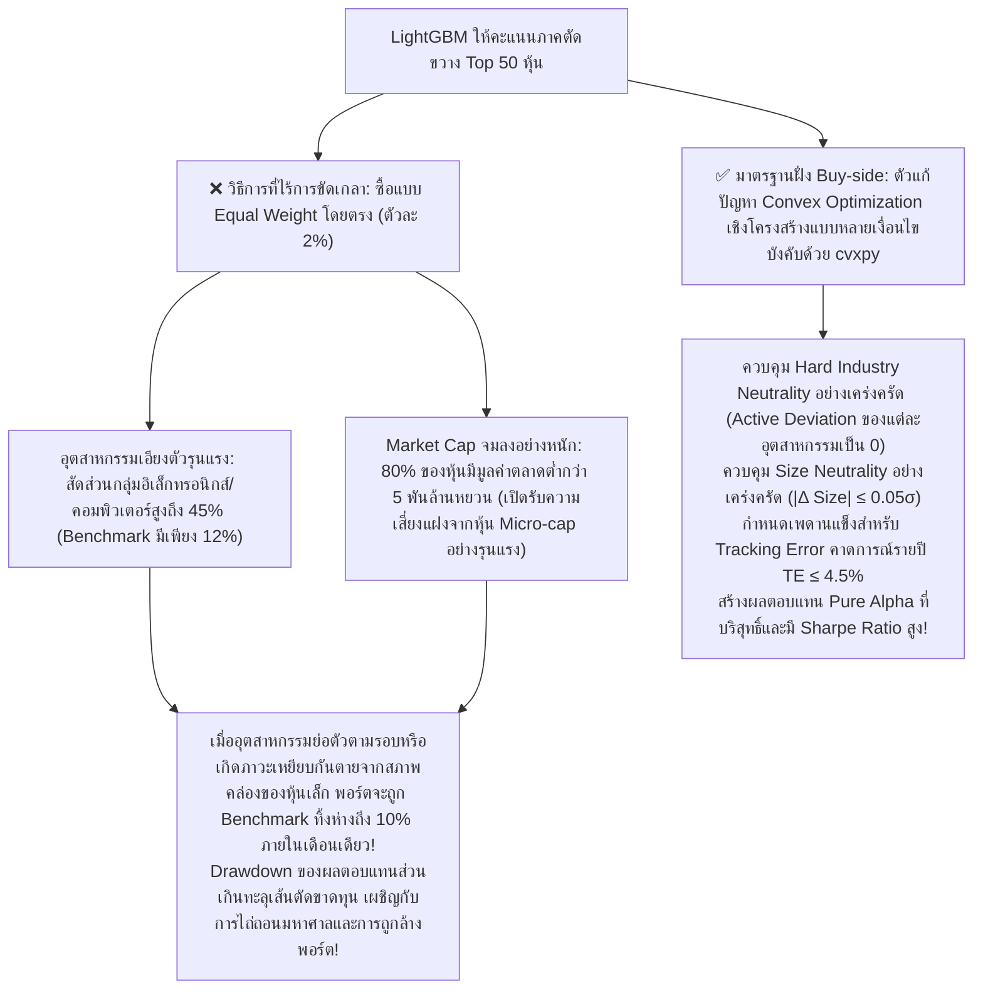
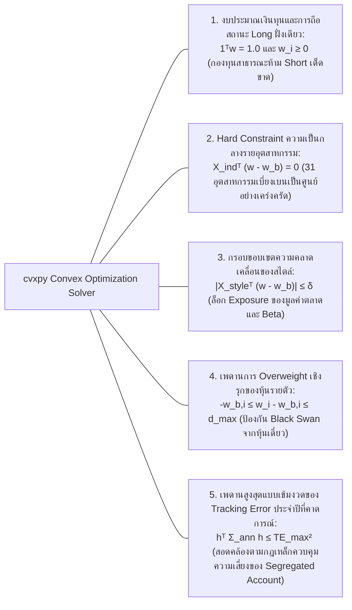

# บทที่ 24: ภาคปฏิบัติ Convex Optimization Solver (cvxpy)

::: tip เป้าหมายหลักของบทนี้
ในสถาบันควอนต์ (Quant) ฝั่ง Buy-side ยุคใหม่ “คะแนนจาก Machine Learning (Alpha)” เป็นเพียงวัตถุดิบต้นน้ำเท่านั้น แต่ **การหาพอร์ตที่เหมาะสมแบบคอนเวกซ์ (Portfolio Convex Optimization)** ต่างหากที่เป็น “เตาปฏิกรณ์ประกอบชิ้นส่วนหลัก” ที่เปลี่ยนการคาดการณ์ให้กลายเป็นผลิตภัณฑ์บริหารสินทรัพย์ที่แข็งแกร่ง

Quant Researcher ระดับจูเนียร์มักจะเลือกหุ้น 50 หรือ 100 ตัวแรกตามคะแนนคาดการณ์มาซื้อแบบถ่วงน้ำหนักเท่ากัน (Equal Weight) ผลลัพธ์คือพอร์ตเผชิญความเสี่ยงจากการเอียงตัวของอุตสาหกรรม (Industry Bias) และการจมลงสู่หุ้นขนาดเล็ก (Small-cap Bias) หลายสิบเปอร์เซ็นต์โดยไม่รู้ตัว เมื่อสไตล์ตลาดเกิดการหมุนเวียนกะทันหัน จึงต้องเผชิญกับ Drawdown ที่สร้างความเสียหายอย่างรุนแรง บทนี้ผสาน **ข้อกำหนดการสร้างพอร์ตของ MSCI Barra** เข้ากับ **แบบจำลองการหาพอร์ตที่เหมาะสมในระบบ Multi-Factor ของ Huatai Securities**: ถ่ายทอดการอนุพัทธ์ทางคณิตศาสตร์ของแบบจำลอง Quadratic Programming (QP) และ Second-Order Cone Programming (SOCP) สำหรับ **Index Enhancement** อย่างเป็นระบบ; เจาะลึกอัลกอริทึมหลักที่ใช้คุณสมบัติเชิงโครงสร้างของ Barra มาลดมิติข้อมูลเพื่อเร่งความเร็วใน **cvxpy** ให้เหลือระดับมิลลิวินาที; สร้างเงื่อนไขบังคับอย่างเข้มงวดทั้ง **Hard Industry Neutrality**, **กรอบความคลาดเคลื่อนของขนาดมูลค่าตลาด (Size Deviation Tolerance)**, **เพดานการ Overweight หุ้นรายตัว** และ **เพดานแข็งของ Tracking Error (TE) จากการคาดการณ์**; พร้อมทั้งอนุพัทธ์ **การมีส่วนร่วมต่อความเสี่ยงเชิงรุกส่วนเพิ่มของแฟกเตอร์ (Factor Marginal Contribution to Active Risk: FMCAR)** เพื่อวิเคราะห์เจาะลึกทะลุถึงแหล่งที่มาของ Active Risk!
:::

---

## 1. วรรณกรรมคลาสสิกและรากฐานทฤษฎีในอุตสาหกรรม

การสร้างระบบ Portfolio Optimization ที่รัดกุม ไม่อาจปราศจากการสนับสนุนจากวรรณกรรมคลาสสิกด้านการวางแผนทางคณิตศาสตร์ (Mathematical Programming) และวิศวกรรมการเงินสมัยใหม่ (Modern Financial Engineering):

1. **Markowitz, Harry (1952)**. *"Portfolio Selection"*, *The Journal of Finance*, 7(1): 77-91.  
   > ผลงานชิ้นเอกที่เป็นรากฐานของทฤษฎีพอร์ตการลงทุนสมัยใหม่ (Modern Portfolio Theory: MPT) ซึ่งเปลี่ยนการตัดสินใจลงทุนให้กลายเป็นปัญหาค่าสุดขีดแบบ Mean-Variance QP เป็นครั้งแรก
2. **Boyd, Stephen, & Vandenberghe, Lieven (2004)**. *Convex Optimization*. Cambridge University Press.  
   > คัมภีร์แห่งการวิจัยดำเนินงาน (Operations Research) และ Convex Optimization ระดับโลก อธิบายกระบวนทัศน์มาตรฐานของเซตคอนเวกซ์ (Convex Set), ฟังก์ชันคอนเวกซ์ (Convex Function), ทฤษฎีภาวะทวิลักษณ์หรือเงื่อนไข KKT (KKT Conditions), QP และ SOCP อย่างเป็นระบบ
3. **สถาบันวิจัย Huatai Securities (Lin Xiaoming, Chen Ye, 2016)**. 《การสำรวจระบบแบบจำลอง Multi-Factor ของ Huatai เบื้องต้น — ซีรีส์ Huatai Multi-Factor ตอนที่ 1》, ส่วนที่ 4: แบบจำลองการหาพอร์ตที่เหมาะสม.  
   > อนุพัทธ์ฟังก์ชันเป้าหมาย QP ภายใต้กรอบ Index Enhancement ของหุ้น A-Share ในประเทศ, เมทริกซ์เงื่อนไขบังคับความเป็นกลางทางอุตสาหกรรมด้วยตัวแปรหุ่น (Dummy Variable), เงื่อนไขบังคับขอบเขตล่างไม่เป็นลบของหุ้นรายตัว และระบบการแจกแจงที่มา (Attribution) ของ FMCAR ไว้อย่างเป็นระบบ
4. **Boyd, S., Busseti, E., He, S., & Kang, J. (2017)**. *"Multi-Period Trading via Convex Optimization"*, *Foundations and Trends in Optimization*, 3(1): 1-76.  
   > บทความวิชาการปริทัศน์ระดับแนวหน้าของทีม Boyd แห่ง Stanford University เกี่ยวกับการประยุกต์ใช้ Convex Optimization ในการเทรดเชิงปริมาณแบบหลายช่วงเวลา (Multi-period) ของฝั่ง Buy-side พร้อมแจกแจงการแก้ปัญหาแบบหลายวัตถุประสงค์สำหรับต้นทุนธุรกรรม (Transaction Cost), ต้นทุน Market Impact และ Tracking Error ไว้อย่างละเอียด
5. **Lobo, M. S., Vandenberghe, L., Boyd, S., & Lebret, H. (1998)**. *"Applications of second-order cone programming"*, *Linear Algebra and its Applications*, 284(1-3): 193-228.  
   > พิสูจน์ว่าเงื่อนไขบังคับความเสี่ยงแบบกำลังสองสามารถแปลงเป็นเงื่อนไขบังคับ Second-Order Cone (SOC) ได้อย่างเคร่งครัดผ่าน Cholesky Decomposition ซึ่งวางรากฐานสำคัญสำหรับการแก้ปัญหาอย่างมีประสิทธิภาพด้วย Interior-Point Method

---

## 2. ทำไม "การเลือกหุ้นแบบถ่วงน้ำหนักเท่ากัน" จึงเป็นทางตันในการเทรดจริงของ Index Enhancement?

หลายทีม Quant สามารถเทรนโมเดลทำนาย LightGBM ที่มีค่า Rank IC สูงถึง $8\%$ ได้ ทว่าเมื่อพวกเขาเลือกหุ้น 50 ตัวแรกตามคะแนนคาดการณ์มาซื้อแบบ Equal Weight โดยตรง มูลค่า NAV จากการ Backtest มักถูกดัชนีชี้วัด (เช่น CSI 500, CSI 1000) ทิ้งห่างอย่างรุนแรง

สาเหตุสำคัญอยู่ที่: **พอร์ตการลงทุนเชิงรุกที่ปราศจากการควบคุมความเสี่ยง แท้จริงแล้วคือการนำ NAV ทั้งหมดไปเดิมพันกับอุตสาหกรรมและสไตล์อย่างบ้าบิ่น!**



---

## 3. การสร้างแบบจำลองทางคณิตศาสตร์อย่างรัดกุมของ Portfolio Optimization สำหรับ Index Enhancement

กำหนดให้ Universe ของหุ้นที่ซื้อขายได้ทั้งตลาด (หรือ Universe ขยายของหุ้นองค์ประกอบใน Benchmark) มีหุ้นทั้งหมด $N$ ตัว

### 3.1 ตัวแปรตัดสินใจและน้ำหนักส่วนเบี่ยงเบนเชิงรุก
- $\mathbf{w} \in \mathbb{R}^N$：**เวกเตอร์น้ำหนักการถือครองของพอร์ตการลงทุน** ที่ต้องการหาคำตอบ (ตัวแปรตัดสินใจ);
- $\mathbf{w}_b \in \mathbb{R}^N$：**เวกเตอร์น้ำหนักองค์ประกอบของดัชนีชี้วัด** (เช่น น้ำหนักของหุ้นองค์ประกอบ CSI 500 ซึ่งสอดคล้องกับ $\mathbf{1}^T \mathbf{w}_b = 1, \; w_{b, i} \ge 0$);
- $\mathbf{h} = \mathbf{w} - \mathbf{w}_b \in \mathbb{R}^N$：**เวกเตอร์น้ำหนักส่วนเบี่ยงเบนเชิงรุก (Active Weights)**

### 3.2 รูปแบบคลาสสิก 3 รูปแบบของ Portfolio Optimization (กรอบการทำงาน Huatai Multi-Factor)

ในการดำเนินงานจริงของฝั่ง Buy-side นั้น QP มักมีรูปแบบแปลงที่เทียบเท่ากัน 3 รูปแบบดังต่อไปนี้:
1. **รูปแบบที่ 1 (กำหนดงบประมาณความเสี่ยง มุ่งเพิ่มผลตอบแทนสูงสุด)**:
   $$\max_{\mathbf{h}} \quad \mathbf{h}^T \boldsymbol{\alpha} \quad \text{s.t.} \quad \mathbf{h}^T \boldsymbol{\Sigma} \mathbf{h} \le \sigma_{\max}^2$$
2. **รูปแบบที่ 2 (กำหนดเป้าหมายผลตอบแทนที่คาดหวัง มุ่งลดความเสี่ยงต่ำสุด)**:
   $$\min_{\mathbf{h}} \quad \mathbf{h}^T \boldsymbol{\Sigma} \mathbf{h} \quad \text{s.t.} \quad \mathbf{h}^T \boldsymbol{\alpha} \ge \alpha_{\text{target}}$$
3. **รูปแบบที่ 3 (การเพิ่มอรรถประโยชน์ Mean-Variance สูงสุดพร้อมบทลงโทษความเสี่ยง นิยมใช้มากที่สุดในอุตสาหกรรม)**:
   $$\max_{\mathbf{w}} \quad U(\mathbf{w}) = \underbrace{\mathbf{h}^T \boldsymbol{\alpha}_H}_{\text{ผลตอบแทนส่วนเกินเชิงรุกที่คาดหวังในช่วงการถือครอง}} - \underbrace{\frac{\lambda}{2} \mathbf{h}^T \boldsymbol{\Sigma}_H \mathbf{h}}_{\text{บทลงโทษความแปรปรวนของ Tracking Error ในช่วงการถือครอง}}$$

โดยที่:
- $\boldsymbol{\alpha}_H \in \mathbb{R}^N$：เวกเตอร์อัตราผลตอบแทนส่วนเกินเชิงรุกที่คาดหวังในรอบการถือครอง $H$ วัน ซึ่งผ่านการปรับเทียบแบบ Out-of-sample จากบทที่ 22;
- $\boldsymbol{\Sigma}_H = \frac{H}{A} \boldsymbol{\Sigma}_{\text{ann}} \in \mathbb{R}^{N \times N}$：การแปลง Barra Covariance แบบรายปีให้เป็น Covariance ในรอบการถือครอง;
- $\lambda > 0$：**พารามิเตอร์การหลีกเลี่ยงความเสี่ยง (Risk Aversion Parameter)**

---
## 4. การเร่งความเร็วเชิงโครงสร้างในมิติต่ำของ Barra (เคล็ดลับการ Optimize พลังคำนวณใน cvxpy)

หากเขียน `cp.quad_form(h, Sigma)` ลงใน cvxpy โดยตรง เมื่อ $N = 5,000$ การสร้าง Dense Quadratic Form ขนาด $5,000 \times 5,000$ จะต้องประมวลผลการคูณและบวกถึง 25 ล้านรายการ ส่งผลให้ Solver หน่วยความจำหมดหรือต้องใช้เวลาคำนวณนานหลายนาที

เมื่อใช้การแยกส่วนเชิงโครงสร้างของ Barra $\boldsymbol{\Sigma} = X F X^T + \Delta$ ที่ได้พิสูจน์ไว้ในบทก่อนหน้า ความแปรปรวนของความเสี่ยงเชิงรุก (Active Risk Variance) สามารถลดรูปได้เป็น:

$$\mathbf{h}^T \boldsymbol{\Sigma} \mathbf{h} = \mathbf{h}^T (X F X^T + \Delta) \mathbf{h} = (X^T \mathbf{h})^T F (X^T \mathbf{h}) + \mathbf{h}^T \Delta \mathbf{h}$$

กำหนดให้**เวกเตอร์การเปิดรับต่อแฟกเตอร์เชิงรุก (Active Factor Exposure Vector)** คือ $\mathbf{y} = X^T \mathbf{h} \in \mathbb{R}^K$ (มีมิติเพียง $K \approx 40 \sim 60$ เท่านั้น!) พจน์ความเสี่ยงใน Objective Function จะถูกแปลงเป็น:

$$\mathbf{h}^T \boldsymbol{\Sigma} \mathbf{h} = \mathbf{y}^T F \mathbf{y} + \sum_{i=1}^N \delta_i h_i^2$$

ใน cvxpy การแปลงรูปนี้ไม่เพียงแต่ช่วยลดการใช้หน่วยความจำลงถึง 99% แต่ยังสอดคล้องตามข้อกำหนด DCP (Disciplined Convex Programming) อย่างเคร่งครัด:

```python
# การ Implement การ Optimize พลังคำนวณเชิงโครงสร้างในมิติต่ำด้วย cvxpy
active_factor_exp = cp.matmul(X.T, h)          # การแปลงเชิงเส้นมิติ (K,)
factor_risk = cp.quad_form(active_factor_exp, F) # รูปแบบกำลังสองของเมทริกซ์ขนาดเล็กเพียง (K, K) มิติ!
specific_risk = cp.sum(cp.multiply(delta, cp.square(h))) # การคูณแบบ Element-wise ของเวกเตอร์ (N,)!
total_variance = factor_risk + specific_risk
```

---

## 5. เจาะลึกระบบเงื่อนไขบังคับสำหรับการเทรดจริง (Live Trading) ในหุ้น A-Share

โมเดลกองทุนดัชนีเสริมผลตอบแทน (Index Enhancement) ในการเทรดจริงจำเป็นต้องกำหนด Hard และ Soft Constraint ในหลายมิติ เพื่อให้เป็นไปตามสัญญากองทุนและกฎระเบียบของ ก.ล.ต. จีน (CSRC):



### 5.1 เงื่อนไขบังคับด้านงบประมาณเงินทุนและการถือสถานะ Long ฝั่งเดียว (Budget & Long-Only)
$$\sum_{i=1}^N w_i = 1, \quad w_i \ge 0, \quad \forall i \in \{1, 2, \dots, N\}$$

ในรูปแบบ Active Weight:
$$\sum_{i=1}^N h_i = 0, \quad h_i \ge -w_{b, i}, \quad \forall i$$
เนื่องจากไม่สามารถทำ Naked Short-selling หุ้นได้ ($w_i \ge 0$) ขีดจำกัดล่างตามสภาพจริงของ Active Weight หุ้นรายตัวจึงเป็นค่าลบของน้ำหนักหุ้นนั้นในเบนช์มาร์ก $-w_{b, i}$ โดยปริยาย!

### 5.2 เงื่อนไขบังคับความเป็นกลางของอุตสาหกรรมแบบเข้มงวด (Industry Neutrality)
กำหนดให้ $S = X_{\text{ind}} \in \mathbb{R}^{N \times 31}$ เป็นเมทริกซ์ตัวแปรหุ่นแบบ One-Hot ของอุตสาหกรรมระดับ 1 ตาม Shenwan จำนวน 31 กลุ่ม:
$$\sum_{j=1}^N h_j s_{ji} = 0, \quad \forall i \in \{1, \dots, 31\} \iff X_{\text{ind}}^T (\mathbf{w} - \mathbf{w}_b) = \mathbf{0}$$
เงื่อนไขบังคับนี้จะบังคับให้สัดส่วนการจัดสรรพอร์ตในทุกอุตสาหกรรมระดับ 1 ตรงกับดัชนีเบนช์มาร์กอย่างสมบูรณ์ เพื่อขจัดความผันผวนจาก Beta ของการหมุนเวียนกลุ่มอุตสาหกรรมออกไปอย่างสิ้นเชิง

### 5.3 เงื่อนไขบังคับกรอบความคลาดเคลื่อนของแฟกเตอร์สไตล์ (Style Tolerance)
ป้องกันไม่ให้โมเดลแอบเอียงพอร์ตลงไปยังหุ้นขนาดเล็กพิเศษหรือหุ้นที่มีความผันผวนสูงเพื่อแสวงหาผลตอบแทน:
$$|X_{\text{style}}^T (\mathbf{w} - \mathbf{w}_b)| \le \boldsymbol{\delta}_{\text{style}}$$
ตัวอย่างเช่น กำหนด Active Exposure ของสไตล์ Log Market Cap ให้เป็น $|\Delta \text{Size}| \le 0.05\sigma$ เพื่อให้มั่นใจว่าพอร์ตลงทุนจะเกาะติดกับเบนช์มาร์กในมิติมูลค่าตลาดอย่างใกล้ชิด

### 5.4 ขีดจำกัดบนและล่างของการเบี่ยงเบนน้ำหนักหุ้นเชิงรุก (Active Stock Bounds) และ "กฎสองสิบ"
1. เพดานการ Overweight สัมพัทธ์กับเบนช์มาร์ก:
   $$-w_{b, i} \le h_i \le d_{\max}$$
   ในการเทรดจริง กองทุนดัชนีเสริมผลตอบแทน CSI 500 มักกำหนด $d_{\max} = 1.0\% \sim 1.5\%$ ส่วน CSI 1000 มักกำหนด $d_{\max} = 0.5\% \sim 0.8\%$
2. เพดานการถือครองแบบสัมบูรณ์ ("กฎสองสิบ" ของกองทุนสาธารณะ): มูลค่าตามราคาตลาดของหุ้นเดี่ยวแต่ละตัวจะต้องไม่เกิน $10\%$ ของมูลค่าทรัพย์สินสุทธิ (NAV) ของกองทุน (ในการเทรดจริง กองทุนดัชนีเสริมผลตอบแทนมักจะจำกัดเพดานหุ้นรายตัวไว้ที่ $2\% \sim 3\%$ เพื่อกระจายความเสี่ยงเฉพาะตัวให้ได้มากที่สุด)

### 5.5 เพดานสูงสุดแบบเข้มงวดของ Tracking Error ที่คาดการณ์ (Tracking Error Hard Bound)
สัมประสิทธิ์การหลีกเลี่ยงความเสี่ยง $\lambda$ ใน Objective Function ทำหน้าที่เพียงกำหนดน้ำหนัก Penalty เท่านั้น ไม่สามารถรับประกันได้โดยตรงว่า Tracking Error จะต่ำกว่าเพดานที่สัญญากำหนดไว้ ดังนั้นจึงต้องกำหนดเงื่อนไขบังคับ Second-Order Cone ไว้อย่างชัดเจน:

$$\mathbf{h}^T \boldsymbol{\Sigma}_{\text{ann}} \mathbf{h} \le \text{TE}_{\max}^2$$

---

## 6. การมีส่วนร่วมต่อความเสี่ยงส่วนเพิ่มของแฟกเตอร์ (FMCAR) และการวิเคราะห์เจาะทะลุความเสี่ยงเชิงรุก

ระบบรายงานมัลติแฟกเตอร์ของ Huatai Securities ได้แสดงการอนุพันธ์เชิงวิเคราะห์เพื่อตรวจสอบย้อนกลับและเจาะทะลุหาแหล่งที่มาของความเสี่ยงหลังจากเสร็จสิ้นการหาพอร์ตที่เหมาะสม (Portfolio Optimization):

### 6.1 สูตรการมีส่วนร่วมต่อความเสี่ยงส่วนเพิ่มของแฟกเตอร์ต่อความเสี่ยงเชิงรุก (FMCAR)
ความแปรปรวนเชิงรุกรวมของพอร์ตคือ:
$$\sigma_P^2 = \mathbf{x}_{PA}^T F \mathbf{x}_{PA} + \mathbf{h}_{PA}^T \Delta \mathbf{h}_{PA}$$
โดยที่ $\mathbf{x}_{PA} = X^T \mathbf{h}_{PA} \in \mathbb{R}^K$ คือ Active Factor Exposure ของพอร์ต

เมื่อหาอนุพันธ์ย่อยเทียบกับ Active Factor Exposure จะได้นิยามของ**การมีส่วนร่วมต่อความเสี่ยงส่วนเพิ่มของแฟกเตอร์ต่อความเสี่ยงเชิงรุก (Factor Marginal Contribution to Active Risk, FMCAR)**:

$$\text{FMCAR} = \frac{\partial \sigma_P}{\partial \mathbf{x}_{PA}^T} = \frac{F \mathbf{x}_{PA}}{\sigma_P}$$

### 6.2 การแจกแจงและรวมความเสี่ยงเชิงรุกอย่างแม่นยำ
เมื่อกระจายด้วยการคูณเมทริกซ์ จะได้ผลของการมีส่วนร่วมจากความเสี่ยงของแฟกเตอร์ต่อความผันผวนเชิงรุก:
$$\mathbf{x}_{PA}^T \cdot \text{FMCAR} = \frac{\mathbf{x}_{PA}^T F \mathbf{x}_{PA}}{\sigma_P}$$

Tracking Error เชิงรุกรวม $\sigma_P$ จะถูกแยกส่วนอย่างเคร่งครัดออกเป็น 2 ส่วน ได้แก่ การมีส่วนร่วมจากแฟกเตอร์เชิงระบบ และการมีส่วนร่วมจากความเสี่ยงเฉพาะตัวของหุ้นรายตัว:

$$\boxed{\sigma_P = \sum_{k=1}^K x_{PA}(k) \cdot \text{FMCAR}(k) + \frac{\mathbf{h}_{PA}^T \Delta \mathbf{h}_{PA}}{\sigma_P}}$$

- **นัยสำคัญในทางปฏิบัติ**: หลังจากเสร็จสิ้น Portfolio Optimization ผู้จัดการกองทุนสามารถสั่งพิมพ์ค่า Marginal Contribution ของแต่ละแฟกเตอร์ $x_{PA}(k) \cdot \text{FMCAR}(k)$ ออกมาได้โดยตรง หากพบว่าสัดส่วน Risk Contribution ของแฟกเตอร์ Size สูงถึง 40% ก็จะสามารถตรวจพบได้อย่างรวดเร็วว่า Market Cap Exposure สูงเกินไป และเข้าไปปรับลดพารามิเตอร์ขอบเขตความคลาดเคลื่อนของขนาดมูลค่าตลาดใน Optimizer ให้เข้มงวดขึ้นได้ทันท่วงที

---
## 7. การเลือก Convex Optimization Solver ยุคใหม่: Clarabel vs OSQP vs MOSEK

| Solver | สถาปัตยกรรมอัลกอริทึม | รองรับ Hard Constraint ของ Tracking Error แบบ SOCP หรือไม่ | สิทธิ์การใช้งาน Open Source / Commercial | ความเร็วในการคำนวณและความแม่นยำเชิงตัวเลข | Use Case ในระดับอุตสาหกรรม |
| :--- | :--- | :--- | :--- | :--- | :--- |
| **Clarabel** | Interior Point Method แบบ Native | ✅ รองรับแบบ Native | Open Source (Apache 2.0, Rust Core) | ความแม่นยำสูงมาก ทนทานต่อ Ill-conditioned Matrix ได้ดีเยี่ยม ลู่เข้าในระดับมิลลิวินาที | Conic Solver แบบ Open Source ยุคใหม่ที่ cvxpy แนะนำอย่างเป็นทางการเป็นอันดับแรก |
| **OSQP** | Alternating Direction Method of Multipliers (ADMM) | ❌ รองรับเฉพาะ QP ที่มี Linear Constraint แบบมาตรฐานเท่านั้น | Open Source (Apache 2.0) | เร็วมาก (ในช่วง Iteration แรกๆ) แต่ลู่เข้าสู่ความแม่นยำระดับสูงได้ช้ากว่า | เหมาะสำหรับงาน QP Optimization ความถี่สูงระดับสเกลใหญ่ที่ไม่มี Hard Constraint ของความเสี่ยงแบบ Quadratic |
| **MOSEK** | Primal-Dual Interior Point Method ระดับอุตสาหกรรม | ✅ รองรับแบบ Native | Commercial Closed Source (ฟรีสำหรับการศึกษา) | มาตรฐานระดับโลกในภาคอุตสาหกรรม รวดเร็วและเสถียรอย่างยิ่ง มี Robustness ในระดับสูงสุด | มาตรฐานสำหรับระบบ Production ของกองทุนเอกชน (Private Fund) สาย Quant ระดับหมื่นล้านชั้นนำและกองทุนความมั่งคั่งแห่งรัฐ |
| **SCS** | Splitting Conic Solver (ADMM) | ✅ รองรับ | Open Source (MIT) | เหมาะสำหรับโจทย์ขนาดใหญ่มาก แต่ความแม่นยำเชิงตัวเลขค่อนข้างต่ำ | เหมาะสำหรับการทำ Prototype Verification อย่างรวดเร็ว |

---

## 8. ภาคปฏิบัติ: การสร้าง cvxpy Optimizer สำหรับกองทุนดัชนีเสริมผลตอบแทน (Index Enhancement) ระดับ Production

ใน `tutorial/examples/lecture_24_cvxpy_portfolio_optimization.py` เราได้พัฒนา `AshareIndexEnhancementOptimizer` ระดับ Production:
1. Encapsulate การลดมิติของ Barra Structural Covariance เพื่อเร่งความเร็วในการประมวลผล;
2. กำหนด Hard Constraint อย่างครบถ้วน ทั้งการทำ Neutralization ของหมวดอุตสาหกรรมแบบเคร่งครัด, กรอบความคลาดเคลื่อนของมูลค่าตลาด, การ Overweight เชิงรุกในหุ้นรายตัว และเพดานสูงสุดของ Tracking Error รายปี;
3. แสดงผลลัพธ์ค่าน้ำหนักการจัดสรรที่เหมาะสมที่สุด $\mathbf{w}^*$ พร้อมตรวจสอบ Residual ของเงื่อนไข KKT ในทุก Constraint อย่างเข้มงวด

สามารถสั่งรันเพื่อทดสอบได้โดยตรงผ่าน Terminal:

```bash
python3 -m examples.lecture_24_cvxpy_portfolio_optimization
```

<<< @/examples/lecture_24_cvxpy_portfolio_optimization.py

---

## 9. สรุปเนื้อหาประจำบทและการประเมินตนเอง

| ประเด็นสำคัญ | สาระสำคัญในการตอบตามมาตรฐานอุตสาหกรรม | กับดักที่พบบ่อยในเชิงวิศวกรรม/วิชาการ |
| :--- | :--- | :--- |
| **ทำไมขีดจำกัดล่างของ Active Weight ในหุ้นรายตัวถึงเป็น $-w_{b, i}$?** | กองทุนรวมและ Private Fund ทั่วไปในตลาดหุ้น A-Share ห้ามขายชอร์ต (Short Selling) อย่างเด็ดขาด ($w_i \ge 0$) ดังนั้น Active Weight จึงเป็น $h_i = w_i - w_{b, i} \ge -w_{b, i}$ | การตั้งขีดจำกัดล่างไว้แบบคงที่ เช่น $-1\%$ ตามอำเภอใจ ส่งผลให้หุ้นขนาดเล็กที่มีน้ำหนักใน Benchmark เพียง $0.2\%$ ถูกคำนวณออกมาเป็นค่าน้ำหนักสัมบูรณ์ที่ติดลบ (ซึ่งเป็นการทำ Naked Short Selling ที่ผิดกฎหมาย) |
| **Factor Marginal Contribution to Active Risk (FMCAR) มีบทบาทอย่างไรในการควบคุมความเสี่ยงของพอร์ตโฟลิโอ?** | การคำนวณเชิงวิเคราะห์ $\text{FMCAR} = F x_{PA} / \sigma_P$ ช่วยให้มองทะลุเห็นผลกระทบส่วนเพิ่มต่อ Active Tracking Error เมื่อแฟกเตอร์ (Factor) Exposure เพิ่มขึ้นทุกๆ 1 หน่วย | สนใจเพียงขนาดของ Factor Exposure เดี่ยวๆ โดยละเลยการขยายผลต่อ Tracking Error ที่เกิดจากความสัมพันธ์ของ Covariance ระหว่าง Factor |
| ** Clarabel Solver แตกต่างจาก OSQP โดยพื้นฐานอย่างไร?** | Clarabel รองรับ Second-Order Cone Programming (SOCP) ทำให้สามารถจัดการ Quadratic Constraint ในรูปแบบ $\mathbf{h}^T \boldsymbol{\Sigma} \mathbf{h} \le \text{TE}_{\max}^2$ ได้อย่างเคร่งครัด ขณะที่ OSQP รองรับเฉพาะ Affine Linear Constraint เท่านั้น | การฝืนระบุ `solver=cp.OSQP` ในโจทย์ที่มี Quadratic Inequality Constraint จนทำให้ Solver แจ้ง Cone Exception ว่าไม่รองรับ |

ในบทถัดไป เราจะเข้าสู่ **บทที่ 25: ข้อจำกัดด้าน Turnover และการเพิ่ม Penalty Term ของต้นทุนการทำธุรกรรม** โดยจะนำค่าคอมมิชชันและภาษีที่เป็นเชิงเส้น รวมถึงต้นทุน Market Impact ที่ไม่เป็นเชิงเส้น มาใส่เป็น Penalty Term ใน Objective Function ของ Convex Optimization โดยตรง!
