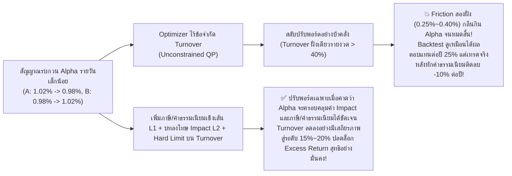
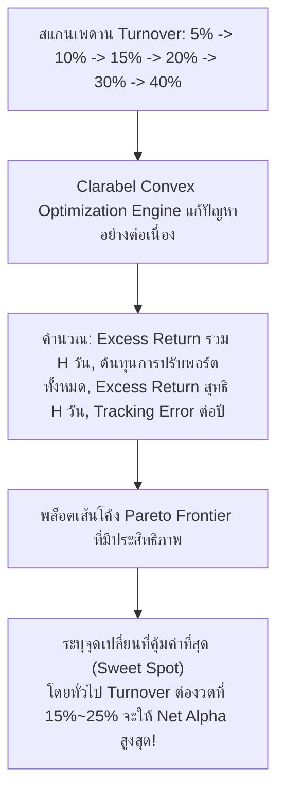

# บทที่ 25: ข้อจำกัด Turnover และการใส่ Transaction Cost Penalty

::: tip เป้าหมายหลักของบทนี้
ในการหาพอร์ตที่เหมาะสม (Portfolio Optimization) เชิงปริมาณ (Quant) ยุคใหม่ Mean-Variance Optimizer แบบดั้งเดิมมักถูกแวดวงวิชาการและอุตสาหกรรมล้อเลียนว่าเป็น “**ตัวขยายความคลาดเคลื่อน (Error Maximizer)**”: เนื่องจากค่าพยากรณ์ Alpha จากโมเดล Machine Learning มีสัญญาณรบกวนทางสถิติ (Statistical Noise) เล็กน้อยในแต่ละวัน Optimizer ที่ปราศจากข้อจำกัด Turnover และบทลงโทษจาก Friction จึงมักยอมล้างพอร์ตเปลี่ยนหุ้นถึง $50\%$ ของโพซิชันหลักทุกวัน เพียงเพื่อหวังผลตอบแทนส่วนเกิน (Excess Return) เพิ่มขึ้นแค่ $0.05\%$ และสุดท้ายก็ต้องเสียเลือดอย่างหนักใน “เครื่องบดเนื้อ” ของอากรแสตมป์ (Stamp Duty) หุ้น A-Share, ค่าคอมมิชชัน และ Slippage จาก Market Impact

บทนี้จะเจาะลึกถึงสาเหตุเชิงพยาธิสภาพของ Optimizer ที่เกิด Turnover มากเกินไป พร้อมทั้งพิสูจน์การผนวก **ต้นทุนธุรกรรมเชิงเส้น L1** และ **แบบจำลอง Market Impact กำลังสอง L2 (การประมาณค่าแบบ Almgren-Chriss)** เข้าไปใน Objective Function ของ Convex Optimization โดยตรง เพื่อสร้าง **Hard Constraint กึ่งนอร์มของ Turnover รายงวด** และพล็อต **เส้นขอบฟ้าพารีโต (Pareto Frontier) ระหว่าง Turnover กับ Excess Return สุทธิหลังหักค่าธรรมเนียม** เพื่อวางกลไกการตัดสินใจด้าน Turnover แบบไดนามิกสำหรับการเทรดจริง (Live Trading) ฝั่ง Buy-side
:::

---

## 1. วรรณกรรมคลาสสิกและรากฐานทฤษฎีในอุตสาหกรรม

การผสาน Friction การซื้อขายเข้ากับ Portfolio Optimization ถือเป็นหนึ่งในสาขาการวิจัยที่มีมูลค่าในทางปฏิบัติสูงสุดในวิศวกรรมการเงินเชิงปริมาณ:

1. **Michaud, Richard O. (1989)**. *"The Markowitz Optimization Enigma: Is 'Optimized' Optimal?"*, *Financial Analysts Journal*, 45(1): 31-42.  
   > พิสูจน์จากมุมมองทางสถิติเป็นครั้งแรกว่า Mean-Variance Optimizer มักเอนเอียงเลือกสินทรัพย์ที่มีความคลาดเคลื่อนในการประมาณการสูงสุด (ประเมินค่าเฉลี่ยสูงเกินจริง และประเมินความเสี่ยงต่ำเกินจริง) ซึ่งเผยให้เห็นปรากฏการณ์ "Error Maximizer"
2. **Almgren, Robert, & Chriss, Neil (2000)**. *"Optimal execution of portfolio transactions"*, *Journal of Risk*, 3(2): 5-40.  
   > วางรากฐานทางทฤษฎีวิชาการสำหรับ Optimal Execution และแบบจำลอง Market Impact (Temporary and Permanent Market Impact)
3. **Kyle, Albert S. (1985)**. *"Continuous Auctions and Informed Trader"*, *Econometrica*, 53(6): 1315-1335.  
   > พัฒนาแบบจำลองเชิงเส้นของผลกระทบต่อราคาจาก Order Flow ของ Informed Trader (Kyle's Lambda) ซึ่งเป็นต้นกำเนิดทฤษฎีต้นทุน Impact ในโครงสร้างจุลภาคของตลาด
4. **Boyd, S., Busseti, E., He, S., & Kang, J. (2017)**. *"Multi-Period Trading via Convex Optimization"*, *Foundations and Trends in Optimization*, 3(1): 1-76.  
   > ระบบ Convex Optimization ของ Stanford University ซึ่งได้พิสูจน์กระบวนทัศน์มาตรฐานในการผนวกค่าธรรมเนียมเชิงเส้น L1 และฟังก์ชัน Impact แบบ Convex L2 เข้ากับ Convex Optimization อย่างเป็นระบบ
5. **Bouchaud, J.-P., Gefen, Y., Potters, M., & Wyart, M. (2004)**. *"Fluctuations and response in financial markets: the subtle nature of 'random' price changes"*, *Quantitative Finance*, 4(2): 176-185.  
   > พิสูจน์ถึงการมีอยู่จริงของกฎ Square-Root Impact แบบไม่เป็นเชิงเส้นในตลาดการเงินจริง

---

## 2. ทำไม Optimizer จึงเกิด "อาการ Turnover สูงเกินไป"?

อัตราส่วนสัญญาณต่อสัญญาณรบกวน (SNR) ในตลาดการเงินมักอยู่ที่เพียง $0.05 \sim 0.15$ เท่านั้น ณ วันที่ $t$ หุ้น A มี Excess Return ที่คาดหวัง $+1.02\%$ ขณะที่หุ้น B อยู่ที่ $+0.98\%$ ทว่าเมื่อถึงวันที่ $t+1$ ความผันผวนเล็กน้อยของ Feature ทำให้ค่าพยากรณ์ของหุ้น A เปลี่ยนเป็น $+0.98\%$ และหุ้น B เปลี่ยนเป็น $+1.02\%$

- **ความคลั่งไคล้ของ Optimizer ไร้ข้อจำกัด**: Optimizer มอง Noise ทางสถิติขนาดเล็กน้อยเพียง $0.04\%$ เป็นโอกาสเก็งกำไรที่แน่นอน สั่งการให้ขายหุ้น A ออกทั้งหมดทันที และซื้อหุ้น B เข้ามาเต็มจำนวน!
- **บทลงโทษอันโหดร้ายในการเทรดจริงบนหุ้น A-Share**:
  - ขายหุ้น A: อากรแสตมป์ขาเดียว $0.05\%$ + ค่าคอมมิชชันและค่าธรรมเนียมจัดการฝั่งขาย $\approx 0.02\%$ + Slippage จาก Market Impact ฝั่งขาย $\approx 0.10\% = 0.17\%$
  - ซื้อหุ้น B: ค่าคอมมิชชันและค่าธรรมเนียมการโอนฝั่งซื้อ $\approx 0.02\%$ + Slippage จาก Market Impact ฝั่งซื้อ $\approx 0.10\% = 0.12\%$
  - **ความสูญเสียจาก Friction รวม**: ต้นทุน Friction สองฝั่งสูงถึง $0.29\%$! การซื้อขายเที่ยวนี้ไม่เพียงแต่ไม่ได้ส่วนต่างกำไร $0.04\%$ ตามที่คาดหวัง แต่กลับทำให้มูลค่าสินทรัพย์สุทธิของพอร์ตหดตัวลงทันที $0.25\%$!



---

## 3. การสร้างแบบจำลอง Convex ของ Transaction Friction Cost (Convex Formulation)

กำหนดให้น้ำหนักการถือครองจริงของพอร์ตก่อนการปรับพอร์ต (Rebalance) ในวันที่ $t$ คือ $\mathbf{w}_{\text{prev}} \in \mathbb{R}^N$ (ซึ่งผ่านการเคลื่อนตัวตามราคาตลาดมาแล้ว)
ตัวแปรการตัดสินใจเป้าหมายในการปรับพอร์ตครั้งนี้คือ $\mathbf{w} \in \mathbb{R}^N$
การเปลี่ยนแปลงของน้ำหนักการปรับพอร์ตสำหรับหุ้นแต่ละตัวคือ:
$$\Delta w_i = w_i - w_{i, \text{prev}}$$

### 3.1 เทอมต้นทุนธุรกรรมเชิงเส้น L1 (อากรแสตมป์ + ค่าคอมมิชชันโบรกเกอร์ + ค่าธรรมเนียมการโอน)

ต้นทุนธุรกรรมเชิงเส้นเป็นสัดส่วนโดยตรงกับมูลค่าการปรับพอร์ต ในตลาดหุ้น A-Share อากรแสตมป์จะเรียกเก็บเฉพาะฝั่งขายเท่านั้น (เกณฑ์ปัจจุบันคือ $0.05\%$) ส่วนค่าคอมมิชชันและค่าธรรมเนียมการโอนจะเก็บทั้งสองฝั่ง (ฝั่งซื้อและขายฝั่งละประมาณ $0.015\% \sim 0.02\%$):

$$C_{\text{linear}}(\Delta \mathbf{w}) = \sum_{i=1}^N \left( c_i^{\text{buy}} (\Delta w_i)^+ + c_i^{\text{sell}} (\Delta w_i)^- \right)$$

โดยที่ $(\cdot)^+ = \max(\cdot, 0)$ คือส่วนของการซื้อ และ $(\cdot)^- = \max(-\cdot, 0)$ คือส่วนของการขาย

ภายใต้ข้อสมมติเพื่อการเรียนการสอนแบบอัตราค่าธรรมเนียมสมมาตร สามารถเขียนให้อยู่ในรูป L1 Norm ได้ดังนี้:
$$C_{\text{linear}}(\Delta \mathbf{w}) = \mathbf{c}^T |\mathbf{w} - \mathbf{w}_{\text{prev}}| = c \cdot \|\mathbf{w} - \mathbf{w}_{\text{prev}}\|_1$$

- **การพิสูจน์ความเป็นฟังก์ชัน Convex**: ฟังก์ชันค่าสัมบูรณ์ $|\cdot|$ และ L1 Norm $\|\cdot\|_1$ เป็นฟังก์ชัน Convex แท้จริง ใน cvxpy สามารถเรียกใช้ผ่าน `cp.norm1(w - w_prev)` ได้โดยตรง และสอดคล้องกับข้อกำหนด Disciplined Convex Programming (DCP) โดยธรรมชาติ!
### 3.2 พจน์บทลงโทษกำลังสอง L2 สำหรับ Market Impact (โมเดล Temporary Impact ของ Almgren-Chriss)

สำหรับผลิตภัณฑ์บริหารสินทรัพย์ของฝั่ง Buy-side ที่มีขนาดสินทรัพย์ภายใต้การบริหารระดับหลายร้อยล้านถึงหลายพันล้านหยวน การส่งคำสั่งซื้อขายขนาดใหญ่จะ "ทะลุความลึกของ Order Book" และก่อให้เกิด Market Impact อย่างมีนัยสำคัญ

ตามทฤษฎีการส่งคำสั่งซื้อขายที่เหมาะสมที่สุดของ Almgren & Chriss (2000) ผลกระทบชั่วคราวต่อราคา (Temporary Price Impact) จะแปรผันตรงกับความเร็วในการส่งคำสั่ง จึงทำให้**มูลค่าต้นทุน Market Impact รวมแปรผันตรงกับกำลังสองของปริมาณการซื้อขาย** ในการหาพอร์ตที่เหมาะสม (Portfolio Optimization) แบบงวดเดียว สามารถจำลองเทียบเท่าได้เป็นพจน์บทลงโทษกำลังสอง:

$$C_{\text{impact}}(\Delta \mathbf{w}) = \frac{1}{2} \sum_{i=1}^N \gamma_i (\Delta w_i)^2 = \frac{1}{2} (\mathbf{w} - \mathbf{w}_{\text{prev}})^T \Gamma (\mathbf{w} - \mathbf{w}_{\text{prev}})$$

โดยสัมประสิทธิ์บทลงโทษแนวทแยงสำหรับ Market Impact $\gamma_i$ จะแปรผันตรงอย่างเคร่งครัดกับขนาดเงินทุน AUM และแปรผกผันกับมูลค่าซื้อขายเฉลี่ยต่อวัน (ADV) ของหุ้น:

$$\gamma_i = k \cdot \sigma_{i, \text{daily}} \frac{\text{AUM}}{\text{ADV}_{i, \text{amount}}}$$

- $\text{AUM}$：มูลค่าทรัพย์สินสุทธิทั้งหมดภายใต้การบริหารของกองทุน (เช่น 1,000 ล้านหยวน);
- $\text{ADV}_{i, \text{amount}}$：มูลค่าซื้อขายเฉลี่ยต่อวันย้อนหลัง 20 วันของหุ้นตัวนั้นที่ทราบก่อนการตัดสินใจปรับพอร์ต (Rebalance) (เช่น 50 ล้านหยวน);
- $\sigma_{i, \text{daily}}$：ความผันผวนของผลตอบแทนรายวันของหุ้นรายตัว;
- $k$：ตัวคูณ Impact เชิงประจักษ์ที่ปรับเทียบจากข้อมูลการจับคู่คำสั่ง (Matching) ในอดีตของอัลกอริทึมการส่งคำสั่ง (TWAP/VWAP)
- **นัยทางเศรษฐศาสตร์**：ยิ่งขนาดการบริหารจัดการใหญ่ มูลค่าซื้อขายของหุ้นยิ่งเบาบาง และความผันผวนของหุ้นรายตัวยิ่งสูง สัมประสิทธิ์ Impact $\gamma_i$ จะพุ่งสูงขึ้นแบบทวีคูณ และ Optimizer จะจำกัดการปรับพอร์ตในหุ้นตัวนั้นโดยอัตโนมัติ!

---

## 4. แบบจำลองการวางแผนแบบสมดุลหลายเป้าหมายฉบับสมบูรณ์และ Hard Constraint ของ Turnover

กำหนดระยะเวลาถือครองการลงทุนให้เป็น $H$ วันทำการ ฟังก์ชันเป้าหมายจะนำผลตอบแทนส่วนเกิน (Excess Return) เชิงรุกในช่วงการถือครอง, บทลงโทษความเสี่ยง, ต้นทุนค่าธรรมเนียมและภาษีเชิงเส้นของการปรับพอร์ตครั้งนี้ และบทลงโทษกำลังสองสำหรับ Market Impact มาพิจารณาพร้อมกัน:

$$\max_{\mathbf{w}} \quad \underbrace{\mathbf{h}^T \boldsymbol{\alpha}_H}_{\text{ผลตอบแทนส่วนเกินคาดการณ์ช่วงถือครอง}} - \underbrace{\frac{\lambda}{2} \mathbf{h}^T \boldsymbol{\Sigma}_H \mathbf{h}}_{\text{บทลงโทษความแปรปรวนของความเสี่ยงช่วงถือครอง}} - \underbrace{\mathbf{c}^T |\mathbf{w} - \mathbf{w}_{\text{prev}}|}_{\text{ต้นทุนเชิงเส้นของการปรับพอร์ตครั้งนี้}} - \underbrace{\frac{1}{2} (\mathbf{w} - \mathbf{w}_{\text{prev}})^T \Gamma (\mathbf{w} - \mathbf{w}_{\text{prev}})}_{\text{ต้นทุน Market Impact ของการปรับพอร์ตครั้งนี้}}$$

$$\text{s.t.} \quad \begin{cases}
\sum_{i=1}^N w_i = 1, \quad w_i \ge 0 & (\text{งบประมาณและ Long-only}) \\
X_{\text{ind}}^T (\mathbf{w} - \mathbf{w}_b) = \mathbf{0} & (\text{Neutralization แบบเข้มของอุตสาหกรรม Shenwan ระดับ 1}) \\
|X_{\text{style}}^T (\mathbf{w} - \mathbf{w}_b)| \le \boldsymbol{\delta}_{\text{style}} & (\text{ส่วนเบี่ยงเบนที่ยอมรับได้ของสไตล์แฟกเตอร์ (Factor)}) \\
-w_{b, i} \le w_i - w_{b, i} \le d_{\max} & (\text{เพดาน Active Overweight หุ้นรายตัว}) \\
\mathbf{h}^T \boldsymbol{\Sigma}_{\text{ann}} \mathbf{h} \le \text{TE}_{\max}^2 & (\text{เพดานแบบเข้มของ Tracking Error พยากรณ์ต่อปี}) \\
\frac{1}{2} \|\mathbf{w} - \mathbf{w}_{\text{prev}}\|_1 \le \tau_{\max} & (\text{เพดานแบบเข้มของ Turnover ด้านเดียวต่องวด})
\end{cases}$$

โดยที่:
$$\text{Turnover}_{\text{single}} = \frac{1}{2} \sum_{i=1}^N |w_i - w_{i, \text{prev}}| = \frac{1}{2} \|\mathbf{w} - \mathbf{w}_{\text{prev}}\|_1$$
เนื่องจากยอดรวมฝั่งซื้อและยอดรวมฝั่งขายเท่ากัน การคูณด้วย $1/2$ จึงเป็น**อัตรา Turnover ด้านเดียว**ตามมาตรฐานอุตสาหกรรม

---

## 5. Pareto Frontier ระหว่าง Turnover และผลตอบแทนส่วนเกินสุทธิ

การค่อย ๆ ผ่อนคลายเพดานแบบเข้มของ Turnover $\tau_{\max} \in [5\%, 50\%]$ ทำให้เราสามารถพล็อต**เส้นโค้ง Pareto Frontier ระหว่าง Turnover กับผลตอบแทนสุทธิ**อันโด่งดังได้:



### 5.1 กฎการลดน้อยถอยลงของผลได้ส่วนเพิ่ม
1. **Turnover ตึงเกินไป ($\tau_{\max} \le 5\%$)**: Optimizer ถูกจำกัดอย่างหนักจนไม่สามารถปรับพอร์ตไปยังหุ้นคุณภาพที่มี Alpha สูงได้ ทำให้ได้ Gross Excess Return ต่ำมาก;
2. **ช่วงสมดุลทองคำ ($\tau_{\max} \approx 15\% \sim 20\%$)**: Optimizer สามารถขายหุ้นที่ Alpha หมดลงอย่างเด็ดขาด และเข้าซื้อหุ้นแข็งแกร่งตัวใหม่ที่เพิ่งค้นพบ โดยมี Friction ในการซื้อขายต่ำมาก ส่งผลให้**ผลตอบแทนส่วนเกินสุทธิหลังหักค่าธรรมเนียมแตะจุดสูงสุดระดับ Global Peak**;
3. **Turnover หย่อนเกินไป ($\tau_{\max} \ge 35\%$)**: Optimizer เริ่มจับสัญญาณรบกวนความถี่สูง ต้นทุน Market Impact และภาษีจะพุ่งสูงขึ้นอย่างรวดเร็วเป็นกำลังสอง ทำให้ผลตอบแทนส่วนเกินสุทธิดิ่งลงเหว!

---

## 6. ภาคปฏิบัติ: Convex Optimizer ระดับโปรดักชันพร้อมต้นทุน Turnover

ใน `tutorial/examples/lecture_25_turnover_constraints_and_costs.py` เราได้พัฒนา `AshareTurnoverConstrainedOptimizer` ระดับ Production:
1. ป้อนข้อมูลพอร์ตจริงงวดก่อนหน้า `w_prev`, เวกเตอร์อัตราค่าธรรมเนียมเชิงเส้น $\mathbf{c}$ และเมทริกซ์แนวทแยงสำหรับ Market Impact ตามขนาดเงินทุน $\Gamma$ อย่างครบถ้วน;
2. หาคำตอบร่วมของปัญหา Convex Optimization ที่ครอบคลุมทั้งบทลงโทษต้นทุน L1/L2 และเพดาน Turnover ด้านเดียวต่องวด $\tau_{\max}$;
3. มี Solver สแกนแบบ Built-in `trace_pareto_frontier()` เพื่อสร้างรายงานความไวของเพดาน Turnover โดยอัตโนมัติ

สามารถรันคำสั่งในเทอร์มินัลเพื่อทดสอบได้โดยตรง:

```bash
python3 -m examples.lecture_25_turnover_constraints_and_costs
```

<<< @/examples/lecture_25_turnover_constraints_and_costs.py

---
## 7. เมทริกซ์อ้างอิงการกำหนดอัตรา Turnover ในการเทรดจริง (Live Trading) สำหรับสถาบันฝั่ง Buy-side

ในการบริหารจัดการผลิตภัณฑ์สินทรัพย์เชิงปริมาณ (Quant) ในทางปฏิบัติ การกำหนดอัตรา Turnover จำเป็นต้องเชื่อมโยงอย่างใกล้ชิดกับความถี่ของกลยุทธ์และความจุของเงินทุน (Capacity):

| ประเภทกลยุทธ์ | รอบการปรับพอร์ต (Rebalance) | เป้าหมายอัตรา Turnover ต่อรอบ | อัตรา Turnover ฝั่งเดียวต่อปี | ความจุ AUM ทั่วไป | ความท้าทายหลักด้าน Transaction Friction |
| :--- | :--- | :--- | :--- | :--- | :--- |
| **แฟกเตอร์ (Factor) เชิงปัจจัยพื้นฐานหลายตัวแปร / กองทุนดัชนีเสริมผลตอบแทน (Index Enhancement) สไตล์ Value** | รายเดือน (Monthly, 21 วัน) | $10\% \sim 15\%$ | $1.2\times \sim 2.0\times$ | 10,000 ล้าน ~ 30,000 ล้านหยวน | มุ่งเน้น Market Impact ที่ต่ำที่สุด เกือบทั้งหมดส่งคำสั่งด้วยอัลกอริทึม VWAP |
| **Alpha ความถี่ระดับกลางเชิงปริมาณ / กองทุนดัชนีเสริมผลตอบแทน CSI 500** | รายสัปดาห์ (Weekly, 5 วัน) | $15\% \sim 20\%$ | $8\times \sim 12\times$ | 3,000 ล้าน ~ 8,000 ล้านหยวน | คำนึงถึงทั้งความสดใหม่ของสัญญาณ Alpha และ Market Impact โดยเน้นการคัดกรองสภาพคล่องของหุ้นรายตัว |
| **ภาคตัดขวาง (Cross-sectional) เชิงปริมาณความถี่สูง / กองทุนดัชนีเสริมผลตอบแทน CSI 1000/2000** | รายวัน (Daily, 1 วัน) | $15\% \sim 25\%$ | $30\times \sim 60\times$ | 500 ล้าน ~ 2,000 ล้านหยวน | ต้นทุน Market Impact คือเส้นเลือดใหญ่ ต้องใช้งานร่วมกับอัลกอริทึมการส่งคำสั่ง Order Flow ด้วย Deep Learning ที่พัฒนาขึ้นเอง |

---

## 8. สรุปเนื้อหาประจำบทและการทดสอบตนเองที่สำคัญ

| ประเด็นสำคัญที่ต้องทดสอบ | สาระสำคัญของคำตอบตามมาตรฐานอุตสาหกรรม | หลุมพรางที่พบบ่อยในเชิงวิศวกรรม/วิชาการ |
| :--- | :--- | :--- |
| **เหตุใด Optimizer ที่ปราศจากข้อจำกัดจึงทำให้เกิด Turnover ที่มากเกินไปอย่างรุนแรง?** | โดยเนื้อแท้ Mean-Variance Optimizer คือ "ตัวขยายสัญญาณความผิดพลาด (Error Maximizer)" ซึ่งจะตีความ Statistical Noise ที่เบาบางในข้อมูลการเงินผิดว่าเป็นผลตอบแทนส่วนเกิน (Excess Return) ที่แน่นอน จนนำไปสู่การปรับเปลี่ยนพอร์ตอย่างพลิกหน้ามือเป็นหลังมืออยู่บ่อยครั้ง | หลงคิดว่าความแม่นยำของโมเดลบน Training Set ที่สูงจะไม่ทำให้เกิด Turnover มากเกินไป ซึ่งเป็นการสับสนระหว่างอัตราส่วนสัญญาณต่อสัญญาณรบกวน (Signal-to-Noise Ratio: SNR) ของการคาดการณ์ กับแรงขับเคลื่อนในการปรับพอร์ต |
| **จะสร้างแบบจำลอง Market Impact ที่สะท้อนคุณลักษณะของขนาดเงินทุนจริงได้อย่างไร?** | ใส่ค่าปรับ Quadratic Impact ของ Almgren-Chriss เข้ามา: $\frac{1}{2} \Delta \mathbf{w}^T \Gamma \Delta \mathbf{w}$ โดยที่สัมประสิทธิ์ $\gamma_i \propto \frac{\text{AUM}}{\text{ADV}_i}$ | ใช้ค่า Slippage คงที่ระดับไม่กี่ bps แบบผิดๆ ส่งผลให้เมื่อขยายขนาดในการทดสอบย้อนหลัง (Backtest) ไปถึง 5,000 ล้านหยวน จะตรวจไม่พบการพังทลายของสภาพคล่อง (Liquidity Shock) โดยสิ้นเชิง |
| **ใน cvxpy จะเขียนเงื่อนไขบังคับแบบแข็ง (Hard Constraint) สำหรับอัตรา Turnover ฝั่งเดียวได้อย่างไร?** | ใช้กึ่งนอร์ม (Semi-norm): `cp.norm1(w - w_prev) <= 2 * max_turnover` | ลืมคูณด้วย $1/2$ ส่งผลให้อัตรา Turnover ฝั่งเดียวถูกขยายออกไปเป็นสองเท่าโดยผิดพลาด |

ถึงจุดนี้ ในสมรภูมิของการ**แสวงหาผลตอบแทนส่วนเกิน (Alpha) เมื่อเทียบกับดัชนีอ้างอิง** กล่องเครื่องมือแบบจำลองความเสี่ยง (Risk Model) เชิงโครงสร้างและการหาพอร์ตที่เหมาะสม (Portfolio Optimization) แบบคอนเวกซ์ของเราก็เสร็จสมบูรณ์เป็นวงปิดเรียบร้อยแล้ว
แต่ในสถานการณ์จริงของการบริหารสินทรัพย์แบบ All-Weather, การจัดสรรกองทุน FOF, การจัดสรรสินค้าโภคภัณฑ์สไตล์ CTA หรือกลยุทธ์ผลตอบแทนสัมบูรณ์ (Absolute Return) นั้น **ไม่มีดัชนีอ้างอิงหุ้นสำเร็จรูปที่สามารถจำลองตามได้ แล้วเราจะจัดสรรสินทรัพย์อย่างเป็นวิทยาศาสตร์ได้อย่างไร?**

ในบทถัดไป เราจะเข้าสู่ **บทที่ 26: การจัดสรรความเสี่ยงแบบเท่าเทียม (Risk Parity) และการจัดสรรความเสี่ยงแบบลำดับขั้น (Hierarchical Risk Parity: HRP)** โดยจะทำการพิสูจน์สูตรว่าเราจะสร้างรากฐานผลตอบแทนสัมบูรณ์แบบ All-Weather เพื่อรับมือกับวัฏจักรเศรษฐกิจมหภาคได้อย่างไร ผ่านการมีส่วนร่วมของความเสี่ยงหน่วยสุดท้าย (Marginal Risk Contribution: MRC) และอัลกอริทึมการจัดกลุ่มเชิงกราฟ (Graph Clustering) ที่ไม่ต้องหาเมทริกซ์ผกผัน (Matrix Inversion)!
