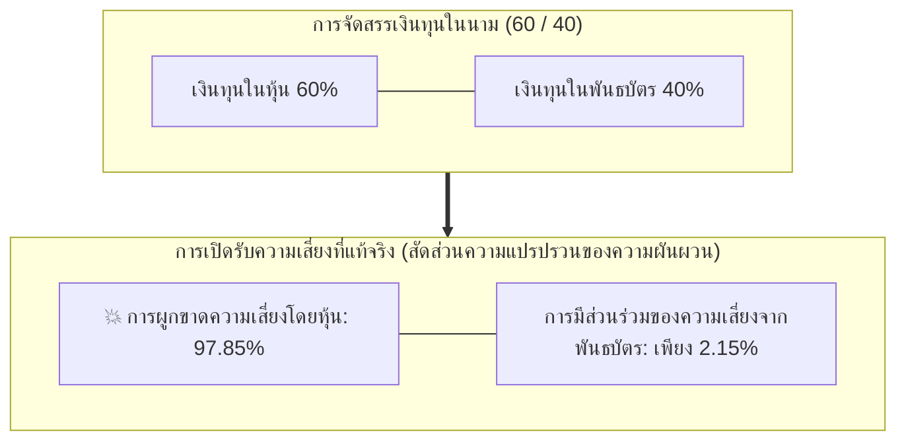
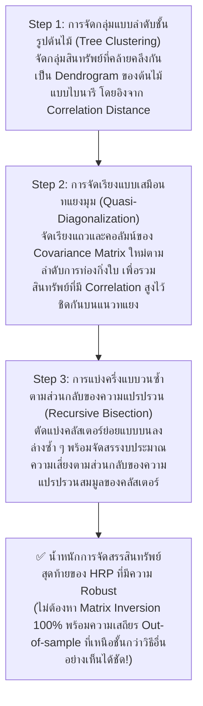

# บทที่ 26: การจัดสรรความเสี่ยงแบบเท่าเทียม (Risk Parity) กับพาริตีความเสี่ยงเชิงลำดับชั้น (Hierarchical Risk Parity, HRP)

::: tip เป้าหมายหลักของบทนี้
ไม่ใช่ทุกกลยุทธ์เชิงปริมาณ (Quant) ฝั่ง Buy-side ที่จะมีเป้าหมายเพื่อสร้างผลตอบแทนชนะดัชนีอ้างอิงเฉพาะเจาะจงอย่าง CSI 300 หรือ CSI 1000 เสมอไป ในการจัดสรรกองทุน FOF (Fund of Funds), การจัดสรรสินค้าโภคภัณฑ์หลายประเภทของกลยุทธ์ CTA หรือการลงทุนแบบมุ่งหวังผลตอบแทนสัมบูรณ์ All Weather (All Weather Absolute Return) นั้น สิ่งที่นักลงทุนแสวงหาคือ "เส้น NAV ที่ราบเรียบและก้าวข้ามได้ทั้งตลาดกระทิงและตลาดหมี"

บทนี้จะเจาะลึกถึงกับดักอันร้ายแรงของ**ความสมดุลของเงินทุนในนาม vs การผูกขาดความเสี่ยงที่แท้จริง**ในการจัดสรรแบบถ่วงน้ำหนักตามมูลค่าตลาดดั้งเดิมและพอร์ต "หุ้น-พันธบัตร 60/40"; พิสูจน์ที่มาของ**การมีส่วนร่วมของความเสี่ยงส่วนเพิ่ม (Marginal Risk Contribution, MRC)** และการหาผลเฉลยพอร์ต Equal Risk Contribution (ERC) ด้วยวิธีฟังก์ชันบาเรียร์ลอการิทึมแบบคอนเวกซ์ (Convex Logarithmic Barrier) ตาม**ทฤษฎีบทฟังก์ชันเอกพันธุ์ของออยเลอร์ (Euler's Homogeneous Function Theorem)** อย่างรัดกุม; ตลอดจนทำความเข้าใจ**อัลกอริทึม Hierarchical Risk Parity (HRP)** ที่นำเสนอโดยผู้บุกเบิกสาย Quant อย่าง Marcos López de Prado ซึ่ง**ขจัดปัญหาภาวะไม่เสถียรเชิงตัวเลขจากการหาอินเวิร์สของเมทริกซ์ความแปรปรวนร่วมเกี่ยวได้อย่างสิ้นเชิง**
:::

---

## 1. เอกสารคลาสสิกและรากฐานทฤษฎีในแวดวงอุตสาหกรรม

เอกสารอ้างอิงหลักสำหรับการสร้างระบบการจัดสรรสินทรัพย์รวมแบบ All Weather และ Risk Parity:

1. **Dalio, Ray (1996)**. *"The All Weather Strategy"*, Bridgewater Associates Research Papers.  
   > ไวต์เปเปอร์ของกลยุทธ์ All Weather ที่ริเริ่มโดย Ray Dalio ผู้ก่อตั้งกองทุน Bridgewater Associates ซึ่งนำเสนอการจัดสรรสินทรัพย์เสี่ยงอย่างเท่าเทียมตามสภาวะเศรษฐกิจมหภาคใน 4 จตุภาคของการเติบโตทางเศรษฐกิจและอัตราเงินเฟ้อเป็นครั้งแรก
2. **Qian, Edward (2005)**. *"Risk Parity Portfolios: Efficient Portfolios Through True Diversification"*, PanAgora Asset Management.  
   > เสนอคำว่า "Risk Parity" อย่างเป็นทางการเป็นครั้งแรก พร้อมทั้งพิสูจน์ความสัมพันธ์เชิงวิเคราะห์ของ MRC กับน้ำหนักเงินทุน ความผันผวนของสินทรัพย์ และความสัมพันธ์ร่วม
3. **Maillard, S., Roncalli, T., & Teïletche, J. (2010)**. *"The Properties of Equally Weighted Risk Contribution Portfolios"*, *The Journal of Portfolio Management*, 36(4): 60-70.  
   > พิสูจน์อย่างรัดกุมถึงการมีอยู่และความเป็นหนึ่งเดียวของผลเฉลยพอร์ตโฟลิโอ Equal Risk Contribution (ERC) ตลอดจนคุณสมบัติทางเรขาคณิตอันงดงามที่อยู่กึ่งกลางระหว่างพอร์ตความแปรปรวนต่ำสุดกับพอร์ตน้ำหนักเท่ากัน
4. **Spinu, Florin (2013)**. *"An Algorithm for Computing Risk Parity Weights"*, *SSRN Electronic Journal*, 2297383.  
   > เปลี่ยนระบบสมการ ERC ที่ไม่เป็นคอนเวกซ์ให้กลายเป็นปัญหาการหาค่าเหมาะสมที่สุดแบบบาเรียร์ลอการิทึมที่เป็นคอนเวกซ์แท้จริงได้อย่างสร้างสรรค์ ทำให้การคำนวณหาน้ำหนักของ Risk Parity ลู่เข้าเชิงตัวเลขได้ในระดับมิลลิวินาที
5. **López de Prado, Marcos (2016)**. *"Building Diversified Portfolios that Outperform Out of Sample"*, *The Journal of Portfolio Management*, 42(4): 59-69.  
   > นำเสนอ Hierarchical Risk Parity (HRP) โดยใช้การจัดกลุ่มแบบต้นไม้ตามทฤษฎีกราฟและการจัดเรียงแบบกึ่งทแยงมุม เพื่อล้มล้างการหาอินเวิร์สของเมทริกซ์แบบ Markowitz อย่างสิ้นเชิง แสดงให้เห็นถึงความทนทานนอกกลุ่มตัวอย่างที่ไม่มีใครเทียบได้ในตะกร้าสินทรัพย์ที่มีภาวะพหุสัมพันธ์ร่วมเชิงเส้น

---

## 2. ภาพลวงตาของการจัดสรรสินทรัพย์แบบดั้งเดิม: ความสมดุลของเงินทุนในนาม vs การผูกขาดความเสี่ยงที่แท้จริง

การจัดสรรสินทรัพย์หลากหลายแบบคลาสสิกที่โด่งดังที่สุดในโลกย่อมหนีไม่พ้น "พอร์ตหุ้น-พันธบัตร 60/40" ($60\%$ ของเงินทุนจัดสรรในดัชนีหุ้น และ $40\%$ ของเงินทุนจัดสรรในดัชนีพันธบัตรรัฐบาล)

แต่ภายใต้กล้องจุลทรรศน์แห่งความผันผวนสมัยใหม่ นี่กลับเป็นความไม่สมดุลของความเสี่ยงอย่างรุนแรง:
- ความผันผวนต่อปีของหุ้นมักอยู่ที่ประมาณ $\sigma_{\text{equity}} \approx 18\%$
- ความผันผวนต่อปีของพันธบัตรรัฐบาลมีเพียงประมาณ $\sigma_{\text{bond}} \approx 4\%$ เท่านั้น
- กำหนดให้ค่าสัมประสิทธิ์สหสัมพันธ์ระหว่างหุ้นกับพันธบัตร $\rho \approx 0$

ความแปรปรวนรวมต่อปีของพอร์ตโฟลิโอคือ:
$$\sigma_p^2 = w_E^2 \sigma_E^2 + w_B^2 \sigma_B^2 = 0.6^2 \times 0.18^2 + 0.4^2 \times 0.04^2 = 0.011664 + 0.000256 = 0.011920$$

โดยที่**สัดส่วนการมีส่วนร่วมต่อความแปรปรวนของหุ้น**สูงถึง:
$$\frac{0.011664}{0.011920} \approx \mathbf{97.85\%}!$$



ในนามแล้ว เงินทุนถึงสี่ส่วนถูกนำไปซื้อพันธบัตรที่ปลอดภัย แต่ในความเป็นจริง **ความเสี่ยงกว่า $98\%$ ของทั้งพอร์ตกลับถูกครอบงำด้วยหุ้นแต่เพียงผู้เดียว**! หากหุ้นเผชิญกับตลาดหมี ผลตอบแทนอันน้อยนิดของพันธบัตรย่อมไม่อาจกอบกู้สถานการณ์ได้เลย

แนวคิดหลักของกลยุทธ์ All Weather จาก Bridgewater จึงถือกำเนิดขึ้น: **ละทิ้งความยึดติดในการจัดสรรเงินทุนแบบเท่ากัน แล้วมุ่งสู่การทำให้แต่ละสินทรัพย์มีส่วนร่วมต่อความเสี่ยงรวมของพอร์ตโฟลิโออย่างเท่าเทียมกัน (Risk Parity)!**

---

## 3. การพิสูจน์หลักการทางคณิตศาสตร์ของ Equal Risk Contribution (ERC) แบบคลาสสิก

กำหนดให้ในตะกร้าสินทรัพย์มีสินทรัพย์ $N$ ชนิด (เช่น ดัชนีหุ้น, พันธบัตรรัฐบาล, ทองคำ, สินค้าโภคภัณฑ์ CTA, Alpha แบบเป็นกลาง) โดยมีเมทริกซ์ความแปรปรวนร่วมเกี่ยวต่อปีเป็น $\boldsymbol{\Sigma} \in \mathbb{R}^{N \times N}$ และเวกเตอร์น้ำหนักการจัดสรรเป็น $\mathbf{w} \in \mathbb{R}^N$ (สอดคล้องกับเงื่อนไข $\mathbf{1}^T \mathbf{w} = 1, \; w_i \ge 0$)

ความผันผวนรวมต่อปีของพอร์ตโฟลิโอคือ:
$$\sigma_p(\mathbf{w}) = \sqrt{\mathbf{w}^T \boldsymbol{\Sigma} \mathbf{w}}$$

### 3.1 การมีส่วนร่วมของความเสี่ยงส่วนเพิ่ม (Marginal Risk Contribution, MRC)
อนุพันธ์ย่อยของการเปลี่ยนแปลงน้ำหนักของสินทรัพย์ที่ $i$ เพียงเล็กน้อยเทียบกับความผันผวนรวมของพอร์ตโฟลิโอ ถูกนิยามเป็น Marginal Risk Contribution:

$$\text{MRC}_i = \frac{\partial \sigma_p}{\partial w_i} = \frac{\partial \sqrt{\mathbf{w}^T \boldsymbol{\Sigma} \mathbf{w}}}{\partial w_i} = \frac{(\boldsymbol{\Sigma} \mathbf{w})_i}{\sqrt{\mathbf{w}^T \boldsymbol{\Sigma} \mathbf{w}}} = \frac{(\boldsymbol{\Sigma} \mathbf{w})_i}{\sigma_p}$$
### 3.2 สัดส่วนความเสี่ยงรวม (Total Risk Contribution, TRC)
เมื่อนำน้ำหนักของสินทรัพย์ที่ $i$ มาคูณกับสัดส่วนความเสี่ยงส่วนเพิ่ม (Marginal Risk Contribution, MRC) จะได้**ค่าสัดส่วนความเสี่ยงสมบูรณ์ (Absolute Risk Contribution)** ที่สินทรัพย์นั้นส่งผลต่อพอร์ตการลงทุน:

$$\text{TRC}_i = w_i \cdot \text{MRC}_i = \frac{w_i (\boldsymbol{\Sigma} \mathbf{w})_i}{\sigma_p}$$

ตาม**ทฤษฎีบทฟังก์ชันเอกพันธุ์ของออยเลอร์ (Euler's Homogeneous Function Theorem)** เนื่องจากความผันผวนของพอร์ต $\sigma_p(\mathbf{w})$ เป็นฟังก์ชันเอกพันธุ์ระดับ 1 ของเวกเตอร์น้ำหนัก $\mathbf{w}$ (กล่าวคือ $\sigma_p(c \mathbf{w}) = c \sigma_p(\mathbf{w})$):

$$\sum_{i=1}^N \text{TRC}_i = \sum_{i=1}^N w_i \frac{\partial \sigma_p}{\partial w_i} = \frac{\mathbf{w}^T \boldsymbol{\Sigma} \mathbf{w}}{\sigma_p} = \frac{\sigma_p^2}{\sigma_p} = \sigma_p$$

**ผลรวมของ TRC จากสินทรัพย์ทั้งหมดรวมกัน จะเท่ากับความผันผวนรวมของพอร์ตอย่างสมบูรณ์แบบพอดี!**

### 3.3 เงื่อนไขสมดุลของ Equal Risk Contribution (ERC)
ERC กำหนดให้สินทรัพย์แต่ละตัวสร้างความเสี่ยงสมบูรณ์ให้กับพอร์ตในระดับที่เท่ากันทั้งหมด:

$$\text{TRC}_1 = \text{TRC}_2 = \dots = \text{TRC}_N = \frac{\sigma_p}{N}$$

กล่าวคือ สำหรับสินทรัพย์ $i, j$ คู่ใด ๆ จะต้องเป็นไปตามเงื่อนไขอย่างเคร่งครัด:
$$w_i (\boldsymbol{\Sigma} \mathbf{w})_i = w_j (\boldsymbol{\Sigma} \mathbf{w})_j, \quad \forall i, j$$

- **หลักการโดยสัญชาตญาณ**: สินทรัพย์ที่มีความผันผวนต่ำ (เช่น พันธบัตรรัฐบาล) จะได้รับน้ำหนักเงินลงทุนที่สูงมาก ขณะที่สินทรัพย์ที่มีความผันผวนสูง (เช่น หุ้น หรือสินค้าโภคภัณฑ์ล่วงหน้า) จะได้รับน้ำหนักเงินลงทุนที่ต่ำมาก เพื่อบรรลุความสมดุลของความเสี่ยงอย่างแท้จริง!

### 3.4 วิธีหาผลเฉลยประสิทธิภาพสูงด้วย Logarithmic Barrier Convex Optimization โดย Spinu (2013)
การแก้ระบบสมการไม่เชิงเส้นโดยตรงนั้นทำได้ยากยิ่ง โดย Spinu (2013) ได้พิสูจน์ว่า ERC เทียบเท่ากับการแก้ปัญหา Unconstrained Convex Optimization ดังนี้:

$$\min_{\mathbf{y}} \quad f(\mathbf{y}) = \frac{1}{2} \mathbf{y}^T \boldsymbol{\Sigma} \mathbf{y} - c \sum_{i=1}^N \ln(y_i)$$

เมื่อหาอนุพันธ์ย่อยอันดับหนึ่งและกำหนดให้เท่ากับศูนย์:
$$\nabla f(\mathbf{y}) = \boldsymbol{\Sigma} \mathbf{y} - c \begin{pmatrix} 1/y_1 \\ \vdots \\ 1/y_N \end{pmatrix} = \mathbf{0} \implies y_i (\boldsymbol{\Sigma} \mathbf{y})_i = c, \quad \forall i$$

เมื่อได้ผลเฉลยที่เหมาะสมที่สุด $\mathbf{y}^*$ แล้ว การ Normalize จะให้น้ำหนัก ERC ที่สมบูรณ์:
$$\mathbf{w}^* = \frac{\mathbf{y}^*}{\sum_{j=1}^N y_j^*}$$

---

## 4. อัลกอริทึม Hierarchical Risk Parity (HRP)

แม้ว่า ERC จะช่วยแก้ปัญหาการกระจุกตัวของความเสี่ยงได้ แต่เมื่อต้องจัดการกับกลุ่มสินทรัพย์ที่มีมิติสูงหรือมีสินทรัพย์ที่มี Correlation สูง เมทริกซ์ความแปรปรวนร่วม (Covariance Matrix) จะมีลักษณะใกล้เคียงกับ Singular Matrix ส่งผลให้ทุกวิธีที่ต้องพึ่งพา Matrix Inversion ต้องเผชิญกับ**ปัญหาความไม่เสถียรเชิงตัวเลข (Ill-Conditioned Inversion)**

ในปี 2016 ผู้บุกเบิกวงการ Quant อย่าง Marcos López de Prado ได้นำเสนอแนวคิด **Hierarchical Risk Parity (HRP)** ซึ่งผสาน Unsupervised Tree Clustering เข้ากับทฤษฎีพอร์ตการลงทุนสมัยใหม่ และ**ขจัดความจำเป็นในการหา Matrix Inversion ออกไปอย่างสิ้นเชิง**!



### 4.1 ขั้นตอนที่ 1: การจัดกลุ่มแบบลำดับชั้นรูปต้นไม้ (Tree Clustering)
1. แมปค่าสัมประสิทธิ์สหสัมพันธ์ $\rho_{i, j}$ ระหว่างสินทรัพย์แต่ละคู่ ให้เป็นระยะห่างของค่าสหสัมพันธ์ (Correlation Distance) ที่สอดคล้องกับสัจพจน์ของปริภูมิเมตริกอย่างเคร่งครัด:
   $$d_{i, j} = \sqrt{\frac{1}{2}(1 - \rho_{i, j})} \in [0, 1]$$
2. คำนวณระยะทางแบบยุคลิด (Euclidean Distance) ระหว่างเวกเตอร์ระยะห่างเพื่อสร้างระดับความคล้ายคลึงแบบแอฟฟีน:
   $$\tilde{d}_{i, j} = \sqrt{\sum_{k=1}^N (d_{k, i} - d_{k, j})^2}$$
3. ใช้อัลกอริทึม Hierarchical Clustering ผ่านฟังก์ชัน `linkage` ของ SciPy เพื่อสร้างแผนภาพต้นไม้แบบทวิภาค (Dendrogram)

### 4.2 ขั้นตอนที่ 2: การจัดเรียงแบบเสมือนทแยงมุม (Quasi-Diagonalization)
จัดเรียงแถวและคอลัมน์ของ Covariance Matrix ใหม่ตามลำดับการท่องโหนดใบ (Leaf Nodes) ของต้นไม้คลัสเตอร์ ทำให้สินทรัพย์ที่มีความคล้ายคลึงกันสูงมากและมี Correlation แน่นแฟ้นที่สุดมาอยู่ชิดกันตามแนวทแยงมุมของเมทริกซ์ เปลี่ยนโครงสร้าง Covariance Matrix ที่เดิมไม่เป็นระเบียบให้กลายเป็น**โครงสร้างเมทริกซ์แบบบล็อกทแยงมุม (Block Diagonal Matrix)** ที่ชัดเจน

### 4.3 ขั้นตอนที่ 3: การแบ่งครึ่งแบบวนซ้ำตามส่วนกลับของความแปรปรวน (Recursive Bisection)
เริ่มต้นจากโหนดรากของต้นไม้คลัสเตอร์ แล้วแบ่งเซตสินทรัพย์ปัจจุบัน $V$ ออกเป็นสองคลัสเตอร์ย่อย $V_1$ และ $V_2$ ที่ไม่ทับซ้อนกันแบบเรียกซ้ำ:
1. คำนวณความแปรปรวนรวมสมมูลของคลัสเตอร์ย่อยทั้งสองแยกกัน:
   สำหรับคลัสเตอร์ย่อย $V_1$ จะกำหนดน้ำหนักเริ่มต้นภายในตามวิธีส่วนกลับของความแปรปรวน (Inverse-Variance):
   $$\tilde{\mathbf{w}}_1 = \frac{\operatorname{diag}(\boldsymbol{\Sigma}_1)^{-1}}{\operatorname{Tr}(\operatorname{diag}(\boldsymbol{\Sigma}_1)^{-1})}$$
   ความแปรปรวนความเสี่ยงโดยรวมของคลัสเตอร์ย่อย $V_1$ คือ:
   $$\tilde{v}_1 = \tilde{\mathbf{w}}_1^T \boldsymbol{\Sigma}_1 \tilde{\mathbf{w}}_1$$
2. คำนวณความแปรปรวนรวม $\tilde{v}_2$ ของคลัสเตอร์ย่อย $V_2$ ในลักษณะเดียวกัน
3. คำนวณสัดส่วนการจัดสรรน้ำหนักระหว่างสองคลัสเตอร์ย่อย (ยิ่งความแปรปรวนต่ำ จะยิ่งได้รับน้ำหนักมาก):
   $$\alpha_1 = 1 - \frac{\tilde{v}_1}{\tilde{v}_1 + \tilde{v}_2} = \frac{\tilde{v}_2}{\tilde{v}_1 + \tilde{v}_2}, \quad \alpha_2 = 1 - \alpha_1$$
4. จัดสรรน้ำหนักรวมของคลัสเตอร์แม่ปัจจุบันลงไปแบบเรียกซ้ำตามสัดส่วน $\alpha_1, \alpha_2$ จนกระทั่งถึงโหนดใบ และได้น้ำหนักสัมบูรณ์ของสินทรัพย์แต่ละตัวในที่สุด!

---

## 5. เปรียบเทียบ 4 แนวทางการจัดสรรน้ำหนักแบบคลาสสิก

| อัลกอริทึมการจัดสรร | ข้อมูลนำเข้าที่ต้องใช้ | ต้องหา Matrix Inversion หรือไม่ | พฤติกรรมเมื่อสินทรัพย์มี Correlation สูง | ความเสถียรของ Sharpe Ratio แบบ Out-of-sample | สถานการณ์การใช้งานหลัก |
| :--- | :--- | :--- | :--- | :--- | :--- |
| **น้ำหนักเท่ากัน (Equal Weight, EW / 1/N)** | เพียงรายชื่อสินทรัพย์ | ❌ ไม่ | มีแนวโน้มกระจุกตัวในความเสี่ยงประเภทเดียวกันได้ง่าย | เกณฑ์มาตรฐานที่ทนทานมาก (มักชนะ Markowitz) | การจัดพอร์ตแบบไม่ใช้ข้อมูลคาดการณ์ใด ๆ เลย (Blind Allocation) |
| **ส่วนกลับของความแปรปรวน (Inverse-Variance Portfolio, IVP)** | เพียงความแปรปรวนของแต่ละสินทรัพย์ | ❌ ไม่ | ละเลย Correlation ระหว่างสินทรัพย์ | ค่อนข้างดี แต่อาจ Overweight ในกลุ่มสินทรัพย์ที่มี Correlation สูง | โมเดลแบบเรียบง่ายภายใต้ข้อสมมติว่าสินทรัพย์แต่ละคู่เป็นอิสระต่อกัน |
| **ความเสี่ยงเท่ากัน (Equal Risk Contribution, ERC)** | Covariance Matrix $\boldsymbol{\Sigma}$ ฉบับเต็ม | ต้องใช้วิธีประมาณการแบบวนซ้ำ | กระจายความเสี่ยงเท่ากัน แต่ได้รับผลกระทบจากความคลาดเคลื่อนในการประมาณค่าเมื่อมีมิติสูง | ปานกลางค่อนข้างสูง | การจัดพอร์ตแบบ All-Weather เพื่อสร้างสมดุลในสินทรัพย์มหภาคหลากหลายกลุ่ม |
| **Hierarchical Risk Parity (HRP)** | Covariance Matrix $\boldsymbol{\Sigma}$ ฉบับเต็ม | ❌ **ไม่ต้องหา Inversion โดยสิ้นเชิง** | **แยกสินทรัพย์ประเภทเดียวกันด้วย Tree Clustering ควบคุมความเสี่ยงตามลำดับชั้นโดยอัตโนมัติ** | **สูงมาก (งานวิจัยของ Prado พิสูจน์แล้วว่าเหนือกว่า Markowitz)** | **พอร์ต CTA หลากหลายสินค้า, กลุ่มกลยุทธ์ Multi-factor และกองทุนแม่ FOF แบบ Absolute Return** |

---
## 6. ปฏิบัติการสร้างเอนจินจัดสรรสินทรัพย์แบบ HRP ระดับโปรดักชัน

ใน `tutorial/examples/lecture_26_risk_parity_and_hrp.py` เราได้อิมพลีเมนต์ `AshareHierarchicalRiskParity` ระดับโปรดักชัน:
1. รับผลตอบแทนย้อนหลัง คำนวณ Correlation Distance อัตโนมัติ พร้อมเรียกใช้ Hierarchical Clustering ของ SciPy;
2. ดำเนินการตามวิธี Recursive Bisection เพื่อกำหนดน้ำหนัก HRP ของแต่ละหุ้นหรือกลยุทธ์;
3. คำนวณและตรวจสอบ Marginal Risk Contribution (MRC) และ Total Risk Contribution (TRC) ของแต่ละสินทรัพย์อย่างแม่นยำ;
4. แสดงรายงานการแจกแจงความเสี่ยงเปรียบเทียบระหว่าง Equal Weight (EW), Inverse Variance Portfolio (IVP) และ HRP

สามารถสั่งรันในเทอร์มินัลเพื่อทดสอบได้โดยตรง:

```bash
python3 -m examples.lecture_26_risk_parity_and_hrp
```

<<< @/examples/lecture_26_risk_parity_and_hrp.py

---

## 7. เช็กลิสต์ส่งมอบงานหลักของโมดูลที่ 6

เมื่อเรียนจบโมดูลนี้ คุณได้ก้าวข้ามคูเมืองทางคณิตศาสตร์ที่ลึกที่สุดของการลงทุนเชิงปริมาณ (Quant) ไปแล้วอย่างสิ้นเชิง — **การบริหารจัดการความเสี่ยงและการหาพอร์ตที่เหมาะสมสมัยใหม่ (Modern Portfolio and Risk Optimization Management)**:

- [x] **การแยกโครงสร้างความเสี่ยงแบบ Barra (บทที่ 23)**:
  - ทลายปัญหาคำสาปแห่งมิติของ Sample Covariance Matrix เมื่อ $N \gg T$;
  - เข้าใจการทำ Low-dimensional Projection ของ $\boldsymbol{\Sigma} = X F X^T + \Delta$, แฟกเตอร์ (Factor) สไตล์หลักทั้ง 10 กลุ่มของ CNE6, การประมาณค่า Covariance ด้วย EWMA และการทำ Bayesian Shrinkage สำหรับ Specific Variance
- [x] **การหาผลเฉลย Convex Optimization สำหรับกองทุนดัชนีเสริมผลตอบแทน (Index Enhancement) (บทที่ 24)**:
  - สร้าง Reference Implementation ระดับโปรดักชันของ Convex Optimization ด้วย cvxpy / Clarabel;
  - อิมพลีเมนต์ **Hard Neutralization เชิงอุตสาหกรรม**, **ขอบเขตการเบี่ยงเบน Market Cap** และ **ข้อจำกัด Hard Upper Bound ของ Tracking Error ที่คาดการณ์**
- [x] **ข้อจำกัด Turnover และบทลงโทษต้นทุนการซื้อขาย (บทที่ 25)**:
  - เข้าใจถึงต้นตอของปัญหาที่ทำให้ Optimizer ปรับพอร์ตจนเกิด Turnover สูงเกินไป;
  - ผสานต้นทุนภาษีและค่าธรรมเนียมเชิงเส้นแบบ L1 เข้ากับต้นทุน Market Impact แบบ L2 พร้อมพล็อตเส้นโค้ง Pareto Frontier ของผลตอบแทนส่วนเกิน (Excess Return) สุทธิหลังหักค่าธรรมเนียม
- [x] **All-Weather Hierarchical Risk Parity (บทที่ 26)**:
  - พิสูจน์ที่มาของ Marginal Risk Contribution (MRC) และทฤษฎีบทฟังก์ชันเอกพันธุ์ของออยเลอร์;
  - เชี่ยวชาญ **อัลกอริทึม Recursive Bisection ของ HRP** ที่ใช้ Graph Clustering โดยไม่ต้องทำ Matrix Inversion ซึ่งเป็นเครื่องมืออันทรงพลังสำหรับการจัดสรรสินทรัพย์หลัก

ถึงจุดนี้ สัญญาณคัดเลือกหุ้นของเราได้ผ่าน Convex Optimizer และถูกกลั่นกรองจนกลายเป็น**น้ำหนักการถือครองหุ้นเป้าหมาย $\mathbf{w}^*$** ที่ผ่านเกณฑ์การควบคุมความเสี่ยงอย่างเข้มงวด

ใน **โมดูลที่ 7: การจำลอง Backtest เสมือนจริงอย่างเข้มงวดและการสร้างแบบจำลอง Friction ในการส่งคำสั่ง** ถัดไป เราจะนำสถานะถือครองที่ Optimize ได้เข้าสู่สมรภูมิจำลองเทรดจริง (Live Trading) ที่เข้มข้นที่สุด — **เอนจิน Backtest แบบ Event-driven, ข้อจำกัดการจับคู่คำสั่ง (Matching) จริงเมื่อราคาชนเพดาน/พื้น (Price Limit) ตลอดจนการคำนวณ Slippage และ Impact อย่างละเอียดแม่นยำ**!
