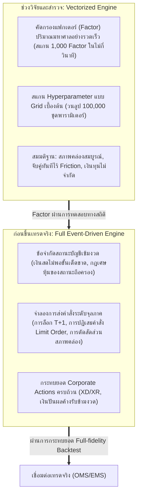
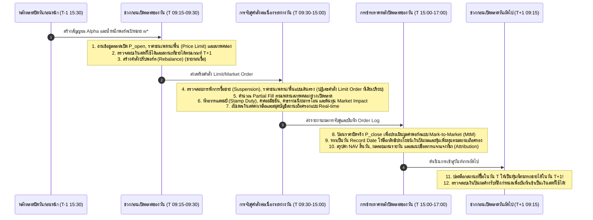

# บทที่ 27: สถาปัตยกรรม Backtest Engine สำหรับหุ้น A-Share: Vectorized vs Event-Driven

::: tip เป้าหมายหลักของบทนี้
ในกระบวนการที่งานวิจัยเชิงปริมาณ (Quant) ก้าวออกจากห้องแล็บไปสู่การเทรดจริง (Live Trading) ด้วยเม็ดเงินจริงระดับหลายร้อยล้าน **Backtest Engine** คือแนวป้องกันด่านแรกในการชี้เป็นชี้ตายของกลยุทธ์ นักวิจัย Quant มือใหม่มักยึดติดอยู่กับการทำ "Vectorized Backtest" ใน Jupyter Notebook โดยใช้ Dot Product และการหาผลรวมบนอาร์เรย์ Pandas/NumPy แล้วเข้าใจผิดว่านี่คือ NAV ที่แท้จริงในอนาคตของกลยุทธ์ ทว่าเมื่อนำไปเทรดจริง กลยุทธ์กลับเกิดปรากฏการณ์ NAV Drift อย่างรุนแรงในทันที เนื่องจากไม่สามารถจัดการข้อจำกัดทางกายภาพได้ ไม่ว่าจะเป็นการเข้าคิวรอส่งคำสั่งเมื่อเงินทุนไม่พอ, การล็อกสถานะ T+1, สภาพคล่องระหว่างวันเหือดแห้ง และการปรับสิทธิ์ Ex-dividend/Ex-right จากเงินปันผลหรือการแจกหุ้นเพิ่มทุน

บทนี้จะเจาะลึกความแตกต่างเชิงโครงสร้างระหว่าง **Vectorized Backtest กับ Event-Driven Backtest (DES)**, อนุพัทธ์ State Machine ของการเดินเวลาที่สอดคล้องกับ Market Microstructure ของหุ้น A-Share, ลงมือเขียนโค้ด**ระบบตรวจสอบกระทบยอดสองสมุดบัญชี (Cash Book และ Position Book)** ระดับโปรดักชัน พร้อมทั้งจัดระเบียบวงจรปิดแบบครบวงจร ตั้งแต่การสร้างสัญญาณ, การประเมินมูลค่าช่วงเปิดตลาด, การจับคู่คำสั่ง (Matching), การคำนวณ Mark-to-Market (MtM) ช่วงปิดตลาด ไปจนถึงการปลดล็อก T+1 ในวันถัดไปอย่างหมดจด!
:::

---

## 1. วรรณกรรมคลาสสิกและรากฐานทฤษฎีในอุตสาหกรรม

เอกสารวิชาการ Quant ระดับคลาสสิกและตำรา Market Microstructure ที่จำเป็นสำหรับการสร้างระบบ Backtest ความเที่ยงตรงสูง:

1. **López de Prado, Marcos (2018)**. *Advances in Financial Machine Learning*. John Wiley & Sons.  
   > บทที่ 11 และบทที่ 12 วิเคราะห์เจาะลึก 3 คำลวงของการทำ Backtest (Overfitting, Survivorship Bias, Look-ahead Bias) พร้อมวางมาตรฐานอุตสาหกรรมสำหรับการจำลองแบบ Event-Driven (Event-Driven Simulation) และ Synthetic Stress Testing
2. **Harris, Larry (2003)**. *Trading and Exchanges: Market Microstructure for Practitioners*. Oxford University Press.  
   > คู่มืออ้างอิงชั้นนำด้าน Market Microstructure ที่อธิบายอย่างละเอียดเกี่ยวกับประเภทคำสั่ง, กลไก Matching ของ Limit Order Book (LOB), Time Slicing ของการซื้อขาย ตลอดจนกระบวนการชำระราคาและส่งมอบหลักทรัพย์
3. **Farmer, J. Doyne, & Foley, Duncan (2009)**. *"The economy needs agent-based modelling"*, *Nature*, 460(7256): 685-686.  
   > อธิบายถึงความสำคัญที่ไม่อาจทดแทนได้ของ Agent-based Modeling และ Discrete Event Simulation (DES) ในการตรวจจับ Non-linear Feedback และ Liquidity Shock ในตลาดการเงิน
4. **Cont, Rama (2001)**. *"Empirical properties of asset returns: stylized facts and statistical issues"*, *Quantitative Finance*, 1(2): 223-236.  
   > สรุปคุณลักษณะเชิงประจักษ์ของผลตอบแทนสินทรัพย์ทางการเงินทั้งความถี่สูงและรายวันในเรื่อง Fat Tail, Volatility Clustering และ Autocorrelation ของโครงสร้างจุลภาค

---

## 2. การเปรียบเทียบเชิงเทคนิคเชิงลึกของ 2 สถาปัตยกรรม Backtest

ในไปป์ไลน์การวิจัยและพัฒนาของฝั่ง Buy-side ระบบ Vectorized และ Event-Driven ไม่ใช่ขั้วตรงข้ามที่ต้องเลือกอย่างใดอย่างหนึ่ง แต่เป็นเครื่องยนต์คู่ที่ตอบโจทย์ขั้นตอนการวิจัยที่ต่างกัน:



| มิติการประเมิน | Vectorized Backtest (Vectorized Engine) | Event-Driven Backtest (Event-Driven DES Engine) |
| :--- | :--- | :--- |
| **โครงสร้างข้อมูลพื้นฐาน** | 2D/3D Dense Matrix (เวกเตอร์ Dot Product ด้วย NumPy / Polars) | คิวของเหตุการณ์แยกย่อย (Time Queue), สมุดคำสั่งซื้อขาย และบัญชีแยกประเภทแบบคู่ |
| **ความซับซ้อนของเวลาในการคำนวณ** | $O(T \times N)$, เร่งความเร็วแบบขนานด้วย GPU/SIMD, ทำ Backtest ข้อมูลหลายปีเสร็จในระดับมิลลิวินาที | $O(\sum \text{Events})$, อัปเดตสถานะทีละเหตุการณ์ โดยทั่วไปใช้เวลาหลักวินาทีถึงหลายนาที |
| **การจัดการข้อจำกัดด้านเงินทุน** | ❌ ไม่สามารถติดตามเงินสดแบบไดนามิกได้; ถือน้ำหนักเป้าหมายรวมกันเป็น 1 เสมือนว่ามีเงินทุนไม่จำกัด | ✅ ผูกกับยอดเงินสดคงเหลือที่ใช้ได้จริงอย่างเข้มงวด; เมื่อเงินไม่พอจะลดขนาดคำสั่งตามลำดับความสำคัญหรือปฏิเสธคำสั่งโดยอัตโนมัติ |
| **การจัดการ T+1 และสถานะที่ถูกล็อก** | ❌ ไม่สามารถแยกแยะระหว่างหุ้นที่เพิ่งซื้อในงวดปัจจุบันกับหุ้นเดิมที่ขายได้ | ✅ ติดตามปฏิทินการแยกสถานะถือครองอย่างแม่นยำ; การซื้อ ณ สิ้นวันจะเข้าสู่สถานะล็อก และปลดล็อกเมื่อเปิดตลาดวันถัดไป |
| **สภาพคล่องและการเข้าคิวรอคำสั่ง** | ❌ สมมติว่าไม่ว่าคำสั่งซื้อขายจะใหญ่เพียงใดก็สามารถจับคู่ได้ $100\%$ ที่ราคาปิด | ✅ กำหนดไม่ให้การจับคู่ต่อหนึ่งคำสั่งเกิน $10\% \sim 20\%$ ของปริมาณการซื้อขายช่วงเปิดตลาด/ทั้งวัน; ส่วนที่เกินจะจับคู่ได้บางส่วนหรือถูกยกเลิก |
| **กระแสเงินสดจากการขึ้นเครื่องหมาย XD/XR** | ❌ พึ่งพาราคาปรับสิทธิ์แบบหยาบๆ ซึ่งบดบังความเสี่ยงที่กระแสเงินสดสะดุดในวันที่เงินปันผลเข้าจริง | ✅ ล็อกสิทธิปันผลในวัน Record Date, บันทึกสินทรัพย์ค้างรับในวัน Ex-date, ปลดล็อกเป็นเงินสดพร้อมใช้ในวันจ่ายปันผล |
| **โปรเจกต์โอเพนซอร์สตัวแทน** | vectorbt, pyfolio, fastquant | Backtrader, Zipline-reloaded, Qlib, NautilusTrader |

---

## 3. State Machine การเดินเวลาแบบไม่ต่อเนื่องเสมือนจริงของหุ้น A-Share ในหนึ่งวันทำการ

เพื่อขจัดปัญหา Look-ahead Bias แอบแฝงอย่างเด็ดขาด Event-Driven Engine จะต้องสร้าง **State Machine ของการเดินเวลา** ที่สอดคล้องกับกฎระเบียบการชำระราคาของตลาดหลักทรัพย์เซี่ยงไฮ้และเซินเจิ้นอย่างเคร่งครัด:


### หลักการจุดเวลาสำคัญ:
1. **ความเข้มงวดของจุดเวลาตัดสินใจ**: การตัดสินใจปรับพอร์ต (Rebalance) ณ เวลาเปิดตลาดของวันที่ $t$ **จะต้องอ่านได้เฉพาะฟีเจอร์และข้อมูลตลาดของวันที่ $t-1$ และก่อนหน้าเท่านั้น**; ฟังก์ชันการส่งคำสั่งต้องบังคับตรวจสอบ `signal_date < trade_date`;
2. **การแยกการประเมินมูลค่าตอนเปิดตลาดและปิดตลาดอย่างเด็ดขาด**: การจับคู่คำสั่ง (Matching) ตอนเปิดตลาดสามารถใช้ได้เฉพาะ $P_{\text{open}}$ เท่านั้น โดยห้ามแอบดู $P_{\text{high}}, P_{\text{low}}, P_{\text{close}}$ ของวันเดียวกันในลอจิก matching ตอนเปิดตลาดโดยเด็ดขาด;
3. **ขายก่อนซื้อ วงจรเงินทุนปิด**: ภายใต้เงื่อนไขที่เงินสดมีจำกัด การปรับพอร์ตต้องปฏิบัติตามกฎเหล็ก "ทำการ matching คำสั่งขายก่อนเพื่อปลดปล่อยเงินสดที่ใช้ได้ แล้วจึงค้นหาและ matching คำสั่งซื้อตามขนาดเงินทุนที่ใช้ได้จริง"

---

## 4. สมการบัญชีพอร์ต Quant ยุคใหม่และระบบบัญชีคู่

ในระบบ Backtest ระดับโปรดักชัน กำไรที่โผล่ขึ้นมาลอยๆ หรือค่าธรรมเนียมที่หายไปอย่างไร้ร่องรอยล้วนเป็นหายนะ บัญชีในทุกจุดเวลาย่อย $t$ จะต้องสอดคล้องกับ**สมการบัญชี**อย่างเคร่งครัด:

$$E_t = C_t + D_t^{\text{receivable}} + \sum_{i=1}^N Q_{i, t} P_{i, t}$$

โดยที่:
- $E_t$：**มูลค่าสินทรัพย์สุทธิรวมของพอร์ตโฟลิโอ (Equity / NAV)**;
- $C_t$：**ยอดเงินสดคงเหลือที่ใช้ได้ในปัจจุบัน (Available Cash)** ซึ่งสามารถนำไปใช้ซื้อหุ้นใหม่ได้ทันที;
- $D_t^{\text{receivable}}$：**เงินปันผลค้างรับ/เงินรอเข้าบัญชี (Dividends Receivable)** ซึ่งได้รับการยืนยันผ่านวันกำหนดรายชื่อผู้ถือหุ้นแล้ว และถูกนับรวมใน NAV รวมของกองทุน แต่ก่อนถึงวันจ่ายเงินปันผลจริง **ห้ามนำมาใช้เป็นเงินสดสำหรับซื้อหุ้นโดยเด็ดขาด**;
- $Q_{i, t}$：จำนวนหุ้นที่ถือครองรวมปัจจุบันของหุ้นตัวที่ $i$ (รวมหุ้นปกติที่ขายได้, หุ้นที่ถูกล็อกจากการซื้อในวันนี้ และหุ้นปันผล/หุ้นเพิ่มทุนที่ยังไม่เข้าตลาด);
- $P_{i, t}$：ราคา Mark-to-market ปัจจุบัน (การประเมินมูลค่าตอนเปิดตลาดใช้ $P_{\text{open}}$ การประเมินมูลค่าสิ้นวันใช้ $P_{\text{close}}$)

### 4.1 การอัปเดตระบบบัญชีคู่เมื่อคำสั่งซื้อจับคู่สำเร็จ
เมื่อซื้อหุ้นจำนวน $Q_{\text{fill}}$ หุ้นสำเร็จที่ราคา $P_{\text{fill}}$:
$$\begin{cases}
C_{t+} = C_{t-} - Q_{\text{fill}} P_{\text{fill}} - \text{Fee}_{\text{buy}} - \text{Impact}_{\text{buy}} \\
Q_{i, t+}^{\text{total}} = Q_{i, t-}^{\text{total}} + Q_{\text{fill}} \\
Q_{i, t+}^{\text{sellable}} = Q_{i, t-}^{\text{sellable}} \quad (\text{ล็อก T+1 จำนวนหุ้นที่ขายได้จะไม่เพิ่มขึ้นเด็ดขาด!})
\end{cases}$$

### 4.2 การอัปเดตระบบบัญชีคู่เมื่อคำสั่งขายจับคู่สำเร็จ
เมื่อขายหุ้นจำนวน $Q_{\text{fill}}$ หุ้นสำเร็จที่ราคา $P_{\text{fill}}$:
$$\begin{cases}
C_{t+} = C_{t-} + Q_{\text{fill}} P_{\text{fill}} - \text{Fee}_{\text{sell}} - \text{Impact}_{\text{sell}} \\
Q_{i, t+}^{\text{total}} = Q_{i, t-}^{\text{total}} - Q_{\text{fill}} \\
Q_{i, t+}^{\text{sellable}} = Q_{i, t-}^{\text{sellable}} - Q_{\text{fill}}
\end{cases}$$

---

## 5. เวิร์กช็อปจริง: Event-Driven Engine ระดับอุตสาหกรรม

ใน `tutorial/examples/lecture_27_vectorized_vs_event_driven_backtest.py` เราได้สร้าง `AshareEventDrivenEngine` ระดับโปรดักชัน:
1. พัฒนา `PositionLedger` (สมุดบัญชีสถานะการถือครอง) และ `CashLedger` (สมุดบัญชีเงินสด);
2. ดำเนินการตามปฏิทินการซื้อขายอย่างเคร่งครัด รองรับการปลดล็อก T+1 แบบไดนามิกและการจัดการเศษหุ้น (Lot Rule);
3. แยกการประเมินมูลค่าตอนเปิดตลาดและปิดตลาดทางกายภาพอย่างเข้มงวด รองรับการจับคู่คำสั่งได้บางส่วนและการปรับลดขนาดคำสั่งเมื่อเงินทุนไม่พอโดยสมบูรณ์;
4. แสดงผลลำดับสแนปช็อตงบแสดงฐานะการเงินแบบรายวันเพื่อใช้ในการกระทบยอดบัญชี

สามารถรันตรวจสอบได้โดยตรงบนเทอร์มินัล:

```bash
python3 -m examples.lecture_27_vectorized_vs_event_driven_backtest
```

<<< @/examples/lecture_27_vectorized_vs_event_driven_backtest.py

---

## 6. การคัดเลือกเฟรมเวิร์ก Event-Driven Backtest แบบโอเพนซอร์สที่เสถียรและการเปรียบเทียบกับการเทรดจริง

| ชื่อเฟรมเวิร์ก | แกนหลักภาษา | จุดเด่นด้านสถาปัตยกรรม | ระดับการปรับแต่งให้เข้ากับหุ้น A-Share | การรองรับเกตเวย์เทรดจริงระดับโปรดักชัน | บริบทสถาบันที่เหมาะสม |
| :--- | :--- | :--- | :--- | :--- | :--- |
| **Backtrader** | Python | Event-driven แบบหลวมสุดคลาสสิก รองรับการซิงค์ข้อมูลหลายสตรีมและ Analyzers ที่กำหนดเอง | ปานกลาง (ต้องห่อหุ้ม T+1 และอากรแสตมป์ (Stamp Duty) เอง) | รองรับ Interactive Brokers, Oanda | กองทุนเอกชน (Private Fund) ขนาดกลางและเล็ก, การสอน Quant และการสร้างต้นแบบเทรดจริง (Live Trading) อย่างรวดเร็ว |
| **Zipline-reloaded** | Python / Cython | มรดกจาก Quantopian, การ matching เสมือนจริงทั้งระดับ Intraday/รายวัน, มี Pipeline ในตัวสำหรับจัดเรียงแฟกเตอร์ (Factor) | ต้องปรับแต่งให้เข้ากับกฎหุ้น A-Share ผ่านไลบรารีภายนอก (เช่น pyfolio) | ต่ำ (เน้นงานวิจัย) | การวิจัย Quant เชิงปัจจัยพื้นฐานแบบมัลติแฟกเตอร์ในตลาดหุ้นสหรัฐฯ |
| **Qlib** | Python / C++ | โอเพนซอร์สจาก Microsoft ออกแบบมาสำหรับ Quant ฝั่ง AI/ML โดยเฉพาะ รองรับการผสมผสานระหว่าง Vectorized และ Event-driven | สูงมาก (รองรับข้อมูลรายวันของหุ้น A-Share, การปรับสิทธิ์ราคา และการประเมิน Alpha แบบเนทีฟ) | ต้องเชื่อมต่อกับระบบเกตเวย์เทรดเอง | ทีม Quant ชั้นนำสาย Machine Learning มัลติแฟกเตอร์ความถี่ระดับกลาง |
| **NautilusTrader** | Rust / Python | Discrete Event Simulation (DES) มัลติเธรดอะซิงโครนัสประสิทธิภาพสูง ประทับเวลาในระดับนาโนวินาที ออกแบบมาเพื่อความถี่สูงโดยเฉพาะ | ค่อนข้างต่ำ (ต้องพัฒนากฎหุ้น A-Share และแหล่งข้อมูลเอง) | รองรับคริปโตกระแสหลักและโปรโตคอล FIX ของตลาดต่างประเทศแบบเนทีฟ | HFT ความถี่สูง, Statistical Arbitrage และ Market Maker ที่ต้องการความหน่วงต่ำ |

---

## 7. สรุปบทนี้และคำถามทดสอบความเข้าใจหลัก

| หัวข้อทดสอบหลัก | ประเด็นคำตอบมาตรฐานอุตสาหกรรม | กับดักทางวิศวกรรม/วิชาการที่พบบ่อย |
| :--- | :--- | :--- |
| **ข้อบกพร่องร้ายแรงที่สุดของ Vectorized Backtest คืออะไร?** | ไม่สามารถจัดการกับความขึ้นต่อกันของเงินทุน, ความขึ้นต่อกันของสถานะ และการหยุดชะงักของสภาพคล่อง โดยตั้งสมมติฐานว่าหุ้นที่ซื้อไม่ได้หรือพักการซื้อขาย (Suspension) สามารถจับคู่คำสั่งได้แบบไร้แรงเสียดทาน | นำเส้น Sharpe Ratio สูงๆ จาก Vectorized ที่ไม่ได้หักภาษีและไม่มีข้อจำกัด T+1 ไปหลอกระดมทุน พอขึ้นเทรดจริงพอร์ตก็ระเบิดทันที |
| **กลไก T+1 ใน Event-driven Engine จำลองแบบเคร่งครัดอย่างไร?** | แยกสถานะการถือครองเป็น `total_shares` และ `sellable_shares`; การซื้อระหว่างวันจะเพิ่มเฉพาะจำนวนหุ้นรวมเท่านั้น แล้วค่อยโอนหุ้นที่ถือครองปกติไปยังจำนวนหุ้นที่ขายได้เมื่อเริ่มวันถัดไป | เผลอใส่หุ้นที่ซื้อในวันนั้นเข้าไปในจำนวนที่ขายได้โดยตรง ทำให้เกิดการขายหมุนเวียนรอบ T+0 ที่ผิดกฎระเบียบภายในวันเดียวกัน |
| **จะป้องกันการรั่วไหลของข้อมูลในอนาคตในลอจิก matching ตอนเปิดตลาดได้อย่างไร?** | แยกอินเทอร์เฟซเปิดตลาดและปิดตลาดทางกายภาพอย่างเข้มงวด การ matching จะรับเฉพาะราคาเปิดเท่านั้น ห้ามส่งค่า High, Low, Close ของวันนั้นเข้าไปโดยเด็ดขาด | ฟังก์ชัน matching อ่านราคาเฉลี่ยทั้งวันหรือราคาต่ำสุดจากออบเจกต์ Bar ของวันนั้นโดยตรงเพื่อตัดสินการจับคู่คำสั่ง ทำให้เกิดช่องโหว่ Look-ahead Bias ร้ายแรง |

หลังจากวางโครงสร้างของ Event-driven Engine ชัดเจนแล้ว ความสมจริงของผลลัพธ์ Backtest จะขึ้นอยู่กับ**การคำนวณต้นทุนแรงเสียดทานการซื้อขายเบื้องลึก**อย่างมีนัยสำคัญ

ในบทถัดไป เราจะเข้าสู่ **บทที่ 28: การจำลองแรงเสียดทานการซื้อขายจริงแบบสมบูรณ์** เจาะลึกการคำนวณอากรแสตมป์, ค่าคอมมิชชันขั้นต่ำระดับสถาบัน และ**แบบจำลองต้นทุน Market Impact ตามกฎ Square-Root Law** อันโด่งดัง!
