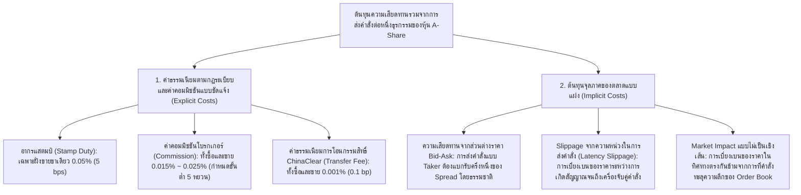
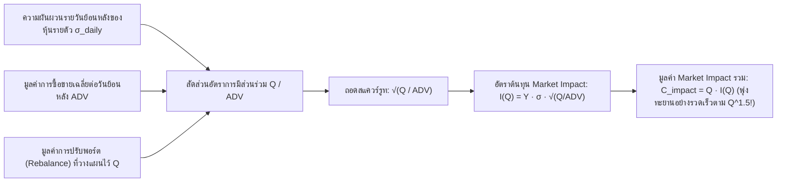
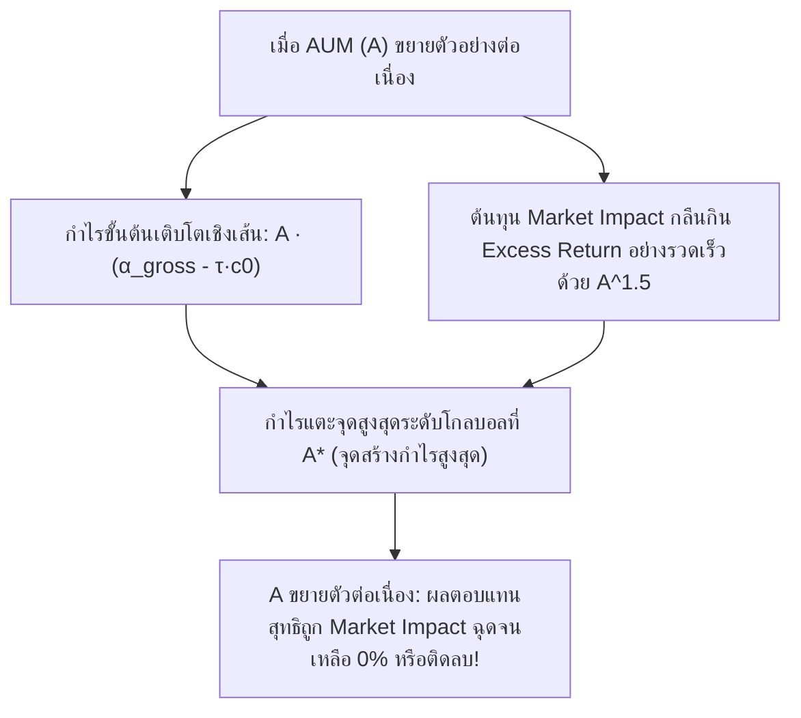

# บทที่ 28: การจำลองความเสียดทานในการเทรดจริงเต็มรูปแบบ

::: tip เป้าหมายหลักของบทนี้
ในสถาบันฝั่ง Buy-side เชิงปริมาณ (Quant) มีคำกล่าวชื่อดังว่า: “**มือสมัครเล่นศึกษาผลตอบแทน มืออาชีพศึกษาความเสี่ยง แต่ผู้เชี่ยวชาญระดับท็อปศึกษาต้นทุนการทำธุรกรรม**”

โมเดลชั้นยอดจำนวนมากที่ทำผลตอบแทนส่วนเกิน (Excess Return) ต่อปีได้ถึง $30\%$ ในห้องทดลอง เมื่อนำไปเทรดจริง (Live Trading) แล้ว ผลตอบแทนส่วนเกินกลับถูกความเสียดทานในการเทรด (Trading Friction) กลืนหายไปอย่างรวดเร็ว หรือกระทั่งเกิดการแย่งชิงสภาพคล่อง (Liquidity Stampede) จนขาดทุนเมื่อขนาดเงินทุนขยายใหญ่ขึ้น บทนี้จะแยกโครงสร้างต้นทุนของหุ้น A-Share อย่างเป็นระบบ ทั้ง**ต้นทุนการเทรดแบบชัดแจ้ง (Explicit Costs: อากรแสตมป์ (Stamp Duty), ค่าคอมมิชชันสถาบัน, ค่าธรรมเนียมการโอนกรรมสิทธิ์ และเกณฑ์ค่าคอมมิชชันขั้นต่ำ)** และ**ต้นทุนการส่งคำสั่งแบบแฝง (Implicit Costs: ส่วนต่างราคา Bid-Ask และต้นทุน Market Impact)**; พิสูจน์ที่มาของ**แบบจำลอง Market Impact ตามกฎสแควร์รูท (Square-Root Law)** อันโด่งดังในแวดวงจุลภาคโครงสร้างตลาดอย่างเข้มงวด; พร้อมทั้งใช้แคลคูลัสทางคณิตศาสตร์ที่รัดกุมเพื่อหาผลเฉลยแบบปิด (Closed-form Analytical Solution) ของ**ขนาดสินทรัพย์ภายใต้การบริหารสูงสุดของกลยุทธ์ (AUM Capacity) และจุดสูงสุดของกำไรเงินทุน**!
:::

---

## 1. เอกสารคลาสสิกและรากฐานทฤษฎีในภาคอุตสาหกรรม

เอกสารคลาสสิกหลักและหมุดหมายทางวิชาการในด้านความเสียดทานในการเทรดและการส่งคำสั่งที่เหมาะสมที่สุด (Optimal Execution):

1. **Almgren, R., Thum, C., Hauptmann, E., & Li, H. (2005)**. *"Equity market impact"*, *Risk*, 18(7): 58-62.  
   > อ้างอิงจากคำสั่งซื้อขายขนาดใหญ่ของสถาบันจริงหลายแสนรายการจาก Citigroup เพื่อทดสอบเชิงประจักษ์กับแบบจำลองผลกระทบแบบไม่เป็นเชิงเส้น ภายใต้ความผันผวนของตลาด ความเร็วในการปรับพอร์ต (Rebalance) และสภาพคล่องของหุ้นที่แตกต่างกัน
2. **Bouchaud, J.-P., Farmer, J. D., & Lillo, F. (2009)**. *"How markets slowly digest changes in supply and demand"*, *Handbook of Financial Markets: Dynamics and Evolution*. North-Holland.  
   > บทความปริทัศน์ระดับแนวหน้าด้านโครงสร้างจุลภาคของตลาดระดับโลก ซึ่งพิสูจน์โดยละเอียดว่าคุณลักษณะความเว้าของความลึกในสมุดคำสั่งลิมิต (Limit Order Book: LOB) คือรากฐานทางกายภาพที่ทำให้เกิดกฎสแควร์รูทของ Market Impact
3. **Tóth, B., Lemperiere, Y., Deremble, C., de Lataillade, J., Kockelkoren, J., & Bouchaud, J.-P. (2011)**. *"Anomalous Price Impact and the Emergence of Arbitrage in Worldwide Markets"*, *Physical Review X*, 1(2): 021006.  
   > การศึกษาเชิงประจักษ์ขนาดใหญ่ครอบคลุมตลาดหุ้นสหรัฐฯ หุ้นยุโรป สินค้าโภคภัณฑ์ และตลาดฟิวเจอร์ส ซึ่งพิสูจน์ว่ากฎ Square-Root Law $I(Q) \propto \sigma \sqrt{Q/\text{ADV}}$ เป็นจริงและใช้ได้ทั่วไปในทุกประเภทสินทรัพย์
4. **Kissell, Robert (2013)**. *The Science of Algorithmic Trading and Portfolio Management*. Academic Press.  
   > ผลงานระดับแถวหน้าในภาคอุตสาหกรรมด้าน Algorithmic Trading และการวิเคราะห์ต้นทุนการเทรด (Transaction Cost Analysis: TCA) ซึ่งนำเสนอระบบการวัดผลสำหรับส่วนต่างราคา Bid-Ask, Slippage จากความหน่วง (Latency Slippage) และ Implementation Shortfall

---

## 2. โครงสร้างต้นทุนการเทรดจริงของหุ้น A-Share: ค่าธรรมเนียมตามกฎระเบียบแบบชัดแจ้ง vs Market Impact แบบแฝง



### 2.1 กฎการคิดคำนวณต้นทุนแบบชัดแจ้งรายธุรกรรม

สำหรับคำสั่งซื้อขายที่มีมูลค่าการจับคู่ $Q$ หยวนต่อธุรกรรม กฎการคำนวณค่าธรรมเนียมแบบชัดแจ้งครบวงจรมีดังนี้:

| รายการต้นทุน | ทิศทางการเก็บค่าธรรมเนียม | อัตราค่าธรรมเนียมมาตรฐานปัจจุบันของหุ้น A-Share | ข้อจำกัดเกณฑ์ขั้นต่ำ | ฐานการคำนวณและประเด็นสำคัญในทางปฏิบัติ |
| :--- | :--- | :--- | :--- | :--- |
| **อากรแสตมป์ (Stamp Duty)** | เรียกเก็บ**เฉพาะฝั่งขาย** | $0.05\%$ (5 ในหมื่น, 5 bps) | ไม่มีเกณฑ์ขั้นต่ำ | ภาษีของรัฐบาล ปรับลดลงครึ่งหนึ่งในเดือนสิงหาคม 2023; ทั้งกองทุนรวมและกองทุนเอกชน (Private Fund) ไม่มีสิทธิได้รับการยกเว้น |
| **ค่าคอมมิชชันโบรกเกอร์ (Commission)** | **ทั้งฝั่งซื้อและฝั่งขาย** | ลูกค้ารายใหญ่สถาบัน Buy-side อยู่ที่ประมาณ $0.015\% \sim 0.025\%$ | บัญชีลูกค้ารายย่อยกำหนดขั้นต่ำ 5 หยวนต่อธุรกรรม; บัญชีแม่-ลูกระดับสถาบันมักจะเฉลี่ยและสรุปยอดเป็นรายเดือน | รวมค่าธรรมเนียมการส่งคำสั่งของตลาดหลักทรัพย์และค่าธรรมเนียมการกำกับดูแลของ ก.ล.ต. |
| **ค่าธรรมเนียมการโอนกรรมสิทธิ์หลักทรัพย์ (Transfer Fee)** | **ทั้งฝั่งซื้อและฝั่งขาย** | $0.001\%$ (1 ในแสน, 0.1 bp) | ไม่มีเกณฑ์ขั้นต่ำ | เรียกเก็บโดยศูนย์รับฝากและชำระบัญชีหลักทรัพย์แห่งประเทศจีน (ChinaClear) |

> [!WARNING] กับดักค่าคอมมิชชันขั้นต่ำ (Minimum Commission Trap)
> ในการ Backtest โมเดลเชิงปริมาณ หากไม่ได้ตั้งเกณฑ์ค่าคอมมิชชันขั้นต่ำ 5 หยวนไว้: เมื่อกลยุทธ์ Rebalance กระจายไปยังหุ้น 500 ตัว โดยแต่ละตัวปรับพอร์ตเพียง 1,000 หยวน อัตราค่าคอมมิชชันที่แท้จริงจะกลายเป็น $5 / 1000 = 0.50\%$ (50 ในหมื่น!) ซึ่งสูงกว่าอัตราที่คาดไว้ถึง 30 เท่า! สิ่งนี้จะทำให้กลยุทธ์ที่มีความถี่สูงและ Rebalance ด้วยเงินจำนวนน้อยขาดทุนอย่างรุนแรงในการเทรดจริง

---

## 3. แบบจำลอง Market Impact ตามกฎสแควร์รูท (Square-Root Law)

เมื่อมูลค่าการปรับพอร์ตมีขนาดใหญ่มาก Market Impact แบบแฝงจะพุ่งแซงภาษีและค่าธรรมเนียมแบบชัดแจ้งอย่างรวดเร็ว จนกลายเป็นตัวการสำคัญอันดับหนึ่งที่กลืนกินกำไรของกลยุทธ์

### 3.1 การพิสูจน์สูตรกฎ Market Impact แบบสแควร์รูท
จากการพิสูจน์ทางฟิสิกส์ระดับจุลภาคโดย Bouchaud et al. (2009) และ Tóth et al. (2011) เมื่อคำสั่งซื้อขายขนาดใหญ่ถูกส่งเข้าไปในสมุดคำสั่งลิมิตแบบต่อเนื่อง อัตราผลกระทบสัมพัทธ์ต่อราคาในทันที $I(Q)$ ไม่ได้เพิ่มขึ้นเป็นเส้นตรงตามปริมาณการซื้อขาย แต่กลับแสดง**กฎสแควร์รูทที่มีคุณลักษณะแบบฟังก์ชันเว้า (Sub-linear Square-Root Law)** อย่างสอดคล้องกันเป็นอย่างยิ่ง:

$$I(Q) = Y \cdot \sigma_{\text{daily}} \sqrt{\frac{Q}{\text{ADV}}}$$

โดยที่:
- $Q$: มูลค่าการซื้อขายที่วางแผนไว้ของคำสั่งซื้อขายปัจจุบัน (หยวน);
- $\text{ADV}$: มูลค่าการซื้อขายเฉลี่ยต่อวันย้อนหลัง 20 วันที่ทราบก่อนการตัดสินใจปรับพอร์ตของหุ้นดังกล่าว (หยวน);
- $\frac{Q}{\text{ADV}}$: สัดส่วนของคำสั่งซื้อขายต่อมูลค่าการซื้อขายเฉลี่ยต่อวัน (Participation Ratio);
- $\sigma_{\text{daily}}$: ความผันผวนของผลตอบแทนรายวันของหุ้นรายตัวในช่วง 60 วันทำการล่าสุด;
- $Y$: ค่าคงที่สัดส่วนเชิงประจักษ์แบบไร้มิติ ค่าเชิงประจักษ์ในตลาดพัฒนาแล้วทั่วโลกอยู่ที่ประมาณ $Y \approx 0.5 \sim 0.7$
### 3.2 การขยายตัวแบบไม่เป็นเชิงเส้นของมูลค่าต้นทุน Market Impact
เนื่องจากมูลค่าต้นทุน Market Impact เท่ากับมูลค่าการซื้อขายคูณด้วยอัตรา Market Impact:

$$C_{\text{impact}}(Q) = Q \cdot I(Q) = Y \cdot \sigma_{\text{daily}} \cdot \frac{Q^{3/2}}{\sqrt{\text{ADV}}}$$

- **ผลกระทบจากการขยายตัวตามกฎกำลัง (Power Law Amplification Effect)**: หากมูลค่าการซื้อขายต่อคำสั่ง $Q$ เพิ่มขึ้น 4 เท่า อัตราต้นทุน Market Impact $I(Q)$ จะเพิ่มขึ้น $\sqrt{4} = 2$ เท่า แต่**มูลค่าต้นทุน Market Impact รวม $C_{\text{impact}}$ จะพุ่งทะยานขึ้นถึง $4^{3/2} = 8$ เท่า!**



---

## 4. การประเมิน Capacity ของกลยุทธ์ตาม AUM และผลเฉลยแม่นตรงจุดกำไรสูงสุด

ในตอนนี้ เราจะรวม Friction ของการซื้อขาย, อัตรา Turnover และขนาดสินทรัพย์ภายใต้การบริหารเข้าด้วยกันในสมการพีชคณิตที่รัดกุม เพื่ออนุพัทธ์หา **Capacity การบริหารระดับทองคำของกลยุทธ์ (Optimal AUM Capacity)** ที่สถาบันเชิงปริมาณ (Quant) ฝั่ง Buy-side ให้ความสนใจมากที่สุด

### 4.1 การกำหนดสัญลักษณ์และการอนุพัทธ์ต้นทุนแบบปรับเป็นรายปี
กำหนดให้:
- $A$：มูลค่าสินทรัพย์สุทธิภายใต้การบริหารของกลยุทธ์ (AUM, หยวน);
- $\tau$：**Turnover รายปีแบบขาเดียว**ที่กลยุทธ์กำหนด (Annual Single-Sided Turnover);
- $D = 250$：จำนวนวันทำการซื้อขายตลอดทั้งปี;
- $N$：จำนวนหุ้นเฉลี่ยที่ถือครองในพอร์ตโฟลิโอ;
- $\overline{\text{ADV}}$：มูลค่าการซื้อขายเฉลี่ยต่อวันเฉลี่ยของ Universe หุ้น;
- $\bar{\sigma}$：ความผันผวนรายวันเฉลี่ยของ Universe หุ้น;
- $s = 0.05\%$：อากรแสตมป์ (Stamp Duty) ขาเดียวฝั่งขาย; $t = 0.001\%$：ค่าธรรมเนียมการโอนสองทาง; $c = 0.015\%$：อัตราค่านายหน้าสองทาง

ในแต่ละวันทำการซื้อขาย มูลค่าการปรับพอร์ตขาเดียวของหุ้นรายตัวคือ:
$$q = \frac{A \cdot \tau}{D \cdot N}$$

ภายใต้สมมติฐานที่ค่านายหน้าขั้นต่ำไม่มีผลบังคับ สัดส่วนอัตราค่าธรรมเนียมรวมตลอดทั้งปีที่เกิดจาก Friction ในการซื้อขายต่อ AUM คือ:

$$C_{\text{annual}}(A) = \tau \left[ \underbrace{s + 2t + 2c}_{\text{อัตราภาษีและค่าธรรมเนียมเชิงเส้น } c_0} + \underbrace{2 Y \bar{\sigma} \sqrt{\frac{A \tau}{D N \overline{\text{ADV}}}}}_{\text{อัตราต้นทุน Market Impact แบบไม่เป็นเชิงเส้น}} \right]$$

### 4.2 ฟังก์ชันผลตอบแทนส่วนเกินสุทธิหลังหักค่าธรรมเนียมและกำไรรวม
กำหนดให้**ผลตอบแทนส่วนเกิน (Excess Return) รายปีที่คาดหวังขั้นต้น**ของกลยุทธ์ก่อนหัก Friction คือ $\alpha_{\text{gross}}$

**อัตรา Excess Return รายปีสุทธิ**ของกลยุทธ์หลังหัก Friction คือ:
$$\alpha_{\text{net}}(A) = \alpha_{\text{gross}} - C_{\text{annual}}(A) = \alpha_{\text{gross}} - \tau c_0 - 2 Y \bar{\sigma} \tau^{3/2} \sqrt{\frac{A}{D N \overline{\text{ADV}}}}$$

**มูลค่ากำไรส่วนเกินสัมบูรณ์รวม (Dollar Alpha / Profit)** ที่ผลิตภัณฑ์บริหารสินทรัพย์สร้างขึ้นให้กับนักลงทุนในแต่ละปีคือ:
$$\Pi(A) = A \cdot \alpha_{\text{net}}(A) = A (\alpha_{\text{gross}} - \tau c_0) - \left( 2 Y \bar{\sigma} \tau^{3/2} \sqrt{\frac{1}{D N \overline{\text{ADV}}}} \right) A^{3/2}$$



### 4.3 การหาค่าขีดสุดเชิงวิเคราะห์ทางคณิตศาสตร์ของ Capacity ที่เหมาะสมที่สุด $A^*$
กำหนดให้อนุพันธ์อันดับหนึ่งของกำไรรวมเทียบกับขนาดสินทรัพย์เท่ากับศูนย์ $\frac{d\Pi(A)}{dA} = 0$:

$$\frac{d\Pi(A)}{dA} = (\alpha_{\text{gross}} - \tau c_0) - \frac{3}{2} \cdot 2 Y \bar{\sigma} \tau^{3/2} \sqrt{\frac{1}{D N \overline{\text{ADV}}}} \cdot \sqrt{A} = 0$$

$$(\alpha_{\text{gross}} - \tau c_0) = 3 Y \bar{\sigma} \tau^{3/2} \sqrt{\frac{A^*}{D N \overline{\text{ADV}}}}$$

ยกกำลังสองทั้งสองข้าง จะได้**ผลเฉลยแม่นตรงของ Capacity ระดับทองคำที่สร้างกำไรส่วนเกินสูงสุดให้กับกลยุทธ์ (Optimal AUM Closed-Form Solution)**:

$$\boxed{A^* = \frac{D \cdot N \cdot \overline{\text{ADV}}}{9 Y^2 \bar{\sigma}^2 \tau^3} \left( \alpha_{\text{gross}} - \tau c_0 \right)^2}$$

### 4.4 ข้อสรุปหลักในเชิงปฏิบัติการจริงระดับอุตสาหกรรม
1. **กฎการแปรผกผันกับ Turnover กำลังสาม ($\tau^3$ Penalty)**: Capacity ของกลยุทธ์จะแปรผกผันกับ Turnover ยกกำลังสาม! โดย Capacity ของกลยุทธ์ความถี่สูง ($\tau = 40$) มักจะอยู่ที่ระดับเพียงหนึ่งในหลายพันของกลยุทธ์ปัจจัยพื้นฐานความถี่ต่ำ ($\tau = 2$) เท่านั้น!
2. **กฎสแควร์รูทของความกว้าง Universe หุ้น**: หากจำนวนหุ้นที่ถือครอง $N$ เพิ่มขึ้นหนึ่งเท่าตัว หรือขยาย Universe หุ้นไปยังหลักทรัพย์ที่มีสภาพคล่องดีขึ้น ($\overline{\text{ADV}} \uparrow$) Capacity ของกลยุทธ์จะขยายตัวเพิ่มขึ้นตามสัดส่วนเชิงเส้น
3. **เส้นตายการหยุดรับเงินระดมทุนตามขนาดสินทรัพย์**: หากยังคงเพิ่มขนาดสินทรัพย์ต่อไปจนกระทั่ง $\alpha_{\text{net}}(A) = 0$ ขนาดสินทรัพย์ ณ จุดนี้จะเรียกว่า "Capacity ขีดจำกัดที่ Excess Return เป็นศูนย์" ของกลยุทธ์ ซึ่งเป็นไปตาม $A_{\text{zero}} = \frac{9}{4} A^* = 2.25 A^*$ เมื่อขนาดสินทรัพย์เกิน $2.25 A^*$ กองทุนยิ่งซื้อมากเท่าใดก็จะยิ่งขาดทุนหนักขึ้นเท่านั้น!

---

## 5. การลงมือปฏิบัติจริงกับเอนจินจำลอง Friction การซื้อขายและ Capacity ระดับโปรดักชัน

ใน `tutorial/examples/lecture_28_transaction_friction_and_market_impact.py` เราได้พัฒนา `AshareTransactionCostEngine` ระดับโปรดักชัน:
1. คำนวณอากรแสตมป์แบบไม่สมมาตรระหว่างฝั่งซื้อและฝั่งขาย, ค่าธรรมเนียมการโอนของศูนย์รับฝากหลักทรัพย์ และเงื่อนไขค่านายหน้าขั้นต่ำของสถาบันอย่างแม่นยำ;
2. พัฒนาแบบจำลอง Market Impact ตามกฎสแควร์รูทที่อิงตามมูลค่าการซื้อขายรายวัน ADV และความผันผวน;
3. มีฟังก์ชัน `evaluate_capacity_curve()` ในตัว เพื่อสแกนเส้นโค้งของ Market Impact, Turnover, Excess Return สุทธิ และกำไร ภายใต้ AUM ระดับต่างๆ

สามารถรันเพื่อตรวจสอบได้โดยตรงในเทอร์มินัล:

```bash
python3 -m examples.lecture_28_transaction_friction_and_market_impact
```

<<< @/examples/lecture_28_transaction_friction_and_market_impact.py

---
## 6. ข้อมูลอ้างอิง Capacity และ Execution Parameters ทั่วไปของ Universe หุ้น A-Share แต่ละกลุ่ม

| Asset Pool | ขอบเขตหลักทรัพย์ | ADV เฉลี่ยต่อหุ้น | จำนวนหุ้นที่ถือครองทั่วไป $N$ | Turnover ฝั่งเดียวต่อปีทั่วไป $\tau$ | คาดการณ์ผลตอบแทนส่วนเกิน (Excess Return) ขั้นต้น | การประเมิน Optimal Capacity $A^*$ |
| :--- | :--- | :--- | :--- | :--- | :--- | :--- |
| **CSI 300 กองทุนดัชนีเสริมผลตอบแทน (Index Enhancement)** | หุ้น Blue-chip ขนาดใหญ่ระดับแกนหลัก | 1.5 พันล้าน ~ 3 พันล้านหยวน | 120 ~ 180 ตัว | $3\times \sim 6\times$ | $6\% \sim 10\%$ | 1.5 หมื่นล้าน ~ 3 หมื่นล้านหยวน |
| **CSI 500 Index Enhancement** | หุ้น Growth ขนาดกลางระดับแกนหลัก | 300 ล้าน ~ 800 ล้านหยวน | 200 ~ 300 ตัว | $8\times \sim 15\times$ | $12\% \sim 18\%$ | 5 พันล้าน ~ 1 หมื่นล้านหยวน |
| **CSI 1000 Index Enhancement** | หุ้น Small-cap ความยืดหยุ่นสูง | 150 ล้าน ~ 300 ล้านหยวน | 300 ~ 500 ตัว | $15\times \sim 30\times$ | $18\% \sim 25\%$ | 2 พันล้าน ~ 5 พันล้านหยวน |
| **CSI 2000 / หุ้น Micro-cap** | ขอบเขตสภาพคล่องของหุ้นขนาดเล็กและจิ๋ว | 30 ล้าน ~ 80 ล้านหยวน | 400 ~ 800 ตัว | $30\times \sim 60\times$ | $25\% \sim 40\%$ | 500 ล้าน ~ 1.5 พันล้านหยวน |

---

## 7. สรุปประจำบทและการทดสอบตนเองในประเด็นสำคัญ

| จุดทดสอบสำคัญ | สาระสำคัญของคำตอบมาตรฐานระดับอุตสาหกรรม | กับดักทางวิศวกรรม/วิชาการที่พบบ่อย |
| :--- | :--- | :--- |
| **เหตุใดต้นทุนการทำธุรกรรมขนาดใหญ่จึงเป็นไปตามกฎ Square Root แบบไม่เป็นเชิงเส้น?** | สภาพคล่องระดับลึกของ Order Book มีจำกัดและไม่คงที่ (Non-stationary) ยิ่งส่งคำสั่งกวาดสภาพคล่องขนาดใหญ่ ยิ่งต้องกวาดลึกทะลุระดับราคาลึกๆ และกระตุ้นให้ Market Maker ระดับจุลภาครายอื่นยกเลิกคำสั่ง ส่งผลให้ Marginal Impact เพิ่มขึ้น | สันนิษฐานผิดพลาดว่าต้นทุน Market Impact เป็นค่าคงที่ตามสัดส่วน (เช่น คงที่ที่ 0.1%) ส่งผลให้การประเมินกลยุทธ์ที่ระดับพอร์ตหมื่นล้านหยวนคลาดเคลื่อนจากความเป็นจริงอย่างรุนแรง |
| **กฎการจัดเก็บอากรแสตมป์ (Stamp Duty) ในปัจจุบันของหุ้น A-Share เป็นอย่างไร?** | จัดเก็บเฉพาะฝั่งขายแบบทางเดียว โดยมีอัตราภาษีอยู่ที่ $0.05\%$ (5 bps) ของมูลค่าการซื้อขาย ส่วนฝั่งซื้อจะไม่มีการจัดเก็บ | คิดภาษีซ้ำซ้อนทั้งฝั่งซื้อและฝั่งขาย หรือยังคงใช้อัตราภาษีเดิมก่อนเดือนสิงหาคม 2023 ที่เป็นแบบทางเดียว $0.1\%$ |
| **ความสัมพันธ์เชิงพีชคณิตระหว่าง Optimal Capacity $A^*$ กับ Turnover $\tau$ ของกลยุทธ์คืออะไร?** | $A^*$ แปรผกผันกับ $\tau^3$ กล่าวคือ เมื่อ Turnover เพิ่มขึ้นหนึ่งเท่า Optimal Capacity ของกลยุทธ์จะหดตัวลงอย่างฮวบฮาบเหลือเพียงหนึ่งในแปดของเดิม | เข้าใจผิดว่า Capacity แปรผกผันเชิงเส้นกับ Turnover จนทำให้กลยุทธ์ความถี่ปานกลางถึงสูงระดมทุนเกินขนาดจนส่งผลให้ผลตอบแทนพังทลาย |

หลังจากเอาชนะอุปสรรคด้านต้นทุนการซื้อขาย (Transaction Friction) ไปได้แล้ว ตลาดหุ้น A-Share ยังมีสมรภูมิเฉพาะตัวอีกแห่งที่ทำให้ยักษ์ใหญ่ Quant ต่างชาติจำนวนมากต้องพ่ายแพ้กลับไป นั่นคือ **ราคาชนเพดาน/พื้น (Price Limit), ปัญหาสภาพคล่องถูกล็อก และหุ้นที่ถูกพักการซื้อขาย (Suspension) ยืดเยื้อ**

ในบทถัดไป เราจะเข้าสู่ **บทที่ 29: การทำระบบจับคู่คำสั่ง (Matching) พิเศษของหุ้น A-Share ในระดับโค้ด** เพื่อเจาะลึกการจำลองสถานะติดล็อกจากการเปิดกระโดดชนเพดาน/พื้นแบบเส้นเดียว (One-word Limit), กรอบราคาเสนอซื้อขาย (Price Cage) และการปิดลูปบัญชีวงจรชีวิตของเงินปันผลและการเพิ่มทุนแจกหุ้น!
