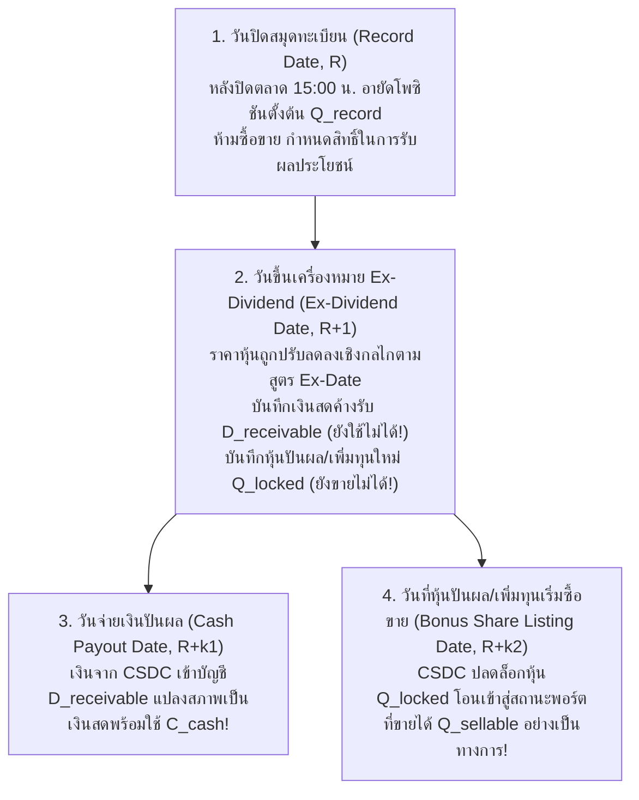

# บทที่ 29: การอิมพลีเมนต์กฎการจับคู่คำสั่งพิเศษของหุ้น A-Share ในระดับโค้ด

::: tip เป้าหมายหลักของบทนี้
ทีม Quant จำนวนมากที่ย้ายสายมาจากหุ้นสหรัฐฯ หรือคริปโทเคอร์เรนซีสู่หุ้น A-Share มักต้องเผชิญกับความจริงที่คาดไม่ถึง: ตลาดหุ้น A-Share ไม่ใช่ตลาดเสรีที่มีการจับคู่คำสั่งอย่างต่อเนื่องแบบทั่วไป แต่เต็มไปด้วย**ข้อจำกัดราคาชนเพดาน/พื้น (Price Limit), การเกิด Passive Lock-in จากแท่งราคา One-word, Order Price Collar ในการส่งคำสั่ง, การพักการซื้อขาย (Suspension) ระยะยาวโดยไม่มีสัญญาณเตือน ตลอดจนปฏิทินการขึ้นเครื่องหมายและการชำระราคาเงินปันผลที่ซับซ้อนอย่างยิ่ง**

หากระบบ Backtest ขาดการจำลองที่มีความแม่นยำสูงในระดับโค้ดสำหรับระบบเฉพาะตัวเหล่านี้ ไม่เพียงแต่จะทำให้ Backtest สร้างภาพลวงตาอย่าง “ไล่ซื้อหุ้นชนเพดาน (Limit-up) ทุกวันจนได้กำไรมหาศาล” หรือ “ล้างพอร์ตหนีตายได้ทันทีเมื่อหุ้นชนพื้น (Limit-down)” แต่ยังจะส่งผลให้การเทรดจริง (Live Trading) เกิดการผิดนัดชำระเงินและเงินสดติดลบขั้นรุนแรง บทนี้จะเจาะลึกโครงสร้าง**กลไกการจับคู่คำสั่งของตลาดหลักทรัพย์**ในปัจจุบันของหุ้น A-Share; พัฒนา State Machine สำหรับ**การปฏิเสธคำสั่งแบบ Conservative ในช่วงราคาชนเพดาน/พื้น และการตัดสภาพคล่องเมื่อเปิดตลาด**; อธิบายอัลกอริทึม **Order Price Collar 2% ภายใต้ระบบ Registration-based เต็มรูปแบบ**อย่างละเอียด; และเชื่อมโยงวงจรปิดทางบัญชี 4 ขั้นตอนของ **Record Date, Ex-Date, Payout Date และ Listing Date ของหุ้นปันผล/หุ้นเพิ่มทุน** อย่างสมบูรณ์!
:::

---

## 1. กฎระเบียบกำกับดูแลและโครงสร้างจุลภาคของการจับคู่คำสั่งในตลาดหลักทรัพย์

การสร้างระบบจับคู่คำสั่งที่มีความแม่นยำสูงจำเป็นต้องปฏิบัติตามกฎระเบียบหลักของตลาดหลักทรัพย์เซี่ยงไฮ้ เซินเจิ้น และปักกิ่งอย่างเคร่งครัด:

1. **ตลาดหลักทรัพย์เซี่ยงไฮ้/เซินเจิ้น (2023)**: "Trading Rules of Shanghai Stock Exchange", "Trading Rules of Shenzhen Stock Exchange" (ฉบับปรับปรุงระบบ Registration-based เต็มรูปแบบ)  
   > กำหนดหลักการปริมาณการซื้อขายสูงสุดในการประมูลแบบ Call Auction, ขอบเขตราคาชนเพดาน/พื้นของกระดาน Main Board และกระดานนวัตกรรม (ChiNext/STAR Market), Order Price Collar 2% ภายใต้ระบบ Registration-based และกลไกการพักการซื้อขายเมื่อเกิดความผันผวนผิดปกติ
2. **ChinaClear (2022)**: "คู่มือการปฏิบัติงานรับฝากและชำระราคาหลักทรัพย์" และ "แนวปฏิบัติการดำเนินงานจัดสรรสิทธิประโยชน์ของผู้ถือหุ้น"  
   > กำหนดกระบวนการชำระราคามาตรฐานของวันกำหนดรายชื่อผู้ถือหุ้น (Record Date), วันขึ้นเครื่องหมายสิทธิ (Ex-Date), วันชำระเงินปันผล (Payout Date) และการหักจ่ายภาษีเงินปันผลส่วนต่างย้อนหลัง
3. **สมาคมการจัดการสินทรัพย์แห่งประเทศจีน (AMAC, 2017)**: "ประกาศเกี่ยวกับการเผยแพร่ดัชนีการประเมินมูลค่าหุ้นกลุ่มอุตสาหกรรมสำหรับกองทุนรวมของ AMAC"  
   > กำหนดเกณฑ์บังคับสำหรับกองทุนสาธารณะและกองทุนเอกชน (Private Fund) เมื่อต้องเผชิญกับหุ้นรายตัวที่ถูกพักการซื้อขายเป็นเวลานาน โดยต้องใช้วิธี "AMAC Industry Index Return Method" ในการประเมินมูลค่าตามราคาตลาดอย่างเป็นธรรมสำหรับหลักทรัพย์ที่ถูกพักการซื้อขาย

---

## 2. โครงสร้างหลายระดับของเพดาน/พื้นราคาหุ้น A-Share และฟิสิกส์การจับคู่คำสั่งบนกระดาน

### 2.1 เมทริกซ์ขอบเขตราคาชนเพดาน/พื้นของแต่ละกระดาน

แต่ละกระดานหลักทรัพย์ในช่วงวงจรชีวิตและสถานะความเสี่ยงที่แตกต่างกัน จะมีขอบเขตราคาชนเพดาน/พื้นที่บังคับใช้แตกต่างกันอย่างเข้มงวด:

| กระดานหลักทรัพย์ | Prefix รหัสหลักทรัพย์ | การเคลื่อนไหวของราคาในวันซื้อขายปกติ | การเคลื่อนไหวของราคาหุ้นเตือนความเสี่ยง ST / *ST | กฎช่วงแรกหลัง IPO เข้าซื้อขาย |
| :--- | :--- | :--- | :--- | :--- |
| **Main Board (เซี่ยงไฮ้/เซินเจิ้น)** | 600, 601, 603, 000, 001 | $\pm 10\%$ | $\pm 5\%$ | 5 วันทำการแรกไม่มีการจำกัดราคา หลังจากนั้น $\pm 10\%$ |
| **ChiNext** | 300, 301 | $\pm 20\%$ | $\pm 20\%$ | 5 วันทำการแรกไม่มีการจำกัดราคา หลังจากนั้น $\pm 20\%$ |
| **STAR Market** | 688 | $\pm 20\%$ | $\pm 20\%$ | 5 วันทำการแรกไม่มีการจำกัดราคา หลังจากนั้น $\pm 20\%$ |
| **BSE (ตลาดหลักทรัพย์ปักกิ่ง)** | 8xx, 43x, 920 | $\pm 30\%$ | $\pm 30\%$ | วันแรกไม่มีการจำกัดราคา หลังจากนั้น $\pm 30\%$ |

### 2.2 กลไกฟิสิกส์การจับคู่คำสั่งช่วงราคาชนเพดาน/พื้น และ "การถูกบังคับล็อกสถานะ (Passive Lock-in)"

```mermaid
flowchart TD
    subgraph LimitUp["ฟิสิกส์การจับคู่คำสั่งฝั่งซื้อช่วง Limit-Up แบบ One-word"]
        LU1["เปิดตลาดล็อกราคาเพดานทันที (P_open = Limit_Up)"] --> LU2["Order Book กองไปด้วยคำสั่งซื้อปริมาณมหาศาลหลายแสน Lot (ต่อคิวที่ Bid 1)"]
        LU2 --> LU3["❌ คำสั่งขายในตลาดแทบเป็น 0: คำสั่งซื้อจากภายนอกไม่สามารถจับคู่ได้เลย!"]
        LU3 --> LU4["กฎเหล็ก Backtest: เปิดตลาดชนเพดานห้ามซื้อโดยเด็ดขาด ต้องปฏิเสธคำสั่งแบบ Conservative!"]
    end

    subgraph LimitDown["ฟิสิกส์การจับคู่คำสั่งฝั่งขายช่วง Limit-Down แบบ One-word"]
        LD1["เปิดตลาดล็อกราคาพื้นทันที (P_open = Limit_Down)"] --> LD2["Order Book กองไปด้วยคำสั่งเทขายตื่นตระหนกหลายล้าน Lot (ต่อคิวที่ Ask 1)"]
        LD2 --> LD3["❌ ฝั่งซื้อในตลาดแห้งสนิท: คำสั่งขายของคุณต่อคิวอยู่หลังหลายสิบล้าน Lot!"]
        LD3 --> LD4["กฎเหล็ก Backtest: เปิดตลาดชนพื้นห้ามขายโดยเด็ดขาด เกิดภาวะ Passive Lock-in!"]
    end
```



ในการ Backtest เชิงปริมาณ จำเป็นต้องใช้**สมมติฐานการปฏิเสธคำสั่งแบบ Conservative ฝั่ง Buy-side (Conservative Rejection Assumption)**:
1. **คำสั่งซื้อชนเพดาน**: เมื่อราคาเปิดของหุ้นเท่ากับราคา Limit-up จากหลักการ Time Priority ในการต่อคิว คำสั่งซื้อจากภายนอกของกลยุทธ์ Quant มีความเป็นไปได้สูงมากที่จะไม่สามารถเข้าคิวจน Match ได้ จึง**ต้องปฏิเสธคำสั่งอย่างเข้มงวด** โดยสถานะถือครองและเงินสดคงเดิมไม่เปลี่ยนแปลง
2. **คำสั่งขายชนพื้น**: เมื่อราคาเปิดของหุ้นเท่ากับราคา Limit-down จากสภาพคล่องที่เหือดแห้งอย่างสมบูรณ์ คำสั่งขายของกลยุทธ์จะไม่สามารถจับคู่เพื่อออกได้เลย **เกิดสภาวะ Passive Lock-in**! สถานะถือครองของหุ้นดังกล่าวจำต้องถูกเก็บไว้ในพอร์ตต่อไป และต้องแบกรับผลขาดทุนทางบัญชีจากการปรับตัวลงหลังจากนั้นอย่างเต็มที่!

---

## 3. กลไก Order Price Collar 2% ภายใต้ระบบ Registration-based เต็มรูปแบบ

นับตั้งแต่การประกาศใช้ระบบ Registration-based เต็มรูปแบบในปี 2023 ตลาดหลักทรัพย์เซี่ยงไฮ้และเซินเจิ้นได้กำหนดข้อจำกัด **Dynamic Price Collar 2%** สำหรับคำสั่ง Limit Order ทั้งหมดในช่วงการซื้อขายแบบต่อเนื่อง เพื่อกำจัดพฤติกรรมเชิงอัลกอริทึมที่ "ตั้งราคาซื้อที่ Limit-up ทันทีเพื่อแย่งของ" หรือ "ตั้งราคาขายที่ Limit-down ทันทีเพื่อเทขายอย่างรวดเร็ว":

### 3.1 สูตรคณิตศาสตร์ของ Order Price Collar
กำหนดให้ราคาอ้างอิงบนกระดานปัจจุบันในช่วงการซื้อขายแบบต่อเนื่องคือ $P_{\text{ref}}$ (โดยปกติจะใช้ราคาเสนอซื้อขายที่ดีที่สุดของฝั่งตรงข้าม หากไม่มีฝั่งตรงข้าม จะใช้ราคาเสนอที่ดีที่สุดของฝั่งตนเอง):

- **ขอบเขตบนของคำสั่งซื้อแบบ Limit Order**:
  $$P_{\text{buy\_order}} \le \max\left( P_{\text{ref}} \times 1.02, \; P_{\text{ref}} + 10 \text{ ticks} \right)$$
- **ขอบเขตล่างของคำสั่งขายแบบ Limit Order**:
  $$P_{\text{sell\_order}} \ge \min\left( P_{\text{ref}} \times 0.98, \; P_{\text{ref}} - 10 \text{ ticks} \right)$$

คำสั่งที่ส่งเกินเกณฑ์ดังกล่าวจะถูกโฮสต์จับคู่คำสั่งของตลาดหลักทรัพย์ปฏิเสธเป็น**คำสั่งไม่ถูกต้อง**ทันที หรือเข้าสู่**สถานะพักคำสั่งชั่วคราวโดยยังไม่รับเข้าระบบ** การส่งคำสั่งด้วยอัลกอริทึม (เช่น VWAP/TWAP) จึงต้องติดตาม Order Book แบบ Real-time เพื่อปรับราคาเสนอซื้อขายทีละช่วงราคาอย่างละเอียด

---

## 4. การประเมินมูลค่าตามราคาตลาดของหุ้นที่ถูกพักการซื้อขาย: วิธี AMAC Industry Index

เมื่อหุ้นถูกพักการซื้อขายเป็นเวลานานเนื่องจากการปรับโครงสร้างกิจการ, ปัญหาร้ายแรง หรือความผิดปกติของตลาด (เช่น คลื่นการพักการซื้อขายของหุ้นนับพันตัวในปี 2015 หรือกรณี Leshi Internet และ Kangde Xin ที่ถูกพักการซื้อขายหลายเดือนจนถึงหลายปี) หากประเมินมูลค่าอย่างง่ายโดยใช้ "ราคาปิดสุดท้ายก่อนพักการซื้อขาย" จะทำให้มูลค่าทรัพย์สินสุทธิ (NAV) ของกองทุนสูงเกินจริงอย่างรุนแรง และเมื่อเกิดการไถ่ถอนขนาดใหญ่ นักลงทุนที่ไถ่ถอนก่อนจะได้เงินตาม NAV ที่สูงเกินจริง ส่วนนักลงทุนที่เหลืออยู่จะต้องแบกรับผลขาดทุนมหาศาล

### 4.1 วิธี AMAC Industry Index Return Method (AMAC Valuation)
กองทุนสาธารณะและกองทุนเอกชนที่ได้มาตรฐาน ในระหว่างที่หุ้นถูกพักการซื้อขาย จะทำการประเมินมูลค่าตามราคาตลาดใหม่แบบไดนามิก โดยอิงตามการเปลี่ยนแปลงสัมพัทธ์ของดัชนีการจัดกลุ่มอุตสาหกรรม (Industry Classification) ที่เกี่ยวข้องซึ่งเผยแพร่โดย AMAC:

$$P_{i, t}^{\text{adjusted}} = P_{i, \text{suspend}} \times \frac{I_{\text{industry}, t}}{I_{\text{industry}, t_0}}$$

โดยที่:
- $P_{i, \text{suspend}}$: ราคาปิดในวันทำการสุดท้ายก่อนการพักการซื้อขาย
- $I_{\text{industry}, t_0}$: จุดปิดของดัชนีกลุ่มอุตสาหกรรม Shenwan / AMAC ที่หุ้นนั้นสังกัดอยู่ ณ วันที่เริ่มพักการซื้อขาย
- $I_{\text{industry}, t}$: จุดปิดของดัชนีกลุ่มอุตสาหกรรมดังกล่าว ณ วันที่ประเมินมูลค่าปัจจุบัน

หากในช่วงที่พักการซื้อขาย กลุ่มอุตสาหกรรมดังกล่าวปรับตัวลดลง $30\%$ มูลค่าของหุ้นตัวนั้นจะถูกบันทึกมูลค่ายุติธรรมที่ $70\%$ จึงสะท้อน NAV ที่แท้จริงในการควบคุมความเสี่ยงของพอร์ตการลงทุนได้อย่างถูกต้อง

---
## 5. State Machine 4 ขั้นตอนสำหรับการชำระสิทธิประโยชน์เงินปันผลและการเพิ่มทุน (Corporate Actions)

การจ่ายเงินปันผลและหุ้นปันผล/เพิ่มทุนไม่ใช่แค่การ "ปรับราคาในวันขึ้นเครื่องหมาย Ex-Dividend" ง่าย ๆ แต่มันครอบคลุม 4 หมุดหมายบนปฏิทินการซื้อขายตามกฎหมาย ซึ่งจำเป็นต้องได้รับการจัดการผ่าน State Machine สำหรับการกระทบยอดบัญชีอย่างรัดกุม:



### 5.1 สมการราคาอ้างอิงทางทฤษฎีในวัน Ex-Dividend
ก่อนเปิดตลาดในวันขึ้นเครื่องหมาย Ex-Dividend ตลาดหลักทรัพย์จะทำการปรับราคาปิดวันก่อนหน้าเชิงกลไก (หักเงินปันผลและสะท้อนการเจือจางจากหุ้นปันผลและหุ้นเพิ่มทุน):

$$P_{\text{ex}} = \frac{P_{\text{before}} - d + p_{\text{allot}} \cdot r_{\text{allot}}}{1 + b + r_{\text{allot}}}$$

โดยที่:
- $P_{\text{before}}$：ราคาปิด ณ วัน Record Date;
- $d$：เงินปันผลก่อนหักภาษีต่อหุ้น (หยวน);
- $b$：สัดส่วนการแจกหุ้นปันผลและหุ้นเพิ่มทุนต่อหุ้น (เช่น 10 แจก 5 จะได้ $b = 0.5$);
- $p_{\text{allot}}$：ราคาหุ้นเพิ่มทุน; $r_{\text{allot}}$：สัดส่วนการจัดสรรหุ้นเพิ่มทุน

### 5.2 ตัวอย่างการพิสูจน์ความอนุรักษ์ของมูลค่าทรัพย์สินในบัญชี
สมมติว่าในวัน Record Date ถือครองหุ้นอยู่ 100 หุ้น ราคาปิด ณ วัน Record Date คือ 10 หยวน มูลค่าตลาดรวม 1,000 หยวน บริษัทประกาศ "ถือ 10 หุ้น จ่ายปันผล 10 หยวน และแจกหุ้นเพิ่มทุน 1 หุ้น" (นั่นคือเงินปันผลต่อหุ้น $d = 1.0$ หยวน, สัดส่วนหุ้นเพิ่มทุน $b = 0.1$):
1. **ราคาอ้างอิง Ex-Dividend**:
   $$P_{\text{ex}} = \frac{10 - 1.0}{1 + 0.1} = \frac{9.0}{1.1} \approx 8.1818 \text{ หยวน}$$
2. **การรับรู้สิทธิประโยชน์**:
   - บันทึกเงินปันผลค้างรับ: $100 \times 1.0 = 100$ หยวน ($D^{\text{receivable}}$ ยังไม่สามารถนำไปซื้อหุ้นได้);
   - บันทึกจำนวนหุ้นถือครองรวมเพิ่มขึ้น: $100 \times (1 + 0.1) = 110$ หุ้น (โดยมี 10 หุ้นเป็นหุ้นที่ถูกล็อกไว้เนื่องจากยังไม่เริ่มซื้อขาย);
3. **การประเมินมูลค่าสินทรัพย์ ณ เวลาเปิดตลาดวัน Ex-Dividend**:
   $$\text{Total Assets} = 110 \times \frac{9.0}{1.1} + 100 = 900 + 100 = \mathbf{1,000 \text{ หยวน}} \quad (\text{คงที่อย่างแน่นอน!})$$

หากระบบ Backtest นำเงินปันผล 100 หยวนไปเพิ่มเป็นเงินสดพร้อมใช้ทันทีในวัน Ex-Dividend เพื่อซื้อหุ้น หรืออนุญาตให้ขายหุ้นทั้งหมด 110 หุ้นได้ในวันนั้น จะก่อให้เกิดการละเมิดกฎเกณฑ์ที่ร้ายแรงเรื่อง**การใช้วงเงินเกินบัญชีและการทำ Short Selling แฝงเกินสิทธิ์จริง**!

---

## 6. ปฏิบัติการ Matching พิเศษระดับ Production และสมุดบัญชี Corporate Actions

ใน `tutorial/examples/lecture_29_matching_rules_limits_suspensions.py` เราได้พัฒนา `AshareSpecialMatchingEngine` ระดับ Production:
1. พัฒนาระบบตัดสินราคาชนเพดาน/พื้น (Price Limit) ตอนเปิดตลาด การตรวจจับหุ้นพักการซื้อขาย (Suspension) และการปฏิเสธคำสั่งซื้อขายแบบ Conservative อย่างเข้มงวด;
2. พัฒนาระบบจับคู่คำสั่งแบบได้ของบางส่วนตามสัดส่วน (Partial Fill) สำหรับการปรับพอร์ต (Rebalance) แต่ละครั้งโดยอิงตามขีดจำกัดสภาพคล่องตอนเปิดตลาด;
3. พัฒนา `CorporateActionTracker` จัดการกระบวนการกระทบยอดบัญชีครบวงจร ทั้งการทำ Snapshot ณ วัน Record Date, การอายัดเงินปันผลค้างรับ, การปลดล็อกเงินสดในวัน Payout Date ตลอดจนวันที่หุ้นปันผล/เพิ่มทุนเริ่มซื้อขายได้อย่างสมบูรณ์แบบ

สามารถรันเพื่อตรวจสอบได้โดยตรงผ่าน Terminal:

```bash
python3 -m examples.lecture_29_matching_rules_limits_suspensions
```

<<< @/examples/lecture_29_matching_rules_limits_suspensions.py

---

## 7. Checklist ผลงานส่งมอบหลักของโมดูลที่ 7

เมื่อเรียนจบโมดูลนี้ กลยุทธ์เชิงปริมาณ (Quant) ของคุณได้ผ่าน "การทดสอบระดับจุลภาคเสมือนเทรดจริง (Live Trading)" ที่เข้มงวดที่สุดของตลาดหุ้น A-Share เรียบร้อยแล้ว:

- [x] **การวิเคราะห์เปรียบเทียบสถาปัตยกรรม Backtest Engine (บทที่ 27)**:
  - จำแนกขอบเขตและการแบ่งหน้าที่ระหว่าง Vectorized Backtest กับ Event-driven Backtest อย่างชัดเจน;
  - เชี่ยวชาญการใช้ State Machine ของ Discrete Event Simulation (DES) ที่เดินหน้าทีละวันและระบบบัญชีคู่ (Double-entry Bookkeeping) ที่สอดคล้องกับกลไกของหุ้น A-Share
- [x] **การจำลองแรงเสียดทานในการซื้อขายแบบสมจริง (บทที่ 28)**:
  - คำนวณอากรแสตมป์ (Stamp Duty) ฝั่งเดียว $0.05\%$, ค่าคอมมิชชันสถาบัน และกับดักค่าธรรมเนียมขั้นต่ำ 5 หยวนอย่างแม่นยำ;
  - พิสูจน์แบบจำลองต้นทุน Market Impact ตามกฎ Square-root Law ที่ไม่เป็นเชิงเส้น พร้อมทั้งหา Closed-form Solution สำหรับ**จุดพีคของขีดความจุ AUM ทองคำของกลยุทธ์**
- [x] **การปิดลูปกฎ Matching พิเศษของหุ้น A-Share ในระดับโค้ด (บทที่ 29)**:
  - พัฒนาระบบปฏิเสธคำสั่งแบบ Conservative เมื่อราคาชนเพดาน/พื้น, การล็อกโพซิชันเชิงรับ และกลไกกรอบราคาเสนอซื้อขาย 2% (Price Cage);
  - พัฒนาวิธีปรับมูลค่าหลักทรัพย์ที่พักการซื้อขายตามดัชนีอุตสาหกรรม AMAC;
  - รันการกระทบยอดบัญชีอย่างรัดกุมครบทั้ง 4 ขั้นตอน: วันปิดสมุดทะเบียน, วันขึ้นเครื่องหมาย Ex-Dividend, วันรับเงินปันผล และวันเริ่มซื้อขายของหุ้นปันผล/เพิ่มทุน ได้อย่างสมบูรณ์แบบ

ถึงจุดนี้ กลยุทธ์ของเราไม่เพียงแต่สร้างเส้นกราฟมูลค่าทรัพย์สินสุทธิหลังหักค่าธรรมเนียมที่สมจริงและเชื่อถือได้ใน Backtest เท่านั้น แต่ยังเตรียมความพร้อมด้านกฎระเบียบทั้งหมดสำหรับการนำขึ้นสู่ระบบส่งคำสั่งเทรดจริง!

ใน **โมดูลที่ 8: ระบบมอนิเตอร์ระดับ Production, การแจกแจงที่มา (Attribution) และการนำขึ้นเทรดจริง** ถัดไป เราจะติดตั้ง **กล้องจุลทรรศน์แจกแจงที่มาของผลการดำเนินงาน (Brinson และ Barra Attribution)** แบบตลอด 24 ชั่วโมง พร้อมทั้ง **แดชบอร์ดเตือนภัย Circuit Breaker สำหรับการควบคุมความเสี่ยง (การเฝ้าระวัง Tracking Error Drift และ PSI Feature Monitoring)** ให้กับกลยุทธ์ เพื่อคุ้มกันให้การเทรดจริงดำเนินไปอย่างมั่นคงในระยะยาว!
