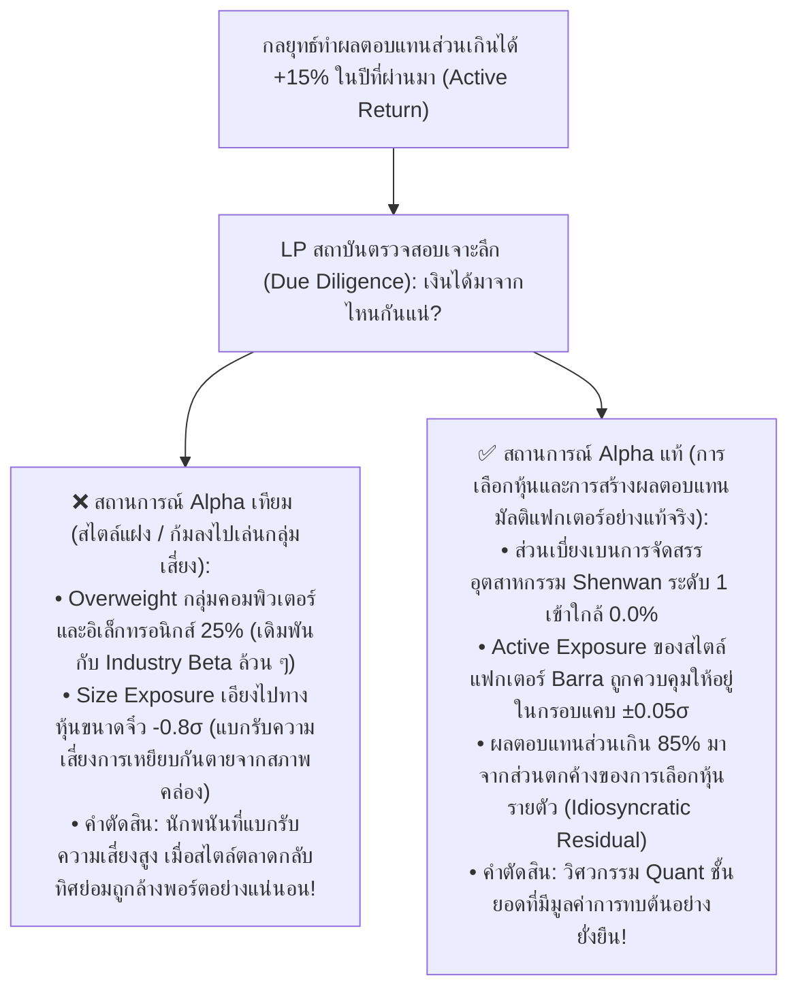
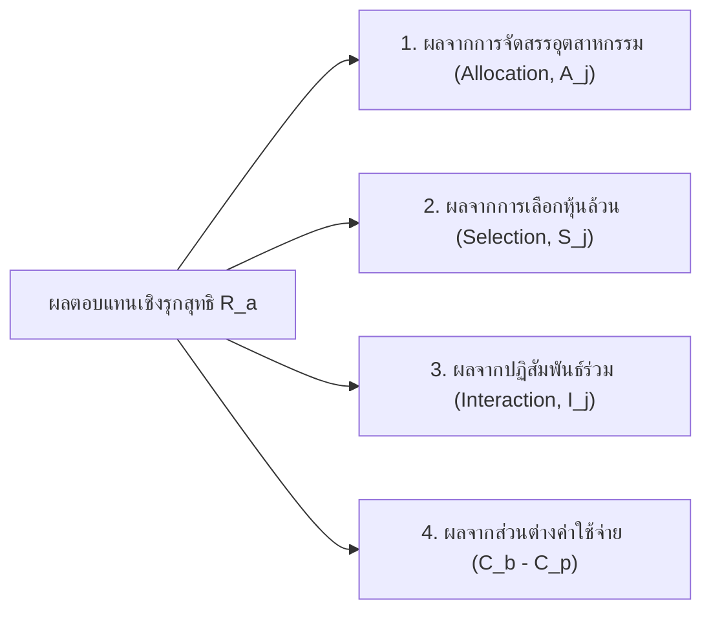
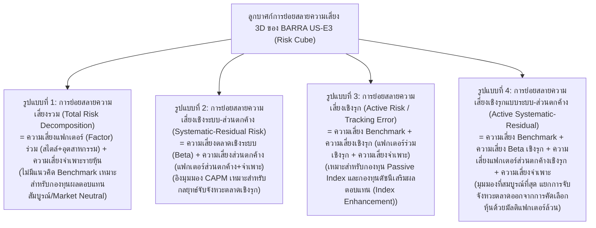

# บทที่ 30: ภาคปฏิบัติการแจกแจงที่มาของผลการดำเนินงาน: กำไรที่ได้คือ Beta หรือ Pure Alpha กันแน่?

::: tip เป้าหมายหลักของบทนี้
ในการลงทุนเชิงปริมาณ (Quant) ระดับสถาบัน ผู้จัดการกองทุนทุกคนต่างต้องตอบ "คำถามสะเทือนใจ" จากกองทุนความมั่งคั่งแห่งชาติ (Sovereign Wealth Fund), กองทุนประกันสังคม และ LP สถาบันขนาดใหญ่ว่า: "**กลยุทธ์ของคุณในปีนี้ทำผลงานชนะเกณฑ์มาตรฐาน (Benchmark) อยู่ 15 เปอร์เซ็นต์ เกิดจากโมเดลการเลือกหุ้นมีพลังพยากรณ์ Alpha ที่แท้จริง หรือเป็นเพียงเพราะแอบ Overweight หุ้น Micro-cap, เดิมพันถูกกลุ่มอุตสาหกรรม หรือแค่แบกรับความเสี่ยง Beta แฝงที่ยังไม่ถูกประเมินกันแน่?**"

หากทีม Quant ไม่สามารถให้การแจกแจงที่มา (Attribution) ทางคณิตศาสตร์ที่แม่นยำระดับ Basis Points (bps) ได้ ผลตอบแทนส่วนเกิน (Excess Return) ชั่วคราวใด ๆ ย่อมถูกนักลงทุนสถาบันมองว่าเป็นเพียง "การเสี่ยงโชคที่ไม่ยั่งยืน" บทนี้ได้ผสาน **คู่มือแบบจำลองความเสี่ยง (Risk Model) คลาสสิก MSCI Barra US-E3** เข้ากับ **ระบบมัลติแฟกเตอร์ของ Huatai Securities**: เจาะลึกการพิสูจน์ **แบบจำลอง 3 ปัจจัยการจัดสรรอุตสาหกรรมและการเลือกหุ้นของ Brinson-Fachler**; ถอดรหัส **แบบจำลองการแยกผลตอบแทนมัลติแฟกเตอร์ย้อนหลัง (Ex-post Multi-factor Return Attribution Model)** ของ Barra; นำเสนอ **ลูกบาศก์การแยกย่อยความเสี่ยง 4 มิติ US-E3 (Risk Decomposition Cube)** อันเป็นมาตรฐานคลาสสิกของอุตสาหกรรม; พิสูจน์สูตร **สัดส่วนความเสี่ยงแอกทีฟส่วนเพิ่มของแฟกเตอร์ (Factor Marginal Contribution to Active Risk: FMCAR)**; พร้อมทั้งเชี่ยวชาญอัลกอริทึม Carino Linking ทางเรขาคณิตสำหรับผลตอบแทนทบต้นหลายงวด!
:::

---

## 1. วรรณกรรมคลาสสิกและรากฐานทฤษฎีในอุตสาหกรรม

วรรณกรรมคลาสสิกและหมุดหมายทางวิชาการในด้าน Attribution และการแยกย่อยความเสี่ยงของการลงทุน Quant:

1. **Brinson, Gary P., & Fachler, Nimrod (1985)**. *"Measuring Non-US Equity Portfolio Performance"*, *The Journal of Portfolio Management*, 11(3): 73-78.  
   > นำเสนอโมเดล Brinson-Fachler (BF) อันโด่งดัง โดยปรับเกณฑ์อ้างอิงของการจัดสรรอุตสาหกรรมให้เป็นผลงานส่วนเกินของอุตสาหกรรมเทียบกับตลาดโดยรวม จนกลายเป็นมาตรฐานสากลของสถาบันฝั่ง Buy-side
2. **BARRA Inc. (1998)**. *United States Equity Version 3 (US-E3) Risk Model Handbook*, Chapter 4 (Modern Portfolio Management and Risk).  
   > กำหนด "4 มิติของการแยกย่อยความเสี่ยง (Modes of Risk Decomposition)" ในการบริหารพอร์ตการลงทุน รวมถึงลูกบาศก์ความเสี่ยงสามมิติ (Risk Decomposition Cube) อันเลื่องชื่อ ซึ่งช่วยจัดระเบียบความสัมพันธ์ระหว่าง Benchmark, Active, Systematic และ Idiosyncratic Risk อย่างสมบูรณ์
3. **สถาบันวิจัยหลักทรัพย์ Huatai (Lin Xiaoming, Chen Ye, 2016)**. 《华泰多因子模型体系初探——华泰多因子系列之一》 (การสำรวจเบื้องต้นเกี่ยวกับระบบโมเดล Multi-Factor ของ Huatai — ซีรีส์ Huatai Multi-Factor ตอนที่ 1), ส่วนที่ 5: การวิเคราะห์ผลการดำเนินงานของโมเดล Multi-Factor.  
   > พิสูจน์สมการถดถอย Jensen's Alpha ของผลตอบแทนพอร์ตเชิงรุกอย่างเป็นระบบ, สมการ Attribution ผลตอบแทนบนฐานมัลติแฟกเตอร์ และอัลกอริทึม Attribution ความเสี่ยงของความเสี่ยงแอกทีฟส่วนเพิ่มจากแฟกเตอร์ (FMCAR)
4. **Carino, David R. (1999)**. *"Combining Attribution Effects Over Time"*, *The Journal of Performance Measurement*, 4(4): 5-14.  
   > นำเสนออัลกอริทึม Carino Linking สำหรับผลตอบแทนทบต้นหลายงวดบนฐานของตัวคูณแปลงค่าลอการิทึม ช่วยแก้ปัญหาความบิดเบือนทางเรขาคณิตของการแจกแจงผลตอบแทนแบบบวกได้ในงวดเดียวเมื่อนำมาทบต้นหลายงวดได้อย่างสมบูรณ์แบบ
5. **Grinold, Richard C., & Kahn, Ronald N. (1999)**. *Active Portfolio Management*, Chapter 17 (Performance Attribution). McGraw-Hill.  
   > วางรากฐานสมการแยกย่อยผลตอบแทนเชิงรุกในอดีตบนฐานของ Factor Exposure เชื่อมโยงวงจรปิดที่สอดคล้องกันระหว่าง Ex-ante Risk Budgeting และ Ex-post Performance Attribution

---

## 2. ทำไมสถาบันฝั่ง Buy-side จึงต้องแยกแยะ Beta และ Alpha อย่างเข้มงวด?



ในสถาบันบริหารสินทรัพย์มืออาชีพ ผลตอบแทนส่วนเกินที่พึ่งพา Exposure ของอุตสาหกรรมหรือการลดระดับมาร์เก็ตแคป ถูกเรียกว่า**Beta ราคาถูก (Cheap Beta)**; มีเพียง**ผลตอบแทนเฉพาะตัวของหุ้นรายตัว (Idiosyncratic Return)** ที่หลงเหลืออยู่หลังจากการแยกตลาดภาพรวม (Market), การหมุนเวียนกลุ่มอุตสาหกรรม (Industry) และการเบี่ยงเบนของสไตล์ (Style) ออกไปอย่างเคร่งครัดแล้วเท่านั้น จึงจะเป็น**Pure Alpha** ที่สามารถคิดค่าธรรมเนียมผลการดำเนินงานในระดับสูงได้!

---

## 3. การแยกโครงสร้างทางคณิตศาสตร์อย่างเข้มงวดของแบบจำลอง Brinson-Fachler Attribution

กำหนดให้ทั้งพอร์ตและเกณฑ์มาตรฐานครอบคลุมหมวดหมู่อุตสาหกรรม $J$ กลุ่ม (ครอบคลุม 31 อุตสาหกรรมของ Shenwan บวกกับ**หมวดหมู่เงินสด**แยกต่างหากอีกหนึ่งหมวด $J_{\text{cash}}$)

### 3.1 ระบบสัญลักษณ์และการตรวจสอบยอดรวม
- $w_{p, j}, w_{b, j}$：น้ำหนักการจัดสรรของพอร์ตและเกณฑ์มาตรฐานในอุตสาหกรรม $j$ โดยสอดคล้องตามเงื่อนไข $\sum_{j=1}^J w_{p, j} = 1, \; \sum_{j=1}^J w_{b, j} = 1$ อย่างเคร่งครัด;
- $r_{p, j}, r_{b, j}$：อัตราผลตอบแทนถ่วงน้ำหนักภายในอุตสาหกรรม $j$ ของพอร์ตและเกณฑ์มาตรฐาน;
- $R_p^{\text{gross}} = \sum_{j=1}^J w_{p, j} r_{p, j}$：อัตราผลตอบแทนรวมขั้นต้นของพอร์ต;
- $R_b^{\text{gross}} = \sum_{j=1}^J w_{b, j} r_{b, j}$：อัตราผลตอบแทนรวมขั้นต้นของเกณฑ์มาตรฐาน;
- $C_p, C_b$：อัตราค่าใช้จ่ายและต้นทุนเสียดทานในการซื้อขายของพอร์ตและเกณฑ์มาตรฐาน

ผลตอบแทนส่วนเกินเชิงรุกสุทธิคือ:
$$R_a^{\text{net}} = R_p^{\text{net}} - R_b^{\text{net}} = (R_p^{\text{gross}} - C_p) - (R_b^{\text{gross}} - C_b)$$

### 3.2 นิยามทางคณิตศาสตร์ของ 3 ปัจจัย Brinson-Fachler

Brinson & Fachler (1985) แยกย่อยผลตอบแทนเชิงรุกขั้นต้นออกเป็น 3 พจน์ที่มีความหมายทางการจัดการอย่างชัดเจน:



#### 1. ผลจากการจัดสรรอุตสาหกรรม (Allocation Effect, $A_j$)
วัดผลตอบแทนที่เกิดจากการตัดสินใจ Overweight/Underweight ในแต่ละอุตสาหกรรมของผู้จัดการกองทุน:

$$A_j = (w_{p, j} - w_{b, j}) (r_{b, j} - R_b^{\text{gross}})$$

- **ตรรกะทางเศรษฐศาสตร์**：หากอุตสาหกรรม $j$ ชนะตลาดเกณฑ์มาตรฐาน（$r_{b, j} > R_b$）และพอร์ตได้ Overweight อุตสาหกรรมนั้น（$w_{p, j} > w_{b, j}$）ผลจากการจัดสรรจะเป็นบวก; ในทางกลับกัน หาก Overweight อุตสาหกรรมที่มีผลการดำเนินงานตามหลังตลาด ผลจากการจัดสรรจะเป็นลบ

#### 2. ผลจากการเลือกหุ้น (Selection Effect, $S_j$)
วัดผลตอบแทนที่เกิดจากการที่ผู้จัดการกองทุนคัดเลือกหุ้นรายตัวภายในอุตสาหกรรมได้เหนือกว่าเกณฑ์มาตรฐานของอุตสาหกรรมนั้น:

$$S_j = w_{b, j} (r_{p, j} - r_{b, j})$$

- **ตรรกะทางเศรษฐศาสตร์**：ภายใต้ข้อจำกัดของน้ำหนักเกณฑ์มาตรฐาน $w_{b, j}$ คือส่วนต่างที่อัตราผลตอบแทนเฉลี่ยของหุ้นที่ถือครองในอุตสาหกรรมนั้นชนะเกณฑ์มาตรฐานอุตสาหกรรม

#### 3. ผลจากปฏิสัมพันธ์ (Interaction Effect, $I_j$)
พจน์ผลคูณไขว้ระหว่างส่วนเบี่ยงเบนเชิงรุกของน้ำหนักอุตสาหกรรมกับความสามารถในการเลือกหุ้น:

$$I_j = (w_{p, j} - w_{b, j}) (r_{p, j} - r_{b, j})$$

#### 4. การตรวจสอบเอกลักษณ์การรวมยอดที่สมบูรณ์
เมื่อรวมผลกระทบแต่ละรายการของทุกอุตสาหกรรมในตลาด ย่อมสอดคล้องตามหลักคณิตศาสตร์อย่างสมบูรณ์:

$$\sum_{j=1}^J (A_j + S_j + I_j) = \sum_{j=1}^J \left( w_{p, j} r_{p, j} - w_{b, j} r_{b, j} \right) = R_p^{\text{gross}} - R_b^{\text{gross}}$$

$$R_a^{\text{net}} = \sum_{j=1}^J A_j + \sum_{j=1}^J S_j + \sum_{j=1}^J I_j + (C_b - C_p)$$

> [!IMPORTANT] หมวดหมู่เงินสดเป็นสิ่งจำเป็นอย่างยิ่ง
> โค้ดตัวอย่างการสอนทั่วไปมักทำการแจกแจงที่มาเฉพาะสินทรัพย์ประเภทหุ้น สมมติว่าพอร์ตสำรองเงินสดไว้ $10\%$ และหุ้นปรับตัวขึ้นแรง $10\%$ โดยผลตอบแทนของเงินสดเป็น $0\%$ ผลตอบแทนเชิงรุกของพอร์ตย่อมตามหลังเกณฑ์มาตรฐาน $-1\%$ อย่างแน่นอน หากละเลยหมวดหมู่เงินสด ผลรวมของ 3 ปัจจัยนี้จะไม่สามารถกระทบยอดปิดบัญชีกับมูลค่าทรัพย์สินสุทธิจริงได้เลย! จำเป็นต้องกำหนดให้เงินสดเป็นหมวดหมู่สินทรัพย์อิสระที่ถูกนับรวมเข้าไปใน $J$ รายการย่อยอย่างเป็นเอกภาพ

---
## 4. การเชื่อมโยงการแจกแจงที่มา (Attribution) แบบทบต้นเชิงเรขาคณิตหลายช่วงเวลา (Carino Linking Algorithm)

ในรายงานประจำไตรมาสและรายงานประจำปีของกองทุนจริง ช่วงเวลาการลงทุนประกอบด้วยช่วงเวลาการปรับพอร์ต (Rebalance) ย่อยหลายช่วง ($t = 1, 2, \dots, T$) เนื่องจากผลกระทบของดอกเบี้ยทบต้น:
$$1 + R = \prod_{t=1}^T (1 + R_t)$$
การนำผล Attribution รายช่วงเวลาเดี่ยวมาบวกสะสมกันตรง ๆ จะก่อให้เกิดความบิดเบือนของค่าเศษเหลือเชิงเรขาคณิตอย่างมหาศาล

### 4.1 การอนุพัทธ์ทางคณิตศาสตร์ของตัวเชื่อมโยงลอการิทึมของ Carino
Carino (1999) พิสูจน์ว่า การกำหนดตัวคูณปรับสเกลการแปลงลอการิทึมแบบทบต้น ทำให้สามารถแปลงผลตอบแทนเชิงเรขาคณิตหลายช่วงเวลาให้อยู่ในรูปเชิงเส้นที่บวกกันได้อย่างแม่นยำ:

กำหนดให้แฟกเตอร์การแปลงลอการิทึมแบบต่อเนื่องของพอร์ตโฟลิโอในงวดที่ $t$ คือ:
$$k_t = \frac{\ln(1 + R_{p, t})}{R_{p, t}}$$

แฟกเตอร์การแปลงลอการิทึมแบบต่อเนื่องระดับ Global ตลอดช่วงเวลาหลายงวดทั้งหมดคือ:
$$K = \frac{\ln(1 + R_p)}{R_p} = \frac{\sum_{t=1}^T \ln(1 + R_{p, t})}{R_p}$$

กำหนดให้**ตัวคูณเชื่อมโยงปรับเรียบตามเวลา**ในงวดที่ $t$ คือ:
$$c_t = \frac{k_t}{K} = \frac{\ln(1 + R_{p, t})}{R_{p, t}} \cdot \frac{R_p}{\ln(1 + R_p)}$$

เมื่อใช้ตัวคูณเชื่อมโยงนี้ในการปรับสเกลตามเวลาสำหรับองค์ประกอบ Attribution ของแต่ละงวด ผลรวมสะสมหลายงวดจะสอดคล้องกับ**คุณสมบัติการบวกเข้าด้วยกันได้อย่างสมบูรณ์**:
$$A_{\text{total}} = \sum_{t=1}^T c_t A_t, \quad S_{\text{total}} = \sum_{t=1}^T c_t S_t, \quad I_{\text{total}} = \sum_{t=1}^T c_t I_t$$

$$R_{p, \text{total}} - R_{b, \text{total}} = A_{\text{total}} + S_{\text{total}} + I_{\text{total}} + \text{Fees}$$

---

## 5. จตุรภาคการย่อยสลายความเสี่ยงแบบคลาสสิกและลูกบาศก์ความเสี่ยง 3D ของ BARRA US-E3

คู่มือความเสี่ยง MSCI Barra US-E3 บทที่ 4 ระบุว่า การย่อยสลายความเสี่ยงของพอร์ตการลงทุนมี 4 มุมมองคลาสสิก ซึ่งประกอบขึ้นเป็นการวิเคราะห์พอร์ตการลงทุนอย่างรอบด้าน:



ทั้ง 4 รูปแบบนี้ในทางเรขาคณิตเทียบเท่ากับการผ่าก้อนเค้กความเสี่ยงทั้งหมดไปตาม 3 มิติที่ตั้งฉากกัน:
1. **มิติที่ 1**：ความเสี่ยงเชิงระบบ (Systematic) vs ความเสี่ยงส่วนตกค้าง (Residual)；
2. **มิติที่ 2**：ความเสี่ยงแฟกเตอร์ร่วม (Common Factor) vs ความเสี่ยงจำเพาะ (Specific)；
3. **มิติที่ 3**：ความเสี่ยงเกณฑ์มาตรฐาน (Benchmark) vs ความเสี่ยงจากการเบี่ยงเบนเชิงรุก (Active)

---

## 6. การจัดวาง Attribution ผลตอบแทนตามแฟกเตอร์เชิงโครงสร้างของ Barra ให้สอดคล้องกับ Attribution ความเสี่ยง FMCAR

รายงานมัลติแฟกเตอร์ของ Huatai Securities เสนอว่า ฝั่ง Buy-side ไม่เพียงแต่ต้องออก**ตาราง Attribution ผลตอบแทน**เท่านั้น แต่ยังต้องนำ**แหล่งที่มาของผลตอบแทนและปริมาณความเสี่ยงที่ใช้ไป (FMCAR) มาเปรียบเทียบเคียงข้างกัน** เพื่อตรวจสอบอัตราส่วนผลตอบแทนต่อหนึ่งหน่วยความเสี่ยง!

### 6.1 สมการ Attribution ผลตอบแทน
ผลตอบแทนส่วนเกิน (Excess Return) เชิงรุกถูกแยกย่อยเป็น:
$$R_a^{\text{net}} = \underbrace{\mathbf{h}^T X_{\text{ind}} \mathbf{f}_{\text{ind}}}_{\text{การมีส่วนร่วมของ Factor อุตสาหกรรม } R_{\text{ind}}} + \underbrace{\mathbf{h}^T X_{\text{style}} \mathbf{f}_{\text{style}}}_{\text{การมีส่วนร่วมของ Factor สไตล์ } R_{\text{style}}} + \underbrace{\mathbf{h}^T \mathbf{u}}_{\text{ส่วนตกค้างเฉพาะของหุ้นรายตัว } R_{\text{spec}}} + \underbrace{(w_{p, c} - w_{b, c}) r_c}_{\text{ภาระฉุดจากเงินสด (Cash Drag)}} - \underbrace{C_p}_{\text{ต้นทุนการปรับพอร์ต (Rebalancing Cost)}}$$

### 6.2 สมการ Attribution ความเสี่ยง (อิง FMCAR)
Tracking Error รวมเชิงรุกของพอร์ตคือ $\sigma_P = \sqrt{\mathbf{x}_{PA}^T F \mathbf{x}_{PA} + \mathbf{h}_{PA}^T \Delta \mathbf{h}_{PA}}$
จากทฤษฎีบทฟังก์ชันเอกพันธุ์ของออยเลอร์:
$$\sigma_P = \sum_{k=1}^K x_{PA}(k) \cdot \text{FMCAR}(k) + \frac{\mathbf{h}_{PA}^T \Delta \mathbf{h}_{PA}}{\sigma_P}$$

### 6.3 ตารางตรวจสุขภาพการจัดวางผลตอบแทน-ความเสี่ยง (แดชบอร์ดมาตรฐานอุตสาหกรรม)


หากแฟกเตอร์สไตล์ตัวใดตัวหนึ่ง (เช่น Size หรือ Beta) ส่งผลต่อความเสี่ยงเชิงรุกถึง $30\%$ แต่กลับสร้างผลตอบแทนส่วนเกินติดลบหรือเพียงเล็กน้อย แสดงว่ากลยุทธ์นี้กำลังแบกรับ "ความเสี่ยงขยะ" ที่ไม่สร้าง Alpha แบบตั้งรับ และควรบีบกรอบจำกัดการเบี่ยงเบนของแฟกเตอร์นั้นใน Optimizer ให้แคบลง

---

## 7. ภาคปฏิบัติ: เอนจินกระทบยอด Attribution ระดับอุตสาหกรรม

ใน `tutorial/examples/lecture_30_performance_attribution_brinson_barra.py` เราได้พัฒนา `AsharePerformanceAttributionEngine` ระดับ Production:
1. รองรับการแยกย่อยกระทบยอดอย่างสมบูรณ์ตาม Brinson-Fachler ทั้งการจัดสรรอุตสาหกรรม การคัดเลือกหุ้นรายตัว อันตรกิริยา และเงินสด;
2. รองรับการแยก P&L ตามแฟกเตอร์เชิงโครงสร้างของ Barra แบบ Native โดยตรวจสอบกระทบยอดผลตอบแทนอุตสาหกรรม ผลตอบแทนสไตล์ และส่วนตกค้างจำเพาะได้อย่างแม่นยำ;
3. แสดงรายงานตรวจสอบยอดรวมที่มีความแม่นยำระดับ Basis Point (bps) โดยมีค่าความคลาดเคลื่อนในการปิดยอดต่ำกว่า $10^{-6}$ อย่างเข้มงวด

สามารถรันตรวจสอบในเทอร์มินัลได้โดยตรง:

```bash
python3 -m examples.lecture_30_performance_attribution_brinson_barra
```

<<< @/examples/lecture_30_performance_attribution_brinson_barra.py

---
## 8. สรุปบทนี้และแบบทดสอบความเข้าใจหลัก

| ประเด็นทดสอบหลัก | ประเด็นคำตอบมาตรฐานอุตสาหกรรม | หลุมพรางทางวิศวกรรม/วิชาการที่พบบ่อย |
| :--- | :--- | :--- |
| **ความแตกต่างเชิงสาระสำคัญระหว่างโมเดล Brinson-Fachler กับโมเดล Brinson ดั้งเดิมคืออะไร?** | โมเดล BF ใช้ผลต่างระหว่างผลตอบแทนของอุตสาหกรรมกับผลตอบแทนรวมของดัชนีตลาด $(r_{b, j} - R_b)$ เป็นเกณฑ์อ้างอิง โดยจะคิดการมีส่วนร่วมเชิงบวกก็ต่อเมื่อ Overweight ในอุตสาหกรรมที่ชนะตลาด ซึ่งสอดคล้องกับสามัญสำนึกในการลงทุน | โมเดลดั้งเดิมหาก Overweight ในอุตสาหกรรมที่มีผลตอบแทนเป็นบวกแต่แพ้ตลาด จะยังคงคำนวณการมีส่วนร่วมจากการจัดสรรออกมาเป็นบวกอย่างผิดพลาด |
| **เหตุใดการแจกแจงที่มา (Attribution) แบบงวดเดียวจึงไม่สามารถนำมาบวกกันตรง ๆ เป็นการแจกแจงที่มาแบบทบต้นหลายงวดได้?** | ผลกระทบจากการทบต้น $(1 + R) = \prod (1 + R_t)$ มีคุณสมบัติการคูณเชิงเรขาคณิตแบบไม่เป็นเส้นตรง การนำมาบวกกันตรง ๆ จะทำให้เกิดผลต่างตกค้างเชิงเรขาคณิตแบบทบต้นมหาศาล | การละเลย Geometric Linking ทำให้ผลรวมแต่ละรายการของการแจกแจงที่มาในรายงานประจำปี เกิดความคลาดเคลื่อนในการกระทบยอดกับผลตอบแทนส่วนเกิน (Excess Return) สะสมต่อปีของ NAV กองทุนอย่างมหาศาลถึงหลายเปอร์เซ็นต์ |
| **รูปแบบการกระจายความเสี่ยงทั้ง 4 แบบของ US-E3 เหมาะสมกับสถานการณ์ใดบ้าง?** | Total Risk เหมาะกับกองทุนเฮดจ์ฟันด์แบบ Market-Neutral, Systematic-Residual เหมาะกับกลยุทธ์ Market Timing, Active Risk เหมาะกับกองทุนดัชนีเสริมผลตอบแทน (Index Enhancement), Active Systematic-Residual เหมาะกับการคัดเลือกหุ้นด้วยหลายแฟกเตอร์ (Multi-factor) แท้ ๆ หลังแยก Beta Timing ออกไปแล้ว | ทุกกลยุทธ์ดูเพียงแค่ Volatility รวมเหมือนกันทั้งหมด ทำให้สับสนระหว่างความเสี่ยงเชิงระบบของตลาดกับความสามารถในการบริหารเชิงรุก |

ในเมื่อเราเข้าใจวิธีการส่องกล้องจุลทรรศน์เพื่อวิเคราะห์กำไรขาดทุนทุกเม็ดของพอร์ตโฟลิโอหลังการลงทุนกันแล้ว **ในทุกนาทีทุกวินาทีหลังจากนำกลยุทธ์เข้าสู่การเทรดจริง (Live Trading) เราจะป้องกันเหตุการณ์ Black Swan จนพอร์ตแตก ติดตามการเสื่อมสภาพของแบบจำลอง และทริกเกอร์ Circuit Breaker เพื่อ Stop-loss อัตโนมัติได้อย่างไร?**

ในบทถัดไป เราจะเข้าสู่บทส่งท้ายของหนังสือเล่มนี้—**บทที่ 31: แดชบอร์ดตรวจสอบการทำงานและแจ้งเตือนความเสี่ยงในการเทรดจริง** เพื่อสร้างปราการป้องกันระดับอุตสาหกรรมที่ครอบคลุมการแจ้งเตือน Tracking Error เบี่ยงเบน, การติดตามสไตล์ Barra, ระบบ Circuit Breaker 3 ระดับเพื่อลดสถานะการถือครอง และการตรวจจับ Feature Drift ด้วย PSI!
