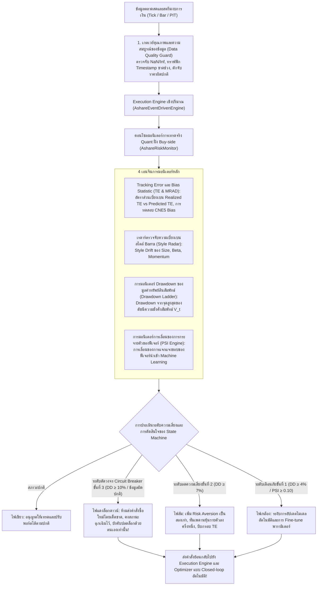
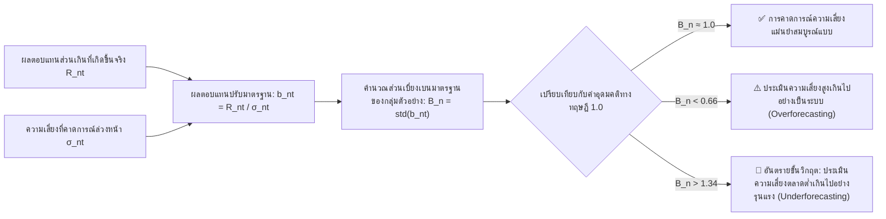
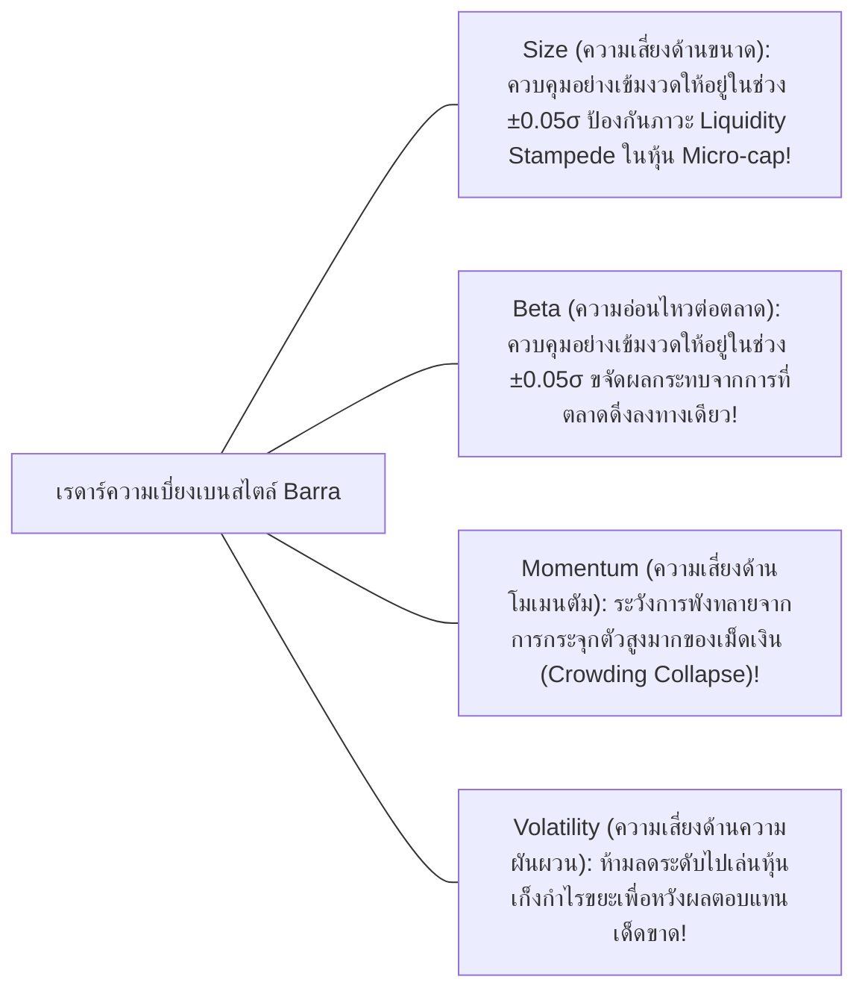
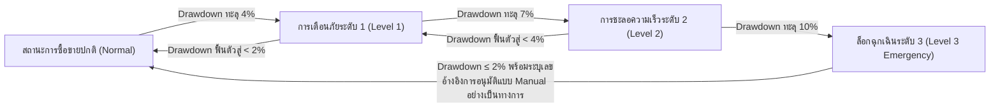
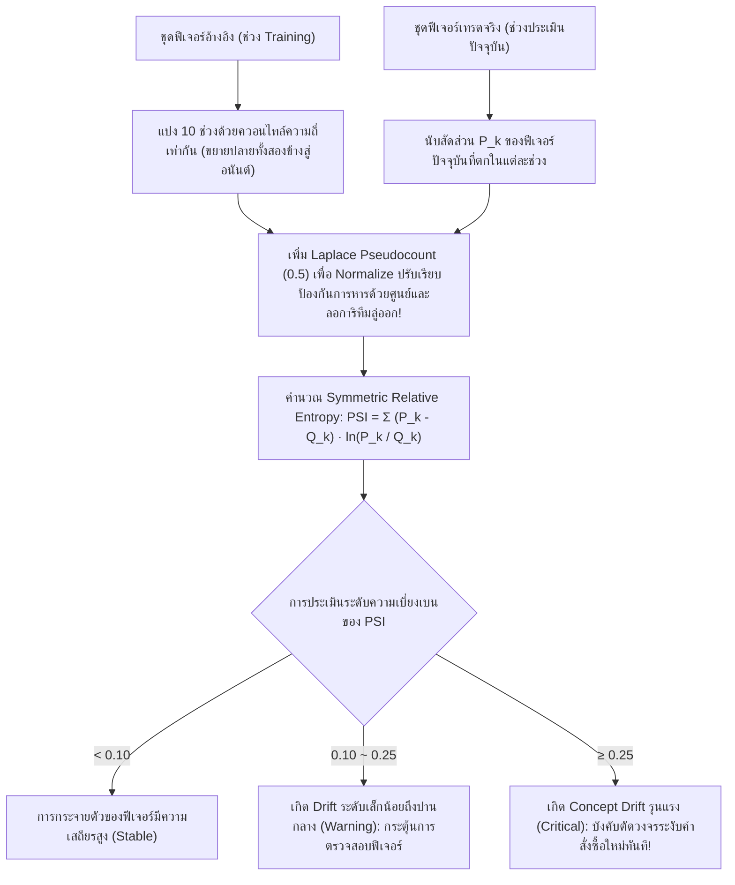
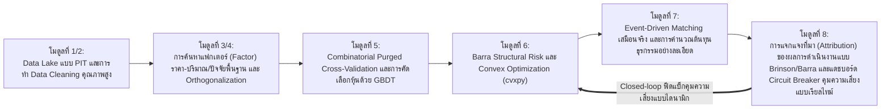

# บทที่ 31: การมอนิเตอร์การเทรดจริงและแดชบอร์ดเตือนภัยการบริหารความเสี่ยง

::: tip เป้าหมายหลักของบทนี้
ในสถาบัน Quant ฝั่ง Buy-side นั้น การวิจัยและพัฒนากลยุทธ์จนเสร็จสมบูรณ์เป็นเพียงแค่ "ก้าวแรกของเส้นทางอันยาวไกล" เท่านั้น การเทรดจริงคือสมรภูมิอันโหดร้ายที่ไม่เคยหยุดนิ่ง ไม่ว่าจะเป็นการเปลี่ยนแปลงสภาวะตลาดอย่างฉับพลัน (Regime Shift), สภาพคล่องในตลาดลดฮวบ, ปรากฏการณ์แย่งกันเทขายหรือเข้าซื้อแฟกเตอร์ (Factor Crowding / Stampede), การเลื่อนของฟิลด์ในแหล่งข้อมูล ตลอดจนระบบขัดข้อง ทั้งหมดนี้พร้อมที่จะฉุดกลยุทธ์ที่ดูเหมือนจะสมบูรณ์แบบในผลการทดสอบย้อนหลัง (Backtest) ดิ่งลงสู่หุบเหวแห่งความเสียหายได้ทุกเมื่อ

ในฐานะ**บทสรุปผลงานชิ้นเอกส่งท้าย**ของชุดคู่มือทั้งหมดนี้ บทนี้จะผสานแนวคิด**วิศวกรรมความน่าเชื่อถือของระบบ (Site Reliability Engineering: SRE)** ในวิศวกรรมซอฟต์แวร์สมัยใหม่, **มาตรฐานการควบคุมความเสี่ยงทางการเงินตามข้อตกลงบาเซิล (Basel Accords)** ของฝั่ง Buy-side และ**ระบบประเมินความแม่นยำในการพยากรณ์ของ MSCI Barra CNE5** เข้าด้วยกันอย่างลึกซึ้ง: เขียน State Machine มอนิเตอร์แบบเรียลไทม์ความถี่รายวันด้วยตนเอง; ติดตาม**อัตราส่วนความเบี่ยงเบนระหว่าง Rolling Realized Tracking Error (Realized TE) กับ Ex-ante Predicted TE**; นำ **Bias Statistic ของ CNE5 และ Mean Relative Absolute Deviation (MRAD)** มาใช้ตรวจสอบความน่าเชื่อถือของการพยากรณ์จากแบบจำลองความเสี่ยง (Risk Model); สร้าง**เรดาร์ตรวจจับการเลื่อนของการเปิดรับความเสี่ยงสไตล์ Barra (Barra Style Exposure Drift Radar)**; อนุพัทธ์**ระบบขั้นบันไดลดพอร์ตผ่าน Circuit Breaker 3 ระดับตามมูลค่าทรัพย์สินสุทธิสัมพัทธ์ (Relative NAV)** ที่มี Hysteresis เพื่อป้องกันสัญญาณหลอก; ประยุกต์ใช้**ดัชนีเสถียรภาพของประชากร (Population Stability Index: PSI)** ในการตรวจจับการเลื่อนของการกระจายตัวของฟีเจอร์ใน Machine Learning; และเชื่อมโยงคำสั่งควบคุมความเสี่ยงเข้ากับ Execution Engine จากบทที่ 27 เป็น Closed-loop ที่รัดกุม เพื่อสร้างป้อมปราการดิจิทัลสำหรับการเทรดจริงที่ไม่มีวันถูกทำลาย!
:::

---

## 1. วรรณกรรมคลาสสิกและรากฐานทฤษฎีในภาคอุตสาหกรรม

วรรณกรรมคลาสสิกและเอกสารไวต์เปเปอร์ระดับอุตสาหกรรมที่ต้องใช้อ้างอิงในการสร้างระบบมอนิเตอร์และ Circuit Breaker ควบคุมความเสี่ยงเชิงปริมาณระดับ Production:

1. **Orr, D. J., Mashtaler, Igor, & Nagy, Adam (2012)**. *"The Barra China Equity Model (CNE5) Empirical Notes"*, Section 5 & Appendix C (Review of Bias Statistics). MSCI Research.  
   > วางรากฐานเกณฑ์มาตรฐานทางสถิติสำหรับสถาบันฝั่ง Buy-side ในการประเมินความแม่นยำของการพยากรณ์นอกกลุ่มตัวอย่าง (Out-of-sample) ของแบบจำลองความเสี่ยง พร้อมทั้งอนุพัทธ์ Bias Statistic, การบิดเบือนของช่วงความเชื่อมั่น (Confidence Interval) ที่เกิดจากการแจกแจงแบบหางหนา (Fat-tailed Distribution) และเกณฑ์การวัด Mean Relative Absolute Deviation (MRAD) ไว้อย่างเป็นระบบ
2. **Yurdakul, Bilal (2018)**. *"Statistical properties of population stability index"*, *Risk Analysis*, 38(6): 1179-1195.  
   > อนุพัทธ์การแจกแจงเชิงเส้นกำกับ (Asymptotic Distribution) และช่วงความเชื่อมั่นของการทดสอบสมมติฐานสำหรับ Population Stability Index (PSI) ภายใต้กลุ่มตัวอย่างขนาดใหญ่อย่างรัดกุม เพื่อเป็นรากฐานทางทฤษฎีให้กับการมอนิเตอร์ฟีเจอร์ของ Machine Learning
3. **Beyer, Betsy, Jones, Chris, Petoff, Jennifer, & Murphy, Niall Richard (2016)**. *Site Reliability Engineering: How Google Runs Production Systems*. O'Reilly Media.  
   > วางมาตรฐานทางวิศวกรรมด้าน Service Level Indicator (SLI), Service Level Objective (SLO) และ Error Budget ซึ่งได้รับการยกย่องให้เป็นคัมภีร์การดูแลระบบ (Operations) ของเหล่า High-Frequency Market Maker และกองทุน Quant ชั้นนำระดับโลก
4. **Basel Committee on Banking Supervision (BCBS, 2013)**. *"Principles for effective risk data aggregation and risk reporting (BCBS 239)"*, Bank for International Settlements.  
   > หลักการสูงสุดของคณะกรรมการบาเซิลว่าด้วยการกำกับดูแลการธนาคาร (Basel Committee on Banking Supervision) ภายใต้ธนาคารเพื่อการชำระหนี้ระหว่างประเทศ (Bank for International Settlements) เกี่ยวกับการรวบรวมข้อมูลความเสี่ยงและการจัดทำรายงานความเสี่ยงแบบเรียลไทม์ที่มีประสิทธิผลสำหรับสถาบันการเงิน
5. **Lo, Andrew W. (2002)**. *"The Statistics of Sharpe Ratios"*, *Financial Analysts Journal*, 58(4): 36-52.  
   > ศาสตราจารย์ Andrew Lo จาก MIT ได้เปิดเผยถึงการบิดเบือนของตัวชี้วัดทางสถิติภายหลัง (Ex-post) ที่เกิดจาก Autocorrelation และความไม่เป็นปกติ (Non-normality) ของผลตอบแทน ซึ่งวางรากฐานทางคณิตศาสตร์ให้กับการมอนิเตอร์ช่วงความเชื่อมั่นแบบไดนามิก

---

## 2. แผนภาพสถาปัตยกรรมแดชบอร์ดการมอนิเตอร์ Quant ฝั่ง Buy-side สมัยใหม่

การมอนิเตอร์การเทรดจริงระดับ Production ไม่ใช่แค่การ "พล็อตกราฟเส้นผลตอบแทนไม่กี่เส้น" แต่เป็นระบบ Closed-loop ที่มีความพร้อมใช้งานสูง (High Availability) ซึ่งบูรณาการทั้ง**การตรวจจับคุณภาพข้อมูล, การมอนิเตอร์ตัวชี้วัดทางสถิติ, การแจ้งเตือน Concept Drift ของโมเดล และการตัดวงจร Circuit Breaker อัตโนมัติ**เข้าไว้ด้วยกัน:



---

## 3. การมอนิเตอร์การเลื่อนของ Tracking Error

### 3.1 สมการคำนวณ Realized Tracking Error
กำหนดให้ผลตอบแทนส่วนเกิน (Excess Return) เชิงรุกแบบเลขคณิตรายวันในช่วง $W$ วันทำการล่าสุด (ค่าเริ่มต้น $W = 60$ วัน) คือ $a_t = R_{p, t} - R_{b, t}$
Realized Tracking Error ต่อปี นิยามจากค่าเบี่ยงเบนมาตรฐานตัวอย่างของผลตอบแทนเชิงรุกปรับเป็นค่าต่อปี:

$$\text{TE}_{\text{realized}} = \sqrt{D} \times \sqrt{\frac{1}{W - 1} \sum_{t=1}^W (a_t - \bar{a})^2}$$

โดยที่ $D = 250$ คือจำนวนวันทำการต่อปี
### 3.2 เกณฑ์เตือนภัย Tracking Error หลุดการควบคุม
1. **อัตราส่วนความเบี่ยงเบน Ex-ante/Ex-post เกินเกณฑ์มาตรฐาน**:
   $$\text{Ratio}_{\text{TE}} = \frac{\text{TE}_{\text{realized}}}{\text{TE}_{\text{ex-ante}}} > 1.5$$
   หาก Tracking Error ที่เกิดขึ้นจริงจากการเทรดจริง (Live Trading) สูงกว่าที่แบบจำลองความเสี่ยง (Risk Model) ของ Barra คาดการณ์ไว้ล่วงหน้าเกินกว่า $50\%$ แสดงว่าโครงสร้างความแปรปรวนร่วม (Covariance Structure) ของตลาดเกิดการบิดเบี้ยวอย่างรุนแรง (เช่น ภาวะแย่งชิงสภาพคล่องอย่างเป็นระบบ / Systematic Liquidity Crunch) ต้องทริกเกอร์สัญญาณเตือนภัยระดับความเสี่ยงสูงทันที;
2. **ทะลุเพดานสูงสุดตามสัญญาโดยเด็ดขาด**:
   $$\text{TE}_{\text{realized}} > \text{TE}_{\text{target}} \quad (\text{เช่น ตามที่ระบุในสัญญา } 4.5\%)$$
   จะแตะเส้นตาย (Red Line) ด้านการควบคุมความเสี่ยงในหนังสือชี้ชวนของผลิตภัณฑ์จัดการสินทรัพย์โดยตรง และตัว Optimizer จะต้องบังคับบีบ Active Deviation ให้แคบลงทันที

---

## 4. การตรวจสอบความแม่นยำในการคาดการณ์ของแบบจำลองความเสี่ยง: สถิติความลำเอียง CNE5 (Bias Statistic) และ MRAD

นอกเหนือจากการติดตามพอร์ตการลงทุนจริงแล้ว ศูนย์บริหารความเสี่ยงเชิงปริมาณ (Quant) ระดับสถาบันยังต้องตรวจสอบอย่างต่อเนื่องว่า **ตัวแบบจำลองความเสี่ยง Barra ขั้นพื้นฐานมีความน่าเชื่อถือหรือไม่** โดยอ้างอิงตามข้อกำหนดใน White Paper ของ MSCI Barra CNE5 จะใช้สถิติความลำเอียง (Bias Statistic) เพื่อทำการตรวจสอบด้วยการทดสอบย้อนหลังแบบกลิ้งไปข้างหน้า (Rolling Backtest) นอกกลุ่มตัวอย่าง (Out-of-sample):

### 4.1 สถิติความลำเอียงของหน้าต่างเดี่ยว (Bias Statistic, $B_n$)
กำหนดให้ผลตอบแทนเชิงรุก (Active Return) ที่เกิดขึ้นจริงของพอร์ต $n$ ในวันซื้อขาย $t$ คือ $R_{nt}$ และความผันผวนเชิงรุก (Active Volatility) ที่คาดการณ์โดยแบบจำลอง Barra ณ ต้นงวดคือ $\sigma_{nt}$ นิยามผลตอบแทนปรับมาตรฐาน (Standardized Return):
$$b_{nt} = \frac{R_{nt}}{\sigma_{nt}}$$
ภายในหน้าต่างการสังเกตการณ์ที่มีความยาว $T$ (เช่น 12 เดือน หรือ 252 วัน) สถิติความลำเอียงจะนิยามจากส่วนเบี่ยงเบนมาตรฐานของกลุ่มตัวอย่างแบบไม่เอนเอียง (Unbiased Sample Standard Deviation) ของผลตอบแทนปรับมาตรฐาน:

$$B_n = \sqrt{ \frac{1}{T - 1} \sum_{t=1}^T (b_{nt} - \bar{b}_n)^2 }$$



- **ช่วงความเชื่อมั่นและการปรับแก้สำหรับหางหนา (Fat Tails)**:
  - ภายใต้ข้อสมมติการแจกแจงแบบปกติ ช่วงความเชื่อมั่น 95% คือ $\left[ 1 - \sqrt{\frac{2}{T}}, \; 1 + \sqrt{\frac{2}{T}} \right]$ สำหรับหน้าต่างรายเดือนขนาด 12 เดือน ($T=12$) ช่วงความเชื่อมั่นจะอยู่ที่ $[0.59, 1.41]$;
  - ทว่าสินทรัพย์ทางการเงินในโลกความเป็นจริงมีความโด่งส่วนเกิน (Excess Kurtosis) อย่างมีนัยสำคัญ หรือมีหางหนา การจำลองของ CNE5 แสดงให้เห็นว่า: ภายใต้การแจกแจงแบบ t ที่มีความโด่ง $k = 4$ เปอร์เซ็นไทล์ที่ 5 (P5) จะเลื่อนลงไปอยู่ที่ 0.61 และเปอร์เซ็นไทล์ที่ 95 (P95) จะเลื่อนขึ้นไปอยู่ที่ 1.40

### 4.2 ค่าเบี่ยงเบนสัมบูรณ์เฉลี่ยแบบกลิ้ง (Mean Rolling Absolute Deviation, MRAD)
สำหรับสินทรัพย์ทดสอบจำนวน $N$ รายการ ซึ่งครอบคลุมพอร์ตแฟกเตอร์ (Factor) บริสุทธิ์, พอร์ตอุตสาหกรรม, พอร์ตที่เอียงตามสไตล์ (Style-tilted) และพอร์ตความแปรปรวนต่ำสุด (Minimum Variance) นิยามค่าเบี่ยงเบนสัมบูรณ์เฉลี่ยดังนี้:

$$\text{MRAD}^\tau = \frac{1}{N} \sum_{n=1}^N \left| B_n^\tau - 1 \right|$$

- **เกณฑ์มาตรฐานขั้นต่ำทางทฤษฎี**: เมื่อผลตอบแทนมีการแจกแจงแบบปกติและการคาดการณ์สมบูรณ์แบบ $\mathbb{E}[\text{MRAD}] \approx 0.17$ ในขณะที่ในตลาดจริงที่มีลักษณะหางหนา (ความโด่ง $3.5 \sim 4.0$) จะได้ $\mathbb{E}[\text{MRAD}] \approx 0.19$;
- **เกณฑ์ตัดสินความเหนือกว่าของแบบจำลอง**: หากแบบจำลอง A มีค่า MRAD เท่ากับ 0.25 และแบบจำลอง B มีค่า MRAD เท่ากับ 0.22 เมื่อพิจารณาว่าขอบเขตล่างคือ 0.19 แบบจำลอง B ได้ลดความคลาดเคลื่อนในการคาดการณ์ส่วนเกินลงไปได้ถึง $(0.25 - 0.22)/(0.25 - 0.19) = 50\%$ เต็มๆ!

---

## 5. เรดาร์ Active Exposure ของปัจจัยสไตล์ Barra

ในผลิตภัณฑ์กองทุนดัชนีเสริมผลตอบแทน (Index Enhancement) และผลิตภัณฑ์ Quant Hedging การเคลื่อนตัวแอบแฝง (Implicit Drift) ของปัจจัยสไตล์ถือเป็นตัวการอันดับหนึ่งที่ก่อให้เกิดผลขาดทุนมหาศาล
ระบบมอนิเตอร์จะคำนวณการเปิดรับความเสี่ยงสุทธิต่อปัจจัย (Factor Net Exposure) ของพอร์ตเทียบกับเกณฑ์มาตรฐาน (Benchmark) เป็นรายวัน:

$$\Delta \beta_k = \sum_{i=1}^N (w_{p, i} - w_{b, i}) X_{i, k} = \mathbf{h}^T X_k$$



- **เส้นเตือนภัยความเสี่ยง (Red Line)**: หาก Active Exposure ของแฟกเตอร์สไตล์หลักตัวใดเกิน $\pm 0.10 \sigma$ หน้าแดชบอร์ดจะแสดงไฟเตือนสีเหลืองทันที หากความเบี่ยงเบนของสไตล์มูลค่าตลาดเกินกว่า $\pm 0.20 \sigma$ จะตัดสินว่าเกิด Style Drift อย่างรุนแรง และสั่งระงับคำสั่งปรับพอร์ต (Rebalance) ในรอบนั้นทันที

---

## 6. ดัชนีความมั่งคั่งสัมพัทธ์และระบบลดสถานะแบบขั้นบันได Circuit Breaker 3 ระดับพร้อม Hysteresis

ทีม Quant จำนวนมากมักคำนวณ Drawdown โดยใช้วิธีบวกสะสมผลตอบแทนเชิงรุก $\sum a_t$ เข้าไปตรงๆ ซึ่งถือเป็นอัลกอริทึมที่ผิดพลาดและมือสมัครเล่นอย่างยิ่ง มาตรวัดที่ถูกต้องคือ **ดัชนีความมั่งคั่งสัมพัทธ์ (Relative Wealth Index, $V_t$)**!

### 6.1 นิยามดัชนีความมั่งคั่งสัมพัทธ์และ Drawdown ที่แท้จริง
กำหนดให้มูลค่าสินทรัพย์สุทธิสัมพัทธ์เริ่มต้น ณ วันที่ 0 คือ $V_0 = 1.0$ ในแต่ละวันซื้อขาย $t$ ความมั่งคั่งสัมพัทธ์จะพัฒนาไปข้างหน้าแบบทบต้นตามผลตอบแทนรวมจริงของพอร์ตเทียบกับเกณฑ์มาตรฐาน:

$$V_t = \prod_{s=1}^t \frac{1 + R_{p, s}}{1 + R_{b, s}}$$

**มูลค่าการย่อตัวสูงสุดของมูลค่าสินทรัพย์สุทธิสัมพัทธ์ (Relative NAV Maximum Drawdown)** จนถึงวันซื้อขาย $t$ คือ:

$$DD_t = 1 - \frac{V_t}{\max_{0 \le s \le t} V_s}$$

> [!WARNING] จุดสูงสุดในประวัติศาสตร์ต้องรวมค่าเริ่มต้น 1.0
> อนุกรมค่าขั้วสูงสุดในประวัติศาสตร์ $\max_{0 \le s \le t} V_s$ จะต้องรวมจุดเริ่มต้น $V_0 = 1.0$ ไว้อย่างชัดเจนเสมอ! มิเช่นนั้น หากกลยุทธ์ขาดทุนตั้งแต่วันแรก ($V_1 = 0.90$) และไม่ได้รวม $V_0$ ค่าสูงสุดในประวัติศาสตร์จะถูกตัดสินผิดพลาดว่าเป็น $0.90$ จนนำไปสู่ข้อสรุปที่ไร้สาระว่า "Drawdown เป็น 0%"!

### 6.2 State Machine ของ Circuit Breaker 3 ระดับที่มีคุณสมบัติ Hysteresis

เพื่อป้องกันไม่ให้มูลค่าสินทรัพย์เกิดอาการแกว่งกวัดซ้ำซาก (Chattering) จากความผันผวนเล็กน้อยในวันเดียวรอบๆ เกณฑ์วิกฤต ซึ่งทำให้เกิด "การทริกเกอร์บ่อยครั้ง และการปลดล็อกบ่อยครั้ง" ระบบจึงนำ **ช่วงหน่วงฮิสเทอรีซิสระดับอุตสาหกรรม (Industrial Hysteresis Loop)** เข้ามาใช้:

| ระดับการควบคุมความเสี่ยง | เกณฑ์ทริกเกอร์เข้าสู่สถานะ | เอาต์พุตการควบคุมและการดำเนินการเมื่อทริกเกอร์ | เงื่อนไขการปรับลดระดับ / ปลดล็อกกลับคืน |
| :--- | :--- | :--- | :--- |
| **ระดับ 1: เฝ้าระวัง (Level 1)** | Drawdown สัมพัทธ์ $DD \ge 4.0\%$ | **ระงับการอัปเดตแบบจำลองออนไลน์**: หยุดพักการ Re-train ฟีเจอร์และการปรับ Hyperparameter อัตโนมัติชั่วคราว เพื่อป้องกันไม่ให้แบบจำลองเรียนรู้สัญญาณรบกวน (Noise) จาก Drawdown ไปเป็นรูปแบบทางสถิติ | Drawdown สัมพัทธ์ฟื้นตัวอย่างมีเสถียรภาพจน $DD < 2.0\%$ |
| **ระดับ 2: ชะลอความเร็ว (Level 2)** | Drawdown สัมพัทธ์ $DD \ge 7.0\%$ | **ดำเนินการลดเลเวอเรจเพื่อการตั้งรับ (Defensive Deleveraging)**:<br/>• สัมประสิทธิ์การหลีกเลี่ยงความเสี่ยง (Risk Aversion Coefficient) $\lambda \leftarrow 2\lambda$<br/>• ลดเพดานการ Overweight หุ้นรายตัวลงครึ่งหนึ่ง $d_{\max} \leftarrow 0.5 d_{\max}$<br/>• บีบเพดาน Target TE ให้แคบลงเหลือ $\min(\text{TE}_{\text{target}}, 3.0\%)$ | Drawdown สัมพัทธ์ฟื้นตัวอย่างมีเสถียรภาพจน $DD < 4.0\%$ จึงลดระดับลงสู่ระดับ 1; และเมื่อต่ำกว่า $2.0\%$ จึงกลับคืนสู่ภาวะปกติอย่างสมบูรณ์ |
| **ระดับ 3: เซอร์กิตเบรกเกอร์ฉุกเฉิน (Level 3)** | Drawdown สัมพัทธ์ $DD \ge 10.0\%$ | **ล็อกสถานะฉุกเฉินแบบคงค้าง (Latched State)**:<br/>• **ห้ามส่งคำสั่งซื้อใหม่ทุกกรณีอย่างเด็ดขาด (`allow_new_buys = False`)**<br/>• ระงับ Active Exposure ส่วนเกินทั้งหมด และปรับสัดส่วนการถือครองให้เข้าใกล้เกณฑ์มาตรฐานอย่างไร้ความเสี่ยง<br/>• **ห้ามปลดล็อกโดยอัตโนมัติเด็ดขาด**! | ต้องสอดคล้องกับเงื่อนไขทั้งหมดต่อไปนี้พร้อมกัน:<br/>1. Drawdown สัมพัทธ์ฟื้นตัวจน $DD \le 2.0\%$;<br/>2. คุณภาพข้อมูลและสไตล์ผ่านเกณฑ์อย่างสมบูรณ์;<br/>3. **ต้องให้ประธานเจ้าหน้าที่บริหารความเสี่ยงป้อนคำสั่งอนุมัติแบบ Manual พร้อมรหัสกำกับการตรวจสอบ (`reset_emergency`) เพื่อปลดล็อกอย่างชัดเจนเท่านั้น!** |



---
## 7. การมอนิเตอร์ Feature Distribution Drift: Population Stability Index (PSI)

หลังจากกลยุทธ์การคัดเลือกหุ้นด้วย Machine Learning ถูกนำไปใช้งานจริง หลายโมเดลมักค่อยๆ เสื่อมประสิทธิภาพลงหลังรันไปได้ราวครึ่งปี ซึ่งโดยทั่วไปแล้วไม่ใช่ Bug ในโค้ด แต่เกิดจากการที่การกระจายตัวของข้อมูลในตลาดการเงินเกิด **Covariate Shift / Concept Drift**!

### 7.1 การอนุพัทธ์ทางคณิตศาสตร์ของ Population Stability Index (PSI)
ดัชนีความเสถียรของประชากร (Population Stability Index: PSI) ใช้สำหรับวัดค่าความเบี่ยงเบนของ Relative Entropy ระหว่างกลุ่มตัวอย่างอ้างอิง (เช่น ชุดข้อมูล Training หรือช่วง Backtest ในอดีต) กับกลุ่มตัวอย่างในการเทรดจริง (Live Trading) ปัจจุบัน ในมิติ Marginal Distribution ของฟีเจอร์:

$$\text{PSI} = \sum_{k=1}^K (P_k - Q_k) \ln\left(\frac{P_k}{Q_k}\right)$$

โดยที่:
- $Q_k$：สัดส่วนตัวอย่างของฟีเจอร์ที่ตกอยู่ใน Bin ที่ $k$ ใน**ช่วงอ้างอิง (ชุด Training)**;
- $P_k$：สัดส่วนตัวอย่างของฟีเจอร์ที่ตกอยู่ใน Bin ที่ $k$ ใน**ช่วงประเมินผลการเทรดจริงปัจจุบัน**;
- $K$：จำนวน Bin (โดยทั่วไปแบ่งตามเดไซล์ความถี่เท่ากันของกลุ่มตัวอย่างอ้างอิง, $K = 10$)



### 7.2 การจัด Bin ระดับ Production และการปรับเรียบตัวเลขเพื่อป้องกัน Numeric Explosion
1. **ขยายปลายทั้งสองข้างสู่อนันต์**：ขอบเขตของ Bin ด้านซ้ายสุดต้องกำหนดเป็น $-\infty$ และขวาสุดเป็น $+\infty$ เพื่อให้มั่นใจว่าจะสามารถดักจับค่าผิดปกติสุดขั้วในสภาวะเทรดจริงได้ทั้งหมด;
2. **การปรับเรียบด้วย Laplace Pseudocount**：เมื่อจำนวนตัวอย่างใน Bin ใดของพอร์ตเทรดจริงมีค่าเป็น 0 ค่า $P_k = 0$ จะส่งผลให้ $\ln(P_k / Q_k) \to -\infty$ จนระบบคำนวณล้มเหลว จำเป็นต้องบวกค่า Pseudocount $0.5$ ให้กับทุก Bin เพื่อปรับเรียบ แล้วทำการ Normalize คำนวณใหม่อีกครั้ง

---

## 8. ปฏิบัติการแดชบอร์ดมอนิเตอร์ความเสี่ยงระดับ Production และการเชื่อมโยงกับ Execution Layer

ใน `tutorial/examples/lecture_31_live_monitoring_risk_dashboard.py` เราได้สร้าง `AshareRiskMonitor` ระดับ Production:
1. พัฒนาระบบมอนิเตอร์แบบ Rolling ครบวงจรสำหรับ Tracking Error, Barra Style Drift, Maximum Drawdown ของ NAV สัมพัทธ์ และ Feature Drift ด้วย PSI;
2. พัฒนา State Machine สำหรับตัดวงจร (Circuit Breaker) จาก Drawdown 3 ระดับ พร้อมกลไกคงสถานะ และการปลดล็อกที่ต้องได้รับการอนุมัติอย่างชัดเจน;
3. ส่งออก Structured Object `RiskControls` ที่อ่านได้ด้วยคอมพิวเตอร์ ทำงานร่วมกับ `AshareEventDrivenEngine` จากบทที่ 27 ได้แบบเนทีฟ เพื่อสกัดกั้นคำสั่งซื้อใหม่โดยอัตโนมัติเมื่อความเสี่ยงเกินเกณฑ์ที่กำหนด

สามารถรันเพื่อตรวจสอบได้โดยตรงบนเทอร์มินัล:

```bash
python3 -m examples.lecture_31_live_monitoring_risk_dashboard
```

<<< @/examples/lecture_31_live_monitoring_risk_dashboard.py

---

## 9. ภาพรวมระบบวิศวกรรมเชิงปริมาณครบวงจรแบบ Closed-Loop (ตั้งแต่ข้อมูลจนถึงการควบคุมความเสี่ยง)

เมื่อทบทวนระบบวิจัยและพัฒนาเชิงปริมาณ (Quant R&D) อันรัดกุมทั้งหมด 8 โมดูล 31 บท เราได้สร้าง Pipeline ระดับอุตสาหกรรมสำหรับฝั่ง Buy-side ที่เชื่อมต่อกันอย่างแนบเนียนและกระทบยอดได้อย่างสมบูรณ์:



| ระยะของโมดูล | อุปสรรคและความท้าทายหลัก | คอมโพเนนต์ระดับ Production และอาวุธโค้ดที่ส่งมอบจริง |
| :--- | :--- | :--- |
| **โมดูลที่ 1/2** | การหลีกเลี่ยง Survivorship Bias, Look-ahead Bias และกับดักความล่าช้าในการเปิดเผยงบการเงิน | Pipeline การเขียนข้อมูลแบบ Atomic ด้วย DuckDB/Polars, สแนปช็อตย้อนเวลาแบบไดนามิกของ `AsharePITEngine`, กฎผ่อนผัน 18 เดือนแบบปู่ย่า (Grandfather Rule) ของ Estimation Universe ใน US-E3/CNE5 |
| **โมดูลที่ 3/4** | ปัญหา Collinearity ของแฟกเตอร์, False Alpha ที่ซ้อนทับกันหลายชั้น และการสลายตัวในระยะสั้น | Robust Standardization ด้วย 1.4826 MAD, การทดสอบ Heteroskedasticity ของ Breusch-Pagan, Löwdin Symmetric Orthogonalization, เมทริกซ์ทดสอบ ICIR ด้วย Newey-West |
| **โมดูลที่ 5** | Data Leakage ในมิติอนุกรมเวลา (Time-series) ของกลุ่มตัวอย่าง และความเสี่ยงจากโมเดล Black-box ที่ไม่สามารถอธิบายได้ | Combinatorial Purged Cross-Validation (CPCV) ของ López de Prado, Learning to Rank ด้วย LambdaMART, การแจกแจงที่มาด้วย TreeSHAP |
| **โมดูลที่ 6** | ปัญหา Curse of Dimensionality ของ Covariance, Turnover ที่สูงเกินไป และ Risk Skewness | การแยกโครงสร้างแบบ Barra CNE5/CNE6, Convex Optimization ด้วย cvxpy/Clarabel, การลงโทษต้นทุนแบบ L1/L2 และการจัดสรรสินทรัพย์แบบ HRP |
| **โมดูลที่ 7** | การใช้วงเงินเกิน (Cash Overdraft), การถูกล็อกพอร์ตโดยไม่ตั้งใจจากราคาชนเพดาน/พื้น (Price Limit) แบบเส้นตรง และข้อจำกัดด้าน Capacity ของพอร์ต | State Machine สำหรับการจำลองเหตุการณ์ไม่ต่อเนื่อง (DES), Square-root Impact Model, สมุดบัญชีกระทบยอด 4 ขั้นตอนสำหรับการจ่ายปันผลและการแตก/แจกหุ้น |
| **โมดูลที่ 8** | การจำแนกว่ากำไรมาจาก Beta หรือ Pure Alpha และการป้องกันการเปลี่ยนแปลงฉับพลันแบบ Black Swan | การแจกแจงที่มา 3 ปัจจัยตามกลุ่มอุตสาหกรรมแบบ Brinson-Fachler, ลูกบาศก์ความเสี่ยง 3 มิติของ US-E3, แดชบอร์ดเตือนภัย Circuit Breaker 3 ระดับ, การทดสอบ Bias Statistic แบบ CNE5 MRAD และเรดาร์ตรวจจับ PSI Drift |

---

## 10. สรุปประจำบทและบทส่งท้ายเล่ม

| ประเด็นสำคัญ | คำตอบมาตรฐานระดับอุตสาหกรรม | กับดักที่พบบ่อยทางวิศวกรรมและวิชาการ |
| :--- | :--- | :--- |
| **ทำไม Relative Drawdown จึงต้องคำนวณจากดัชนีความมั่งคั่งสัมพัทธ์ $V_t$ เสมอ?** | มีเพียงการคำนวณตาม $V_t = \prod \frac{1+R_p}{1+R_b}$ เท่านั้นที่สะท้อนความมั่งคั่งของ NAV แบบทบต้นที่พอร์ตสร้างได้เหนือเกณฑ์มาตรฐานได้อย่างแท้จริง ส่วนการบวก Active Return สะสมตรงๆ จะทำให้เกิดความบิดเบือนจากการทบต้นเชิงเรขาคณิต | การนำ Active Return มาบวกกันตรงๆ แบบง่ายๆ จะทำให้ได้ค่า Drawdown ที่ผิดพลาดในสภาวะตลาดผันผวนไซด์เวย์ ส่งผลให้ระบบควบคุมความเสี่ยงตัดสินใจผิดพลาด |
| **ทำไม State Machine สำหรับ Circuit Breaker 3 ระดับจึงต้องออกแบบให้มี "Hard Latch"?** | การเกิด Relative Drawdown รุนแรงถึง $10\%$ มักหมายความว่าสมมติฐานพื้นฐานของกลยุทธ์หรือโมเดลเกิดความล้มเหลวอย่างมีนัยสำคัญ จึงต้องหยุดอัลกอริทึมไม่ให้เพิ่มสถานะการลงทุนอย่างสุ่มสี่สุ่มห้าโดยอัตโนมัติเมื่อตลาดรีบาวด์ในวันถัดไป และบังคับให้ผู้เชี่ยวชาญตรวจสอบสาเหตุรวมถึงอนุมัติเพื่อรีเซ็ตระบบด้วยตนเอง | เข้าใจผิดโดยออกแบบ Circuit Breaker ระดับ 3 ให้เป็นการตัดสินใจแบบไร้สถานะรายวัน ทำให้เมื่อตลาดรีบาวด์ 1% ในวันรุ่งขึ้น ระบบจะปลดล็อกอัตโนมัติและขาดทุนต่อเนื่อง |
| **วัตถุประสงค์หลักของ CNE5 Bias Statistic คืออะไร?** | ใช้สำหรับการตรวจสอบ Out-of-sample ว่าความผันผวนที่พยากรณ์โดยแบบจำลองความเสี่ยง (Risk Model) มีความไม่เอนเอียงหรือไม่ (ค่าในอุดมคติคือ $B_n \equiv 1.0$); เมื่อใช้ร่วมกับดัชนี MRAD จะสามารถวัดค่าความคลาดเคลื่อนในการพยากรณ์ของแบบจำลองความเสี่ยงในเชิงปริมาณได้ | ตรวจสอบเฉพาะความแม่นยำในการทำนายผลตอบแทนของ Alpha แต่ละเลยการตรวจสอบความแม่นยำในการพยากรณ์ของแบบจำลองความเสี่ยงอย่างสิ้นเชิง ส่งผลให้พอร์ตล้มละลายในช่วงที่ความผันผวนเปลี่ยนแปลงอย่างฉับพลัน |

---

### 🎉 บทส่งท้ายเล่ม: แด่ว่าที่สถาปนิกเชิงปริมาณฝั่ง Buy-side ในอนาคต

ขอแสดงความยินดีด้วย! เมื่อมาถึงจุดนี้ คุณได้ศึกษาการอนุพัทธ์ทางคณิตศาสตร์, โมเดลอัลกอริทึม และสถาปัตยกรรมทางวิศวกรรมที่ลึกซึ้งและเข้มข้นที่สุดของการลงทุนเชิงปริมาณในตลาดหุ้น A-Share ของจีนจนครบถ้วนแล้ว

การลงทุนเชิงปริมาณไม่ใช่เวทมนตร์แปรธาตุ แต่เป็น**วิทยาศาสตร์อันจริงจัง**ที่มุ่งค้นหาความได้เปรียบทางสถิติท่ามกลางมหาสมุทรแห่งสัญญาณรบกวนที่เต็มไปด้วยความไม่แน่นอน พร้อมควบคุมความเสี่ยงด้วยระเบียบวินัยทางวิศวกรรมและข้อจำกัดทางคณิตศาสตร์ที่รัดกุมที่สุด ขอให้คุณก้าวสู่การเทรดจริงในอนาคตด้วยความเคารพต่อตลาด ถืออาวุธทางวิทยาศาสตร์ที่มั่นคงไว้ในมือ และยืนหยัดอยู่ได้อย่างไร้พ่ายในระยะยาว!
