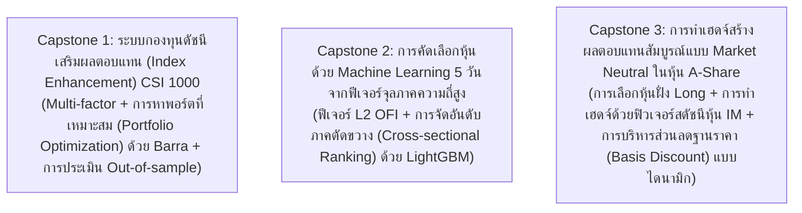

# 《ปฏิบัติการวิจัยและลงทุนเชิงปริมาณ (Quant) หุ้น A-Share ยุคใหม่: จากข้อมูล แฟกเตอร์ (Factor) AI สู่ระบบเทรดจริง (Live Trading) กองทุนดัชนีเสริมผลตอบแทน (Index Enhancement) แบบครบวงจร》โครงสร้างหลักสูตร

> **กลุ่มเป้าหมาย**: นักพัฒนา, นักศึกษาวิศวกรรมการเงิน และผู้ศึกษาระดับแอดวานซ์ด้าน Quant ที่มีพื้นฐาน Python (คุ้นเคยกับไวยากรณ์พื้นฐาน ฟังก์ชัน และโครงสร้างข้อมูลทั่วไป) ซึ่งต้องการเชี่ยวชาญกระบวนการวิจัยและลงทุน Quant แบบครบวงจรระดับฝั่ง Buy-side / กองทุนเอกชน (Private Fund)  
> **หลักการสำคัญ**: **กำหนดขอบเขตตัวอย่างให้ชัดเจน สอดคล้องกับบริบทการวิจัยหุ้น A-Share ตรวจสอบความสอดคล้องของช่วงเวลา และเชื่อมโยงกระบวนการทางวิศวกรรมทีละขั้นตอน**  
> **เทคโนโลยีสแตกสมัยใหม่**: Python 3.11+, Polars (การประมวลผลอนุกรมเวลา (Time-series) และภาคตัดขวาง (Cross-sectional) ประสิทธิภาพสูง), DuckDB (การวิเคราะห์ในเครื่องที่รวดเร็วเป็นพิเศษ), cvxpy (Convex Optimization), LightGBM/CatBoost (การสร้างแบบจำลอง Time-series ข้อมูลตาราง)

> **ความคืบหน้าปัจจุบัน**: บทที่ 1–31 มีเนื้อหาพื้นฐานและตัวอย่างที่รันได้แล้ว อยู่ระหว่างการลงลึกทีละบท บทที่ 1 ได้ย้อนกลับเป็นเวอร์ชันก่อนการลงรายละเอียดครั้งนี้ โดยแผนการเจาะลึกยังอยู่ระหว่างปรับปรุง ดูเป้าหมายการเรียนรู้และความรู้พื้นฐานที่ต้องมีได้ที่ [เส้นทางการเรียนรู้](./learning_path.md) เอกสารอ่านประกอบดูได้ที่ [คู่มือแหล่งข้อมูลสาธารณะ](./resources.md) วิธีการรันดูได้ที่ [คำอธิบายโปรเจกต์](./README.md)

---

## แผนผังภาพรวมของหลักสูตร

---

## โมดูลที่ 1: การปรับกรอบความคิดและวิศวกรรม Quant สมัยใหม่ (4 บท)

### บทที่ 1: ภาพรวมระบบนิเวศ Quant และโมเดลการทำกำไรในหุ้น A-Share
- **Quant ในหุ้น A-Share ทำเงินจากอะไร**: จากยุคแรกที่ "กำไรมหาศาลจากหุ้น Small-cap" สู่ยุคปัจจุบันอย่าง "Index Enhancement บน CSI 1000/2000", "Quant Market Neutral", "T+0 ความถี่สูง" และ "Macro CTA"
- **แผนภูมิตระกูลกลยุทธ์ของสถาบันกระแสหลัก**:
  - กองทุนดัชนีเสริมผลตอบแทน (Index Enhancement): แหล่งที่มาของ Alpha ส่วนเกิน (Excess Return) บน CSI 500, CSI 1000 และ A500
  - Market Neutral: ตรรกะการทำ Hedging ด้วยสัญญาซื้อขายล่วงหน้าดัชนีหุ้น (IF/IC/IM) และต้นทุน Basis Discount
- **ระบบการซื้อขายและข้อจำกัดเฉพาะตัวของหุ้น A-Share**:
  - ผลกระทบของระบบ T+1 ต่อ Turnover ภายในวันและความเสี่ยงข้ามคืน
  - ข้อจำกัดราคาชนเพดาน/พื้น (กระดานหลัก ±10%, กระดาน ChiNext/STAR Market ±20%, ตลาดหลักทรัพย์ปักกิ่ง ±30%)
  - อากรแสตมป์ (Stamp Duty) และกลไกการจำกัดการยืมหุ้นเพื่อขายชอร์ต (ความขาดแคลนของเครื่องมือทำ Short-selling)

### บทที่ 2: "4 สาเหตุการตาย" ในการ Backtest ของ Quant และหลักการป้องกัน
- **Look-ahead Bias**:
  - วิเคราะห์กรณีศึกษา: ทำไมการใช้ข้อมูลงบการเงินไตรมาส 3 มาทำ Backtest ในวันที่ 15 ตุลาคม จึงเป็นข้อผิดพลาดร้ายแรง?
  - การรั่วไหลของข้อมูลในอนาคตที่เกิดจากการนำราคาสูงสุด/ต่ำสุดระหว่างวันมาใช้
- **Survivorship Bias**: กับดัก "การอันตรธานหายไป" ของหุ้นที่ถูกเพิกถอนหลักทรัพย์ (Delisting) หรือถูกพักการซื้อขาย (Suspension) ไปแล้วในการ Backtest ข้อมูลย้อนหลัง
- **กับดักคำสั่งที่ไม่สามารถจับคู่ได้จริง**: อัตราการชนะ (Win Rate) ที่สูงเกินจริงจากการซื้อเมื่อราคาชนเพดาน (Limit-up) แบบเปิดกระโดด (One-word Limit-up) หรือการขายเมื่อราคาชนพื้น (Limit-down)
- **Overfitting และการแอบส่องข้อมูล (Data Snooping / P-Hacking)**: ค่า Sharpe Ratio ลวงตาจากการมีพารามิเตอร์มากเกินไป

### บทที่ 3: บอกลาเทคโนโลยีแบบเดิมที่เชื่องช้า: การติดตั้งสภาพแวดล้อมวิศวกรรม Quant สมัยใหม่
- **เครื่องมือจัดการแพ็กเกจ**: การจัดการสภาพแวดล้อม Python ยุคใหม่ที่รวดเร็วเป็นพิเศษด้วย `uv` / `pixi`
- **ทำไมจึงไม่ใช้เพียงแค่ Pandas อีกต่อไป**:
  - การใช้ Expression และความสามารถด้าน Parallel Processing ของ Polars ในการคำนวณ Multi-factor ภาคตัดขวาง; การตรวจสอบความสอดคล้องของผลลัพธ์และการเปรียบเทียบประสิทธิภาพจริง
  - DuckDB ฐานข้อมูล OLAP แบบฝังตัว (Embedded): รวมข้อมูล (Aggregate) อนุกรมเวลาของหุ้นระดับล้านรายการและงบการเงินได้ในระดับวินาที
- **การออกแบบโซลูชันการจัดเก็บข้อมูล**: การย้ายจาก CSV ไปสู่ฟอร์แมต Parquet แบบแบ่งพาร์ติชัน เพื่อสร้าง Data Lake บนเครื่องตนเองที่เบาและมีประสิทธิภาพสูง

### บทที่ 4: ปฏิบัติการเชื่อมต่อข้อมูลหลากหลายแหล่งของหุ้น A-Share และจัดเก็บลงฐานข้อมูลภายในเครื่อง
- **การเปรียบเทียบแหล่งข้อมูลฟรีกับเชิงพาณิชย์**: การเชื่อมต่อแหล่งข้อมูล Tushare Pro, AkShare, Baostock และแหล่งข้อมูลระดับเชิงพาณิชย์อย่าง Choice / Wind / Tongdaxin
- **การซิงค์ข้อมูลและการสร้าง Pipeline ภายในเครื่อง**:
  - การดึงข้อมูลและตรวจสอบความถูกต้องอัตโนมัติของ Bar รายวัน, Factor การปรับสิทธิ์ (Adjustment Factor), น้ำหนักย้อนหลังของหุ้นองค์ประกอบดัชนี และปฏิทินการซื้อขาย
  - **ผลลัพธ์เชิงปฏิบัติ**: สร้างฐานข้อมูลพื้นฐาน Parquet ภายในเครื่องสำหรับหุ้น A-Share ที่อัปเดตอัตโนมัติและมีน้ำหนักเบา

---

## โมดูลที่ 2: วิศวกรรมข้อมูลและการคลีนซิ่งข้อมูลโดยไร้การรั่วไหล (รากฐาน PIT) (4 บท)

### บทที่ 5: การปรับสิทธิ์ข้อมูลราคาและการสร้างกรอบหุ้นเป้าหมาย (Universe) แบบไดนามิก
- **เจาะลึกกลไกการปรับสิทธิ์**: ความแตกต่างและสถานการณ์การใช้งานระหว่างการปรับสิทธิ์ย้อนหลัง (Backward Adjustment) vs การปรับสิทธิ์ไปข้างหน้า (Forward Adjustment) (การคำนวณแฟกเตอร์ให้ใช้การปรับสิทธิ์ย้อนหลัง ส่วนการจับคู่คำสั่งซื้อขาย (Matching) และราคาในการ Backtest ให้ใช้ราคาตลาดจริง)
- **เกณฑ์การคัดกรอง Dynamic Universe**:
  - คัดหุ้นเข้าใหม่ออก (ไม่เข้าร่วมการซื้อขายในช่วง N วันแรกหลังเข้าตลาด)
  - คัดหุ้น ST / *ST และหุ้นที่อยู่ในช่วงเตือนภัยก่อนการเพิกถอนหลักทรัพย์ออก
  - จัดการหุ้นที่มีการพักการซื้อขายชั่วคราวระหว่างวันและหุ้นที่พักการซื้อขายทั้งวัน
- **การอิมพลีเมนต์โค้ด**: สร้างเมทริกซ์ Mask ของกลุ่มสินทรัพย์ที่สามารถซื้อขายได้จริงแบบ Rolling ตามเวลา (Trading Mask)

### บทที่ 6: การจัดการข้อมูลงบการเงินแบบ Point-in-Time (PIT) อย่างถูกต้อง
- **3 ไทม์สแตมป์หลักของงบการเงิน**: วันสิ้นสุดรอบรายงาน (Period End Date), วันเปิดเผยประกาศจริง (Notice Date), วันประกาศฉบับแก้ไข (Revision Date)
- **อัลกอริทึมการจัดวางข้อมูลให้ตรงกันของ PIT**:
  - ตรวจสอบให้แน่ใจว่า ณ จุดเวลา Backtest ในอดีต $t$ ใด ๆ กลยุทธ์จะสามารถ "มองเห็น" ได้เฉพาะงบการเงินล่าสุดที่เปิดเผยก่อนวัน $t$ เท่านั้น
  - แก้ไขปัญหาลำดับเวลาคาบเกี่ยวกันในช่วงการเปิดเผยงบไตรมาส 1, รายงานครึ่งปี, งบไตรมาส 3 และรายงานประจำปี
- **โค้ดปฏิบัติการ**: ระบุเงื่อนไขการใช้งาน `join_asof` ให้ชัดเจน และทำการจัดเรียงงบการเงินให้ตรงกันตามเวลาที่เริ่มใช้งานได้จริง รอบรายงาน และเวอร์ชัน

### บทที่ 7: วิวัฒนาการของการจัดกลุ่มอุตสาหกรรมและการดูแลรักษาแท็กแนวคิด (Concept Tags)
- **ระบบการจัดกลุ่มอุตสาหกรรม**: ตรรกะการจัดกลุ่มอุตสาหกรรมระดับ 1/ระดับ 2 ของ Shenwan และอุตสาหกรรมของ CITIC
- **ประวัติการเปลี่ยนแปลงการจัดกลุ่มอุตสาหกรรม**: จัดการผลกระทบจากการจัดกลุ่มอุตสาหกรรมใหม่ที่มีต่อแฟกเตอร์ในอดีต
- **ธรรมาภิบาลข้อมูลกลุ่มธีม (Concept Sector)**: การทำเครื่องหมายเชิงปริมาณของการหมุนเวียนกลุ่มธีม (Concept Rotation) และความเสี่ยงเปิดรับต่อธีม (Thematic Exposure)

### บทที่ 8: 【ลงมือปฏิบัติ】เขียน Search Engine สำหรับดึงข้อมูล PIT ของหุ้น A-Share ประสิทธิภาพสูงด้วยตนเอง
- **เป้าหมายความต้องการ**: รับข้อมูลนำเข้าเป็นวันที่ `2024-03-01` และรายชื่อหุ้น ส่งคืนฟีเจอร์ราคาและปริมาณหลังตลาดปิดของวันซื้อขายนั้น ตัวชี้วัดงบการเงินที่ใช้งานได้ ณ เวลานั้น และ Mask หมวดหมู่อุตสาหกรรม พร้อมทั้งตรวจสอบขอบเขตของข้อมูล
- **Unit Test**: การทดสอบจำลองการรั่วไหลของ Look-ahead Bias เพื่อให้มั่นใจในความทนทาน (Robustness) ของโค้ด

---

## โมดูลที่ 3: วิศวกรรมฟีเจอร์และการขุดแฟกเตอร์คลาสสิก/ระดับจุลภาค (5 บท)

### บทที่ 9: การพัฒนาคลังแฟกเตอร์ราคาและปริมาณแบบคลาสสิกในเชิงวิศวกรรม
- **กลุ่มโมเมนตัมและการกลับตัว**: โมเมนตัม Time-series แบบคลาสสิก, โมเมนตัม Cross-sectional, การกลับตัวระยะสั้น (วิเคราะห์ปรากฏการณ์การกลับตัวรอบ 5 วัน / 20 วันของหุ้น A-Share)
- **กลุ่มความผันผวนและผลตอบแทนสุดโต่ง**: ความผันผวนย้อนหลัง, ความผันผวนเฉพาะตัว (Idiosyncratic Volatility), ผลตอบแทนรายวันสูงสุด (ปรากฏการณ์ผิดปกติ MAX)
- **กลุ่มสภาพคล่องและ Turnover**: ดัชนีการขาดสภาพคล่อง Amihud, อัตรา Turnover ส่วนเกิน, ค่าสัมประสิทธิ์ Divergence ระหว่างราคากับปริมาณ
- **มาตรฐานโค้ด**: ใช้ Expression ของ Polars เพื่อคำนวณแบบ Vectorization สำหรับ 20+ แฟกเตอร์ราคาและปริมาณแบบคลาสสิก เลิกใช้ลูป `for` ที่เชื่องช้าอย่างสิ้นเชิง

### บทที่ 10: แฟกเตอร์ปัจจัยพื้นฐานและการคาดการณ์ของนักวิเคราะห์
- **มูลค่าและความสามารถในการทำกำไร**: EP (ส่วนกลับของ P/E), BP (ส่วนกลับของ P/B), การแยกส่วนประกอบ ROE (ระบบวิเคราะห์ DuPont)
- **การเติบโตและคุณภาพทางการเงิน**: SUE (Standardized Unexpected Earnings), อัตราการเติบโตของรายได้เมื่อเทียบกับปีก่อนหน้า (YoY), สัดส่วนกระแสเงินสดจากการดำเนินงานต่อกำไรสุทธิ
- **แฟกเตอร์การคาดการณ์ของนักวิเคราะห์**: การปรับเพิ่มคำแนะนำการลงทุน (Rating Upgrade) ที่คาดการณ์, โมเมนตัมการปรับประมาณการกำไรสุทธิขึ้น (กรณีใช้ข้อมูลทางเลือก)

### บทที่ 11: วิศวกรรมฟีเจอร์แปลงข้อมูลความถี่สูงเป็นความถี่ต่ำ (แหล่งที่มาหลักของผลตอบแทนส่วนเกินฝั่ง Buy-side)
- **มุมมองโครงสร้างจุลภาคความถี่สูง (Market Microstructure)**: สกัด Alpha ความถี่ปานกลาง-ต่ำ จาก Snapshot ข้อมูล Level-2 ระหว่างวัน
- **ความไม่สมดุลของกระแสคำสั่งซื้อขาย (Order Flow Imbalance, OFI)**:
  - ความสัมพันธ์ระหว่างการเปลี่ยนแปลงปริมาณคำสั่งเสนอซื้อเสนอขายอันดับหนึ่ง (Best Bid/Ask) กับการเคลื่อนไหวของราคา
  - การรวมข้อมูล OFI ระหว่างวันเป็นความถี่ต่ำ (การสะสมรายวัน/รายสัปดาห์)
- **รูปแบบจุลภาคของราคาและปริมาณระหว่างวัน**:
  - แฟกเตอร์ Smart Money (Smart Money Indicator): อิงตามส่วนต่างของ VWAP ที่จับคู่คำสั่งสำเร็จระหว่างคำสั่งขนาดเล็กและคำสั่งขนาดใหญ่ระหว่างวัน
  - ฟีเจอร์ความหนาแน่นของปริมาณการซื้อขายในช่วง 30 นาทีแรกหลังเปิดตลาดและ 30 นาทีสุดท้ายก่อนปิดตลาด
### บทที่ 12: 4 ขั้นตอนมาตรฐานระดับอุตสาหกรรมสำหรับการเตรียมข้อมูลเบื้องต้นของแฟกเตอร์ (Factor)
- **Step 1: Winsorization**：วิธี 3-Sigma vs วิธีค่าเบี่ยงเบนสัมบูรณ์มัธยฐาน (MAD)
- **Step 2: การจัดการและแทนที่ค่าสูญหาย**：การแทนที่ด้วยค่ามัธยฐานของกลุ่มอุตสาหกรรม vs การตัดทิ้งแบบภาคตัดขวาง (Cross-sectional)
- **Step 3: Standardization**：การทำ Z-Score Standardization แบบ Cross-sectional
- **Step 4: การทำ Neutralization รายอุตสาหกรรมและมูลค่าตลาด**：
  - ทำไมต้องทำ Neutralization? (ขจัด Beta ของอุตสาหกรรม และการเปิดรับความเสี่ยงที่ไม่ได้เจตนาในหุ้นขนาดเล็ก)
  - ภาคปฏิบัติการสกัด Residual แบบ Cross-sectional บนพื้นฐานวิธี Weighted Least Squares (WLS)

### บทที่ 13: การทำ Orthogonalization ของ Factor และการขจัดปัญหาภาวะร่วมเส้นตรง
- **อันตรายจากภาวะร่วมเส้นตรงพหุคูณ (Multicollinearity)**：ความสัมพันธ์ระดับสูงระหว่าง Factor ส่งผลให้น้ำหนักพอร์ตเพี้ยนและเกิด Overfitting
- **Symmetric Orthogonalization**：คงความหมายทางเศรษฐศาสตร์ดั้งเดิมของ Factor ไว้ให้ได้มากที่สุด
- **Gram-Schmidt Orthogonalization**：วิธีแยกองค์ประกอบทีละขั้นตามลำดับความสำคัญของ Factor อ้างอิง
- **สิ่งที่ได้จากภาคปฏิบัติ**：ตรวจสอบเงื่อนไขข้อจำกัดของการทำ Orthogonalization และ Neutralization พร้อมอธิบายว่าการแปลงข้อมูลเปลี่ยนความหมายของฟีเจอร์อย่างไร โดยที่ความเป็น Orthogonal ไม่ได้พิสูจน์ถึงพลังในการพยากรณ์

---

## โมดูลที่ 4: ระบบการประเมิน Factor ระดับอุตสาหกรรม (4 บท)

### บทที่ 14: ตัวชี้วัดหลักของพลังการพยากรณ์ของ Factor (IC / Rank IC / ICIR)
- **หลักการทางคณิตศาสตร์ของ IC (Information Coefficient) และ Rank IC**：สัมประสิทธิ์สหสัมพันธ์เพียร์สัน vs สัมประสิทธิ์สหสัมพันธ์อันดับสเปียร์แมน
- **ICIR และค่าสถิติ t**：ประเมินความเสถียรและความเชื่อมั่นของ Factor
- **เกณฑ์การพิจารณาหลักฐาน**：ประเมินร่วมกันระหว่าง Effect Size, ความยาวของกลุ่มตัวอย่าง, Autocorrelation, การทดสอบซ้ำหลายครั้ง และผลงานนอกกลุ่มตัวอย่าง โดยไม่ใช้เกณฑ์ขั้นต่ำแบบเหมารวมในการตัดสินว่าค่า IC/ICIR ดีเลิศ

### บทที่ 15: การทำ Backtest แบบแบ่งชั้นและการทดสอบ Monotonicity
- **วิธีทดสอบผลตอบแทนตามกลุ่มควอนไทล์ (Quantile Portfolio Analysis)**：
  - แบ่งหุ้นตามค่า Factor ออกเป็น 5 กลุ่ม หรือ 10 กลุ่ม แล้วคำนวณเส้นกราฟ NAV ของแต่ละกลุ่ม
  - การทดสอบ Monotonicity: ให้คะแนนการเพิ่มขึ้น/ลดลงแบบทางเดียว เพื่อป้องกันความผันผวนที่ไม่เป็นโมโนโทนิกในกลุ่มตรงกลาง
- **ผลตอบแทน Long-Short Spread**：
  - ผลตอบแทนต่อปีและ Maximum Drawdown ของกลยุทธ์ Long-Short โดยนำกลุ่ม Top หักลบด้วยกลุ่ม Bottom
  - ประเมินแยกกันระหว่างผลตอบแทนส่วนเกิน (Excess Return) ฝั่ง Long (กลุ่ม Top ชนะเกณฑ์มาตรฐาน) กับสัดส่วนผลกำไรจากฝั่ง Short

### บทที่ 16: Turnover ของ Factor และเส้นกราฟ Alpha Decay
- **Autocorrelation ของ Factor และการประมาณการ Turnover**：ยิ่งค่าสัมประสิทธิ์ Autocorrelation สูง อัตรา Turnover ในการปรับพอร์ต (Rebalance) ในอนาคตยิ่งต่ำ
- **การพล็อตเส้นกราฟการลดทอนของ Factor**：
  - คำนวณความเร็วการเสื่อมถอยของค่า IC ของ Factor เมื่อ Lag ไป 1 วัน, 3 วัน, 5 วัน, 10 วัน และ 20 วัน
  - กำหนดรอบการ Rebalance ที่ดีที่สุดสำหรับกลยุทธ์ (รายวัน, ทุก 3 วัน หรือรายสัปดาห์?)

### บทที่ 17: 【ข้อควรระวังในภาคปฏิบัติ】กรณีศึกษาการตรวจจับ Factor ลวงที่ล้มเหลวไม่เป็นท่า
- **กรณีศึกษาที่ 1**：Factor ที่ดูทรงพลังด้วย Rank IC สูงถึง 0.12 ทำไมหลังทำ Neutralization แล้วผลตอบแทนถึงหายไปจนหมดสิ้น? (แท้จริงแล้วเปิดรับความเสี่ยงต่อส่วนต่างผลตอบแทนของหุ้นขนาดเล็กมาก)
- **กรณีศึกษาที่ 2**：กลยุทธ์ค่า Sharpe Ratio สูงลิ่วแต่เมื่อเทรดจริง (Live Trading) กลับซื้อไม่เข้าเลยแม้แต่น้อย (กับดัก Survivorship Bias จากการไล่ซื้อหุ้นชนเพดาน (Limit-up))

---

## โมดูลที่ 5: การจัดอันดับแบบ Cross-sectional และการสร้างโมเดล Machine Learning แบบอนุกรมเวลา (Time-series) (5 บท)

### บทที่ 18: วิธีการแบ่งชุดข้อมูล Cross-Validation (CV) สำหรับข้อมูล Time-series ทางการเงินอย่างถูกต้อง
- **ทำไม K-Fold ทั่วไปถึงเป็นหายนะ**：Autocorrelation ของข้อมูล Time-series ทำให้เกิด Data Leakage รุนแรง
- **Purged Group Time Series Split**：
  - กำหนดช่วงตัดข้อมูลปนเปื้อน (Purging) และช่วงกันชนส่วนซ้อนทับของการคาดการณ์ (Embargoing)
  - หลักการและโค้ดของ Combinatorial Purged Cross-Validation (CPCV)

### บทที่ 19: ภาคปฏิบัติกับโมเดล Gradient Boosted Decision Tree ระดับตารางข้อมูล (LightGBM / CatBoost)
- **การเลือก Objective Function**：
  - เป้าหมายการถดถอย (Regression MSE/Huber): พยากรณ์อัตราผลตอบแทนล่วงหน้า N วัน
  - เป้าหมายการจัดอันดับ (LambdaMART / RankPairwise): พยากรณ์อันดับสัมพัทธ์แบบ Cross-sectional โดยตรง
- **การทำ Feature Engineering และการสร้างชุดข้อมูลตัวอย่าง**：
  - การทำ Winsorization กับ Label ของตัวอย่าง และการทำ Cross-sectional Rank Normalization
  - การออกแบบกลไก Walk-forward Retraining

### บทที่ 20: การป้องกัน Overfitting ในโมเดลต้นไม้และความสามารถในการอธิบาย Feature
- **ภาคปฏิบัติการจูน Regularization**：อัตราการเรียนรู้, จำนวนโหนดใบ, สัดส่วนการสุ่มเลือกฟีเจอร์ (`feature_fraction`)
- **การแจกแจงที่มา (Attribution) ของ Feature ด้วยค่า SHAP**：วิเคราะห์ Marginal Contribution ของแต่ละ Factor ต่อการตัดสินใจของโมเดลในสภาวะตลาดต่าง ๆ
- **Adversarial Validation**：ตรวจสอบว่าชุดข้อมูล Train และ Test มี Distribution Shift อย่างมีนัยสำคัญหรือไม่

### บทที่ 21: ขอบเขตความเหมาะสมของการนำ Deep Learning มาใช้คัดเลือกหุ้น A-Share
- **โมเดล Deep Learning แบบ Time-series**：การประเมินผลการจัดอันดับแบบ Cross-sectional ระหว่าง LSTM / GRU vs 1D-CNN vs Temporal Transformer
- **"คำสาปแห่งมิติ" และกับดัก Signal-to-Noise Ratio**：ทำไมโมเดล Deep Learning ที่ซับซ้อนมักแพ้ LightGBM ที่เสริมด้วย Feature Engineering อันประณีตเมื่อนำไปใช้เทรดจริง?
- **แนวทางปฏิบัติที่ดีที่สุดสำหรับโมเดล Deep Learning**：ใช้เป็น Feature Extractor เพื่อสร้าง Low-dimensional Embedding แทนที่จะใช้แบบ End-to-end เพื่อคาดการณ์ขนาดสถานะพอร์ตโดยตรง

### บทที่ 22: 【ภาคปฏิบัติ】จากการให้คะแนน Multi-factor แบบ Cross-sectional สู่ไปป์ไลน์คัดเลือกหุ้นแบบอัตโนมัติเต็มรูปแบบ
- **ข้อกำหนดข้อมูลนำเข้า**：พาเนลฟีเจอร์ที่จัดเรียง Point-in-time ตรงกันเรียบร้อยแล้ว, Mature Label และปฏิทินการซื้อขาย
- **การแยกมิติด้านเวลา**：จัดการแยกส่วนอย่างชัดเจนระหว่างการ Train, การ Validate, การปรับเทียบผลตอบแทน และการ Test ขั้นสุดท้าย
- **จากอันดับสู่ผลตอบแทน**：ปรับเทียบ Ranking Score ด้วย Mature Label นอกกลุ่มตัวอย่าง เพื่อให้ได้ผลตอบแทนที่คาดหวังตลอดช่วงเวลาถือครองสำหรับนำไปใช้ทำ Portfolio Optimization (การหาพอร์ตที่เหมาะสม)
- **การเชื่อมต่อกับการส่งคำสั่งซื้อขาย**：แยกน้ำหนักเป้าหมาย ณ ราคาปิด ออกจากการจับคู่คำสั่งซื้อขายจริงในรอบการซื้อขายถัดไปอย่างชัดเจน และคงความหมายที่ชัดเจนไว้แม้ในกรณีเป้าหมายที่เป็นสถานะว่างเปล่า
- **ขอบเขตการต่อยอด**：การวิจัยและการลงทุนด้วย LLM/Agent ถือเป็นหัวข้อทางเลือกสำหรับอนาคต และจะไม่ถูกระบุผิดว่าได้นำมาใช้งานจริงแล้วในบทนี้

---

## โมดูลที่ 6: แบบจำลองความเสี่ยง (Risk Model) Barra และ Portfolio Optimization ยุคใหม่ (4 บท)

### บทที่ 23: เจาะลึก Structural Risk Model ของ Barra สำหรับหุ้น A-Share
- **หลักการพื้นฐานของ Multi-factor Risk Model**：แยกความเสี่ยงรวมของหุ้นออกเป็นความเสี่ยงจากอุตสาหกรรม, ความเสี่ยงจากสไตล์ และความเสี่ยงเฉพาะตัว
- **การสร้าง 10 Style Factor หลักของหุ้น A-Share**：Size (มูลค่าตลาด), Beta, Momentum (โมเมนตัม), Volatility (ความผันผวน), Non-linear Size (หุ้นขนาดกลาง), Value (มูลค่า), Liquidity (สภาพคล่อง) เป็นต้น
- **การจัดการให้อยู่ในรูปแบบมาตรฐานของ Factor Exposure Matrix $X$**

### บทที่ 24: Portfolio Optimization สำหรับกองทุนดัชนีเสริมผลตอบแทน (Index Enhancement) ด้วย cvxpy
- **Objective Function**：การปรับมิติหน่วยวัดให้สอดคล้องกันระหว่างผลตอบแทนช่วงเวลาถือครอง, บทลงโทษความเสี่ยง และข้อจำกัดของพอร์ต
- **ข้อจำกัด**：งบประมาณ, อุตสาหกรรม, สไตล์, น้ำหนักหุ้นรายตัว และขีดจำกัดสูงสุดของ Tracking Error ต่อปี
- **การตรวจสอบผลการหาค่าเหมาะที่สุด**：อ่านสถานะของปัญหา, ตรวจสอบ Residual, จัดการกรณี Infeasible และความผิดพลาดเชิงตัวเลข
- **ทิศทางการต่อยอดเชิงลึก**：สัญชาตญาณและกรณีศึกษาคำนวณด้วยมือในเรื่อง Convexity, Duality และ Constraint Sensitivity

### บทที่ 25: ข้อจำกัดด้าน Turnover และการนำพจน์บทลงโทษต้นทุนการซื้อขายเข้ามาใช้
- **ต้นทุนการซื้อขาย**：ภาษีและค่าธรรมเนียมเชิงเส้น ร่วมกับพจน์ต้นทุน Market Impact แบบไม่เป็นเชิงเส้นที่อิงตาม AUM/ADV
- **ข้อจำกัด Turnover**：แยกความแตกต่างระหว่างเพดานสูงสุดของ Turnover กับบทลงโทษ พร้อมอธิบายพารามิเตอร์ตามมูลค่าการซื้อขายจริง
- **งบประมาณความเสี่ยง**：การแปลงระหว่างผลตอบแทนช่วงเวลาถือครองกับความเสี่ยงต่อปี และการ Trade-off ระหว่างต้นทุน / ความเสี่ยง / Turnover
- **การทดลอง**：สถานการณ์ผลตอบแทนสุทธิและการตรวจสอบความเป็นไปได้ภายใต้งบประมาณ Turnover ที่แตกต่างกัน โดยไม่กำหนดพารามิเตอร์ที่เหมาะสมที่สุดไว้ล่วงหน้า

### บทที่ 26: Risk Parity และ Hierarchical Risk Parity (HRP)
- **โมเดลการจัดสรรสินทรัพย์แบบไม่อิงเกณฑ์มาตรฐาน**：ทางออกของพอร์ตโฟลิโอเมื่อไม่ได้มุ่งเน้น Excess Return เทียบกับดัชนี แต่มุ่งเน้น Absolute Return แบบ All-weather
- **Hierarchical Risk Parity (HRP)**：การจัดสรรน้ำหนักสินทรัพย์โดยใช้การจัดกลุ่มเชิงกราฟ เพื่อหลีกเลี่ยงปัญหาความไม่เสถียรเชิงตัวเลขจากการหา Matrix Inversion

---

## โมดูลที่ 7: การทำ Backtest สภาพแวดล้อมเสมือนจริงที่เข้มงวดและการจำลองความเสียดทานในการส่งคำสั่งซื้อขาย (3 บท)

### บทที่ 27: สถาปัตยกรรมเอนจิน Backtest สำหรับหุ้น A-Share: Vectorized vs Event-Driven
- **การ Trade-off ระหว่าง 2 เฟรมเวิร์กการ Backtest**：
  - Vectorized Backtest: ความเร็วสูงมาก ใช้สำหรับการคัดกรองเบื้องต้นกับ Factor และกลยุทธ์จำนวนหลายพันรายการในขั้นแรก
  - Event-Driven Backtest: ขับเคลื่อน State Machine แบบรายวัน/รายคำสั่ง เพื่อจำลองการจับคู่คำสั่งและการควบคุมความเสี่ยงอย่างละเอียดสมจริง
- **การออกแบบสถาปัตยกรรม**：เขียนเอนจิน Event-Driven ขนาดมินิมอลขึ้นมาเอง ที่รองรับ Position Ledger, Order Registry และการติดตามกระแสเงินสด
### บทที่ 28: การจำลองความเสียดทานในการเทรดจริง (Transaction Friction) เสมือนจริง
- **ค่าธรรมเนียมรายธุรกรรม**: คำนวณตามภาษีและค่าธรรมเนียมที่กำหนดค่าได้, ค่าคอมมิชชันขั้นต่ำ และพารามิเตอร์ Impact; อัตราค่าธรรมเนียมย้อนหลังและสัญญาบัญชีส่งมอบจากภายนอกตามวันที่มีผลบังคับใช้
- **โมเดล Slippage และต้นทุน Market Impact**:
  - Slippage แบบคงที่ตามจำนวน Tick (Fixed Tick Slippage)
  - โมเดล Market Impact ตามกฎ Square-root Law: ความสัมพันธ์ระหว่างต้นทุน Market Impact กับสัดส่วนคำสั่งซื้อขายต่อมูลค่าซื้อขายเฉลี่ยต่อวัน (ADV)
- **การประเมิน Capacity ตามสถานการณ์จำลอง**: กำหนดเกณฑ์มาตรฐานเดียวกันสำหรับ Turnover รายปีฝั่งเดียว, คำสั่งซื้อขายรายวัน และต้นทุนสองฝั่ง โดยคงผลขาดทุนไว้; ผลลัพธ์จาก Grid ไม่เท่ากับ Capacity ในการเทรดจริง (Live Trading)

### บทที่ 29: การอิมพลีเมนต์กฎการจับคู่คำสั่ง (Matching) พิเศษของหุ้น A-Share ในระดับโค้ด
- **การตรวจสอบคำสั่งที่ไม่สามารถจับคู่ได้จากราคาชนเพดาน/พื้น (Price Limit)**:
  - ปฏิเสธคำสั่งซื้อแบบระมัดระวังเมื่อราคาเปิดแตะระดับชนเพดาน (Limit-up) โดยไม่อ่านราคาต่ำสุด สูงสุด หรือราคาปิดของวันนั้น
  - ปฏิเสธคำสั่งขายแบบระมัดระวังเมื่อราคาเปิดแตะระดับชนพื้น (Limit-down) โดยสถานะคงค้างที่ยังไม่ถูกจับคู่จริงจะยังคงถูกคำนวณมูลค่าต่อไป ส่วนคำสั่งอื่นจะถูกจำกัดด้วยปริมาณที่สามารถจับคู่ได้ ณ ราคาเปิด
- **การจัดการการพักการซื้อขาย (Suspension) และสิทธิประโยชน์เงินปันผล/หุ้นปันผล**:
  - ไม่สามารถปรับพอร์ต (Rebalance) ได้ในระหว่างพักการซื้อขาย และจะกลายเป็น Dead Position โดยปริยาย
  - อายัดสิทธิประโยชน์ ณ วันปิดสมุดทะเบียน, บันทึกรับรู้สิทธิค้างรับและหุ้นปันผล ณ วันขึ้นเครื่องหมาย Ex-Date, และชำระราคาแยกกันในวันจ่ายเงินสดและวันเข้าซื้อขายของหุ้นใหม่

---

## โมดูลที่ 8: การแจกแจงที่มา (Attribution) ของผลการดำเนินงาน, การมอนิเตอร์ และแดชบอร์ดบริหารความเสี่ยง (2 บท)

### บทที่ 30: ภาคปฏิบัติการแจกแจงที่มาของผลตอบแทน: กำไรที่ได้มาจาก Beta หรือ Pure Alpha?
- **โมเดลการแจกแจงผลการดำเนินงานแบบ Brinson**: ผลตอบแทนจากการจัดสรรสินทรัพย์ (Allocation), ผลตอบแทนจากการเลือกหุ้น (Selection) และผลตอบแทนจาก Interaction
- **การแจกแจงกำไรขาดทุนตามแฟกเตอร์ (Factor) ของ Barra**:
  - แยกองค์ประกอบตามอุตสาหกรรม, สไตล์, ส่วนตกค้างของหุ้นที่อธิบายไม่ได้, เงินสด และค่าธรรมเนียม พร้อมตรวจสอบความถูกต้องของผลตอบแทนเชิงรุกสุทธิ; ส่วนตกค้างไม่ได้เท่ากับ Pure Alpha ที่พิสูจน์แล้ว
- **สร้างตาราง Attribution รายงวดและตรวจสอบ Closing Error**; ส่วนการเทรดระหว่างงวดและการเชื่อมโยงหลายงวดต้องจัดการแยกต่างหาก

### บทที่ 31: การมอนิเตอร์ระบบเทรดจริงและแดชบอร์ดแจ้งเตือนความเสี่ยง
- **ตัวชี้วัดสถานะความสมบูรณ์ของกลยุทธ์**:
  - Tracking Error รายปีแบบเคลื่อนที่ และการตรวจสอบเป้าหมาย TE
  - การทดสอบ Style Drift: Exposure ด้านสไตล์ของพอร์ตจริงทะลุเกณฑ์บริหารความเสี่ยงหรือไม่
  - คำนวณ Drawdown ของ Relative NAV โดยเริ่มจากมูลค่าเริ่มต้นที่ 1, บันทึกสถานะแบบแบ่งระดับคงทนภายในโพรเซส, ฮิสเทอรีซิส และการรีเซ็ตอย่างชัดเจน; ส่งเอาต์พุตการควบคุมเชื่อมต่อไปยัง Execution Layer
- **การแจ้งเตือนการกระจายตัวของฟีเจอร์ (ดัชนี PSI)**: มอนิเตอร์การกระจายตัวของข้อมูลนำเข้าและค่าสูญหาย/NaN ทั้งนี้ไม่สามารถใช้เป็นหลักฐานเดี่ยวเพื่อพิสูจน์ Concept Drift หรือตัดสินใจ Retrain โมเดลได้

---

## ทิศทางโปรเจกต์จบตลอดหลักสูตร (งานบูรณาการที่ต้องทำให้เสร็จสิ้น)

ด้านล่างนี้คือเป้าหมายการฝึกปฏิบัติด้านการวิจัยและวิศวกรรม ไม่ใช่ระบบ Production ทั้งสามระบบที่ส่งมอบไว้แล้วในคลังโค้ด สำหรับการแบ่งเฟสและเกณฑ์การให้คะแนน ดูที่ [เส้นทางการเรียนรู้](./learning_path.md#_7-三个阶段项目及评分方式)

### โปรเจกต์ที่ 1: ระบบ End-to-End กลยุทธ์ Index Enhancement ดัชนี CSI 1000
- **เป้าหมาย**: ใช้ดัชนี CSI 1000 เป็นเกณฑ์มาตรฐานในการสร้างกลยุทธ์ Index Enhancement แบบ Multi-factor โดยใช้ Tracking Error รายปีที่ 5% เป็นตัวอย่างงบประมาณความเสี่ยง รายงานผลตอบแทนส่วนเกิน (Excess Return) หลังหักค่าธรรมเนียมช่วง Out-of-sample, Drawdown และความมีเสถียรภาพ โดยไม่ตั้งสมมติฐานระดับผลตอบแทนล่วงหน้า
- **ผลลัพธ์ที่ส่งมอบ**:
  1. สคริปต์คำนวณ Universe แบบไดนามิกที่เป็น Point-in-Time (PIT) และฟีเจอร์พื้นฐาน
  2. การกำหนดค่า Optimizer ที่ทำ Neutralization อุตสาหกรรมและมูลค่าหลักทรัพย์ตามราคาตลาดอย่างเข้มงวด
  3. รายงาน Backtest ระดับมืออาชีพหลังหัก Transaction Friction จริง และรายงาน Attribution ของ Barra

### โปรเจกต์ที่ 2: กลยุทธ์คัดเลือกหุ้น A-Share กรอบ 5 วันด้วย LightGBM จากฟีเจอร์โครงสร้างจุลภาคความถี่สูง
- **เป้าหมาย**: ผสานรวมข้อมูลราคาและปริมาณการซื้อขายระดับรายวัน, ข้อมูลปัจจัยพื้นฐาน และฟีเจอร์จุลภาคระหว่างวันที่สกัดจาก Level-2 Snapshot (OFI, ตัวชี้วัด Smart Money) เพื่อเทรนโมเดล LightGBM สำหรับทำนายผลตอบแทนล่วงหน้า 5 วัน
- **ผลลัพธ์ที่ส่งมอบ**:
  1. โมดูลสกัดฟีเจอร์ความถี่สูงให้อยู่ในรูปแบบความถี่ต่ำ
  2. โมเดลที่ผ่านการจูนด้วย Purged Time-Series CV
  3. แดชบอร์ดอธิบายความสำคัญของแฟกเตอร์ด้วย SHAP และกราฟผลตอบแทนแยกตามระดับชั้นในการเทรดจริง

### โปรเจกต์ที่ 3: การศึกษากลยุทธ์ Market Neutral ในหุ้น A-Share และความเสี่ยงในการทำเฮดจ์
- **เป้าหมาย**: จำลองสถานการณ์การทำเฮดจ์ระหว่างพอร์ตหุ้นฝั่ง Long และสัญญาฟิวเจอร์สดัชนีหุ้น บันทึกค่าประมาณการ Beta, Exposure คงเหลือ, Basis, หลักประกัน และความเสี่ยงด้านสภาพคล่อง โดยไม่มีการรับประกันการทำเฮดจ์ที่สมบูรณ์หรือการได้ผลตอบแทนที่เป็นบวก
- **ผลลัพธ์ที่ส่งมอบ**:
  1. โมดูลประเมินต้นทุนการ Rollover สัญญาฟิวเจอร์สดัชนีหุ้นและ Basis Discount
  2. การมอนิเตอร์ความเสี่ยงขาลงขั้นรุนแรงและการควบคุมอัตราส่วนเลเวอเรจ
  3. สคริปต์จำลองการส่งคำสั่งและกระทบยอดการจับคู่คำสั่งในสภาพแวดล้อมเสมือนของ QMT
